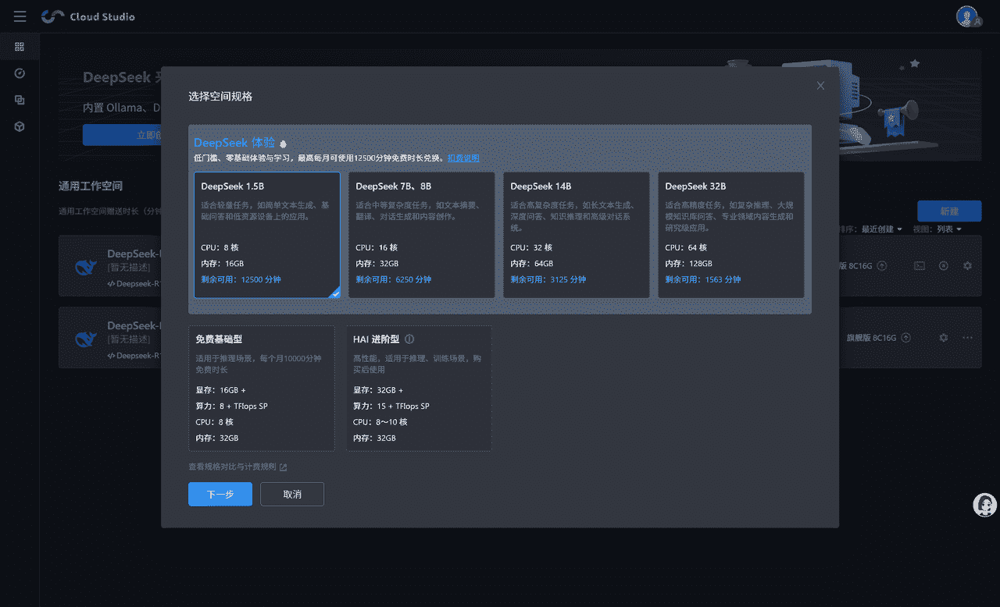
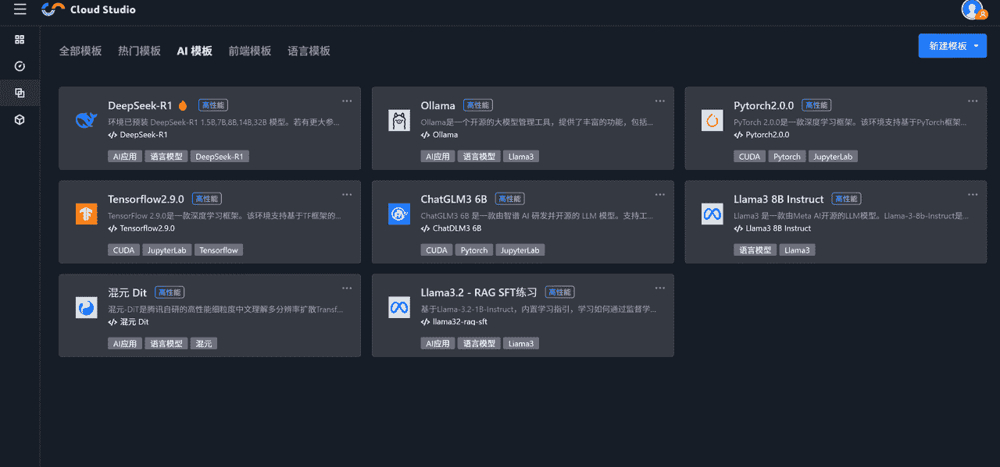
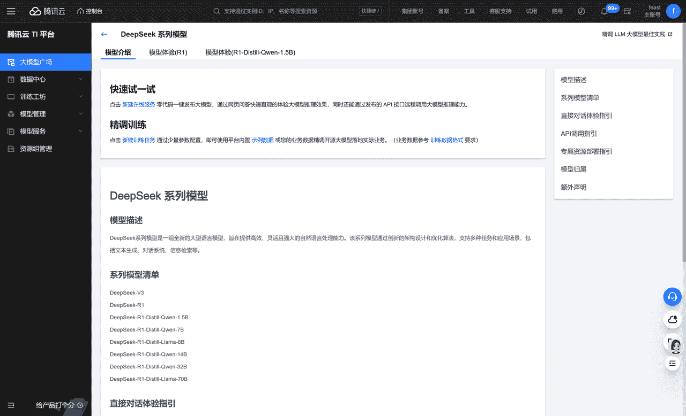
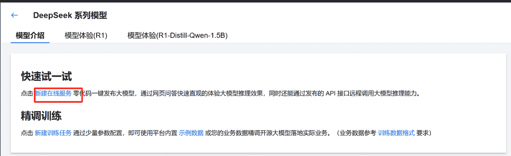
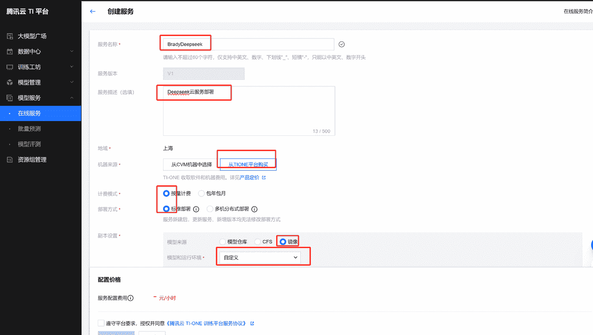
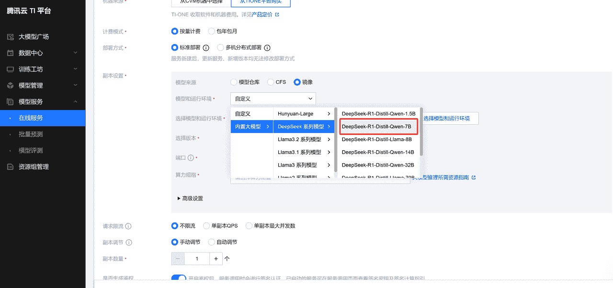
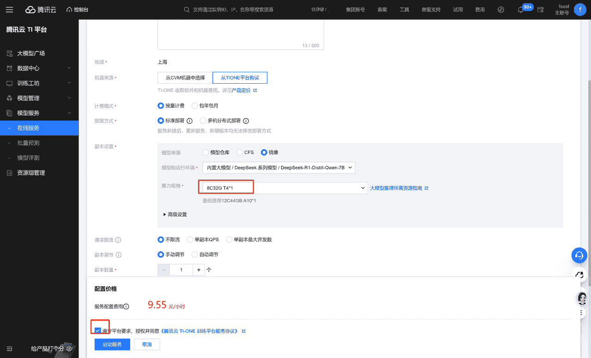

# 体验快速云部署 Deepseek

> 来源：[https://vcn0zlxse9ua.feishu.cn/docx/G5T6dqFdWobimkxfueccNxqMnTQ](https://vcn0zlxse9ua.feishu.cn/docx/G5T6dqFdWobimkxfueccNxqMnTQ)

之前分享过本地部署 Deepseek 的内容，但是由于本地电脑硬件环境的各种限制，不能得到更好的体验，所以这里分享云部署 Deepseek 的相关内容。

## 为什么要云部署？

前面介绍过本地部署的流程，但是 Deepseek 的能力取决于你的硬件设备（电脑），而我们的设备有限，也不可能去买个几十万的显卡，那么云服务部署是我们的一个好的选择方式，也可以进行私有数据的管理。

大致可以分为一下几个方面

+ 硬件要求：本地不足以跑高参数模型，如 70B

+ 开放性：可以开 api 到公共平台

+ 减少电脑性能消耗

## 腾讯 ide

https://ide.cloud.tencent.com/dashboard/gpu-workspace

可以体验限量免费 GPU，送总计 50000 分钟。

### 立即创建

### 快速选择模板

可以选择更多模板

### 效果

## 腾讯云 TI 平台快速部署 DeepSeek

如何通过 [腾讯云 TI 平台](https://console.cloud.tencent.com/tione/v2)，快速部署 DeepSeek 系列模型。完成模型部署后，即可与模型进行对话体验；或以 API 形式进行调用，接入 AI 应用中。

### 模型列表及资源/价格参考

腾讯云 TI 平台已上架 [DeepSeek](https://github.com/deepseek-ai) 全系模型，详见下表。

> **注意：**
>
> 1. 刊例价总价包括了 `CVM` 算力费用 和 TI 平台软件订阅费用，因此略高于 `CVM` 算力费用。
>
> [`CVM` 各机型最](https://console.cloud.tencent.com/cvm/instance/)新库存及价格请[前往 `CVM` 控制台](https://cloud.tencent.com/document/product/213/44264)查看，可参考 `CVM`-实例创建指引。
>
> **PNV6/HCCPNV6** 机型需联系您所对接的腾讯云销售或售前架构师进行开通。
>
> 2. 按量计费模式下，TI 平台软件订阅费按[天结算，](https://cloud.tencent.com/document/product/851/74108)具体以账单为准。更多计费规则可见计费概述。
>
> 3. 在部署 V3 或 R1 模型时，如仅需短时体验，对并发/上下文窗口要求不高，可使用[单节点部署](https://cloud.tencent.com/document/product/851/107823)，部署方式请选择标准部署；其他情况下更推荐多节点部署，部署方式请选择多机分布式部署，节点数至少配置为 2 个。表中仅列出了部分 `CVM` 实例规格，更多资源推荐可参考大模型推理所需资源指南。
>
> 单节点部署：最大支持 64K 上下文，可用的最小 `CVM` 实例规格是“PNV6.32XLARGE1280”；若该机型库存不足也可使用“PNV6.96XLARGE2304”。
>
> 多节点部署：最大支持 128K 上下文，可用的 `CVM` 实例规格是“HCCPNV6.96XLARGE2304”。
>
> 上下文窗口：针对 DeepSeek V3/R1 模型，最大上下文窗口默认配置为 16K。在部署时，可通过修改环境变量 `MAX_MODEL_LEN` 来进行扩展。例如：`MAX_MODEL_LEN=131072` 对应最大上下文窗口为 128K。
>
> 4. 在部署 1.5B 至 70B 的 DeepSeek 蒸馏版模型时，仅需单节点，部署方式请选择标准部署。
>
> 5. 下表的推理资源配置略小于 `CVM` 实例配置，是因为在“从 `CVM` 机器中选择”模式下 TI 平台管理 `CVM` 机器时将占用少量资源。例如：某 `CVM` 实例规格包含 128 核，添加至资源组后的可用资源为 125.6 核。

### 登录腾讯 TI 平台部署

#### 登录腾讯云 TI 平台

点击【大模型广场】

#### 点击 Deepseek 打开详情查看介绍

#### 点击【新建在线服务】

##### 填写相关配置信息

##### 选择模型

##### 选择算力

### 查看推理模型并体验模型效果

您可以通过访问“模型服务 > 在线服务”

### Cherry Studio 马甲

### 参考

腾讯云快速部署 DeepSeek：https://cloud.tencent.com/document/product/851/115962

## 阿里云 PAI 平台快速部署 Deepseek

### 参考

> https://help.aliyun.com/zh/eci/user-guide/deploy-deepseek-1?spm=5176.21213303.J_v8LsmxMG6alneH-O7TCPa.8.53802f3dhvFFBv&scm=20140722.S_help@@%E6%96%87%E6%A1%A3@@2869197._.ID_help@@%E6%96%87%E6%A1%A3@@2869197-RL_Deepseek%E9%83%A8%E7%BD%B2-LOC_2024SPHelpResult-OR_ser-PAR1_2150448e17406274924168988e47d6-V_4-RE_new6-P0_0-P1_0

## 参考

https://zhuanlan.zhihu.com/p/20937926684
