# 清爽快捷 Deepseek+LM Studio 本地部署

> 来源：[https://vcn0zlxse9ua.feishu.cn/docx/IiDgdznA7oViaxx7xLlcSN6mnhg](https://vcn0zlxse9ua.feishu.cn/docx/IiDgdznA7oViaxx7xLlcSN6mnhg)

LM Studio 是一款桌面应用程序，可在你的计算机本地开发和试验大语言模型。可以方便快速本地部署 Deepseek。

## 为什么使用 LM Studio

+   简单易用的界面：LM Studio 提供了图形用户界面（GUI），对于那些不太熟悉命令行操作或复杂编程的用户来说，通过直观的界面就能轻松完成模型的下载、配置和启动等操作。例如，用户只需在界面上选择要部署的 DeepSeek 模型版本，点击下载按钮，即可自动完成模型文件的下载，无需手动编写复杂的脚本或命令来处理文件的下载和存储。

+   快速部署：LM Studio 简化了模型部署的流程，减少了繁琐的环境配置步骤。它会自动处理模型依赖的各种库和环境变量，用户无需花费大量时间去安装和配置这些依赖项，就能快速将 DeepSeek 模型部署到本地环境中并开始使用。

LM Studio 可用于 macOS、Windows 和 Linux。

系统要求：LM Studio 通常支持 Apple Silicon Mac、x64/ARM64 Windows PC 和 x64 Linux PC。

## LM Studio 优势

🤖 • 完全离线地在您的笔记本电脑上运行 LLM

📚 • 与您的本地文档对话 （0.3 版本新增功能）

👾 • 通过应用内聊天界面或兼容 OpenAI 的本地服务器使用模型

📂 • 从 Hugging Face 🤗 仓库下载任何兼容的模型文件

🔭 • 在应用的发现页面中直接发现新的和值得关注的 LLM

## LM Stuidio 部署

> 官网：https://lmstudio.ai/

### 下载

打开官网

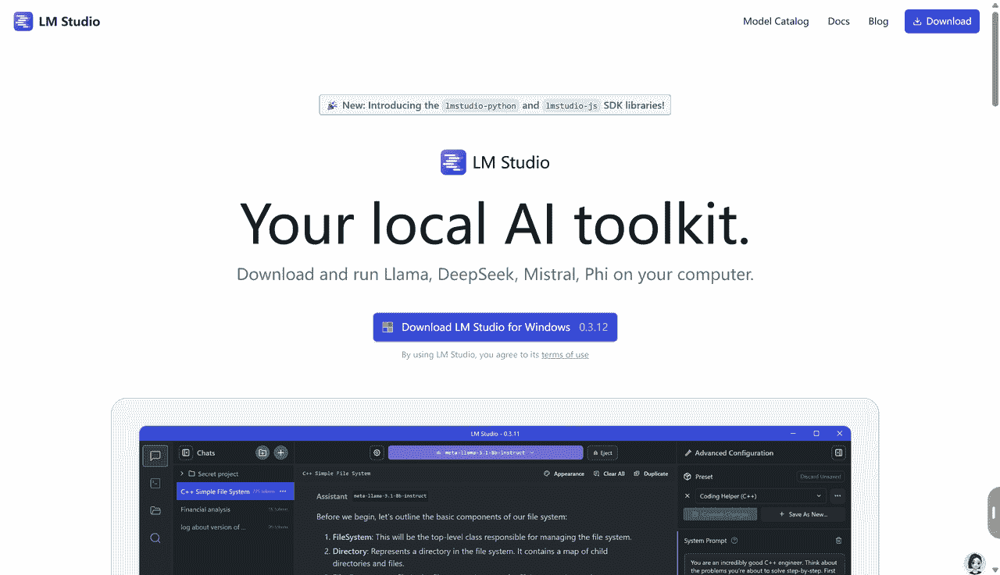

选择对应的版本下载

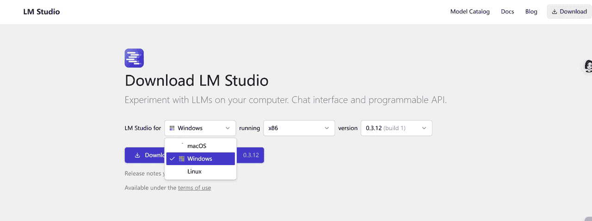

安装路径：C 盘不够有需要可以改成自己的其他盘～

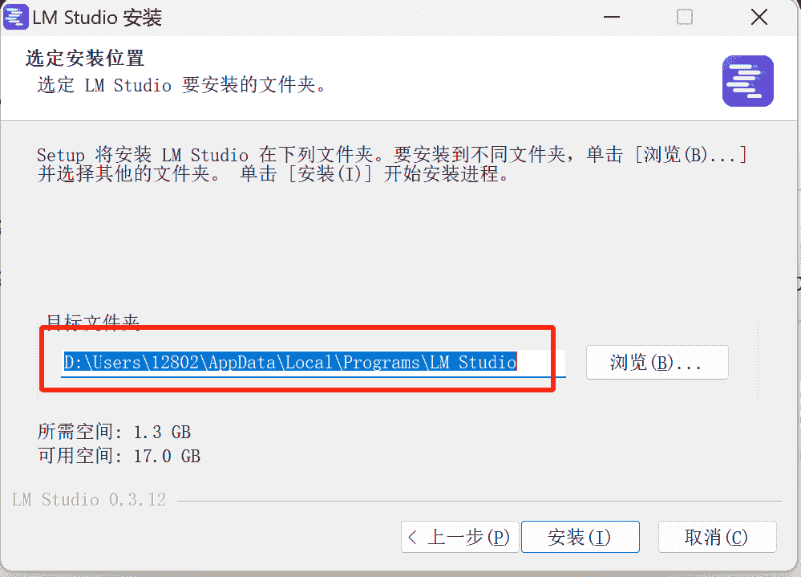

然后一路安装就行

### 打开工具

可以直接下载模型也可以跳过，这里选择先跳过

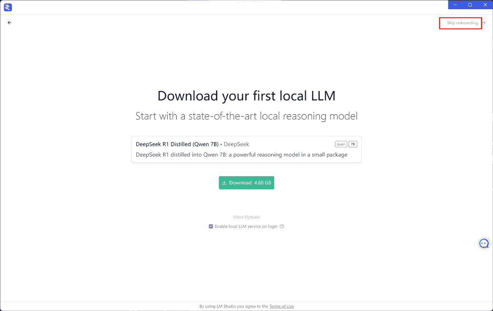

#### 聊天界面


#### 模型界面

修改模型地址，模型特别大，C 盘容易占满

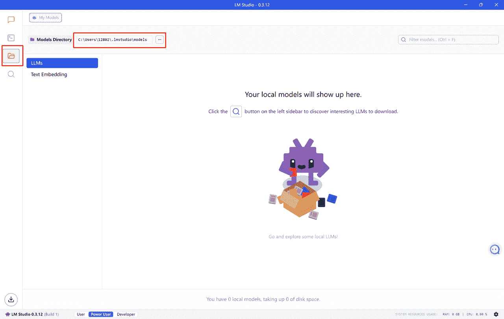

#### 切换中文

点击右下角设置


选择中文

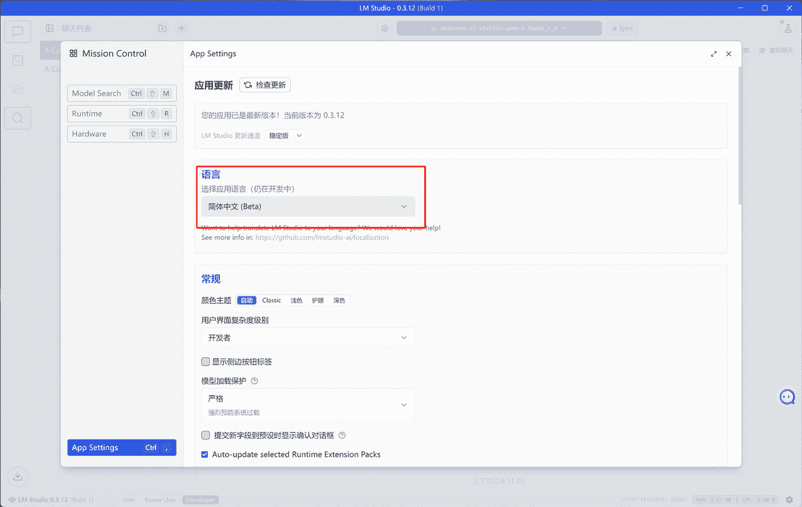

### 下载模型

#### 方式 1：在 LM Studio 工具中下载开源模型（推荐）

模型界面，选择标签 **放大镜** 搜索


搜索模型名称进行下载，右边会有介绍，

一个 7B 的界面：会判断你电脑是否可能安装，红色表示可能配置不够

1.5B 界面：这里我选择最小的量化模型 1.5B 下载


##### 点击下载后这里有进度条

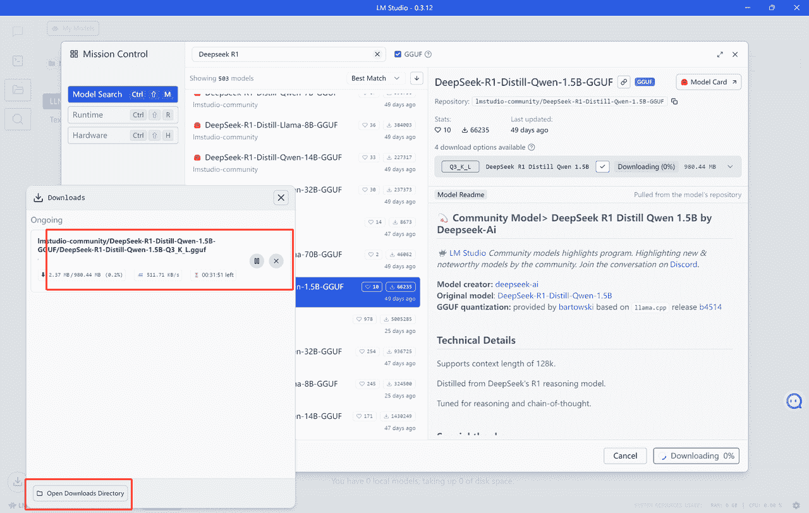

#### 方式 2：从 Hugging Face 下载开源模型

> 入口：https://huggingface.co/

需要开魔法才能访问

+   说明：LM Studio 需要加载的模型文件要为 gguf 结尾的文件

##### **GGUF 模型**

GGUF，全称 GPT-Generated Unified Format，是一种新型的文件格式，专门用于存储和交换大型机器学习模型的数据。这种格式针对模型的快速加载和保存进行了优化，使其在推理方面更加高效。GGUF 可以有多种不同版本的量化，Q2、Q3、Q4、Q5、Q6、Q8，这些数字表示模型权重的位数，位数越高，模型的精度通常越高，但所需的存储空间和计算资源也越多。

> 不是所有 gguf 格式的模型都能用 LM Studio 运行，你可以打开下面这个链接，这里所有模型都可以用 LM Studio 运行：https://hf-mirror.com/lmstudio-community。量化是指将模型中的高精度数字转换为低精度数字，以减少模型的存储空间和计算需求。


##### 搜索模型

选择模块 **模型**，搜索 Deepseek R1 gguf


查看更多


选择最受欢迎或最多下载排序


##### 下载模型

这里选择 lmstudio-community/DeepSeek-R1-Distill-Qwen-1.5B-GGUF


选择 Files and versions，看到模型文件


[选择一个模型下载即可，这里我选择 Deep](https://huggingface.co/lmstudio-community/DeepSeek-R1-Distill-Qwen-1.5B-GGUF/blob/main/DeepSeek-R1-Distill-Qwen-1.5B-Q4_K_M.gguf)Seek-R1-Distill-Qwen-1.5B-Q4_K_M.gguf

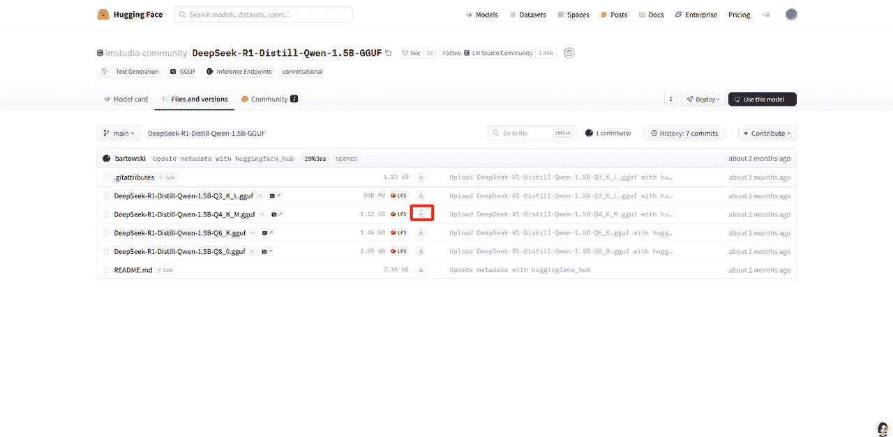

##### 装载模型

###### 步骤

在模型的安装目录下，如我的是 D:\data\LM_models

在下面建立文件夹：【发布者】/【模型名称】

模板：D:\data\LM_models\【发布者】/【模型名称】

层级

```

~/.lmstudio/models/
└── publisher/
    └── model/
        └── model - file.gguf
```

###### 案例

如我现在安装模型 lmstudio-community/DeepSeek-R1-Distill-Qwen-1.5B-GGUF

发布者：lmstudio-community

模型名称：DeepSeek-R1-Distill-Qwen-1.5B-GGUF

完整路径：D:\data\LM_models\lmstudio-community\DeepSeek-R1-Distill-Qwen-1.5B-GGUF

```

D:\data\LM_models/
└── lmstudio-community/
    └── DeepSeek-R1-Distill-Qwen-1.5B-GGUF/
        └── DeepSeek-R1-Distill-Qwen-1.5B-Q3_K_L.gguf
```

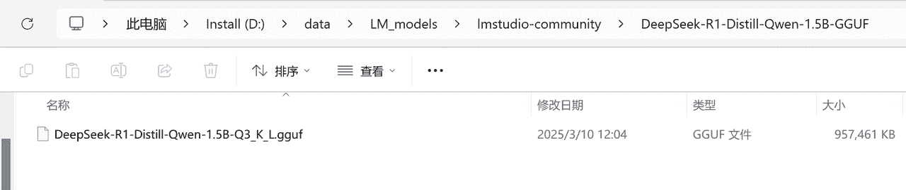

### 聊天界面效果

#### 提问

选择模型


提问


#### 上传文件


#### 预设系统提示词


预设系统提示词和配置


#### 模式

##### User

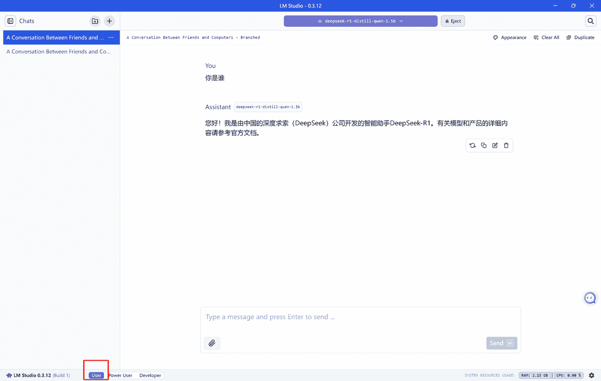

##### PowerUser

可以随意切换 User 和 Assistant 角色

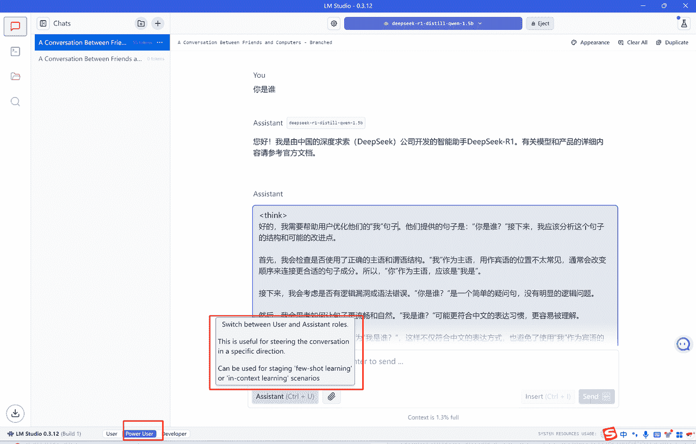

##### Developer

有思考过程

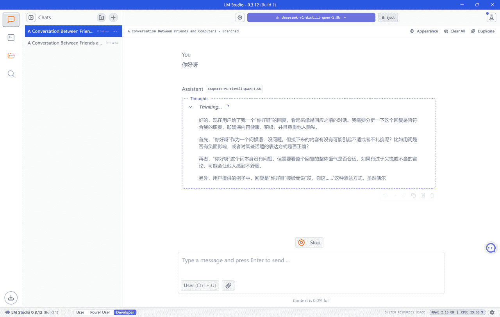