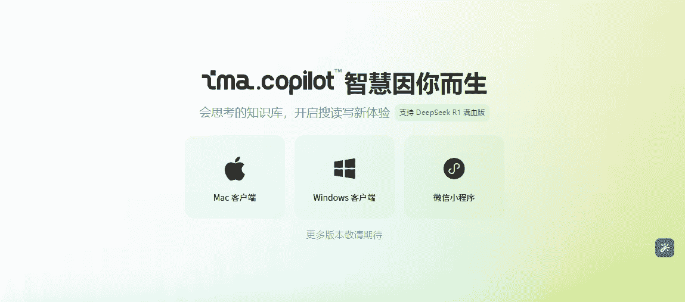
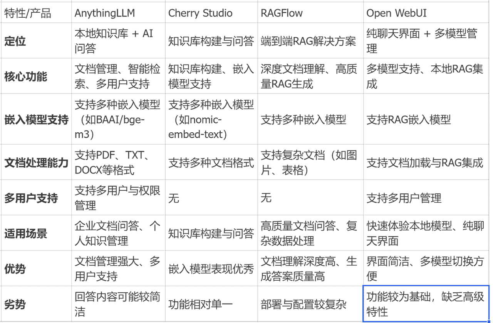

# Deepseek+知识库部署方案（本地+云）

> 来源：[https://vcn0zlxse9ua.feishu.cn/docx/IRN0dyLzYoFXgCxWhpZc91N4nwf](https://vcn0zlxse9ua.feishu.cn/docx/IRN0dyLzYoFXgCxWhpZc91N4nwf)

AI 知识库，我们可以通过自己的知识内容内容进行回答处理，并通过自然语言交互提供高效的知识检索与问答服务。

AI 知识库的核心技术包括：

+   **大语言模型（LLM）**：如 GPT 系列，用于理解自然语言并生成回答。

+   **检索增强生成（RAG）**：结合向量数据库，通过检索外部知识库增强回答的准确性，解决大模型的“幻觉”问题。

+   **向量化处理**：将文本转化为向量存储，提升语义检索效率。

## 云知识库

### 腾讯推出 ima

https://ima.qq.com/

ima.copilot（简称 ima）是腾讯推出的智能工作台产品。

### 推出时间

+   2024 年 10 月 23 日腾讯推出 ima 的 mac 版本。

+   2025 年 2 月 20 日，ima 推出 App 版本。

### 功能特点

+   智能搜索与问答

+   可基于 “腾讯混元大模型” 和 “DeepSeek - R1 模型” 进行联网搜索问答，无论是学术问题、工作难题还是生活疑问等都能尝试提问获取答案。

+   能在全网信源或个性化知识库中进行智能问答，用户可以切换 “基于全网” 和 “基于知识库” 模式，满足不同搜索需求。

+   知识库管理

+   支持多格式文件上传，如 PDF、DOCX、JPEG、PNG 等。用户可以将本地的各种资料上传，快速构建个人知识库。

+   可以创建共享知识库，并对共享知识库进行成员权限、内容权限的修改 4。方便团队协作、知识共享与交流。

+   与微信生态深度整合，能一键导入微信聊天文件、公众号文章、腾讯文档、腾讯会议纪要等。

+   智能写作与笔记

+   笔记功能强大，可基于用户资料生成文章、论文等，并能对内容进行编辑以及智能化写作。

+   支持基础文本编辑和格式设置，还能插入图片、表格等。

+   记笔记时可使用 Markdown 语法，增添文章的结构美感。

+   其他功能

+   具有图片生成、图片识别、图片一键转笔记、图片解题等功能。

+   可以进行文档阅读，对文档总结核心内容，生成大纲和脑图。

+   访问网页时，可实现一键总结、一键笔记、生成表格、一键翻译等功能。

### 平台支持

+   支持多终端使用，包括 Mac、Windows 电脑端。

+   微信小程序 “IMA 知识库”，方便在微信中直接使用部分功能。

+   手机端 App 已上线安卓版本，iOS 版本正在上架。

### 应用场景

+   学习方面：辅助学生完成课程作业、整理学习资料、构建学科知识库等，帮助快速理解知识点、总结重点。

+   工作领域：助力职场人士进行方案策划、工作总结、项目资料管理等，提高工作效率和质量。

+   学术研究：方便研究人员进行文献检索、分析、综述撰写等，减少信息检索和文献整理的时间，专注于知识的创造和应用

## 本地部署+知识库

+   [Deepseek 本地部署-Docker（二）](https://vcn0zlxse9ua.feishu.cn/wiki/RrW1w2L0EifGMQk298nc2wGFnXb)eepseek+Open WebUI 参考：

+   Deepseek+Cherry Studio

+   Deepseek+Ragflow

+   Deepseek+AnythingLLM

以下是关于 **AnythingLLM**、**Cherry Studio**、**RAGFlow** 和 **Open WebUI** 四款产品的对比表格

### 产品对比表格

---

### 使用推荐说明

1.  **AnythingLLM**

+   **推荐场景**：适合需要构建本地知识库并进行智能问答的企业或个人用户，尤其是需要多用户协作和权限管理的场景。

+   **优势**：文档管理能力强，支持多种文档格式和多用户模式。

+   **注意**：回答内容可能较为简洁，适合对答案深度要求不高的场景。

1.  **Cherry Studio**

+   **推荐场景**：适合需要高质量知识库构建和问答的用户，尤其是对嵌入模型性能要求较高的场景 18。

+   **优势**：嵌入模型表现优秀，回答内容更贴近资料。

+   **注意**：功能相对单一，适合专注于知识库问答的用户。

1.  **RAGFlow**

+   **推荐场景**：适合需要处理复杂文档（如图片、表格）并生成高质量答案的用户，尤其是对文档理解深度要求高的场景。

+   **优势**：文档理解能力强，生成答案质量高。

+   **注意**：部署与配置较复杂，适合有一定技术背景的用户。

1.  **Open WebUI**

+   **推荐场景**：适合需要快速体验本地模型并进行简单聊天的用户，尤其是对界面简洁性和多模型切换有需求的场景。

+   **优势**：界面简洁，支持多模型切换和本地 RAG 集成。

+   **注意**：功能较为基础，缺乏高级特性，适合轻量级使用。

---

### 总结

+   **如果需要强大的文档管理**和多用户支持，推荐 AnythingLLM。

+   **如果追求高质量的嵌入模型和**知识库问答，推荐 Cherry Studio。

+   **如果需要处理复**杂文档并生成高质量答案，推荐 RAGFlow。

+   **如果只需要简单的聊天**界面和多模型切换，推荐 Open WebUI。

根据具体需求选择合适的工具，可以显著提升知识库构建和问答的效率与效果。

## 知识库注意

上传本地文件绘进行向量化。

如果本地 PDF 文件是 **扫描件、手写件**，或者**带有复杂的表格** 和 **数学公式**，解析效果会很差，甚至无法解析。

如果追求性价比，推荐使用 **Doc2x**：https://doc2x.noedgeai.com?inviteCode=4A6KOD

**如果希望更加**稳定，那么可以考虑 Textin ：https://www.textin.com/market/detail/pdf_to_markdown

## 后续会分享具体知识库搭建

Cherry Studio 等