# Deepseek+CherryStudio 搭建知识库

> 来源：[https://vcn0zlxse9ua.feishu.cn/docx/Y9SkdvLdHopNXJxh936cP6bentb](https://vcn0zlxse9ua.feishu.cn/docx/Y9SkdvLdHopNXJxh936cP6bentb)

之前分享过 Deepseek 相关本地部署的内容和 Deepseek 搭配知识库的方案，这里结合一款 UI（CherryStudio）来搭建本地部署，同时可以搭建知识库。搭配 ollama+CherryStudio 进行本地部署。

## 安装 ollama

参考前面文档 ollama 部分

[https://vcn0zlxse9ua.feishu.cn/wiki/LFWHwooVGiX](https://vcn0zlxse9ua.feishu.cn/wiki/LFWHwooVGiXFeYkKs7dcUiqincg?fromScene=spaceOverview)FeYkKs7dcUiqincg?fromScene=spaceOverview

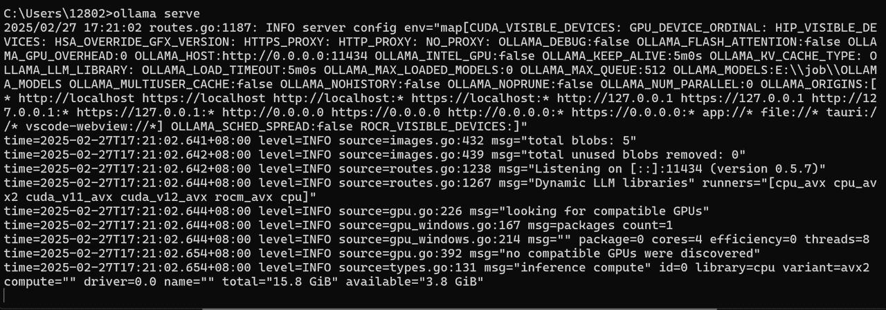

### 安装 Deepseek R1

参考之前文档

### 安装嵌入模型

地址：https://ollama.com/library/mxbai-embed-large

```
ollama pull mxbai-embed-large
```

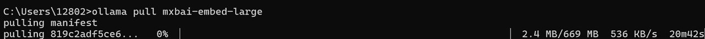

## 安装 Cherry Studio

比较轻量，安装很快。同时功能也比较强大。

> 更多文档：https://docs.cherry-ai.com/knowledge-base/knowledge-base

### 下载

点击打开下载：https://cherry-ai.com/download

然后直接安装


### 介绍

#### 聊天


#### 智能体：预设一些内容

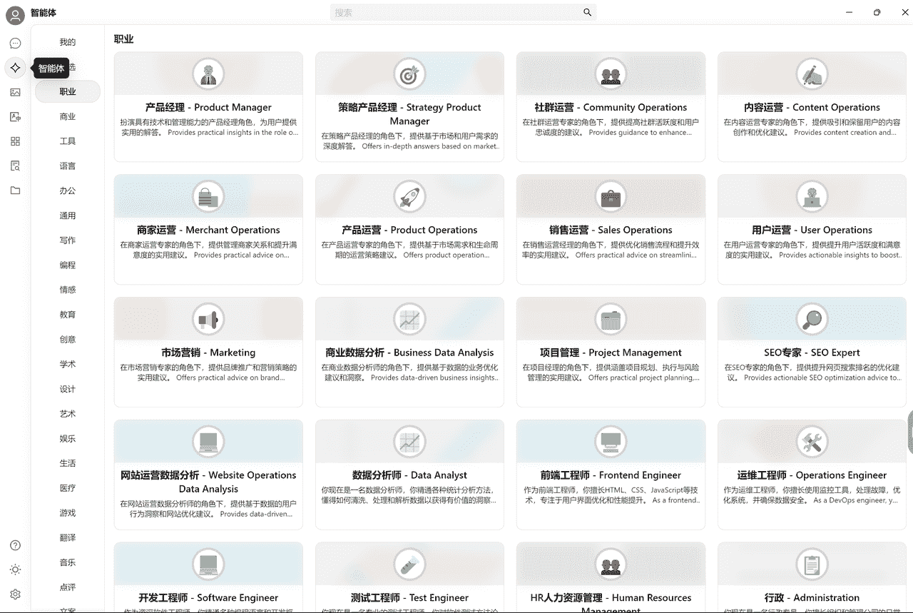

#### 生图

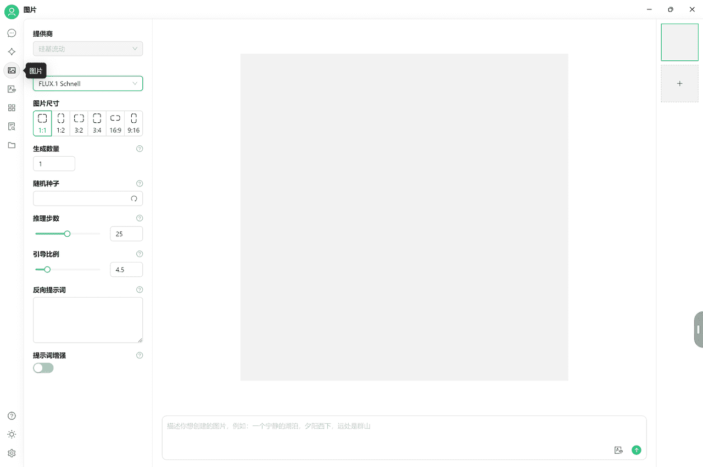

#### 翻译

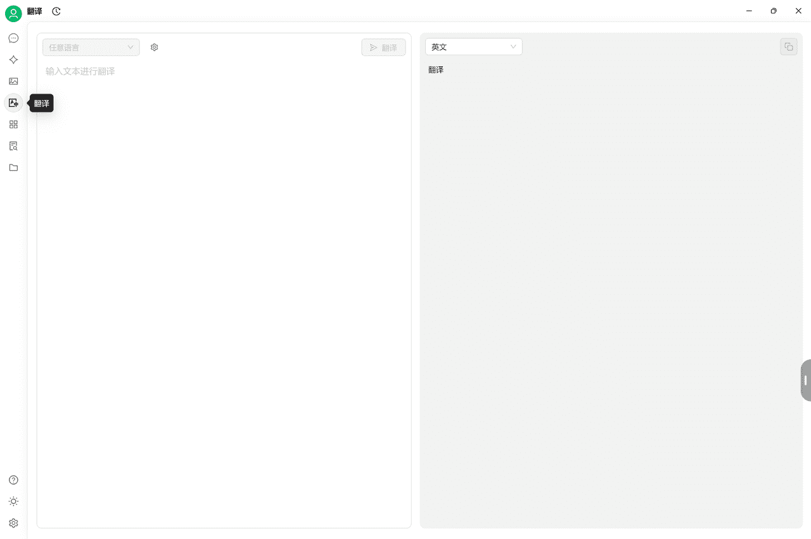

#### 各个模型应用入口

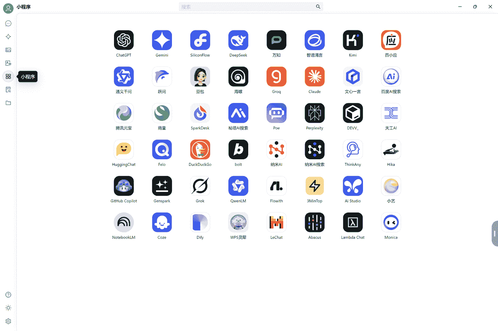

#### 知识库

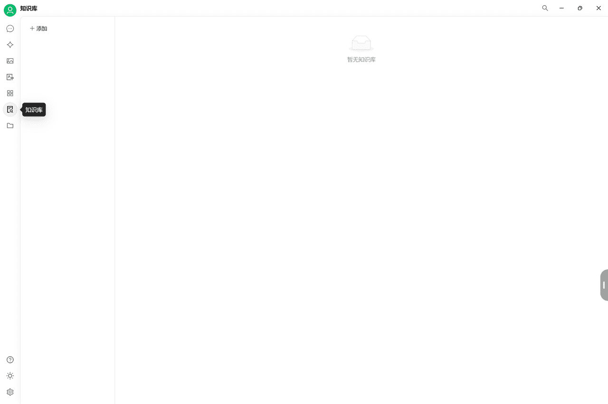

#### 联网

在Cherry Studio 的提问窗口，点击 【小地球】 图标即可开启联网。


点击地球图标 - 开启联网


表示 - 已开启联网功能

##### 方式一：模型服务商的大模型自带联网功能

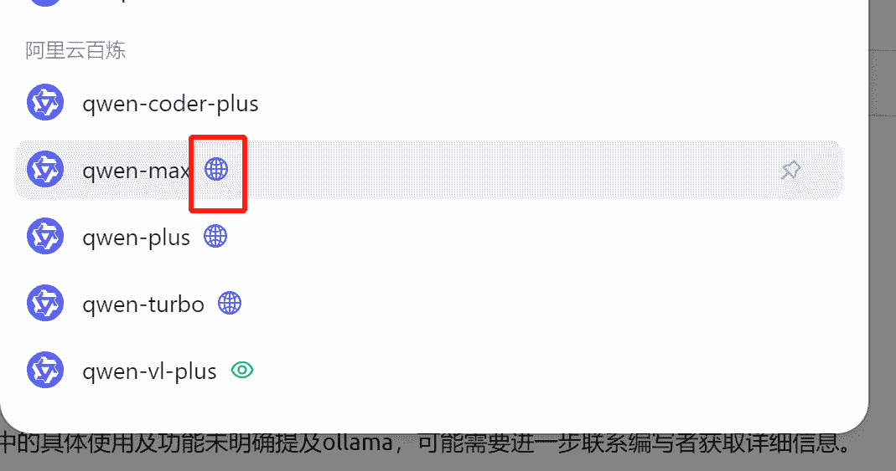

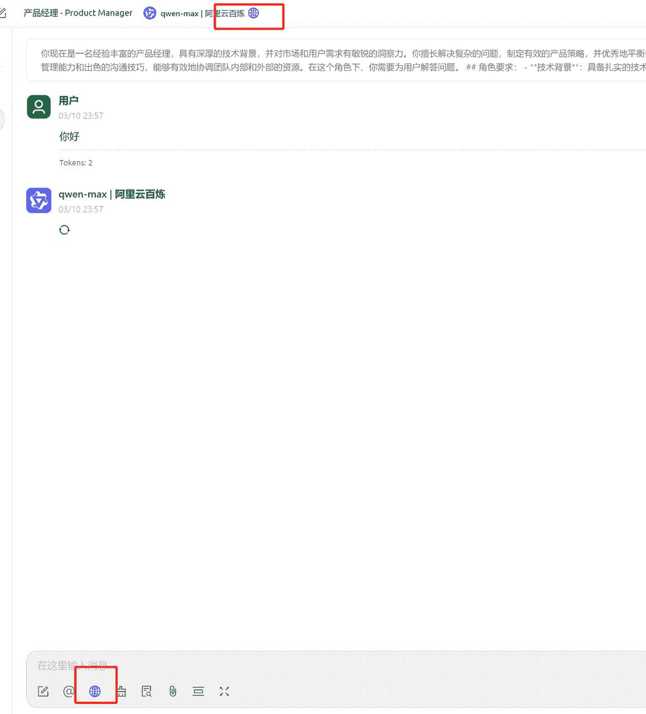

##### 方式二：需要配置搜索引擎

使用 Tavily服务 实现联网功能


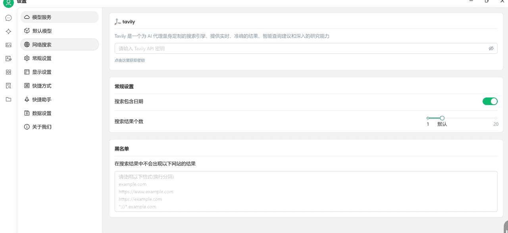

#### Notion功能

将对话导出到Notion

参考：https://docs.cherry-ai.com/advanced-basic/notion

### 添加模型

#### 添加大模型

使用 Deepseek

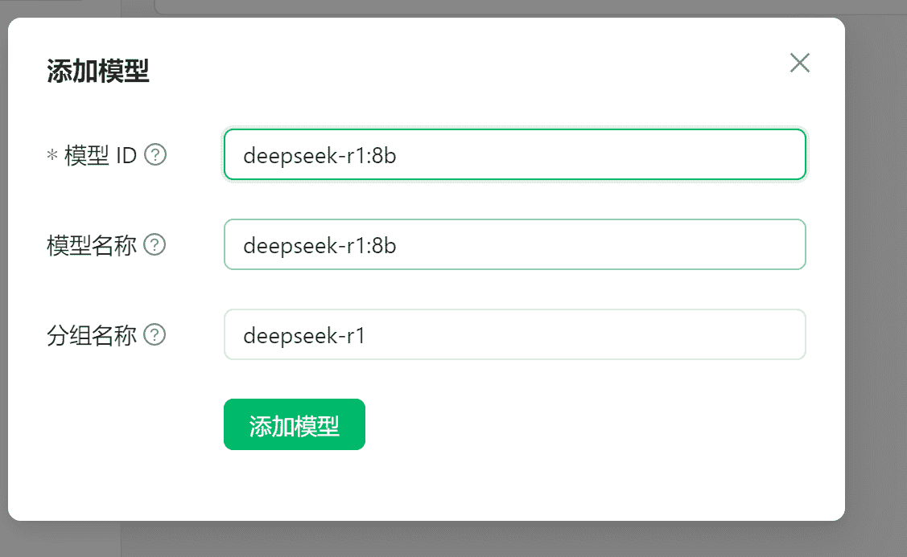

检查模型是否可用

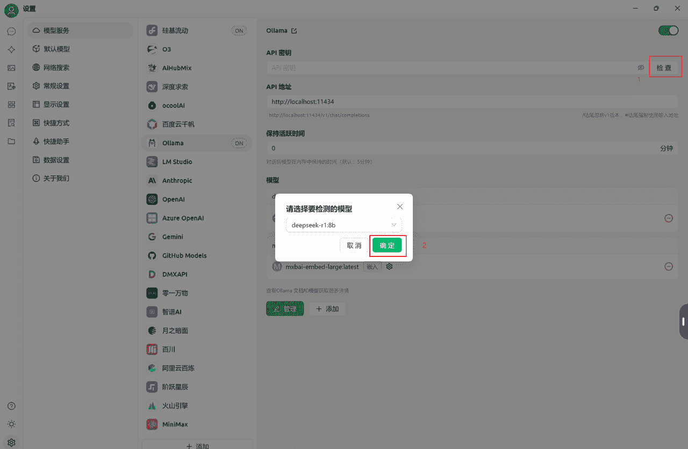

#### 添加嵌入模型

使用模型 mxbai-embed-large:latest

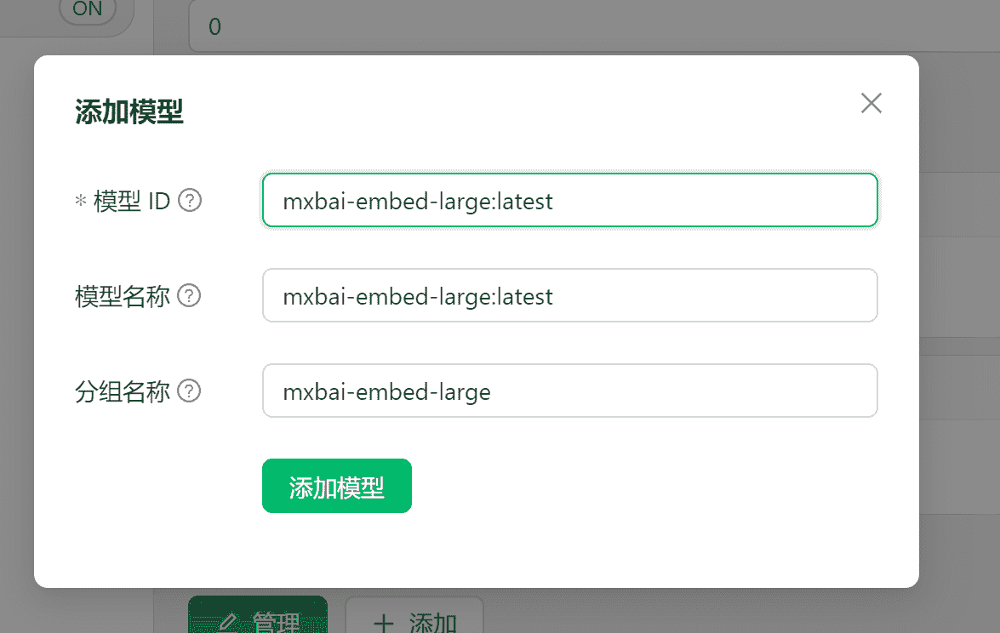

### 添加知识库

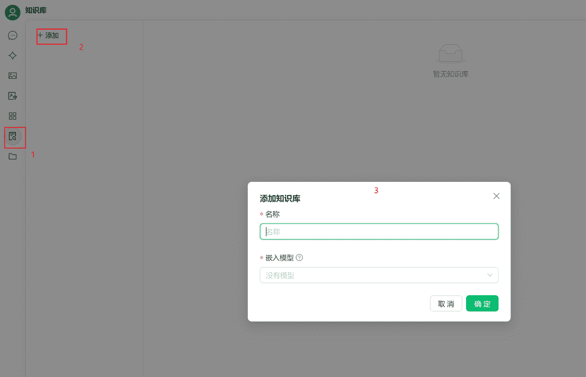

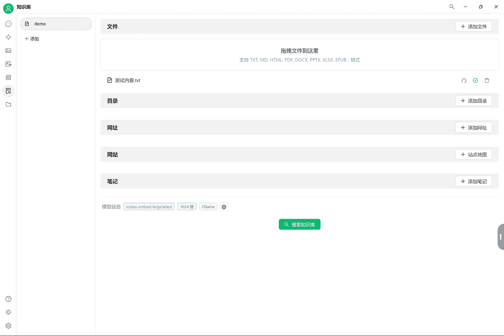

### 知识库对话

选择模型

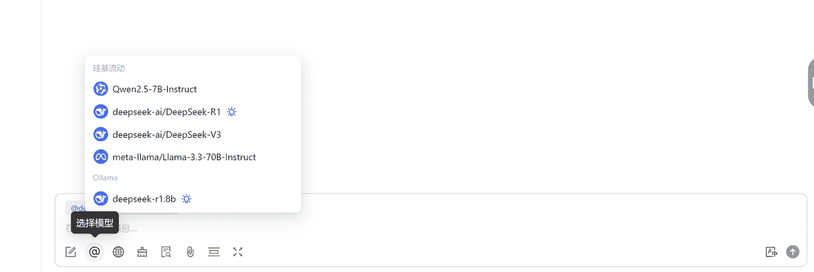

选择知识库


聊天效果

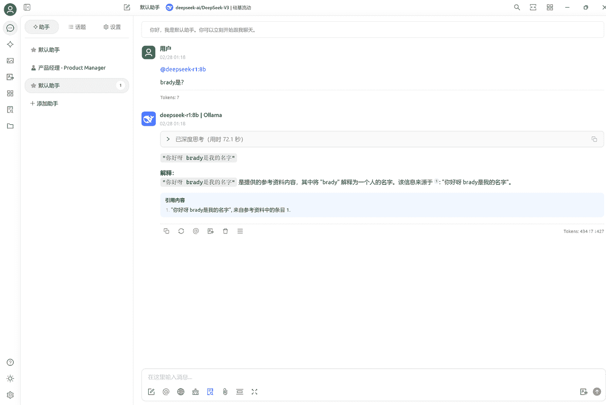