# DeepSeek+Ragflow 搭建知识库

> 来源：[https://vcn0zlxse9ua.feishu.cn/docx/LUKOdMwoRoy22mxFsCmc8D0Mnfe](https://vcn0zlxse9ua.feishu.cn/docx/LUKOdMwoRoy22mxFsCmc8D0Mnfe)

DeepSeek+RAGFlow 为企业和个人提供了从 数据安全 到 智能应用 的全链路解决方案，尤其适合需兼顾效率与隐私的场景。通过灵活的架构设计，用户可快速搭建专属知识库，释放大模型在垂直领域的潜力

## 安装 ollama

参考前面文档 ollama 部分：

https://vcn0zlxse9ua.feishu.cn/wiki/LFWHwooVGiXFeYkKs7dcUiqincg

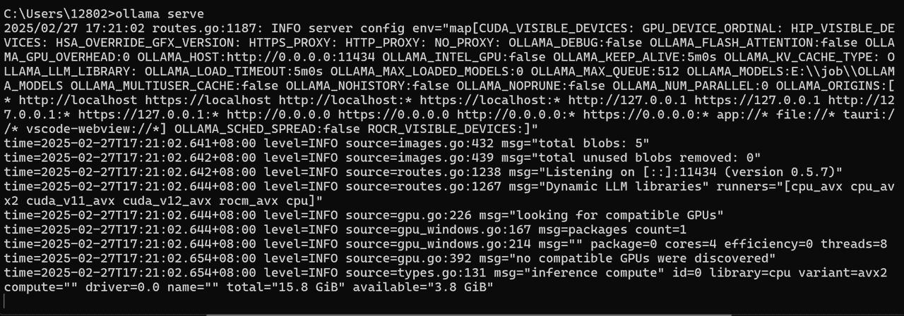

### 安装 Deepseek R1

参考之前文档

### 安装嵌入模型

地址：https://ollama.com/library/mxbai-embed-large

```
ollama pull mxbai-embed-large
```

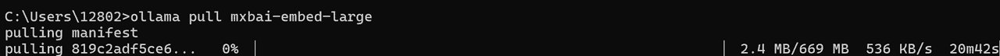

## 安装 docker

参考前面文档 docker 部分：

https://vcn0zlxse9ua.feishu.cn/wiki/RrW1w2L0EifGMQk298nc2wGFnXb?fromScene=spaceOverview

## 安装 Ragflow

github 地址：[https://github.co](https://github.com/infiniflow/ragflow)m/infiniflow/ragflow

官网文档：https://ragflow.io/

### 前置条件

+   CPU >= 4 核

+   内存 >= 16 GB

+   硬盘 >= 50 GB

+   Docker 版本 >= 24.0.0 & Docker Compose >= v2.26.1

### 下载 Ragflow

访问：https://github.com/infiniflow/ragflow

点击 【下载】

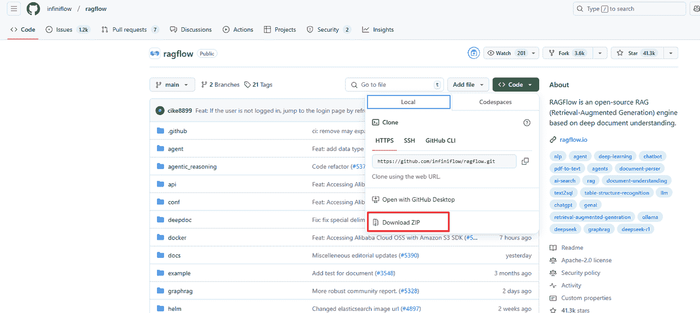

### 启动镜像

#### 修改配置

把下载的压缩包解压，然后进入到 docker 文件夹

先修改 docker/。env 文件内的 RAGFLOW_IMAGE 变量。

```
RAGFLOW_IMAGE=infiniflow/ragflow:v0.16.0
```

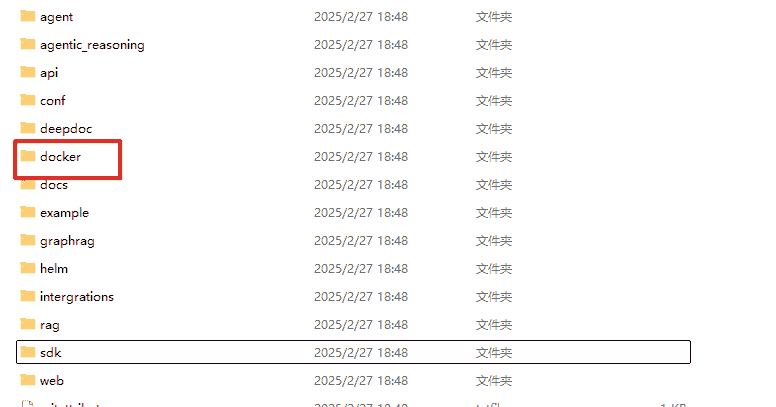

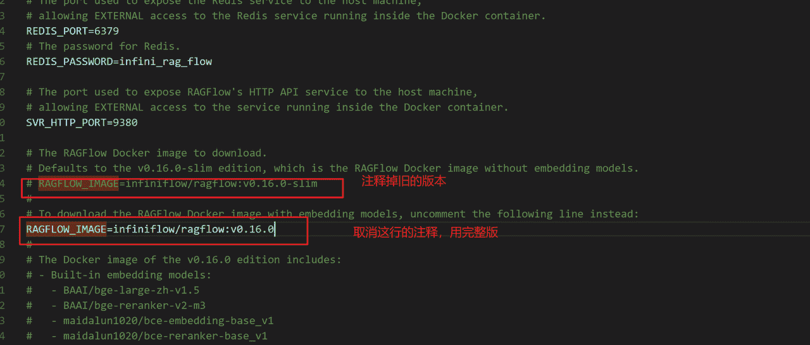

#### 启动

进入到刚才下载完成的 ragflow-main 文件夹下，文件夹路径输入 cmd，复制一下命令到 cmd 执行

```
docker compose -f docker/docker-compose.yml up -d
```

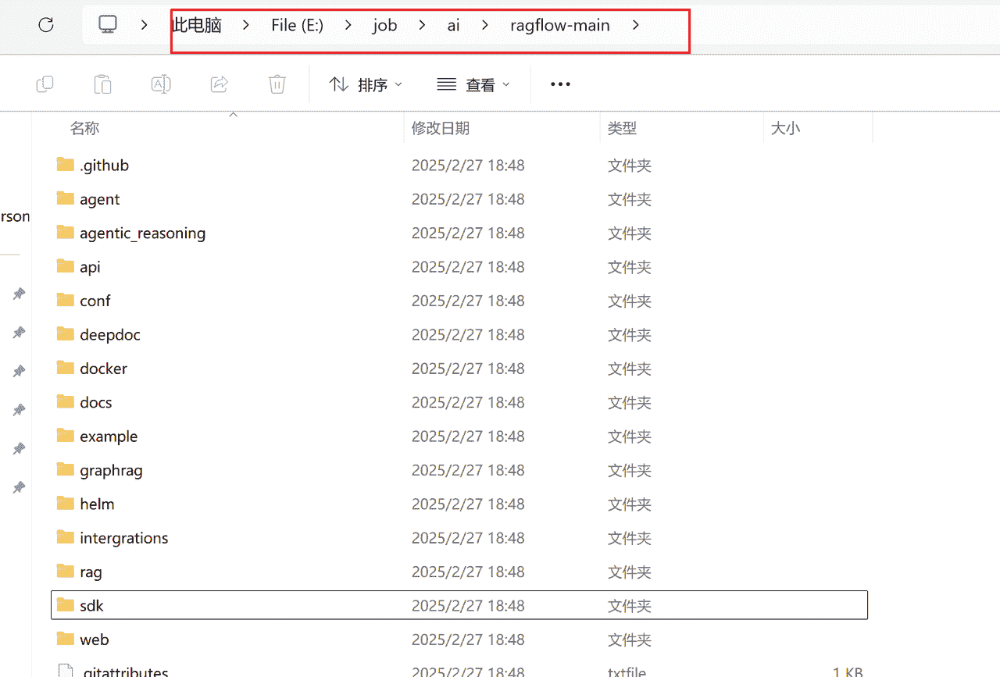

#### 查看启动日志情况

复制命令

```
docker logs -f ragflow-server
```

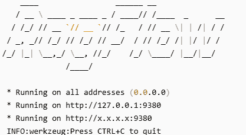

#### 注意

如果你本地安装了 redis 或 minio 可能出现端口占用问题，修改。env 中的配置信息即可

核心映像的大小约为 9 GB，可能需要一段时间才能加载。

## Ragflow 创建知识库

### 启动 Ragflow

打开电脑自带的浏览器，访问 http://localhost:80/，进行注册


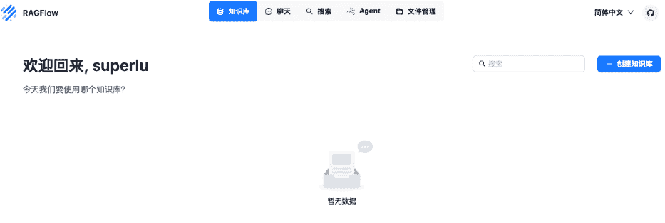

### 添加模型

点击【头像】-【模型提供商】

#### 添加 ollama【大模型】

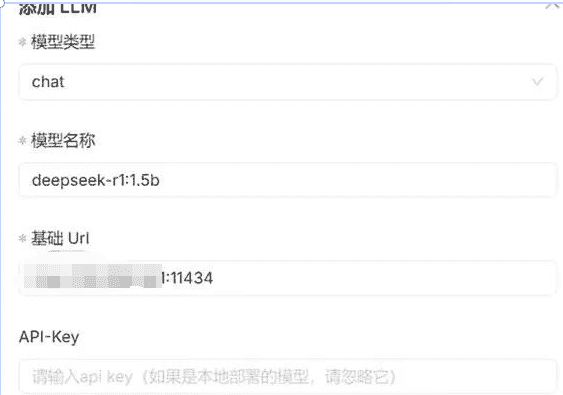

#### 添加【嵌入模型】

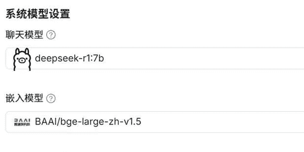

#### 创建知识库

##### 开始

点击【知识库】-【创建知识库】

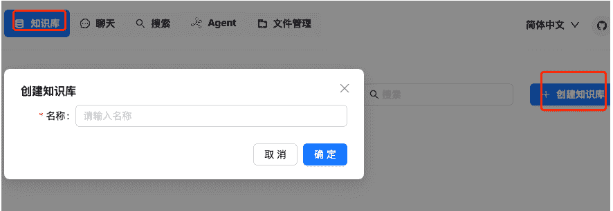

##### 选择嵌入模型和解析方法

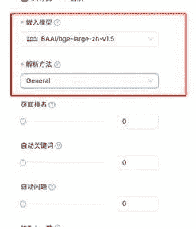

##### 添加文件

点击【数据集】-【新增文件】

#### 知识库聊天

点击【聊天】-【新建助理】

## 参考

https://blog.csdn.net/m0_58592891/article/details/145480321