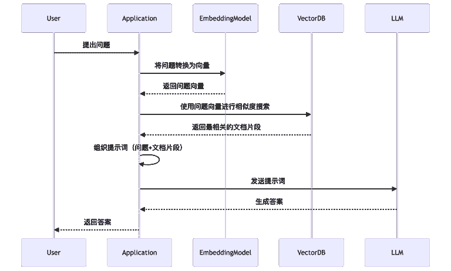

# Deepseek+知识库的数据安全问题

> 来源：[https://vcn0zlxse9ua.feishu.cn/docx/O78UdB6sqo3AuDxPjMZcUNYGnSd](https://vcn0zlxse9ua.feishu.cn/docx/O78UdB6sqo3AuDxPjMZcUNYGnSd)

## 模型

本地部署模型，已经可以保障本地安全了

LLM：ollama本地

嵌入模型：ollama本地

知识库还有个重点就是向量数据库，每个知识库不一样，但平台安装后都会附带默认一个向量数据库

## Cherry Studio 知识库

1.  **数据保障**

+   **多种备份方案**：支持本地备份、WebDAV 备份和定时备份，确保数据安全。

+   **数据安全**：支持全本地场景使用，结合本地大模型，避免数据泄漏风险。

在 Cherry Studio 知识库中添加的数据全部存储在本地，在添加过程中会复制一份文档放在 Cherry Studio 数据存储目录

向量数据库：https://turso.tech/libsql

当文档被添加到 Cherry Studio 知识库之后，文件会被切分为若干个片段，然后这些片段会交给嵌入模型进行处理

当使用大模型进行问答的时候，会查询和问题相关的文本片段一并交个大语言模型处理

如果对数据隐私有要求，建议使用本地嵌入数据库和本地大语言模型

## 其他的知识库

和CherryStudio是类似的

### Ragflow

开源，更灵活，可切换成本地的数据和技术

#### 向量库

默认集成 Elasticsearch

+   可切换至 Infinity（千亿级向量支持）

#### 其他

集成更多知识库的能力，同时也更重

### AnythingLLM

#### 向量库

默认LanceDB

## 总结：所有内容本地化后，安全就掌控在电脑上