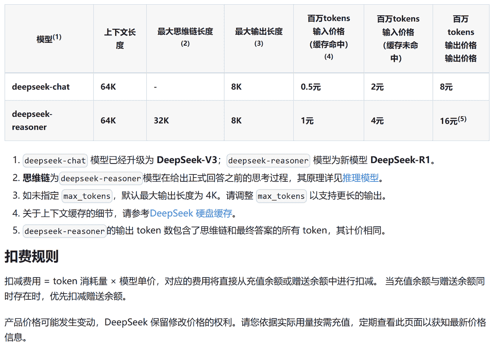
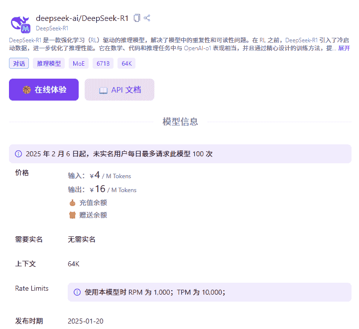
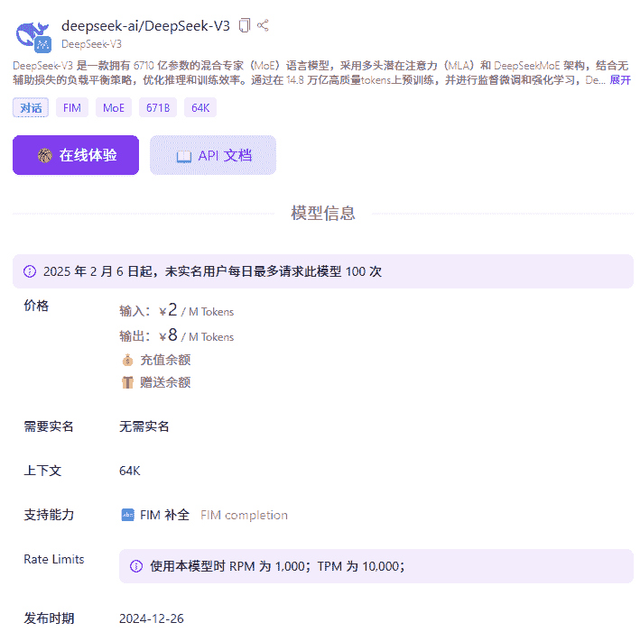
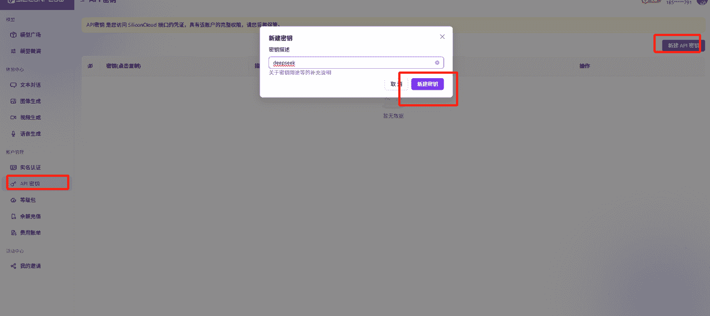
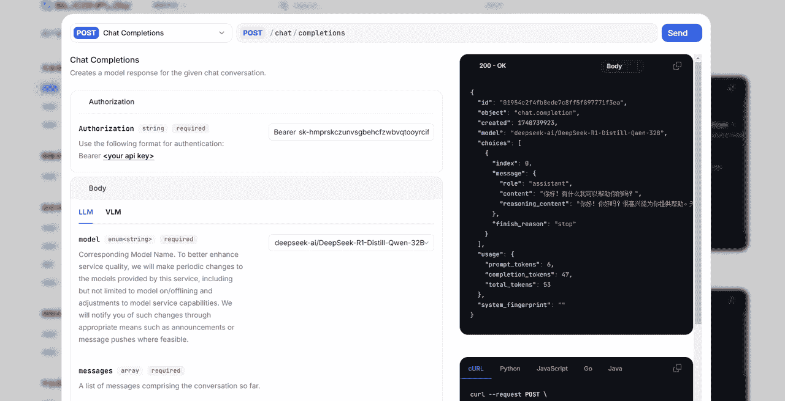
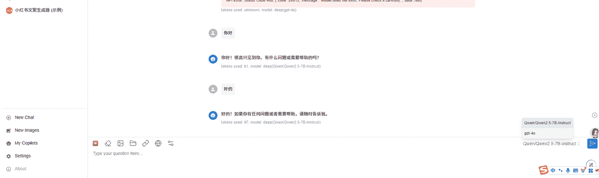
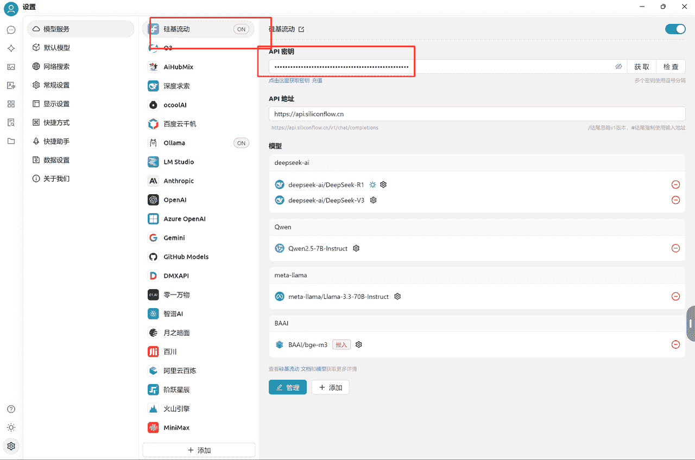
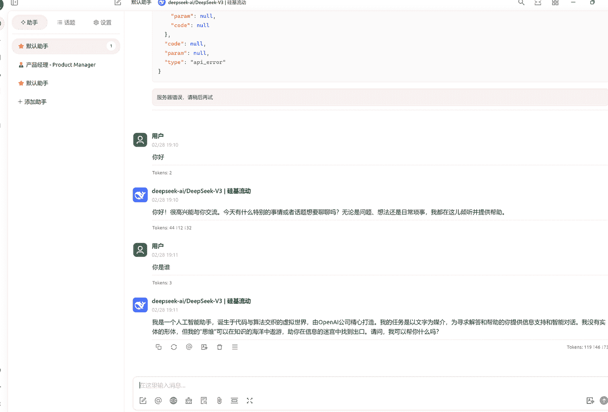

# Deepseek的API开放平台

> 来源：[https://vcn0zlxse9ua.feishu.cn/docx/BNA7d7ZZ1oqFgZxr1yRcXLoWnpe](https://vcn0zlxse9ua.feishu.cn/docx/BNA7d7ZZ1oqFgZxr1yRcXLoWnpe)

可通入 API 接入自己的平台实现满血 Deepseek 问答，可以适配自己各种灵活的需求。

## 各大API平台

多维表格（Lmbobi7bya8oNzsMU6fc0ZIVniP_tbl3egnWqdQGbycS）

## 官方

### 平台地址

https://platform.deepseek.com

### 模型和价格

### 实用集成

https://github.com/deepseek-ai/awesome-deepseek-integration/blob/main/README_cn.md

## 硅基流动

更多功能参考官方文档：https://docs.siliconflow.cn/cn/userguide/quickstart

### 产品价格

更多查看官方：https://cloud.siliconflow.cn/models

#### Deepseek-R1

#### Deepseek-V3

### 新建API密钥

### 在线调试

访问：https://docs.siliconflow.cn/cn/api-reference/chat-completions/chat-completions

### 接入平台chatbox

参考：https://docs.siliconflow.cn/cn/usercases/use-siliconcloud-in-chatbox

效果：

### 接入Cherry Studio

## 阿里百炼

从如下链接获取：

https://bailian.console.aliyun.com

## 火山方舟

https://console.volcengine.com/ark/region:ark+cn-beijing/model