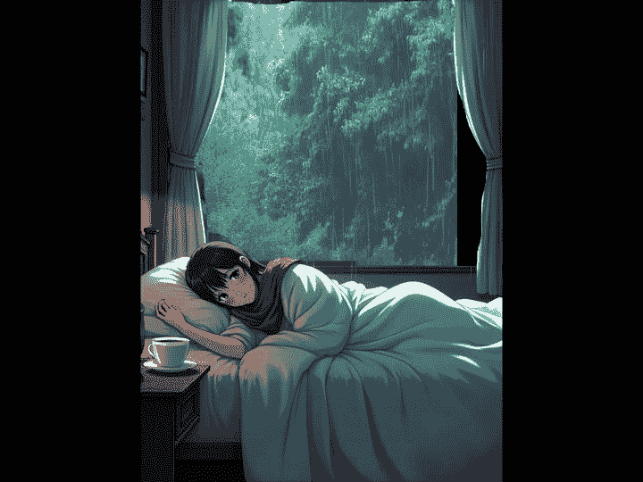

# 1.宫崎骏治愈系

> 来源：[https://vcn0zlxse9ua.feishu.cn/docx/LECWdTHkwofenAx0UVccZbkqnMe](https://vcn0zlxse9ua.feishu.cn/docx/LECWdTHkwofenAx0UVccZbkqnMe)

你是否一直在保持快速的步伐，试试慢下来看看

多给给自己一点空间，世界仿佛都慢了下来，你会发现更大的世界~

[4月26日 (4).mp4](https://internal-api-drive-stream.feishu.cn/space/api/box/stream/download/all/G5oXb1KYoohUDVx5Re8cA2JYnBU)

## 制作流程

### 生成创意内容

deepseek、kimi、chatgpt

1、通过拆解爆款内容反推文案信息，然后再通过AI工具重新梳理

2、根据自己想要的内容让AI工具生成创意脚本

### 生成图片

MJ、SD、即梦

根据创意脚本信息生成提示词，然后生图

### 处理图片

PS

将图片的窗口空间处理成透明，导出png

### 合成视频

通过剪映把这些内容合成

+   图片

+   下雨的素材

+   音乐