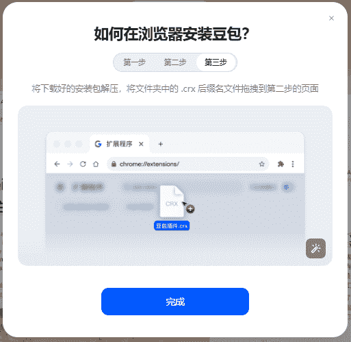
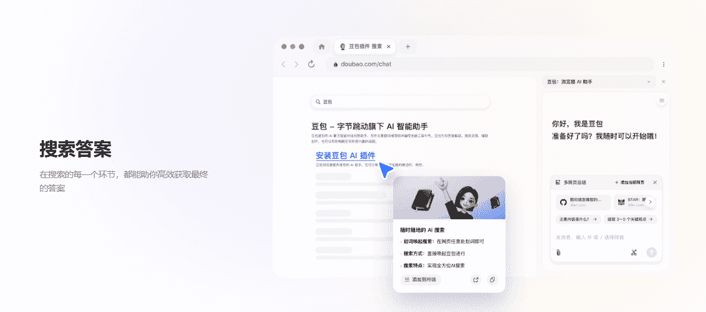
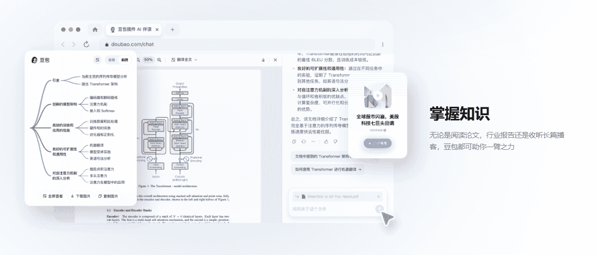
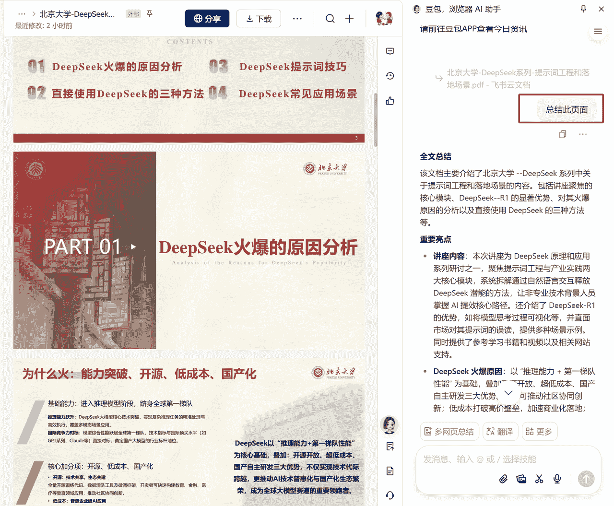
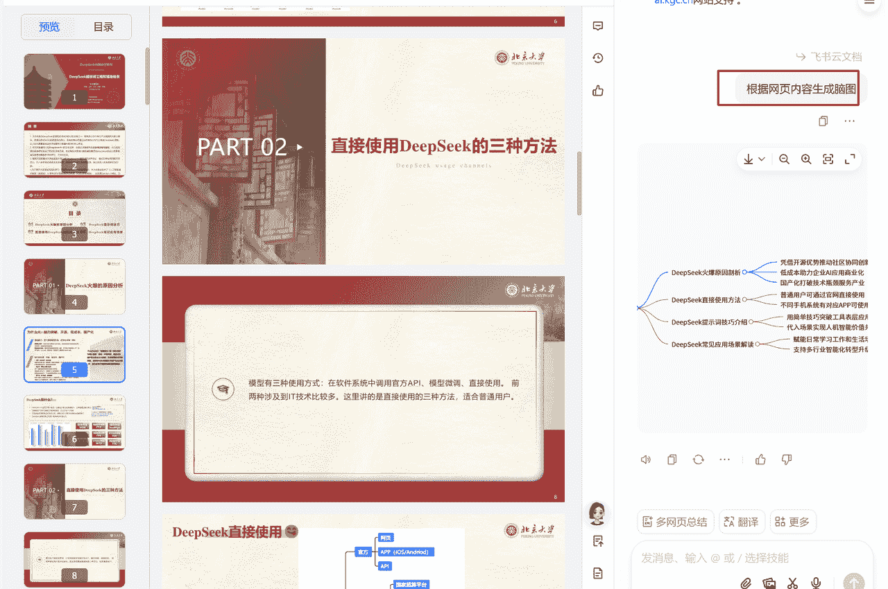
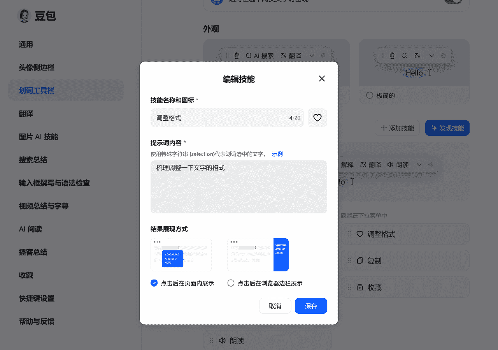
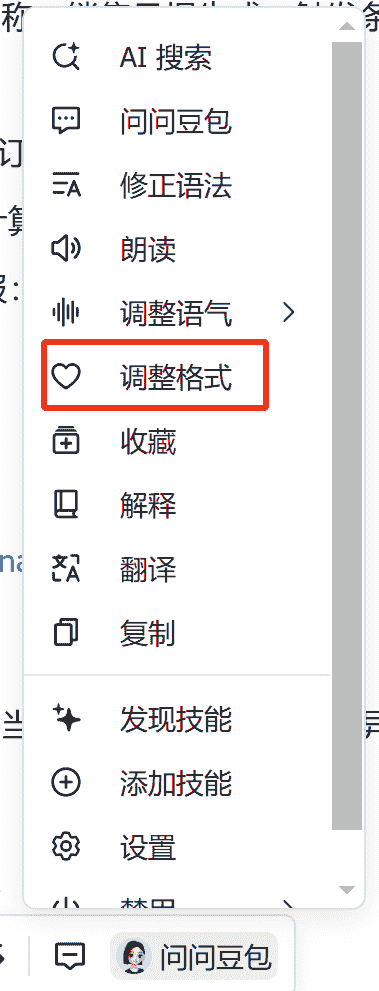

# 在网页上快捷使用豆包AI功能

> 来源：[https://vcn0zlxse9ua.feishu.cn/docx/DLYadxjzZoV9aJxg7sCcvozmnud](https://vcn0zlxse9ua.feishu.cn/docx/DLYadxjzZoV9aJxg7sCcvozmnud)

## 插件地址

https://www.doubao.com/browser-extension/landing?from=ext&extId=dbjibobgilijgolhjdcbdebjhejelffo

## 功能

### AI搜索

### 观看视频

### 学习外语

### 搜索答案

### 掌握知识

## 实践

### 总结当前网页的内容

### 通过网页内容生成脑图

### 添加AI快捷技能

