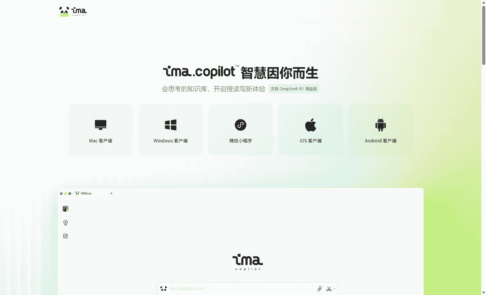
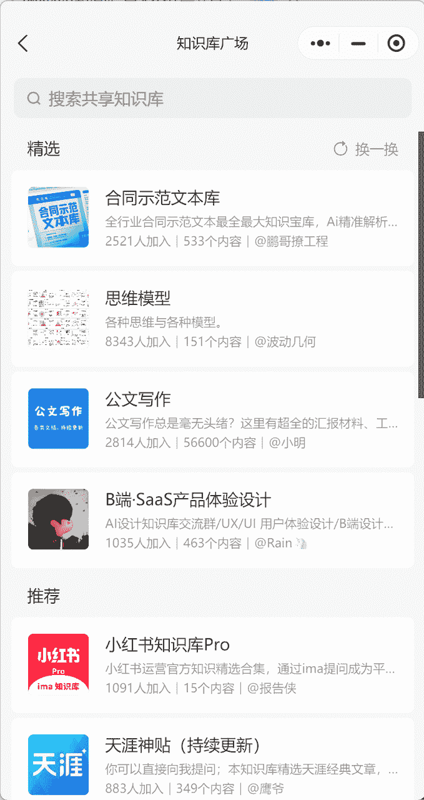
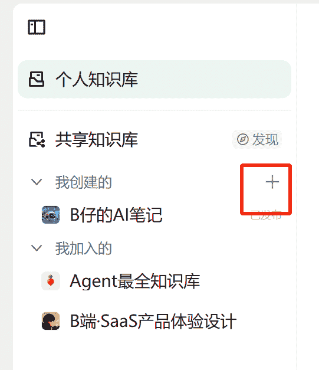
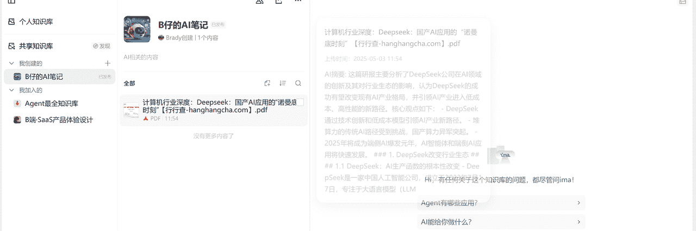
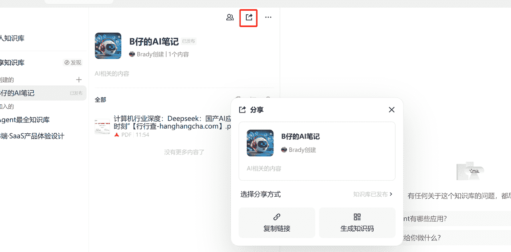
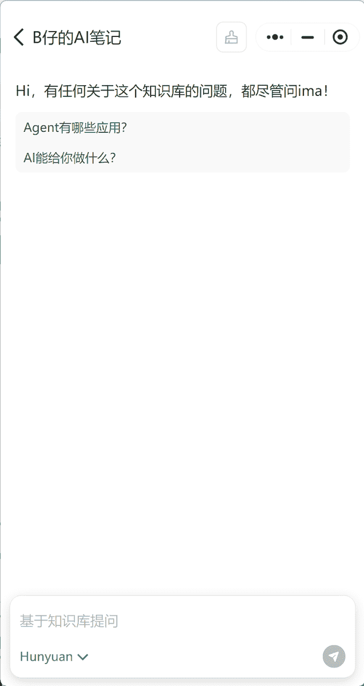
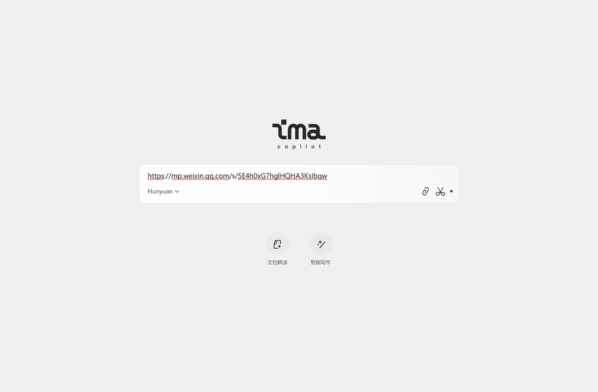
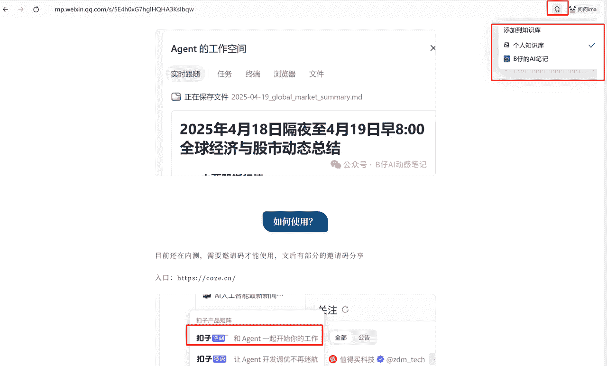
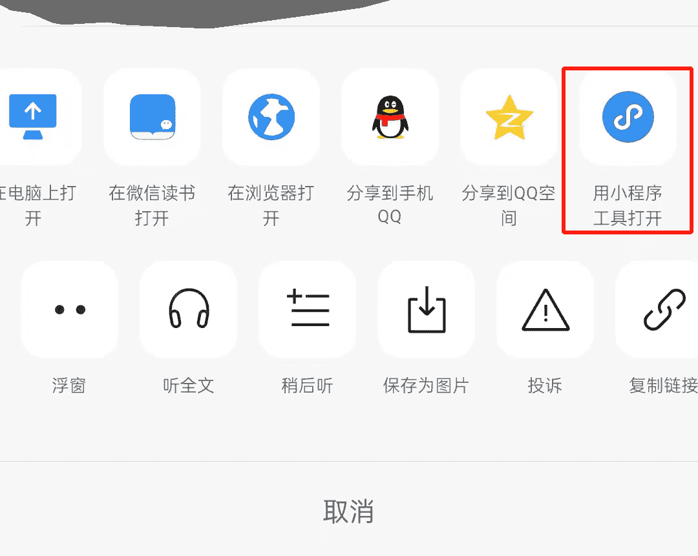
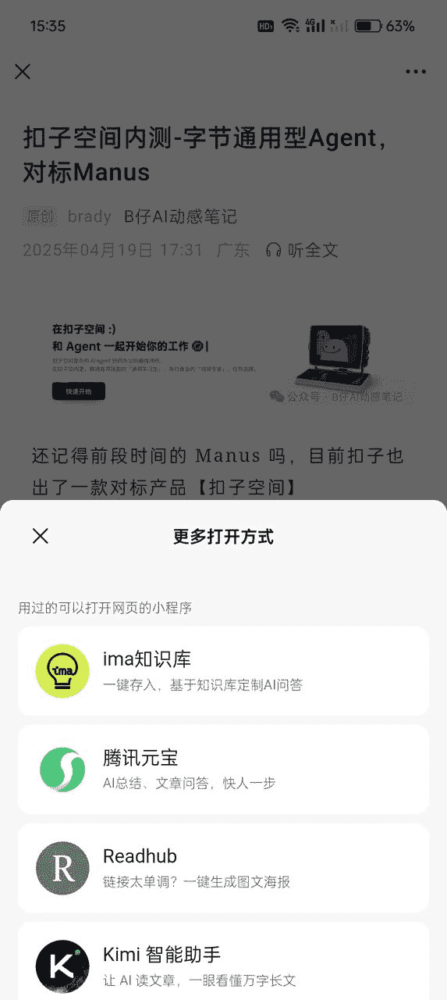

# 腾讯IMA的AI知识库-导入👸号文章等

> 来源：[https://vcn0zlxse9ua.feishu.cn/docx/KN2fdidtPo5C5axR5aeccYCxnbe](https://vcn0zlxse9ua.feishu.cn/docx/KN2fdidtPo5C5axR5aeccYCxnbe)

IMA知识库，通过导入自己的知识库文章等打造属于自己个人的知识库体系，同时还能分享出去，让别人加入自己的生态知识库体系。

## 知识库广场

将自己的知识库放出来，别人可以添加进行提问，打造类似个人品牌模式

+   共享知识库

+   导入👸号文章等内容

## 桌面版：添加共享知识库

> 地址：https://ima.qq.com/

新建一个共享知识库

分享

## 小程序：日常使用

## 如何将👸号添加到知识库中？

很多入口可以将文件添加到知识库，但是👸号却是没看到入口

### 方式1：输入网址搜索

点击右上角

### 方式2：手机打开👸号后右上角添加

手机打开👸号：点击右上角三个点，然后点击【用小程序工具打开】

选择导入ima知识库

