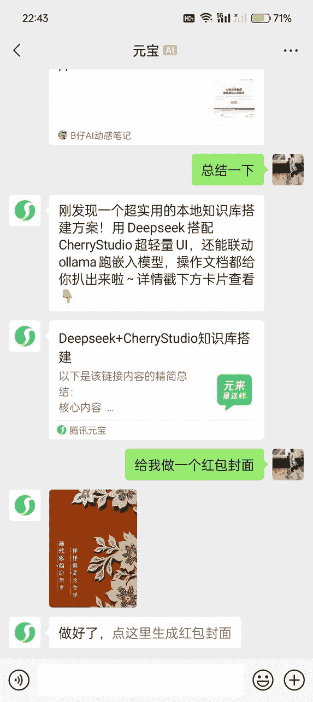
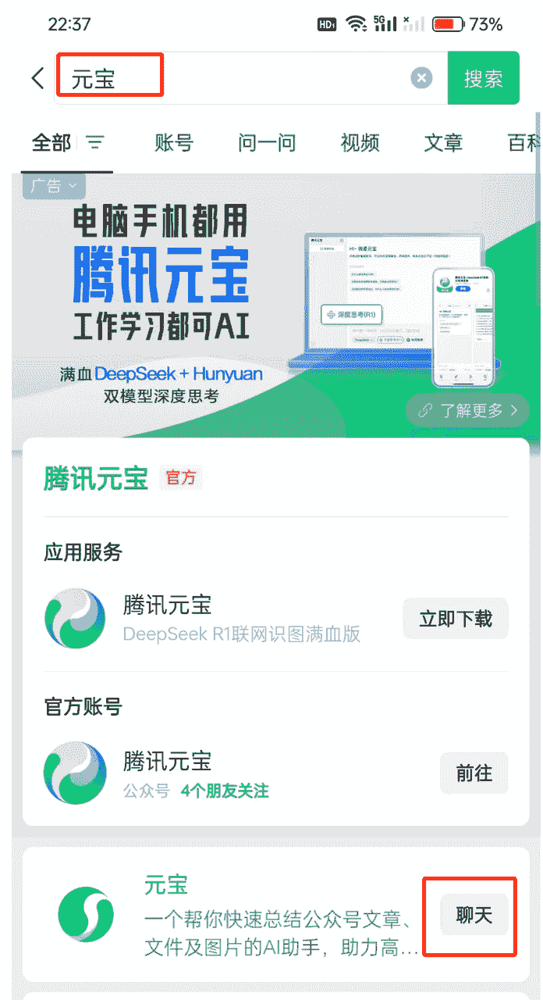

# 第一个🛰️官方AI好友“元宝”

> 来源：[https://vcn0zlxse9ua.feishu.cn/docx/MIgOdxImUorCPox4QdrcsaUtn1e](https://vcn0zlxse9ua.feishu.cn/docx/MIgOdxImUorCPox4QdrcsaUtn1e)

还想做一个🛰️AI机器人？

最近🛰️出了一个🛰️AI好友“元宝”，可以去体验一下🛰️AI~

那它到底有什么能力的呢？

+   AI聊天：文字、语音聊天等

+   解析👸号：解读总结

+   解析文件内容：如合同分析等

+   解析图片内容

+   🛰️生态内容：如生成红包封面

### 解析总结👸号

转发👸号给它就会自动给你总结👸号内容信息

### 解析图片或文件

上传图片，它就会直接帮你解析总结图片内容

### 红包封面

指令：“给我做一个红包封面”

就可以生成你的红包封面，点击进去可以查看

### 怎么添加好友呢？

打开🛰️，最上方的搜索栏进行搜索“元宝”，找到聊天添加入口的元宝，然后点击聊天，可以添加好友

如果觉得使用AI工具总是切来切去，可以体验一下🛰️版好友AI，有事直接问“好友”AI，离你最近~