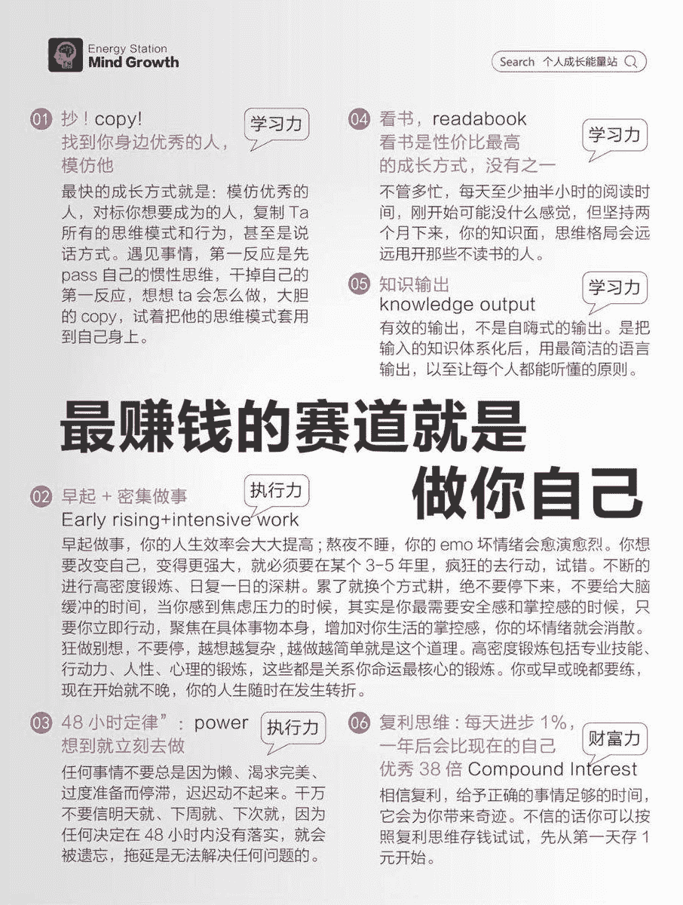
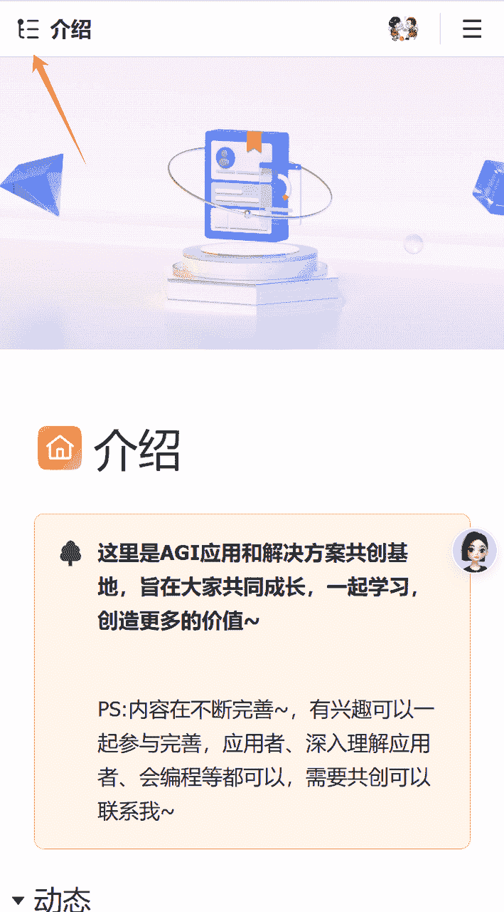
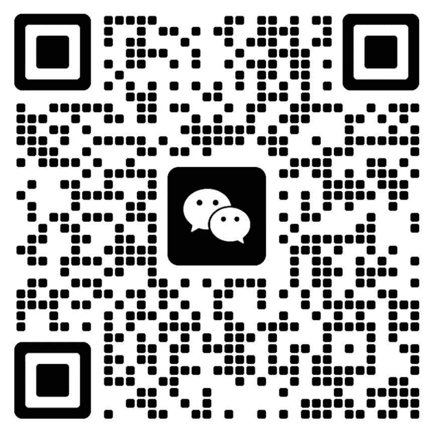

# AGI 共学

# 绘客厅AGI共学~

> 来源：[https://vcn0zlxse9ua.feishu.cn/docx/V0e9dzAzRo6CszxqHzIc7yaGn1g](https://vcn0zlxse9ua.feishu.cn/docx/V0e9dzAzRo6CszxqHzIc7yaGn1g)

# 打造新时代的AI精兵

> **这里是****绘客厅****AGI应用和解决方案****共享****基地，****我们赋能个体和创业者，掌握智驱动AI的**能力，成为AI智能体专家，成为超级个体。

> 无论你是否有编程基础，即使是纯小白，通过我们社**群**的学习体系都可以提高各类AI应用的能力~

> 同时也会有线下的活动，有兴趣也可以来参加~

> **PS:我们会不断输入内容，还有很**多知识体系不是很完善，持续更新迭代中……

> 需要共创可以文末联系我~

## 做你自己~

看到一个比较有意思的内容分享一下~

## 手机技巧~

点击 **左上角菜单 **如下查看更多菜单内容

# **先交朋友**** **当下最火的AI课程和工具【免费公开】

> 下面是学习文档和视频学习资料，点击快速直达！

# A-Deepseek专题

## [Deepseek基础认知](https://vcn0zlxse9ua.feishu.cn/wiki/QEQVwSOYpixp11kNfmzcH2xwnWb)

## [Deepseek平替平台](https://vcn0zlxse9ua.feishu.cn/wiki/TpFYwwlnqieYO4k1gFJcuL9XnSd)

## [Deepseek使用技巧](https://vcn0zlxse9ua.feishu.cn/wiki/OCBxw05lBiLvAikyueMcBMbinVf)

## [Deepseek喂饭指令](https://vcn0zlxse9ua.feishu.cn/wiki/VifiwkWP6iWokhkB1UCcnSVHnse)

## [Deepseek+ollama本地部署种草](https://vcn0zlxse9ua.feishu.cn/wiki/LFWHwooVGiXFeYkKs7dcUiqincg)

## [清爽快捷 Deepseek+LM Studio 本地部署](https://vcn0zlxse9ua.feishu.cn/wiki/IxkdwH6QJiVd50k97VXcO0O4nJc)

## [Deepseek+知识库部署方案（本地+云）](https://vcn0zlxse9ua.feishu.cn/wiki/N8qOwo3hdiRJ6UkyayLcQir4nod)

## [Deepseek进阶](https://vcn0zlxse9ua.feishu.cn/wiki/J6YUwpKiGiriSjkIEPxc3jwVnFf)

## [Deepseek的API开放平台](https://vcn0zlxse9ua.feishu.cn/wiki/FDkJwulRiiGWNxkrLQvc9r15n7g)

## [Deepseek+Office(集成到工具)](https://vcn0zlxse9ua.feishu.cn/wiki/UyrhwR0wTihT0FkrY3iceliyn3e)

## [Deepseek模型技术报告](https://vcn0zlxse9ua.feishu.cn/wiki/AWCiwgjIkiQyaGkCs1mcUC2jnUg)

# AI基础入门

## [1.0 AI 入门](https://vcn0zlxse9ua.feishu.cn/wiki/UgRXwSdn2ilK1bkUK26cVCsDnCe)

## [1.1 AI 大模型](https://vcn0zlxse9ua.feishu.cn/wiki/UhOBwAXTmid2q7kA3sccNPx9nlh)

## [1.2 AI 绘图](https://vcn0zlxse9ua.feishu.cn/wiki/TxsUwYH1MiMLaukVuwIcZtt7nXe?fromScene=spaceOverview)

## [1.3 AI 短视频创作](https://vcn0zlxse9ua.feishu.cn/wiki/ZbmUwXG0nisUJCkbjZEcu51Mn3g?fromScene=spaceOverview)

## [1.4 AI 编程](https://vcn0zlxse9ua.feishu.cn/wiki/XapPwzhMli6bsVkNqmnctQDAneg)

## [1.5 AI 应用](https://vcn0zlxse9ua.feishu.cn/wiki/O4qzwADcCiHeYIk2wwac2BHZnOc)

# 智能体专题

## [1、什么是 Agent 智能体？](https://vcn0zlxse9ua.feishu.cn/wiki/BKF7wQZX9iiH2fkKX4Pc9mo6npb)

## [2、扣子空间内测-字节通用型 Agent-对标 Manus](https://vcn0zlxse9ua.feishu.cn/wiki/KENwwRlVPi3ZfKkBXn8cf309nrh)

## [3、Coze扣子智能体](https://vcn0zlxse9ua.feishu.cn/wiki/KKZnwvenYinFbHkcaanc2pshnoh)

# 企业应用专题

## [2.0 行业应用（TODO）](https://vcn0zlxse9ua.feishu.cn/wiki/SAG4wfqSAiYpgnkQIlfcohfen1d)

# 资讯更新

## [2.0 AI资讯](https://vcn0zlxse9ua.feishu.cn/wiki/FK4JwKBhoidW2cku7Dxcrw9on8g)

# 每月线下沙龙 专注资源链接与创业者成长

[绘客厅AI主题活动](https://vcn0zlxse9ua.feishu.cn/wiki/KxY5wyRX4iY0prkCQP2cr8yNn8K)

## 欢迎共创或关注~

有兴趣共创可以联系~

在这里，你可以

+   会不定时更新AI相关内容

+   原创内容

+   一起共创AI应用

+   一起共创AI解决方案

+   一起研发好的AI应用

+   一起线下学习

+   和绘客厅链接更多行业

+   联系进入相关社群

+   ...

## 联系和加群~

