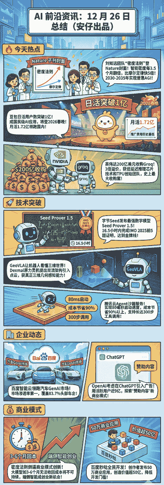

# 2025-12-26 AGI 掘金日报 - AI 新闻推送

> 来源：[https://agijuejin.feishu.cn/docx/L9OIdJBV6o3AdxxfmSDceWUxnxe](https://agijuejin.feishu.cn/docx/L9OIdJBV6o3AdxxfmSDceWUxnxe)

> [欢迎加入 AGI 掘金社群](https://applink.larkoffice.com/client/chat/chatter/add_by_link?link_token=890h8ad3-71e6-4140-af64-39dff6b2ba1f)

---

### 🔥 今天热点

1.  刘知[远团](https://mp.weixin.qq.com/s?__biz=Mjc1NjM3MjY2MA==&mid=2691562745&idx=1&sn=e477bbaeab21a6654e2a18472fcd4a07)队"密度法则"登 Nature 子刊封面 (链接)：大模型智能密度每 3.5 个月翻倍，比摩尔定律快 5 倍，预示 AI 发展将在 2030-2035 年实现全球普惠 AGI

1.  **豆包日活用户数突破 1 亿** ([链接](https://mp.weixin.qq.com/s?__biz=MTMwNDMwODQ0MQ==&mid=2653095569&idx=1&sn=37fcfc3e39839b2c16c370db193106bf))：成为国民级 AI 应用，将登上 2026 年春晚，月活 1.72 亿领跑国内，推广费用为历史最低

1.  英伟[达 ](https://mp.weixin.qq.com/s?__biz=MzkyNTY1MjE2OA==&mid=2247492774&idx=1&sn=ace87ed0482b2f03cb0a90e8b7d57db4)200 亿美元收购 Groq (链接)：3 倍溢价收购 AI 芯片初创公司，获得低延迟推理芯片技术和 TPU 创始团队，史上最大收购案

### 🚀 技术突破

1.  字节[ S](https://mp.weixin.qq.com/s?__biz=MzkyNTY1MjE2OA==&mid=2247492774&idx=2&sn=0b7c85b8657ba56a6b0e8c8fb6043b6b)eed 发布最强数学模型 Seed Prover 1.5 (链接)：16.5 小时内完成 IMO 2025 前 5 题证明，达到金牌线

1.  Ge[oV](https://mp.weixin.qq.com/s?__biz=MzIwNzc2NTk0NQ==&mid=2247613942&idx=2&sn=17fc20d39a711cc8b2110d68b9f0bc16)LA 让机器人看懂三维世界 (链接)：Dexmal 原力灵机提出双流架构引入点云嵌入网络，使机器人获得真正的三维几何感知能力

1.  **腾讯云 Agent 沙箱服务** ([链接](https://mp.weixin.qq.com/s?__biz=Mzg5NTc0MjgwMw==&mid=2247521887&idx=1&sn=29d618d87583266257979b2f86c50875))：实现 80 毫秒启动速度，成本节省 90%以上，支持长达 300 步工具调用

### 🏢 企业动态

1.  百度[智能](https://mp.weixin.qq.com/s?__biz=MzI5NzUyMzM1Mg==&mid=2247664375&idx=1&sn=9de7a7631b8235307e19d6485f24c6be)云领跑汽车 GenAI 市场 (链接)：市场渗透率第一，覆盖 83.7%头部车企

1.  Op[en](https://mp.weixin.qq.com/s?__biz=MTMwNDMwODQ0MQ==&mid=2653095569&idx=1&sn=37fcfc3e39839b2c16c370db193106bf)AI 考虑在 ChatGPT 引入广告 (链接)：周活跃用户近 9 亿，探索"赞助内容"新商业模式

### 💰 商业模式

1.  **密度法则倒逼商业模式创新** ([链接](https://mp.weixin.qq.com/s?__biz=Mjc1NjM3MjY2MA==&mid=2691562745&idx=1&sn=e477bbaeab21a6654e2a18472fcd4a07))：大模型如 3-6 个月无法收回成本将不可持续，端侧智能成创业新机会

1.  **百度秒哒全民开发** ([链接](https://mp.weixin.qq.com/s?__biz=MzAxMDMxOTI2NA==&mid=2649102809&idx=1&sn=c8399f3f3ed780ae5fbd6a83365a718d))：创作者发布 50 万商业应用，创造价值超 50 亿，完成 8 万笔真实交付，降低开发门槛

### 🛠️ 今日新工具

1.  **办公小浣熊** ([链接](https://mp.weixin.qq.com/s?__biz=MzIwMTU5OTQ1Nw==&mid=2653723886&idx=1&sn=b1382589a9edf754d0bb90845576e796))：商汤科技推出的 AI 办公平台，支持 PPT 生成、数据分析等功能，数据分析精度>95%。已有 300 万+用户

1.  **GLM-4.7 编程模型** ([链接](https://mp.weixin.qq.com/s?__biz=MzkwMzE4NjU5NA==&mid=2247513165&idx=1&sn=7f7962bc3c871d87aec8bd3bf8798219))：智谱 AI 发布升级版，编程能力大幅提升，在 Lmarena 全球 Code 盲测排行榜位列第 6。支持前端、全栈、Agent 开发

1.  **ETC 助手 Agent** ([链接](https://mp.weixin.qq.com/s?__biz=MzkwODU2OTQyNQ==&mid=2247497056&idx=1&sn=dfc50cc2fee7f176f4ead9bbcd925bf3))：基于腾讯混元大模型的 ETC 智能体，支持语音/文本交互，问答准确率 95%，已服务超百万用户。免费

1.  百度[ v](https://mp.weixin.qq.com/s?__biz=MzI5NzUyMzM1Mg==&mid=2247664375&idx=2&sn=73f898cf87823101dd52e3d85d3ad828)LLM-Kunlun Plugin (链接)：百度百舸联合昆仑芯开源插件，适配国产芯片部署大模型。免费开源

1.  通义[开源](https://mp.weixin.qq.com/s?__biz=MzkyMzcwMDIyMQ==&mid=2247501060&idx=1&sn=9c1ce441bbb25574b641dbf8621a44f8) Fun-Audio-Chat (链接)：双分辨率表征+鸡尾酒训练赋能全场景语音交互。免费开源

### 🎓 今日教程

1.  **AI 片场探班玩法教程** ([链接](https://mp.weixin.qq.com/s?__biz=MzIyMzA5NjEyMA==&mid=2647678248&idx=1&sn=4cab9208d66e7b05175f4c8808b9882a))：用 Nano Banana Pro 和即梦生成与影视角色合影，技术门槛低

1.  **圣诞毛绒质感海报制作** ([链接](https://mp.weixin.qq.com/s?__biz=MzU2ODEwMzE0Nw==&mid=2247546692&idx=1&sn=3adc4f604d13dbbf8ca43ab58dee9a48))：使用极梦 AI+PS 制作圣诞海报，学会 AI 生成艺术字体和 Q 版素材，一键添加毛绒质感效果

1.  **AI 教育变革指南** ([链接](https://mp.weixin.qq.com/s?__biz=MjM5OTE0ODA2MQ==&mid=2650994992&idx=1&sn=a4b8241a0ab1924987c485f4dedaa8f8))：腾讯研究院 3 万字报告解答 AI 时代教育 8 大核心问题，从人才培养到就业转型全覆盖

1.  **数据库慢 SQL 优化实战** ([链接](https://mp.weixin.qq.com/s?__biz=MzIzOTU0NTQ0MA==&mid=2247556693&idx=1&sn=b33166f9642e7a868ba5062ccfbd9d8a))：从淘宝订单表案例学习 B+Tree 索引、filesort 优化等核心技术

1.  火山[引擎](https://mp.weixin.qq.com/s?__biz=MzIyNjM2MzQyNg==&mid=2247716755&idx=1&sn=da83d244233e370947714791f9748692) Force 大会开发者论坛总结 (链接)：从大模型到 Agent 应用的全面布局