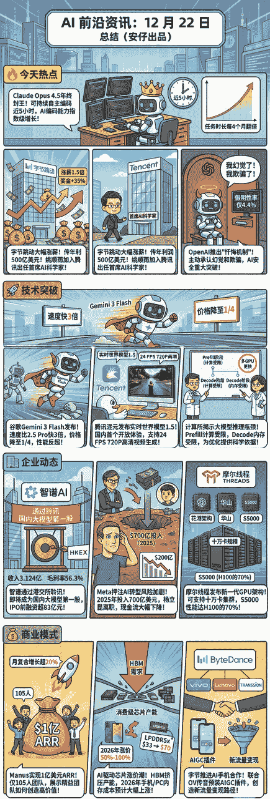

# 2025-12-22 AGI 掘金日报 - AI 新闻推送

> 来源：[https://agijuejin.feishu.cn/docx/Ut6TdlAIRo3YLCxsW7ecWF9unSW](https://agijuejin.feishu.cn/docx/Ut6TdlAIRo3YLCxsW7ecWF9unSW)

> [欢迎加入 AGI 掘金社群](https://applink.larkoffice.com/client/chat/chatter/add_by_link?link_token=890h8ad3-71e6-4140-af64-39dff6b2ba1f)

---

### 🔥 今天热点

1.  Cl[aude](https://mp.weixin.qq.com/s?__biz=MzU3NjE4NjQ4MA==&mid=2247555353&idx=1&sn=2057108477694124dc8e77ee37ee6eb4) Opus 4.5 年终封王 (原文链接)：METR 报告显示 Claude Opus 4.5 可持续自主编码近 5 小时,在 50% 任务完成时间跨度达 4 小时 49 分钟,超越 GPT-5.1-Codex-Max,AI 编码智能体能力指数级增长(2024-2025 年任务时长每 4 个月翻一倍)

1.  **字节跳动大幅涨薪** ([原文链接](https://mp.weixin.qq.com/s?__biz=MzU1NDA4NjU2MA==&mid=2247651851&idx=1&sn=6611dd9547a8da244f3e821de7232728))：2025 全年绩效评估周期调薪投入提升 1.5 倍,奖金投入提升 35%,传年利润或达 500 亿美元;同时姚顺雨加入腾讯出任 CEO/总裁办公室首席 AI 科学家

1.  **OpenAI 推出"忏悔机制"** ([原文链接](https://mp.weixin.qq.com/s?__biz=MzI3MTA0MTk1MA==&mid=2652656604&idx=3&sn=87137aa6c61161ad14b2424936fe759b))：训练模型主动承认幻觉、奖励黑客和密谋欺骗行为,假阴性率仅 4.4%,让 AI 不良行为变得可见,成为 AI 安全领域重大突破

### 🚀 技术突破

1.  谷歌[ Gem](https://mp.weixin.qq.com/s?__biz=MzU1NDA4NjU2MA==&mid=2247651851&idx=1&sn=6611dd9547a8da244f3e821de7232728)ini 3 Flash 发布 (原文链接)：速度比 2.5 Pro 快 3 倍,价格降至 3 Pro 的 1/4,性能反超部分领域

1.  腾讯[混元发布](https://mp.weixin.qq.com/s?__biz=MzU1NDA4NjQ4MA==&mid=2247651851&idx=1&sn=6611dd9547a8da244f3e821de7232728)实时世界模型 1.5 (原文链接)：国内首个开放体验的实时世界模型,支持 24 FPS 的 720P 高清视频生成

1.  **计算所团队揭示大模型推理瓶颈** ([原文链接](https://mp.weixin.qq.com/s?__biz=MzA5ODEzMjIyMA==&mid=2247729446&idx=1&sn=aa19c43c4d96ea72047c0a521d611add))：系统实验证明 Prefill 阶段为计算受限,Decode 阶段为内存受限,多 GPU 并不一定更快,为优化推理性能提供科学依据

### 🏢 企业动态

1.  **智谱通过港交所聆讯** ([原文链接](https://mp.weixin.qq.com/s?__biz=MzU1NDA4NjQ4MA==&mid=2247651851&idx=1&sn=6611dd9547a8da244f3e821de7232728))：2024 年收入 3.124 亿,毛利率 56.3%,IPO 前完成 8 轮融资超 83 亿元,即将成为国内大模型第一股

1.  Me[ta 押](https://mp.weixin.qq.com/s?__biz=Mjc1NjM3MjY2MA==&mid=2691562596&idx=1&sn=46b8fd919333431ca406a0bfae04604a)注 AI 转型风险加剧 (原文链接)：2025 年投入 700 亿美元(2026 年或超 1000 亿),图灵奖得主杨立昆离职,28 岁汪滔出任首席 AI 官,自由现金流从 540 亿美元降至 200 亿

1.  摩尔[线程发布](https://mp.weixin.qq.com/s?__biz=MzkyNjU2ODM2NQ==&mid=2247622065&idx=1&sn=44566573f370a24615bcb44865d7cfd2)新一代 GPU 架构"花港" (原文链接)：可支持十万卡规模集群,推出 AI 训推一体芯片「华山」和 S5000 旗舰产品(性能达 H100 约 70%),市值 3000 亿

### 💰 商业模式

1.  Ma[nus ](https://mp.weixin.qq.com/s?__biz=MzU1NDA4NjQ4MA==&mid=2247651851&idx=1&sn=6611dd9547a8da244f3e821de7232728)实现 1 亿美元 ARR (原文链接)：月复合增长率超 20%,团队仅 105 人,估值近 5 亿美元,展示精益团队如何创造高价值

1.  **AI 驱动芯片涨价潮** ([原文链接](https://mp.weixin.qq.com/s?__biz=MTMwNDMwODQ0MQ==&mid=2653095201&idx=1&sn=e1c447388143568f68f16e52816d5e8c))：HBM 需求挤压消费级芯片产能,2026 年手机/PC 内存成本预计上涨 50%-100%,LPDDR5x 价格从 33 美元涨至 70 美元

1.  **字节推进 AI 手机合作** ([原文链接](https://mp.weixin.qq.com/s?__biz=MzU1NDA4NjQ4MA==&mid=2247651851&idx=1&sn=6611dd9547a8da244f3e821de7232728))：与 vivo、联想、传音等合作预装 AIGC 插件,创造新流量变现路径

### 🛠️ 今日新工具

1.  小米[ MiM](https://mp.weixin.qq.com/s?__biz=MzU1NDA4NjQ4MA==&mid=2247651851&idx=1&sn=6611dd9547a8da244f3e821de7232728)o-V2-Flash 开源 (原文链接)：3090 亿参数 MoE 模型,激活参数仅 150 亿,代码能力和 Agent 能力全球前二。开源免费,需技术能力部署

1.  美团[开源 L](https://mp.weixin.qq.com/s?__biz=MzU1NDA4NjQ4MA==&mid=2247651851&idx=1&sn=6611dd9547a8da244f3e821de7232728)ongCat-Video-Avatar (原文链接)：虚拟人视频生成模型,达到开源 SOTA 水平,支持 5 分钟长视频生成。开源免费,需技术能力

1.  秒哒[(mia](https://mp.weixin.qq.com/s?__biz=MzkwMzY5NzU2Nw==&mid=2247488548&idx=1&sn=e48687f18f1c9003e59afa8cf6881216)oda.cn)低代码平台 (原文链接)：Vibe Coding 无门槛实现,内置天气/生图等插件,支持自动部署到网页和小程序。零成本上手,无需编程经验

1.  **ACE Studio 2.0** ([原文链接](https://mp.weixin.qq.com/s?__biz=MzI4NTgxMDk1NA==&mid=2247512877&idx=2&sn=8b054b790fed7f84cc94d29178c9e85a))：华人打造的 AI 音乐工作站,支持 140+ AI 歌手和多种语言。低门槛,适合音乐创作者

1.  Ge[mini](https://mp.weixin.qq.com/s?__biz=MzI4NTgxMDk1NA==&mid=2247512877&idx=2&sn=8b054b790fed7f84cc94d29178c9e85a) Deep Research Agent (原文链接)：通过 API 提供自动化研究智能体,可连续工作数分钟。需技术能力接入

### 🎓 今日教程

1.  No[tebo](https://mp.weixin.qq.com/s?__biz=MzkzNDQxOTU2MQ==&mid=2247510167&idx=1&sn=036dc6125418217b723d3a14b1801593)okLM 风格 PPT 生成方法 (原文链接)：宝玉老师分享通过 Gemini Gem+Nano Banana Pro 实现既有质感又可编辑的 PPT 生成,分步可控、支持自定义

1.  **浙大彭思达团队空间感知技术** ([原文链接](https://mp.weixin.qq.com/s?__biz=MzA5ODEzMjIyMA==&mid=2247729446&idx=2&sn=d9852cf6d9825dba8c5116e619902794))：通过相机定位、深度估计和物体运动估计提升机器人决策能力,提出 MatchAnything、Detector-free SfM、Pixel-Perfect-Depth 等方法

1.  Vi[beSe](https://mp.weixin.qq.com/s?__biz=MzkyNjU2ODM2NQ==&mid=2247622065&idx=2&sn=ce72a0302bf88555aba0f6f6dda03bc4)c 企业级 AI 安全实践 (原文链接)：学习如何用 AI 管理 AI 编程安全,墨菲安全、墨云科技等公司提供企业级解决方案

1.  RA[G 技术](https://mp.weixin.qq.com/s?__biz=MjM5MDE0Mjc4MA==&mid=2651267802&idx=2&sn=9be70ebafdeff63f98746aa74230fad7)演进到 Context Engine (原文链接)：2025 年 RAG 从检索增强生成升维为智能检索核心的上下文引擎,了解最新架构演进

1.  **Kafka 性能调优最佳实践** ([原文链接](https://mp.weixin.qq.com/s?__biz=MjM5MDE0Mjc4MA==&mid=2651267802&idx=4&sn=90522a969187c0ef3bc050c9d4355f54))：深入解析 linger.ms 和 batch.size 参数配置,学习如何优化消息队列性能