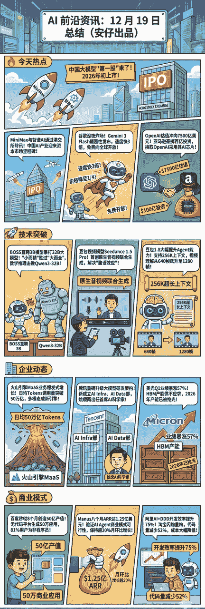

# 2025-12-19 AGI 掘金日报 - AI 新闻推送

> 来源：[https://agijuejin.feishu.cn/docx/DdWFdcKDmoJGFrxD6tpcHOcrnac](https://agijuejin.feishu.cn/docx/DdWFdcKDmoJGFrxD6tpcHOcrnac)

> [欢迎加入 AGI 掘金社群](https://applink.larkoffice.com/client/chat/chatter/add_by_link?link_token=890h8ad3-71e6-4140-af64-39dff6b2ba1f)

---

### 🔥 今天热点

1.  中国[大模](https://mp.weixin.qq.com/s?__biz=MzkyNTY1MjE2OA==&mid=2247492670&idx=1&sn=d9baba7212fc5a88ce835092f5647519)型"第一股"来了！MiniMax 与智谱 AI 通过港交所聆讯 (链接)：预计 2026 年初上市，中国 AI 产业迎来资本市场里程碑时刻

1.  谷歌[深夜](https://mp.weixin.qq.com/s?__biz=MzkyNTY1MjE2OA==&mid=2247492670&idx=2&sn=69657969ed107db95630792ed361cdbf)炸场！Gemini 3 Flash 颠覆性发布 (链接)：速度比 2.5 Pro 快 3 倍，价格降至 1/4（仅$0.50/百万 tokens），GPQA 测试达 90.4%，免费向全球开放

1.  Op[en](https://mp.weixin.qq.com/s?__biz=MzkyNTY1MjE2OA==&mid=2247492670&idx=2&sn=69657969ed107db95630792ed361cdbf)AI 估值冲向 7500 亿美元！亚马逊或豪掷百亿投资 (链接)：计划投资至少 100 亿美元，交易条件是 OpenAI 采用亚马逊 AI 芯片，AI 军备竞赛进入白热化

### 🚀 技术突破

1.  BO[SS](https://mp.weixin.qq.com/s?__biz=Mzk3NTc1NTU0Mw==&mid=2247503474&idx=1&sn=38b1d1abb1e286373c88f7d07cbb6e08) 直聘 3B 模型暴打 32B 大模型 (链接)：Nanbeige4-3B 通过 23 万亿 Token 训练，仅 30 亿参数却在数学推理上击败 Qwen3-32B，证明"小而精"胜过"大而全"

1.  豆包[视频](https://mp.weixin.qq.com/s?__biz=MzIwNzc2NTk0NQ==&mid=2247613774)模型 Seedance 1.5 Pro 首创原生音视频联合生成 (链接)：基于 MMDiT 双分支架构，视频音频同时生成而非后期对口型，解决"腹语效应"，支持中文方言、多角色对白、电影级运镜

1.  豆包[ 1](https://mp.weixin.qq.com/s?__biz=MzkwMzE4NjU5NA==&mid=2247512844&idx=1&sn=a2cebee96d995d2104ea58621790b1ab).8 大幅提升 Agent 能力 (链接)：支持 256K 超长上下文，视频理解从 640 帧跃升至 1280 帧，多模态理解能力全面增强

### 🏢 企业动态

1.  火山[引擎](https://mp.weixin.qq.com/s?__biz=MTMwNDMwODQ0MQ==&mid=2653094942) MaaS 业务爆发式增长 (链接)：豆包日均 Tokens 调用量突破 50 万亿，超 100 家企业客户日均调用破万亿，多模态成为新增长引擎

1.  **腾讯重磅升级大模型研发架构** ([链接](https://mp.weixin.qq.com/s?__biz=MzkyNTY1MjE2OA==&mid=2247492670&idx=2&sn=69657969ed107db95630792ed361cdbf))：新成立 AI Infra 部、AI Data 部等，姚顺雨出任首席 AI 科学家，AI 战略再提速

1.  **美光 Q1 业绩暴涨 57%** ([链接](https://mp.weixin.qq.com/s?__biz=Mjc1NjM3MjY2MA==&mid=2691562517&idx=2))：营收 136.4 亿美元，毛利率 56.8%，HBM 产能供不应求，2026 年产能已被抢光

### 💰 商业模式

1.  百度[秒哒](https://mp.weixin.qq.com/s?__biz=MzI3MTA0MTk1MA==&mid=2652655890) 8 个月创造 50 亿产值 (链接)：无代码平台生成 50 万商业应用，服务超 1000 万人，81%用户为非程序员，2 万+应用接入支付完成 8 万笔交易

1.  Ma[nu](https://mp.weixin.qq.com/s?__biz=MzI4NTgxMDk1NA==&mid=2247512801&idx=3&sn=c4780c7f71cbb0cb7c98d96de1df6f1e)s 八个月 ARR 达 1.25 亿美元 (链接)：新加坡 AI Agent 公司保持超 20%月环比增长，验证 AI Agent 商业模式可行性

1.  阿里[ A](https://mp.weixin.qq.com/s?__biz=MzIzOTU0NTQ0MA==&mid=2247556526&idx=1&sn=4df544a3b331803bdedf7a6c974fa6cf)I+DDD 开发效率提升 75% (链接)：淘宝闪购通过 AI 辅助 DDD 架构重构，代码量减少 52%，新增服务包成本从 5-8 人天降至配置化

### 🛠️ 今日新工具

1.  Au[to](https://mp.weixin.qq.com/s?__biz=MzU3NjE4NjQ4MA==&mid=2247555331&idx=1&sn=215fe102d566e50d4362ef63bc6db445)GLM 手机操作 Agent (链接)：智谱开源的 9B 端侧模型，可通过 ADB 控制手机完成发微信、订票等任务，一周获 15K 星。门槛：需 2 张 24G 显卡或 API 调用

1.  Se[ed](https://exp.volcengine.com/ark/vision?launch=seedance)ance 1.5 Pro (链接)：原生音视频生成，支持中文方言、多角色对白、电影级运镜。已在即梦 AI/豆包 APP 上线可体验，API 下周开放

1.  **Step-GUI 系列** ([链接](https://mp.weixin.qq.com/s?__biz=MzkyNTY1MjE2OA==&mid=2247492670&idx=2&sn=69657969ed107db95630792ed361cdbf))：阶跃星辰发布业内首个支持手机部署的开源 GUI Agent 模型，可在 200+APP 场景执行任务。门槛：开源可本地部署

1.  **MiMo-V2-Flash** ([链接](https://mp.weixin.qq.com/s?__biz=MzkyMzcwMDIyMQ==&mid=2247500957&idx=1&sn=83f23b567c15fafc94b6e76be2a0bbc0))：小米开源的 3090 亿参数 MoE 模型，采用多令牌预测技术降低推理成本。门槛：开源模型需自行部署

1.  **印象 AI** ([链接](https://mp.weixin.qq.com/s?__biz=MTMwNDMwODQ0MQ==&mid=2653094959&idx=1&sn=47ec4fa02007ba3846a915005d7aad1e))：印象笔记打造 AI 时代"第二大脑"，通过个人记忆图谱实现主动式智能服务。Q1 上线，期待值高

### 🎓 今日教程

1.  Au[to](https://mp.weixin.qq.com/s?__biz=MzU3NjE4NjQ4MA==&mid=2247555331&idx=1&sn=215fe102d566e50d4362ef63bc6db445)GLM 本地部署保姆级教程 (链接)：详细讲解 VLLM 部署、ADB 配置、手机端设置全流程，解决显存不足等常见问题

1.  He[ll](https://mp.weixin.qq.com/s?__biz=MzIyNjM2MzQyNg==&mid=2247716496&idx=1&sn=04629640cd5bd3213c9e46a115d8ff0e)o-Agents 从零学习 AI Agent 开发 (链接)：Datawhale 开源智能体学习教程突破 1 万 star，系统化学习 AI Agent 开发

1.  **Seedance 技术深度解析** ([链接](https://mp.weixin.qq.com/s?__biz=MzkwMzY5NzU2Nw==&mid=2247488510))：从方言口音到 3A 游戏音效全面测试，揭示 MMDiT 双分支架构和 RLHF 训练细节

1.  Vi[be](https://mp.weixin.qq.com/s?__biz=MzkyNjU2ODM2NQ==&mid=2247621970&idx=2&sn=01ecde0dc57080c5ba150300ead878c4) Engineering 实践指南 (链接)：从 Vibe Coding 升级到 Vibe Engineering，强调工程方法而非盲目 AI 生成，包含 voice coding、rules/docs 管理等实用技巧

1.  Ge[mi](https://mp.weixin.qq.com/s?__biz=Mzg2OTA1OTAxNA==&mid=2247487496&idx=1&sn=c536558e8419a3dea598fb62e586d591)ni 前端设计专用提示词 (链接)：让 Gemini 3 Flash 30 秒生成高质量网站设计，实现专业设计效果