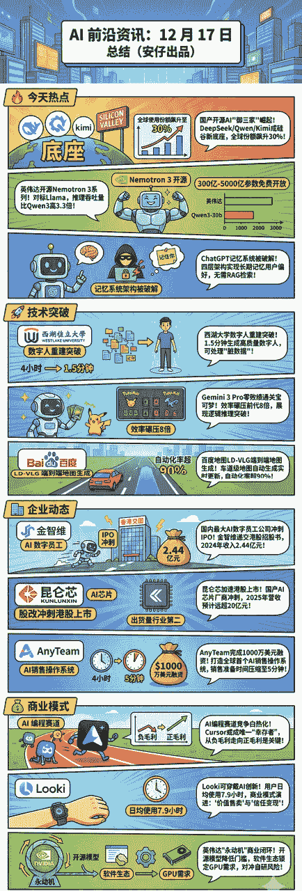

# 2025-12-17 AGI 掘金日报 - AI 新闻推送

> 来源：[https://agijuejin.feishu.cn/docx/O97vdZO8Ko88Y6xig3ackNY1ntd](https://agijuejin.feishu.cn/docx/O97vdZO8Ko88Y6xig3ackNY1ntd)

> [欢迎加入 AGI 掘金社群](https://applink.larkoffice.com/client/chat/chatter/add_by_link?link_token=890h8ad3-71e6-4140-af64-39dff6b2ba1f)

---

### 🔥 今天热点

1.  **国产开源 AI"御三家"崛起** ([链接](https://mp.weixin.qq.com/s?__biz=MzkyNjU2ODM2NQ==&mid=2247621871&idx=2&sn=61cc07b953d7ef6956c1bab7a7b0eb93))：DeepSeek/Qwen/Kimi 成为硅谷新底座，全球使用份额飙升至 30%，标志着中国 AI 技术正在全球范围内建立影响力

1.  英伟[达开](https://mp.weixin.qq.com/s?__biz=MjM5OTgyNTA0MQ==&mid=2650532163&idx=2&sn=79affe4ef00458ffee6cb3edfaa6cfa2)源 Nemotron 3 系列震撼登场 (链接)：免费开放 300 亿至 5000 亿参数模型，对标 Meta 的 Llama，推理吞吐量比 Qwen3-30b-a3b 高 3.3 倍，支持 100 万 token 上下文

1.  Ch[at](https://mp.weixin.qq.com/s?__biz=MzIwNzc2NTk0NQ==&mid=2247613585&idx=1&sn=b125ad53dc83747d9f742c8e7f0ed23d)GPT 记忆系统架构被破解 (链接)：四层架构实现"记住你"功能，无需 RAG 检索即可长期记忆用户偏好，揭示了下一代 AI 交互的技术路径

### 🚀 技术突破

1.  **西湖大学数字人重建突破** ([链接](https://mp.weixin.qq.com/s?__biz=MzA5ODEzMjIyMA==&mid=2247728800&idx=1&sn=0e7ccebc4f23fbf54935d4c2c5f773c2))：UP2You 技术将数字人重建时间从 4 小时压缩至 1.5 分钟，可直接处理"脏数据"生成高质量多视角图像

1.  Ge[mi](https://mp.weixin.qq.com/s?__biz=Mzg3MTkxMjYzOA==&mid=2247511145&idx=1&sn=226f2de71b14cb2cef710d64bdf38416)ni 3 Pro 零败绩通关宝可梦 (链接)：效率碾压前代 8 倍，展现从概率拟合到逻辑推理的突破，具备自主工具创建能力

1.  百度[地图](https://mp.weixin.qq.com/s?__biz=MzI5NzUyMzM1Mg==&mid=2247663778&idx=2&sn=7e5a62abee090ec6a978b0b1afe0fa46) LD-VLG 端到端地图生成 (链接)：通过端到端多模态大模型实现车道级地图自动生成和实时更新，自动化率超 90%

### 🏢 企业动态

1.  国内[最大](https://mp.weixin.qq.com/s?__biz=MzkyNTY1MjE2OA==&mid=2247492625&idx=1&sn=f18cd8f7f9af31d9204dcf59f7a93acc) AI 数字员工公司冲刺 IPO (链接)：金智维向港交所递交招股书，2024 年收入 2.44 亿元，从金融 RPA 龙头转型企业级 AI Agent 平台

1.  **昆仑芯即将完成股改冲刺港股上市** ([链接](https://mp.weixin.qq.com/s?__biz=Mjc1NjM3MjY2MA==&mid=2691562411&idx=1&sn=a69018fad4fa22acfe559d754d04cd31))：国产 AI 芯片厂商加速推进香港上市，2025 年营收预计远超 20 亿元，出货量排行业第二

1.  An[yT](https://mp.weixin.qq.com/s?__biz=Mzg3NDc2MjQxMg==&mid=2247492645&idx=1&sn=a0c38c31b751f0c1b0baa14cdfe4d05b)eam 完成 1000 万美元融资 (链接)：打造全球首个销售人员 AI 操作系统，将销售准备时间从 4 小时压缩到 5 分钟，40+硅谷大佬参投

### 💰 商业模式

1.  **AI 编程赛道竞争白热化** ([链接](https://mp.weixin.qq.com/s?__biz=MjM5MDE0Mjc4MA==&mid=2651266890&idx=2&sn=cc98c86722b5e9d4b133e2c186d50043))：Cursor 或成创业公司唯一"幸存者"，AI 编程从负毛利走向正毛利是关键，模型能力达"博士生"但工程环境仍在"小学生"水平

1.  Lo[ok](https://mp.weixin.qq.com/s?__biz=Mzg5NTc0MjgwMw==&mid=2247521585&idx=1&sn=5e528ccba1463fe0e7880704b2a0a654)i 可穿戴 AI 设备商业模式创新 (链接)：用户日均使用时长达 7.9 小时，商业模式从硬件销售向"价值售卖"演进，强调"信任变现"逻辑

1.  **英伟达"永动机"商业闭环** ([链接](https://mp.weixin.qq.com/s?__biz=MjM5OTgyNTA0MQ==&mid=2650532163&idx=2&sn=79affe4ef00458ffee6cb3edfaa6cfa2))：通过开源模型降低入门门槛，用软件生态锁定 GPU 需求，对冲大客户自研芯片风险

### 🛠️ 今日新工具

1.  **百度秒哒无代码 AI 平台** ([链接](https://mp.weixin.qq.com/s?__biz=MjM5ODU1MzQzOQ==&mid=2451428279&idx=1&sn=d4a970cdeacdd39dc3d40d093c394e92))：81%用户非程序员，50 万+商业应用，支持前后端一体化生成。零门槛，适合所有人

1.  Me[de](https://mp.weixin.qq.com/s?__biz=MzkzNDQxOTU2MQ==&mid=2247509885&idx=1&sn=f1be350a8028e84d9c41d9974be863d1)o 1.0 对话式视频创作 (链接)：采用 Cursor 交互模式做视频，保留用户迭代修改权利。中等门槛，需要一定创作经验

1.  **Typeless 语音输入法** ([链接](https://mp.weixin.qq.com/s?__biz=MzAxMDMxOTI2NA==&mid=2649102070&idx=1&sn=33af085df68f4ac449f82ff9e5fbb776))：自动去口头禅、结构化文本、场景自适应语气。低门槛，即装即用

1.  Z-[Im](https://mp.weixin.qq.com/s?__biz=Mzk3NTc1NTU0Mw==&mid=2247503220&idx=1&sn=6ac9a3a079c1a30eaae93f4be952d51f)age-Turbo 文生图模型 (链接)：仅 6B 规格，10 步内生成高质量图片，中英文理解能力突出。低门槛，支持快速部署

1.  Cl[au](https://mp.weixin.qq.com/s?__biz=MzU2NzkxNDY0Ng==&mid=2247489480&idx=1&sn=b517f65d81762f8606737c32f260e93d)de Code 的 Skills 技能系统 (链接)：通过打包专业知识为可复用的技能包，让 AI 智能体掌握领域专长。中等门槛，需安装 Claude Code

### 🎓 今日教程

1.  AI[ 产](https://mp.weixin.qq.com/s?__biz=MzIzOTU0NTQ0MA==&mid=2247556426&idx=1&sn=d5f96700a24743c4da6f11b98866b8d8)品评测体系设计与平台实现 (链接)：阿里云团队分享 AI 产品从技术探索向价值落地转型的评测方法论，涵盖数字人、数据分析、内容创作等四大应用场景

1.  让 [AI](https://mp.weixin.qq.com/s?__biz=MzIzOTU0NTQ0MA==&mid=2247556422&idx=1&sn=591b799815cdf269fbc4751018ee9f79) 真正懂数据：猫超 Matra 项目中的 AI 知识库建设 (链接)：阿里猫超团队打造 Data Agent 系统，知识库范围内问答准确率达 85%+

1.  **AI 驱动的应用全球化实战** ([链接](https://mp.weixin.qq.com/s?__biz=MzAwODY4OTk2Mg==&mid=2652160396&idx=1&sn=3229930f272ff120537ad43f61460c90))：12 月 18 日直播分享谷歌技术栈如何支持 AI 产品出海，包括智能装修、长视频生成等场景

1.  **企业 AI 落地三大误区** ([链接](https://mp.weixin.qq.com/s?__biz=MzIyOTA5NTM1OA==&mid=2247485154&idx=1&sn=fd425821c4e02eaad3803ea056e4638f))：揭示 95%项目失败原因，教你如何建立知识底座和数字员工体系

1.  **陈天桥论 AI 进化三阶段** ([链接](https://mp.weixin.qq.com/s?__biz=MzA3ODk5OTEzOA==&mid=2962185947&idx=1&sn=1793c815bd7c2dfa5f46b5ca86c81986))：从 AI 赋能到 AI 原生再到 AI 觉醒，解析商业重构路径