# AGI掘金视界周刊第 7期

> 来源：[https://agijuejin.feishu.cn/docx/WztGdxk7xo3GxlxZDMvczcOTnXb](https://agijuejin.feishu.cn/docx/WztGdxk7xo3GxlxZDMvczcOTnXb)

> 本周，AI 领域迎来多项重大突破和创新。Anthropic 推出 MCP 协议，通过统一的客户端-服务器架构解决 LLM 应用与数据源连接的难题。阿里云的 Qwen2.5-Turbo 实现百万级上下文支持，可在 45 秒内总结 69 万 token 内容，推理速度提升 4.3 倍。DeepSeek 发布的 R1-Lite-Preview 模型在美国数学竞赛和全球顶级编程竞赛中超越 OpenAI 的 o1。产品创新方面，Mistral AI 推出 124B 参数的多模态模型 Pixtral Large，支持处理多达 30 张高分辨率图片，并发布免费聊天助手 Le Chat。开发工具领域，Cursor 升级至 0.43 版本，引入 Composer Agent 实现完整的项目理解和编辑能力。与此同时，黄仁勋预测未来十年计算需求增长百万倍，郑永年教授深入探讨 AI 对人类社会的影响，为我们展现了 AI 技术的发展方向和深远影响。

### 本周亮点

+ ●Anthropic 发布 MCP 协议，提供统一的 LLM 应用数据连接标准和安全措施
+ ●阿里云 Qwen2.5-Turbo 支持 1M token 超长上下文，实现 4.3 倍推理加速
+ ●DeepSeek R1-Lite-Preview 在数学和编程竞赛中超越 o1，承诺未来完全开源
+ ●Mistral AI 推出 Pixtral Large 多模态模型，支持 128K 上下文和多图处理
+ ●Cursor 0.43 版本引入 Composer Agent，大幅提升代码审查和项目管理能力
+ ●腾讯云 AI 代码助手展示双环驱动研发体系，深化代码智能应用
+ ●Microsoft 发布 LazyGraphRAG，将数据索引成本降低至传统方法的 0.1%
+ ●英伟达 CEO 黄仁勋展望 AI 制造革命，预测计算成本大幅降低
+ ●Meta 通过开源 Llama 2 引领行业创新，实现战略转型
+ ●Anthropic CEO 分析大模型发展趋势，讨论合成数据和模型训练优化方向

## 深度解析：Anthropic MCP 协议

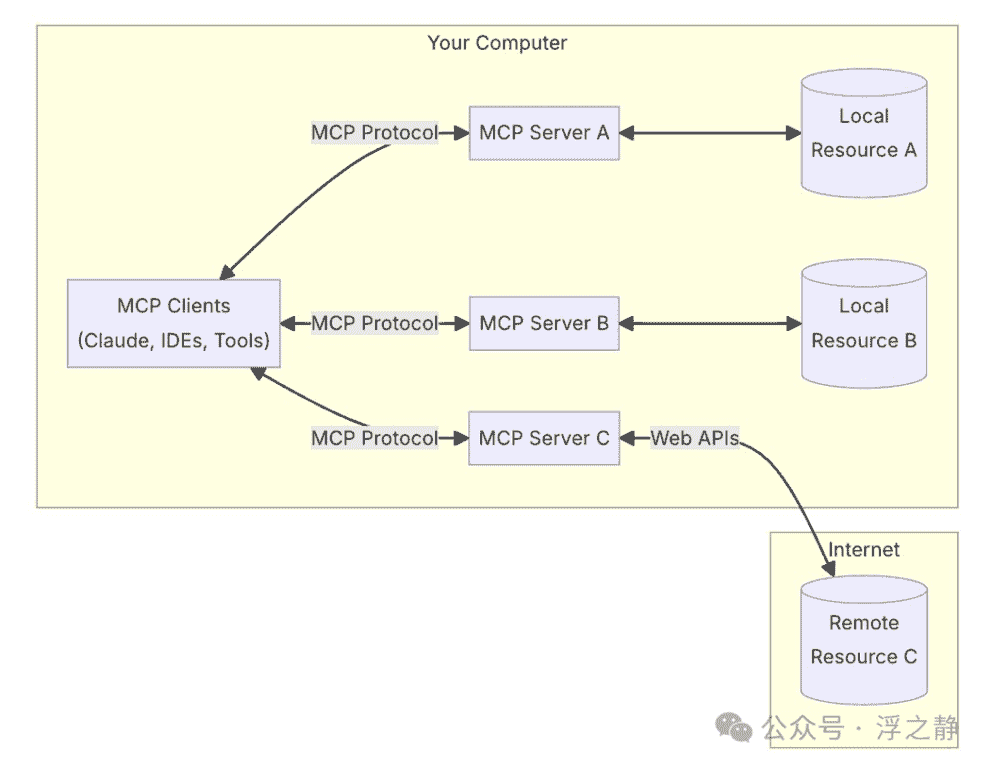

本文详细介绍了 Anthropic 推出的 MCP（Model Context Protocol）协议，该协议旨在解决大型语言模型（LLM）应用与数据源连接的难题。通过统一的客户端-服务器架构，MCP 支持本地和远程资源访问，推动 AI 集成的标准化发展。文章首先概述了 MCP 协议的核心概念和架构，包括协议层、传输层、消息类型和连接生命周期。随后，详细介绍了如何在 macOS 和 Windows 系统上配置和使用 MCP 协议，包括安装必要软件、创建测试数据库、配置 Claude 桌面应用等步骤。此外，文章还深入探讨了 MCP 协议中的资源管理、安全性措施以及 Prompts 的使用方法。最后，通过一个名为 `debug-error` 的工作流示例，展示了如何处理和分析用户遇到的错误信息。

## [Qwen2.5 更新百万超长上下文，推理速度 4.3 倍加速，网友：RAG 要过时了](https://www.bestblogs.dev/article/7dd3be)

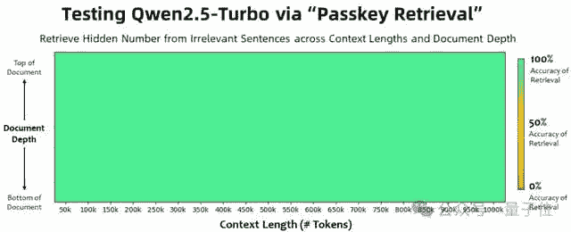

Qwen2.5 系列最新成员 Qwen2.5-Turbo 的发布，标志着国产大模型在处理超长上下文和提升推理速度方面取得了显著进展。Qwen2.5-Turbo 支持 1M token 的超长上下文，相当于 10 部长篇小说或 150 小时语音记录的量，能够在 45 秒内总结 69 万 token 的内容，并在“大海捞针”实验中 100%捕捉到细节。此外，通过稀疏注意力机制，Qwen2.5-Turbo 在处理百万上下文时，首字返回时间从 4.9 分钟降低到 68 秒，实现了 4.3 倍加速。在性价比方面，Qwen2.5-Turbo 以 0.3 元/1M tokens 的价格，提供了比 GPT-4o-mini 更高的处理能力。文章还展示了 Qwen2.5-Turbo 在代码库信息掌握、论文分类和摘要等实际应用中的表现，并在多个基准测试中超越了 GPT-4o-mini 和 GPT-4。尽管模型权重尚未开源，但已在 HuggingFace 和魔搭社区提供在线体验的 Demo，API 服务也已上线阿里云大模型服务平台。

## 推理性能直逼 o1，DeepSeek 再次出手，重点：即将开源

DeepSeek 最近发布了其全新的推理模型 DeepSeek-R1-Lite-Preview，该模型在多项权威评测中表现出色，特别是在美国数学竞赛（AMC）和全球顶级编程竞赛（codeforces）中，其性能超越了包括 OpenAI 的 o1 在内的多个顶尖模型。DeepSeek-R1-Lite-Preview 的成功秘诀在于其深度思考能力，通过强化学习和长思维链技术，模型能够在推理过程中展示详细的思路链，类似于人类大脑的深度思考过程。此外，模型还展示了在处理复杂问题时的优势，如破解行测题的逻辑陷阱和解决大学物理难题。尽管目前模型仅支持网页使用，并未完全开源，但 DeepSeek 已承诺未来将完全开源正式版 DeepSeek-R1 模型，并公开技术报告和部署 API 服务。这一消息引发了国内 AI 社区的广泛关注和期待。

## [Mistral 放大招：124B 多模态，Canvas、搜索、图片生成免费用](https://www.bestblogs.dev/article/c2f1be)

Mistral AI 近期发布了两项重大更新，分别是 1240 亿参数的多模态模型 Pixtral Large 和全新聊天助手 Le Chat。Pixtral Large 在多模态任务如 MathVista、DocVQA 和 VQAv2 上达到了 SOTA 水平，拥有 128K 上下文窗口长度，能够处理多达 30 张高分辨率图像或约 300 页书籍的输入。该模型在 Mistral 研究许可证下可用于研究和教育用途，并可在 Hugging Face 平台上免费下载。Le Chat 则是一个集成了网页搜索、图像生成、文档理解等功能的免费聊天助手，用户可以通过 Le Chat 进行网络搜索、使用 Canvas 进行创意构思、上传 PDF 进行分析和总结，甚至生成图像。Le Chat 的推出标志着 AI 技术在多模态应用和用户体验上的重大进步，特别是其免费提供的特性，使得更多人能够接触和使用先进的 AI 技术。

## [腾讯混元大模型核心论文曝光：Scaling law、MoE、合成数据以及更多](https://www.bestblogs.dev/article/8cb385)

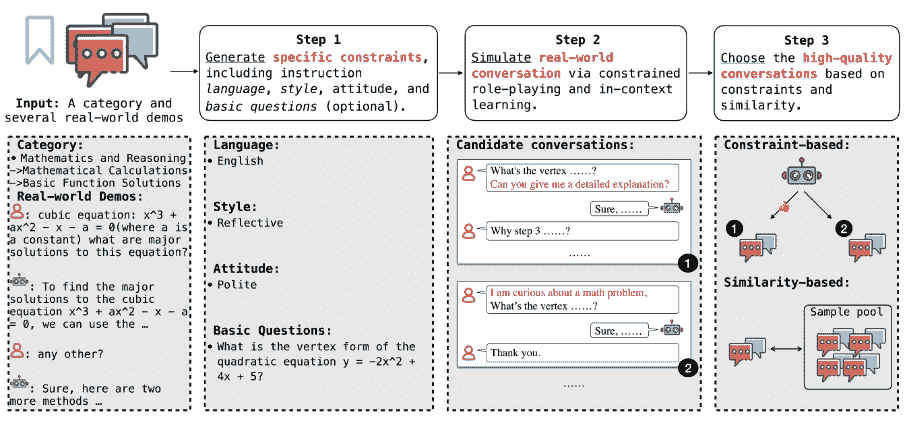

随着 ChatGPT 的广泛应用，大语言模型的能力在多个领域得到了验证，并深刻影响了腾讯混元团队的研发工作。腾讯混元团队长期致力于大模型的研究，通过创新性的研究成果和技术积累，提升了大模型的基础能力，并将这些能力与业务深度结合，推动生成式 AI 在业务中的应用。腾讯混元团队发布了业界最大参数规模的 MoE 开源模型腾讯混元 Large，该模型在高质量合成数据和先进的模型架构下表现优异，在广泛的基准测试中优于同类模型。此外，团队在多个前沿研究领域取得了重要进展，包括探索大模型批大小和最佳学习率之间的 scaling law、提出异构混合专家模型（HMoE）、构建细粒度且多样化的指令遵循评估数据集 DINGO，以及在大模型幻觉问题的数据集构建、检测和缓解上进行创新性研究。这些研究成果不仅为腾讯混元团队自身的大模型训练提供了理论基础和经验结论，也为整个大模型社区提供了宝贵的见解和指导。

## OpenAI 实时 API：缺失的手册

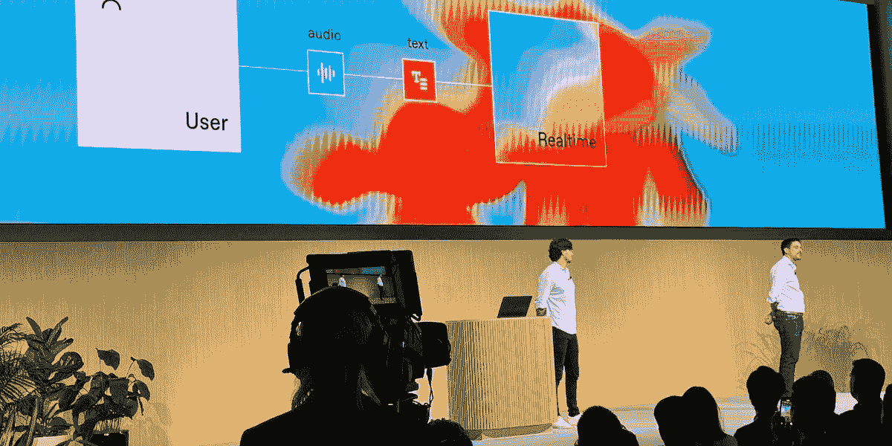

文章首先介绍了作者在 OpenAI DevDay Singapore 上的演讲，以及他们如何使用 OpenAI 实时 API 构建一个编码语音 AI 代理。作者分享了他们在使用原始实时 API（无框架，无外部依赖）时学到的一些技巧，特别是在准备 DevDay Singapore 演讲时。文章随后转向 Kwindla Kramer 的视角，他分享了从 GPT-4 到 GPT-4o 的演变，以及 OpenAI 实时 API 的最新进展。Kwindla 详细描述了 API 的架构、事件处理、音频处理和延迟优化，并提供了 Pipecat 框架的代码示例和使用建议。文章还讨论了语音活动检测（VAD）、短语端点检测和上下文管理等关键技术问题，并提供了实用的开发建议和代码示例。

## 从 Medprompt 到 OpenAI o1-预览版模型的优化

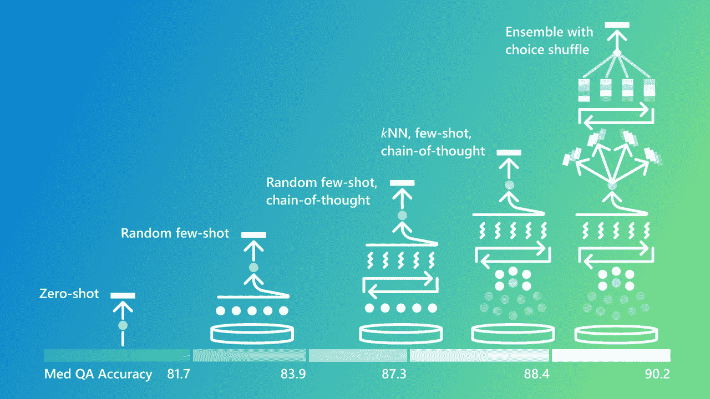

微软研究博客的文章探讨了从 Medprompt 方法到 OpenAI o1-预览版模型的进展，重点优化了基础模型以进行专业任务，特别是在医学领域。Medprompt 由微软开发，利用多阶段提示来增强 GPT-4 的性能，无需模型微调，在 MedQA 基准测试中实现了高准确性。然而，OpenAI o1-预览版模型在其基于强化学习的设计中直接集成了运行时策略，展示了卓越的性能，无需复杂的提示指导即可在同一基准测试中达到 96%的准确性。文章深入探讨了 GPT 模型与 o1 系列之间的差异，强调了后者的内置运行时推理能力，尽管每个令牌的成本大约是 GPT-4 的六倍，但显著优于 GPT-4 与 Medprompt 的结合。文章还讨论了各种提示策略，如定制提示、集成和少样本提示，以及它们在 o1-预览版模型中的有效性。此外，文章还考察了这些模型在多语言基准测试中的性能，包括日本医学执照考试 (JMLE)，并探讨了推理令牌对模型准确性的影响。文章最后强调了运行时策略、基准饱和以及从基准测试到临床应用的过渡的重要性，强调需要更具挑战性的基准测试和严格的临床试验，以有效评估 AI 模型在现实医疗环境中的应用。

## LazyGraphRAG 为 GraphRAG 质量和成本设定了新标准

文章介绍了 LazyGraphRAG（懒惰图增强检索增强生成），这是一种突破性的图增强检索增强生成（GraphRAG）方法，旨在解决传统向量 RAG 和全 GraphRAG 方法的局限性。与需要预先汇总和索引源数据的传统方法不同，LazyGraphRAG 将所有大型语言模型（Large Language Model, LLM）的使用推迟到查询时间，从而显著降低了初始成本并提高了可扩展性。该方法结合了最佳优先和广度优先搜索动态，以迭代加深的方式进行，允许高效查询处理和答案生成。关键性能指标突显了 LazyGraphRAG 在各种成本质量权衡中的优越性。例如，LazyGraphRAG 的数据索引成本与向量 RAG 相同，仅为全 GraphRAG 成本的 0.1%。此外，LazyGraphRAG 在本地查询上的表现优于所有竞争方法，查询成本与向量 RAG 相当，并且在全局查询上以超过 700 倍的较低查询成本实现了与 GraphRAG 全局搜索相当的答案质量。文章还展示了实验结果，证明了 LazyGraphRAG 在全面性、多样性和赋能等指标上的最先进性能。LazyGraphRAG 将作为微软开源 GraphRAG 库的一部分发布，为轻量级数据索引上的本地和全局查询提供统一的查询接口。这一发展有望使高质量、成本有效的 AI 驱动数据检索解决方案更加普及。

## [从零开始了解推荐系统全貌](https://www.bestblogs.dev/article/b7b15e)

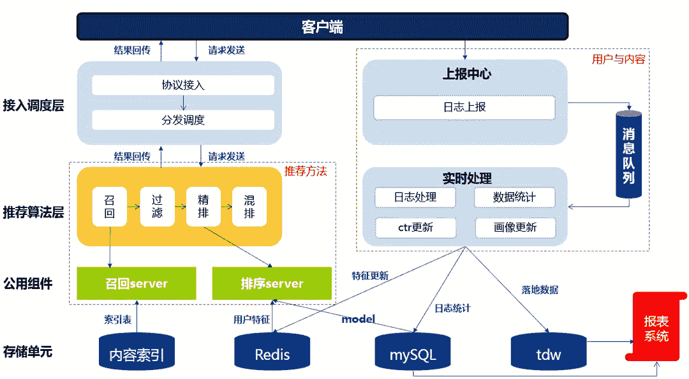

本文详细介绍了如何从零开始搭建推荐系统，涵盖了推荐算法、系统架构、用户画像和内容画像等多个方面。文章首先强调了数据、算法和架构在推荐系统中的关键作用，并介绍了推荐系统的主要步骤，包括召回、过滤、精排、混排和强规则。随后，文章深入探讨了召回策略、粗排策略和精排策略的具体方法和应用场景，并详细介绍了逻辑回归和深度学习模型的基本原理、构建流程及其优缺点。此外，文章还讨论了 embedding 技术在推荐系统中的应用，以及推荐系统面临的 EE 问题、多样性问题和上下文问题及其解决方案。最后，文章介绍了推荐系统的多种关键技术和应用，包括冷启动、因果推荐、序列推荐、图神经网络、知识图谱、强化学习、多模态内容推荐和对话系统，并讨论了算法的衡量标准。文章还探讨了推荐系统的实验方法及其对信息不平等、信息茧房的影响，以及推荐算法在视频号等平台中的应用和潜在影响。

## GitHub Copilot 能否提升代码质量？数据告诉你答案

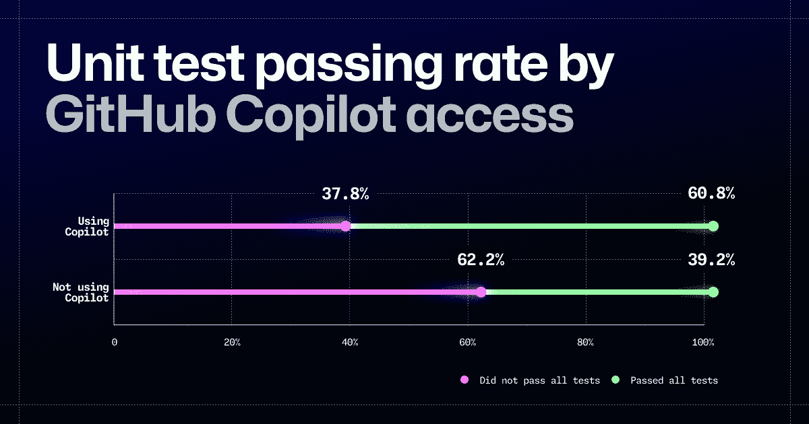

本文介绍了一项由 GitHub 研究团队进行的全面研究，探讨了 GitHub Copilot 对代码质量的影响。这项随机对照试验邀请了 202 名经验丰富的开发者参与，其中一半可以使用 GitHub Copilot，另一半则不能。参与者需要为一个 Web 服务器编写 API 端点，他们的代码将通过单元测试和专家评审进行评估。结果显示，使用 GitHub Copilot 编写的代码在功能性、可读性、可靠性、可维护性和审批率方面均有显著提升。具体而言，使用 GitHub Copilot 的开发者通过所有单元测试的概率提升了 56%，在不影响可读性的前提下编写了 13.6%更多的代码行，并且代码的可读性、可靠性、可维护性和简洁性分别提升了 1-4%。此外，使用 GitHub Copilot 编写的代码获得审批合并的概率也提升了 5%。研究结论指出，GitHub Copilot 能够帮助开发者编写更高质量的代码，因为它能让开发者将更多精力放在代码质量的优化上，而不是仅仅满足功能需求。这与之前的研究结果相符，即使用 GitHub Copilot 能够提升开发者的信心和生产力。

## [在 PostgreSQL 中结合语义搜索和全文搜索（使用 Cohere、pgvector 和 pgai）](https://www.bestblogs.dev/article/3f8966)

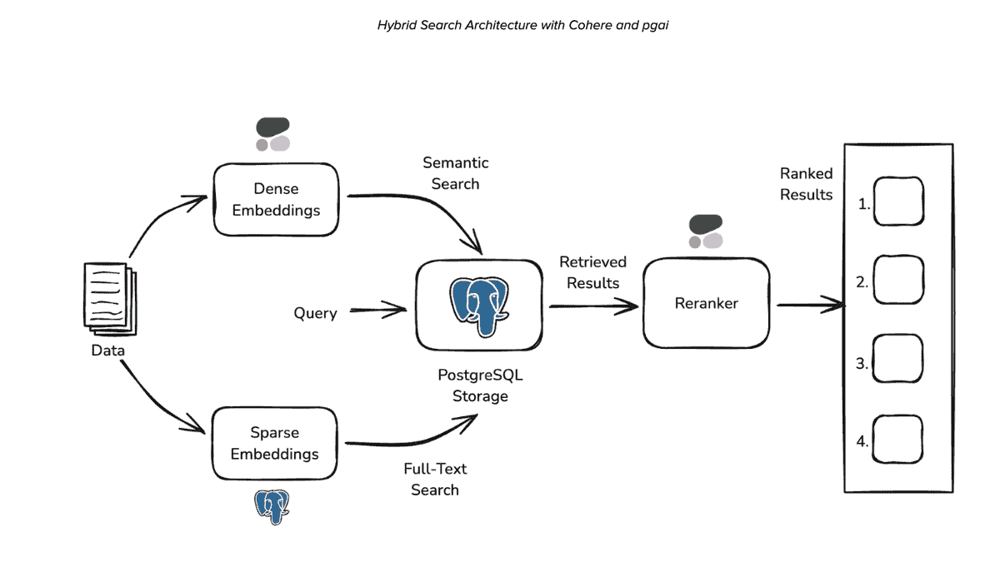

本文探讨了搜索技术的演变，从简单的关键词匹配到理解上下文和用户意图的更高级语义搜索算法。它强调了单纯依赖全文搜索的局限性，例如无法准确捕捉用户意图，导致结果不相关。为此，本文介绍了混合搜索的概念，它结合了全文搜索的精确性和语义搜索的上下文理解能力。文中详细介绍了如何在 PostgreSQL 中实现混合搜索：使用 Cohere 生成文本嵌入，pgvector 存储和查询向量嵌入，以及 pgai 集成 AI 能力。本文提供了一个逐步指南，涵盖环境设置、数据集下载、表格创建以及关键词和语义搜索的实现。最后，本文构建了一个混合搜索函数，它整合两种搜索方法的结果，并使用 Cohere 的重排序模型根据相关性重新排序结果。本文还讨论了混合搜索在电子商务、法律研究、科学文献综述和客户支持等多个领域的优势，并强调了平衡搜索方法、缓存和预处理，以及定期评估和调整以优化混合搜索系统的重要性。

## 后期分块的真正含义及其非含义：第二部分

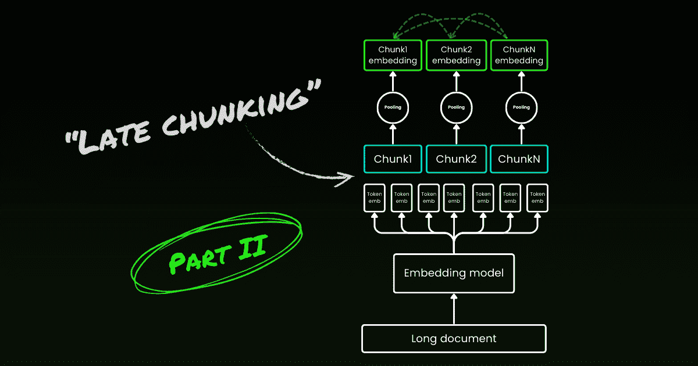

文章深入探讨了后期分块的概念，这是一种旨在提高密集向量检索系统中分块嵌入质量的方法。这些系统通常在处理较短的文本段时表现更好，以避免嵌入中的语义过度压缩。然而，传统的分块方法可能会丢失周围分块的上下文信息，导致表示效果不佳。后期分块通过首先使用长上下文嵌入模型嵌入整个长文本，然后在均值池化之前进行分块来解决这一问题。这保留了完整的上下文信息，从而在各种任务中实现了卓越的检索性能。该方法是通用的，无需额外训练即可工作，尽管微调可以进一步增强其有效性。文章还讨论了后期分块对不良边界提示的韧性及其双向性质，与 Anthropic 的上下文检索等其他方法形成对比。结论强调了后期分块的实用性和效率，主张在更复杂的解决方案中使用它。

## [RAG 没有银弹！四级难度，最新综述覆盖数据集、解决方案，教你「LLM+外部数据」的正确使用姿势](https://www.bestblogs.dev/article/4c58f5)

本文由新智元报道，主要讨论了检索增强生成（RAG）技术在处理不同难度级别用户查询时的应用和挑战。文章首先指出，由于大模型在参数量和知识更新方面的限制，许多真实场景下的任务需要连接外部数据源，RAG 技术因此逐渐受到关注。然而，接入外部数据并不意味着问题就能轻松解决，许多用户查询非常复杂，需要从检索相关数据、准确解释用户意图到充分利用大模型的推理能力进行多方面的优化。文章提出了一种 RAG 任务分类法，将用户查询分为四个级别：显式事实查询、隐式事实查询、可解释理由查询和隐含理由查询。每个级别都有其独特的难点和解决方案，需要不同的技术和方法来优化性能。此外，文章还讨论了将外部数据集成到大型语言模型（LLMs）中的三种主要方式：上下文、小模型和微调，并分析了各自的优势、局限性以及适合解决的问题类型。文章最后强调，RAG 技术没有银弹，必须根据具体任务的需求选择合适的技术和方法，才能获得最佳的性能表现。

## 万字干货！手把手教你如何训练超大规模集群下的大语言模型

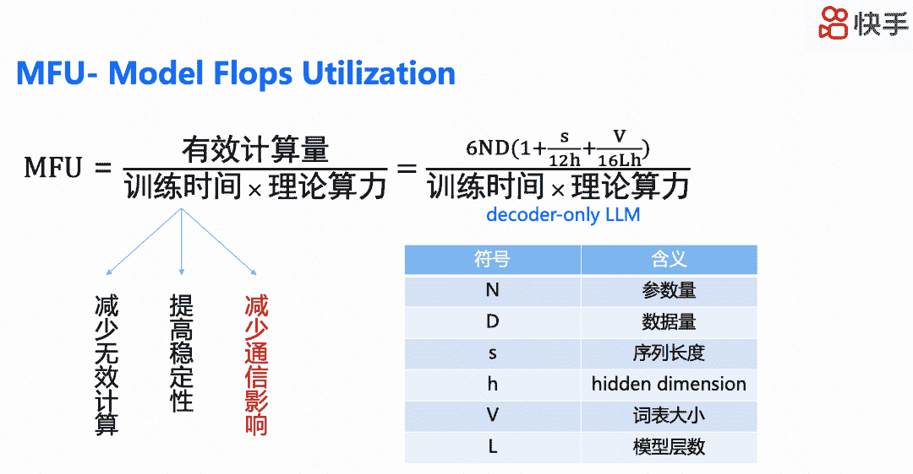

快手 AIP 团队在 USENIX ATC '24 上发表并开源了一套超大规模集群下大语言模型训练方案。该方案通过混合并行、通信优化和显存管理等技术，解决了大模型训练中的存储和计算效率问题。具体包括：通过混合并行分散模型状态和中间激活值，减少通信量；采用 DP overlap 和 TP overlap 方案优化通信开销；通过 all-gather overlap GEMM 和 reduce scatter 操作实现计算与通信的重叠；引入上下文并行（CP）技术解决 TP 的不可扩展性和通信量大问题；通过 GEMM last recomputing 和 pipeline aware offloading 策略提升训练效率和显存利用率。此外，团队还提出了激活值重建策略和并行配置优化方案，显著提升了模型浮点运算利用率（MFU）。未来研究方向包括万亿参数规模的 MoE 模型、扩大序列长度、RLHF 框架、低精度训练和异构算力的引入。

## 更新了！带 Agent 的 Cursor 太疯狂了

本文详细介绍了 AI 辅助编程工具 Cursor 的最新版本 0.43 的更新内容，特别是其核心功能 Composer Agent 的引入。Composer Agent 具备完整的项目理解和编辑能力，能够帮助开发者更高效地进行代码审查和项目管理。文章通过实际用户测试展示了 Composer Agent 在处理复杂项目时的强大功能，如解析整个文件、审查代码并提出改进建议等。此外，文章还提到了 Bug Finder 功能，尽管目前处于 Beta 阶段且存在一定风险，但其旨在帮助开发者尽早发现代码问题。除了 Cursor 的更新，文章还引用了 GitHub Copilot 的研究数据，展示了 AI 工具在提高开发者编码速度和代码质量方面的显著效果。总体而言，文章强调了 AI 辅助编程工具在现代软件开发中的重要性和潜力，预示着未来开发者工作方式的重大变革。

## 腾讯云 AI 代码助手：产品研发过程的思考和方法论

本文系统地阐述了腾讯云 AI 代码助手的产品布局、整体架构、研发体系和技术方法。文章首先回顾了 AI 代码助手的发展历程，从第一代的代码补全功能到第三代基于大模型的多维度代码补全，展示了技术的进步和应用场景的扩展。接着，文章详细介绍了腾讯云 AI 代码助手的产品整体架构，包括在 IDE 中的主屏写代码模式和侧屏 Chat 对话模式，以及在内部源代码托管平台中的代码评审场景。在产品研发体系和技术方法部分，文章详细描述了腾讯内部的双环驱动研发体系，强调了从用户需求出发，通过数据工程、模型训练、评测和部署的迭代过程，以及产品功能的同步迭代。文章还深入探讨了代码大模型的预训练和精调策略，包括高质量代码数据的研制方法、FIM 技术、代码数据配比、SFT 数据研制流程等。此外，文章还介绍了 Trigger、Prompt、Stop 和 Show 等核心策略和算法，确保代码补全的准确性和用户体验。总结部分，文章强调了腾讯在代码智能赛道上的系统化思考和技术方法，展望了未来在智能化时代的高效产品迭代和极致用户体验。

## 如何在不查看查询或结果的情况下改进搜索

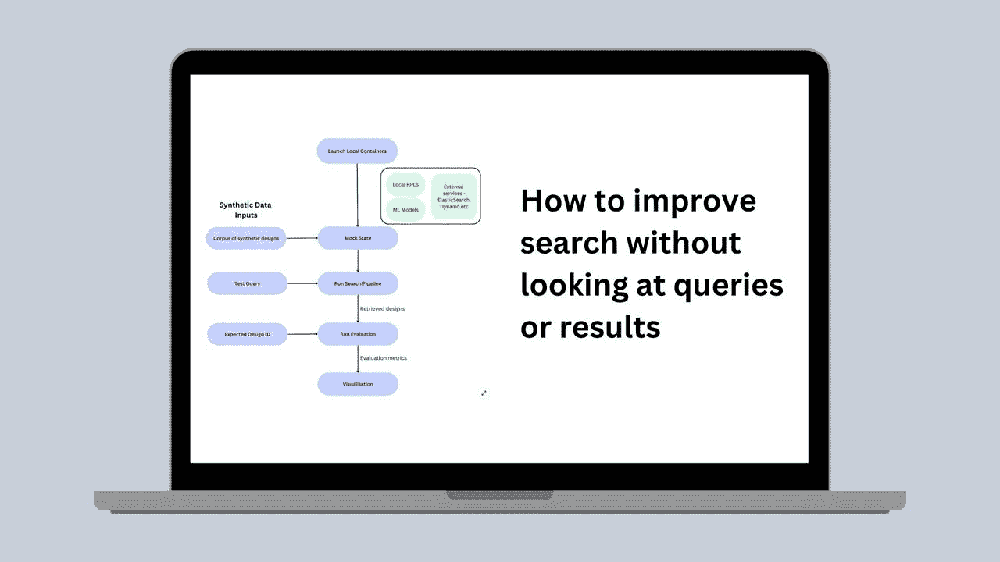

Canva 拥有 2 亿月活跃用户和超过 300 亿设计作品，面临着确保有效搜索功能的重大挑战。传统的评估方法使用抽样的用户查询和专家人工判断，由于隐私问题而不可行。Canva 的核心价值观 '做正确的事' 要求严格的隐私措施，使得使用真实用户数据变得不可能。为了解决这个问题，Canva 开发了一种新颖方法，使用生成式 AI 创建真实但合成的内容和查询。这种方法允许创建标记的评估数据集，而不会损害用户隐私。文章详细介绍了生成这些数据集的过程、用于评估的工具以及遇到的挑战。Canva 的搜索评估原始状态涉及有限的离线测试，随后进行在线实验，这有许多缺点。理想状态旨在实现自定义数据集和评估管道，允许可重复、快速和真实的结果，从而实现并行实验而不会阻塞其他工程师。合成数据集的创建过程涉及使用设计主题和类型对 `GPT-4` 进行种子处理，生成真实的标题和内容，并创建具有不同难度级别的查询。然后使用 `Testcontainers` 在本地评估搜索管道，确保结果反映生产行为。使用 `Streamlit` 构建的评估工具允许工程师可视化和比较结果，促进快速迭代和明智的决策。该系统的影响包括快速迭代、离线和在线结果之间的正相关性以及增强的本地调试能力。Canva 计划继续扩展其数据集，增加更多现实特征，并改进工具，使工程师能够高效地自行满足其特定的合成数据需求。

## [专访 Perplexity 增长负责人：最大 AI 搜索的增长尝试，哪些成了，哪些没成？](https://www.bestblogs.dev/article/07d24c)

Perplexity 作为 AI 搜索领域的代表产品，其增长负责人 Raman Malik 在专访中详细分享了公司在用户增长、留存、品牌营销和团队建设方面的策略和经验。他强调了 A/B 测试在增长中的重要性，但也指出其局限性，并讨论了如何通过大胆尝试和微优化来推动增长。Malik 还分享了 Perplexity 在用户增长和留存方面的策略，强调了口碑传播的重要性，并讨论了如何通过设定正确的指标和合作来提高用户留存率。此外，他还讨论了如何优化用户留存率，包括用户群优化、平台分布优化和消息传递优化，以及 CAC 和 LTV 的重要性。在品牌营销方面，Malik 分享了在 Lyft 和 TikTok 上的付费广告经验，强调了品牌营销的增量效应和社区渠道的重要性。最后，他讨论了团队建设和招聘的经验，强调了创始人和有创业经验的人在团队中的重要性，以及如何通过面试和笔试来评估候选人的能力和适应性。

## 8000 字竞品分析干货！超详细的 AI 对话类产品分析与思考

本文详细分析了五款热门 AI 对话产品（讯飞星火、文心一言、通义、Kimi、豆包）的页面布局、对话交互、功能设计及用户体验。文章首先介绍了各产品的页面布局和功能设计特色，如讯飞星火的上下结构布局和 Kimi 的联网搜索功能。接着，文章深入探讨了联网搜索和深度搜索功能，分析了各产品在这两方面的实现方式和用户体验差异。此外，文章还详细分析了语音录入、文本润色、输入框设计、加载状态展示、长文本内容生成、重新生成和停止生成功能等方面的设计差异。最后，文章总结了各产品的功能和设计亮点，如讯飞星火的“全新对话”按钮和“群聊”功能，通义千问的效率工具集等。通过这些分析，文章为开发者和技术人员提供了宝贵的竞品分析和设计思考。

## 硅谷一线增长专家分享：C 端 SaaS 产品增长的七大核心杠杆

本文由硅谷一线增长专家 Phil Carter 分享，详细探讨了 C 端 SaaS 产品增长的七大核心杠杆。文章首先强调了增长团队组建的重要性，建议根据商业模型和获客渠道定制团队，并优先考虑员工的求知欲和影响力。接着，文章讨论了增长策略的选择，指出应根据公司在 S 曲线上的位置进行调整，初创公司应专注于大规模的增长突破而非细节优化。此外，文章还分析了 C 端产品面临的获客成本上升和用户留存率低的问题，提出了通过硬件与订阅相结合的商业模式和产品创新来解决这些挑战。定价策略、Onboarding 流程和季节性折扣也是文章关注的重点，强调了个性化和有效引导的重要性。最后，文章以健身应用 Ladder 为例，展示了通过团队教练和 TikTok 营销实现显著增长的成功案例。

## [Menlo VC 报告：AI 最有价值的 4 个应用场景，AI 今年的支出是去年的 6 倍](https://www.bestblogs.dev/article/e15cbb)

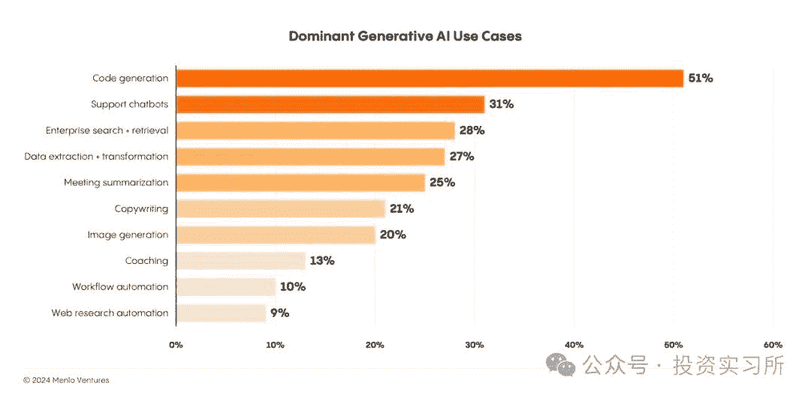

Menlo Ventures 发布的报告通过对 600 名企业 IT 决策者的调查，展示了 AI 应用的快速增长和多样化。报告指出，今年企业在 AI 的支出达到了 138 亿美金，是去年的 6 倍多，显示出企业从实验转向执行的趋势。生成式人工智能工具的采用率预计将大幅增加，尤其是在编程、客服、企业搜索和会议总结等领域。报告还强调了 AI 应用层的快速增长，2024 年企业向生成式人工智能应用投入 46 亿美元，比去年增长了近 8 倍。报告列出了四个最有价值的 AI 应用场景：AI 编程、AI 客服、企业搜索和检索以及数据提取和转换、AI 会议总结。此外，报告预测了 AI 代理和垂直应用的崛起，特别是在医疗保健、法律、金融服务和媒体与娱乐等领域。在技术堆栈方面，报告指出企业正在采用多模型战略，不再依赖单一供应商。RAG（检索增强生成）架构成为主流，而代理架构也开始崭露头角。报告还预测了 AI 人才的严重短缺，以及现有企业可能面临的颠覆。

## Runway 和 Luma 又开始对掐！一手实测全新功能，谁能胜出？

本文详细介绍了 Runway 和 Luma 在 AI 视频生成领域的最新动态和竞争态势。Runway 在三天内连续推出了视频扩展（Expand Video）功能和图像生成模型 Frames，展示了其在视频比例调整、视觉一致性保持以及风格控制方面的创新能力。特别是 Frames 模型，能够精确设计图像的外观、感觉和氛围，提供了多种风格的世界供用户选择。与此同时，Luma 也不甘示弱，推出了全新的 Dream Machine，不仅支持视频生成，还引入了视觉效果极佳的图像生成功能。Luma 的 Dream Machine 提供了直观的交互设计、参考重绘功能、一致性角色生成、视频创作工具和头脑风暴功能，极大地简化了用户的创作流程。文章还通过实际测试展示了 Luma 新功能的易用性和创作潜力，用户可以通过简单的提示词和参考图像生成高质量的视频和图像。总体而言，Runway 和 Luma 的这些新功能不仅提升了 AI 视频生成的技术水平，也为用户提供了更多创作可能性。

## [OpenAI 主推的 AI PDF 工具，套壳产品一年 50 万用户，团队只有 5 个人｜Z Talk](https://www.bestblogs.dev/article/5c92ab)

本文详细介绍了 OpenAI 主推的 AI PDF 工具，该工具由一个仅五人的团队开发，上线不到一年已获得 50 万用户，并在 GPT Store 完成 200 万次对话。尽管面临 ChatGPT 等强大竞争对手，AI PDF 通过专注于 PDF 处理的极致功能和用户需求，实现了快速增长和收支平衡。文章强调了该工具如何通过服务技术早期使用者，解决处理大量文档的实际问题，并不断调整产品以适应市场和技术的发展。此外，文章还讨论了初创公司与大公司在 AI 应用上的竞争优势，强调小团队通过创新和冒险精神，能够提供更灵活、个性化的 AI 体验，抓住大公司难以实现的机会。最后，文章探讨了 AI 技术如何提升个人和团队的生产力，以及 AI 在管理和任务分配中的应用，指出了 AI 在实际应用中仍需人为引导和管理的挑战。

## 黄仁勋最新万字对话：英伟达十年将计算边际成本降低 100 万倍

黄仁勋与沈向洋在香港科技大学的对话中，深入探讨了人工智能的变革性影响及其在多个领域的应用潜力。黄仁勋强调了人工智能在理解信息内涵、精准数据分析和创新应用方面的突破，指出计算能力的增长速度超越了摩尔定律的预测，未来 10 年计算需求可能增长 100 万倍。他还讨论了 AI 在科学研究中的应用，特别是生物学和医学领域，提出了创建数字孪生体的概念，并建议香港科技大学在建立医学院时结合技术和人工智能，走出一条独特的道路。此外，黄仁勋分享了他在领导英伟达过程中的学习、领导风格和团队管理经验，强调了持续学习、透明度和团队合作的重要性。最后，他探讨了 AI 计算能力的提升及其对能源消耗的影响，强调 AI 的应用目标在于推理而非训练，并探讨了 AI 在物理智能和机器人领域的应用前景，特别是大湾区在机电一体化和人工智能结合方面的独特优势。

## 走出元宇宙阴影、拥抱开源 AI 模型，Meta 实现“扎克伯格式复兴”

本文详细探讨了 Meta 公司通过开源其生成式 AI 模型 Llama 2，在 AI 领域实现的战略转型和创新。文章首先指出，Meta 决定开源 Llama 2 是为了在 AI 竞赛中追赶竞争对手，并推动行业创新。尽管面临盈利和法律风险，扎克伯格坚信开源能推动创新，并使 Meta 在生成式 AI 领域确立了领导地位。文章进一步分析了 Meta 通过开源 Llama 2 试图在 AI 领域树立新的行业标准，预示着 AI 领域的重大变革。扎克伯格认为开源 AI 将像 Linux 一样成为行业标准，打破专有操作系统的主导地位。Meta 在 AI 领域的探索始于 2013 年，通过开源策略在生成式 AI 领域取得了显著进展。此外，文章还讨论了 Meta 通过开源 Llama 2 模型，旨在打破 AI 垄断，加速创新并开辟新的盈利机会。尽管存在数据集不开放等限制，Llama 2 已成为生成式 AI 领域的重要平台，吸引了大量开发者贡献和改进。Meta 内部将 AI 研究团队 FAIR 与生成式 AI 产品团队整合，以加速 AI 技术在产品中的应用，并致力于开发通用人工智能（AGI）。最后，文章提到 Meta 的开源 AI 模型 Llama 面临严格审查和潜在风险，但扎克伯格坚信开源模型的风险小于封闭模型，并积极推动 AI 人才招募和公司转型。Meta 在 AI 领域的投资需要冒险精神，扎克伯格和 Spotify 联合创始人丹尼尔·埃克共同撰文支持开源开发，认为这是推动 AI 进步的最佳途径。

## 做出最好大模型的 CEO，不认为 Scaling Law 撞墙了

Anthropic CEO Dario Amodei 在访谈中深入探讨了大模型的现状和未来发展。他强调 Scaling Law 尚未见顶，认为合成数据和思维链思考是解决数据限制的有效方案。Amodei 指出，尽管模型能力持续进步，但未来 post-training 环节的成本可能会超过 pre-training。他还讨论了模型命名、编程能力提升及其对编程职业的影响，强调了 AI 在编程领域的快速进步和未来 IDE 的潜力。此外，Amodei 强调了模型在执行任务时的潜力和风险，提出了在模型能力增强时需要的安全措施和沙盒环境。最后，他讨论了模型训练中的 pre-training 和 post-training 的比重、RLHF 的效果及其对模型智能的影响，以及模型对提示词的敏感性问题。

## [专访可汗学院创始人：AI 教育赛道，中美之间最大的区别是什么？｜甲子光年](https://www.bestblogs.dev/article/a5a9d4)

本文通过专访可汗学院创始人萨尔曼·可汗，深入探讨了 AI 在教育领域的应用及其对教育方式的影响。文章首先介绍了 AI 教学助手 Khanmigo 的作用，强调 AI 不仅不会阻碍学生提问能力，反而能激发好奇心和自我探索。接着，文章讨论了 AI 在促进学生批判性思维和深入学习中的潜力，特别是在标准化考试和教育评估中的应用。萨尔曼·可汗进一步阐述了 AI 在教育中的辅助角色，指出 AI 应与人类教师合作，共同培养学生的独立学习能力和社交技能。他还强调了人类教师在情感支持和人际互动中的不可替代性，并展望了 AI 教育设备的未来发展。最后，文章探讨了 AI 对未来社会结构和人类工作方式的影响，指出 AI 的普及将减少重复性劳动，增加人类在创造性和社交活动中的投入。

## [郑永年教授：人工智能与人类的终极思考——如何避免成为会说话的羊？｜AI&Society 百人百问](https://www.bestblogs.dev/article/a41501)

郑永年教授在文章中详细讨论了人工智能对人类社会的多方面影响，特别是在教育、劳动价值、社会意义和人际交往等方面。他强调，学术界和教育界必须积极拥抱人工智能，否则将被时代淘汰。同时，人工智能不仅是工具，更是与人类互动并影响人类行为的存在。教育需要进行革命，以适应人工智能时代，同时保持人文教育的平衡。郑永年教授还指出，人工智能的发展可能导致人类思维的退化，需要进行教育革命以应对。此外，人工智能的普及可能导致大量就业替代，需要重新定义人类与 AI 的分工。他呼吁人类应思考在无需劳动的情况下如何找到生活的意义，避免完全依赖人工智能。最后，郑永年教授强调人文与科学两种文化的均衡发展对人类把握人文发展方向的重要性，并鼓励大众参与 AI 与社会的讨论，共同塑造未来。

## [我在 Character.ai 做 Post Training｜42 章经](https://www.bestblogs.dev/article/13a4d5)

本文由 Ted 分享了他在 Character.ai 进行 Post Training 的实践经验。文章首先介绍了 Character.ai 的核心优势，包括模型全自研、Noam Shazeer 带来的成本优势和用户偏好对齐。Ted 强调了 C.AI 在 AGI 领域的专注，导致其商业化探索较晚，但他对 AI 陪伴产品的未来持乐观态度。接着，文章详细描述了 Post Training 的工作流程和方法，包括 SFT、RLHF 和 DPO 三种主流方式，以及数据对齐和迭代路径设计的重要性。Ted 指出，Post Training 的目的是教会大模型正确回应人类问题，而数据对齐和高效的迭代路径设计是成功的关键。文章还讨论了模型微调过程中如何通过高频次测试和用户数据分析来优化模型表现，以及如何通过产品设计和模型搭配来减少语音延迟。Ted 强调了模型评估体系的建立和语音延迟问题的解决方案，包括预生成、光标动画和双模型搭配等技术手段。最后，文章探讨了硅谷对多模型混用的看法、模型未来发展、AI 公司的面试趋势、Post Training 的重要性、硅谷华人现状及 Ted 离开 C.AI 的原因。Ted 认为多模型混用是未来趋势，AI 公司面试更注重实战和解决问题的思路，Post Training 人才需求大。他还预告了一场由他主持的线上 AMA 活动，时间为 12 月 7 日，主要面向非投资人群体。

## [LWiAI 播客 #190 - AI](https://www.bestblogs.dev/article/e58a02) 扩展挑战，OpenAI 代理，超级权重

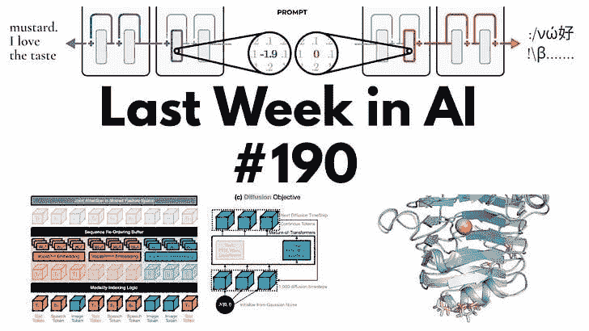

第 190 期 AI 上周回顾 (LWiAI) 播客提供了 AI 行业最新新闻和发展的全面概述。由安德烈·库伦科夫和杰里米·哈里斯主持，本期节目涵盖了从 OpenAI 和谷歌等主要 AI 公司在扩展其 AI 模型方面面临的挑战，到新 AI 工具的引入和 AI 硬件的进展等一系列广泛主题。关键讨论包括 OpenAI 构建更先进 AI 模型的挑战，即将发布的 OpenAI 代理工具，这些工具旨在为用户自动化任务，以及谷歌推出的双子座模型，该模型在聊天机器人领域和生成式 AI 进展方面挑战了 OpenAI 的领先地位。播客还涉及 AI 硬件的战略影响，包括 NVIDIA 和谷歌在新型芯片上的更新，这些芯片显著提升了 AI 训练性能，以及 DeepMind 开源 AlphaFold3，预计将彻底改变药物发现和分子生物学领域。在政策和安全方面，本期节目讨论了 AI 监管的复杂动态，包括 OpenAI 计划在美国提出 AI 战略和与中国竞争的联盟，以及关键安全研究人员离开 OpenAI 的情况。
