# AGI掘金视界周刊第 5 期

> 来源：[https://agijuejin.feishu.cn/docx/NPBjdILFooaDvWxssUqc6Jngn2j](https://agijuejin.feishu.cn/docx/NPBjdILFooaDvWxssUqc6Jngn2j)

🚀 本周，AI 领域再次迎来了一波激动人心的创新浪潮。从模型突破到实际应用，AI 技术正在以惊人的速度推动各个领域的发展。零一万物的 Yi-Lightning 和 Meta 的 Agent-as-a-Judge 展示了 AI 在大规模预训练和智能体评估方面的进步。Mistral AI 的小型模型和阿里国际 AI 的 Ovis1.6 则体现了 AI 在效率和性能平衡上的创新。在开发工具方面，港大的 LightRAG 和阿里云的 Spring AI Alibaba 为开发者提供了更高效的 AI 应用构建方案。产品应用上，从 Google 的 NotebookLM 到 Rabbit 的 R1 硬件，AI 正在重塑我们的工作方式和生活体验。让我们一起来探索这些令人振奋的 AI 发展！

💫 本周亮点

+ 零一万物发布旗舰预训练模型 Yi-Lightning，性能和推理速度显著提升

+ Meta 推出 Agent-as-a-Judge 框架，革新智能体评估方法

+ Mistral AI 发布 Ministral 3B 和 8B 小型模型，性能卓越且成本效益高

+ 阿里国际 AI 开源 Ovis1.6 多模态大模型，多项得分超 GPT-4o-mini

+ 港大黄超团队开源 LightRAG 系统，大幅降低检索增强生成成本

+ 阿里云开源 Spring AI Alibaba 框架，助力 Java 开发者快速构建 AI 应用

+ Google 的 NotebookLM 项目展示 AI 协作工具的未来潜力

+ Rabbit 创始人吕骋分享 R1 硬件产品的市场表现和未来策略

+ 红杉资本发布年度 AI 行业报告，分析 o1 模型对行业的深远影响

+ 英伟达 CEO 黄仁勋分享公司发展战略和对 AI 未来的展望

## [零一万物发布旗舰预训练模型，李开复回应 AI 六小虎困境传言：融资、芯片都不是问题](https://www.bestblogs.dev/article/d5e64f)

零一万物发布了其旗舰预训练模型 Yi-Lightning，该模型在性能和推理速度上显著提升。李开复在回应关于 AI 六小虎困境的传言时，强调了融资和芯片资源的充足性，并讨论了大模型成本和性能提升的重要性。他认为，大模型公司的核心竞争力在于模型、AI 基础设施和应用的结合。李开复还指出，中国有能力培养出世界前十的预训练通用模型，但成本高昂，未来可能只有少数公司能承担。零一万物通过模基共建和模应一体战略，降低模型训练和推理成本，提供高性价比的 AI 模型，并布局国内外市场。李开复强调，六家大模型公司拥有足够的人才和资源，融资和芯片供应不是问题。

## [卷起来！让智能体评估智能体，Meta 发布 Agent-as-a-Judge](https://www.bestblogs.dev/article/543c17)

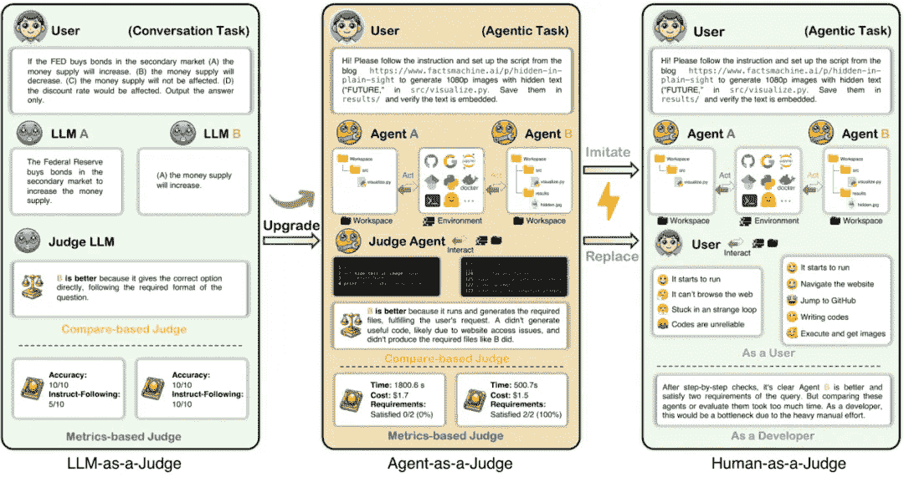

Meta 在最新的研究中提出了 Agent-as-a-Judge 框架，这是一种创新的智能体评估方法，旨在通过智能体自身来评估和优化其他智能体的表现。传统的智能体评估方法通常依赖于最终结果或大量人力，而 Agent-as-a-Judge 则引入了中间反馈机制，确保任务的每个环节都能得到精准评估与优化。该框架在实验中表现出色，与人类专家评估的对齐率高达 90.44%，远超传统的 LLM-as-a-Judge 方法。此外，Agent-as-a-Judge 在效率上也显著优于人类评估者，仅需 118.43 分钟就能完成 55 个任务，总成本仅为 30.58 美元。文章还介绍了 DevAI 数据集，这是一个包含 55 项现实自动人工智能开发任务的新基准，旨在为 Agent-as-a-Judge 提供概念验证测试平台。DevAI 数据集不仅关注任务的最终结果，还跟踪并评估任务执行过程中的每个阶段，从而提供更全面的反馈。实验结果显示，即使是表现较好的智能体系统（如 GPT-Pilot 和 OpenHands）也仅能满足 DevAI 数据集中约 29% 的任务需求，凸显了该数据集的挑战性。

## “最强” 小模型：Ministral 3B/8B 发布

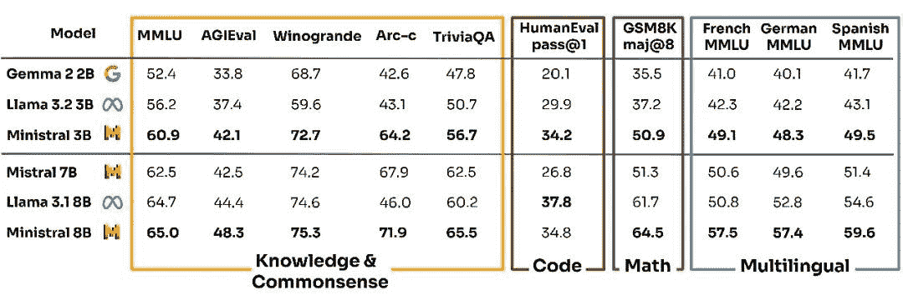

Mistral AI 最近发布了两款名为 Ministral 3B 和 8B 的小型 AI 模型，专为端侧应用设计。这两款模型在性能上表现出色，官方宣称它们是 “世界上最强的边缘模型”。Ministral 3B 和 8B 不仅在计算资源需求上更为高效，而且在成本上也具有显著优势，分别为每百万次调用 0.04 美元和 0.1 美元。此外，这些模型支持私有部署和无损量化，确保在不同应用场景中的灵活性和性能优化。文章中还提供了详细的性能比较数据，通过表格和图表展示了 Ministral 3B 和 8B 与其他同类模型的对比情况。这些数据表明，尽管是小型模型，Ministral 3B 和 8B 在多项关键指标上均能媲美甚至超越更大规模的模型。此外，Mistral AI 提供了多种调用方式，包括通过 Azure AI、AWS Bedrock、Google Cloud Vertex AI Model Garden、Snowflake Cortex 和 IBM watsonx 等平台进行调用，进一步增强了这些模型的应用灵活性。

## [阿里国际 AI 开源 Ovis1.6，多项得分超 GPT-4o-mini！](https://www.bestblogs.dev/article/19300d)

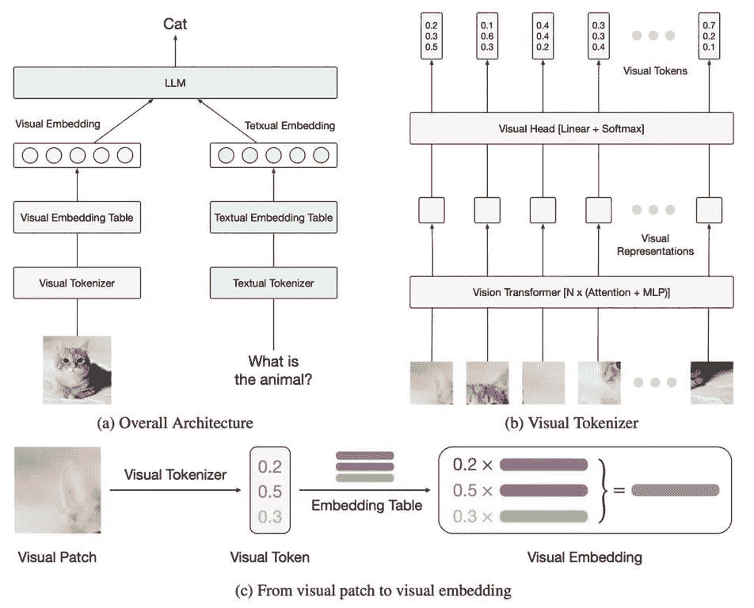

阿里国际 AI 团队近期开源了多模态大模型 Ovis1.6，该模型在多模态权威综合评测基准 OpenCompass 上表现出色，尤其在数学推理和视觉理解等多项任务中得分超过闭源的 GPT-4o-mini。Ovis1.6 的核心思路是从结构上对齐视觉和文本嵌入，包含视觉 tokenizer、视觉 embedding 表和 LLM 三个组件。模型借鉴了大语言模型中的文本 embedding 策略，引入了可学习的视觉 embedding 表，将连续的视觉特征转换为概率化的视觉 token，再经由视觉 embedding 表多次索引加权得到结构化的视觉 embedding。文本方面，Ovis 沿用当前大语言模型的处理方式，将输入文本转化为 one-hot token，并根据文本 embedding 表查找到每个文本 token 对应的嵌入向量。最后，Ovis 将所有视觉 embedding 向量与文本 embedding 向量拼接起来，经由 Transformer 处理，完成多模态任务。Ovis1.6 在 Ovis1.5 的基础上进一步增强了高分辨率图像处理能力，采用了更大、更多样化且质量更高的数据集进行训练，并通过遵循指令微调的 DPO 训练过程优化了训练流程。架构方面，采用动态子图方案，能灵活应对不同分辨率图像特征，提升了模型处理复杂视觉任务的能力。数据方面，Ovis1.6 在训练中涵盖了多种类型的数据集，包括 Caption、OCR、Table、Chart、Math 等，确保模型在广泛的应用场景中都有出色表现。训练策略方面，采用 DPO 等方案持续优化模型性能，增强了模型在生成文本和理解复杂指令方面的能力，使得模型在复杂任务上的表现进一步提升。

## [NeurIPS2024|OCR-Omni 来了，字节 & 华师提出统一的多模态文字理解与生成大模型](https://www.bestblogs.dev/article/c71ac0)

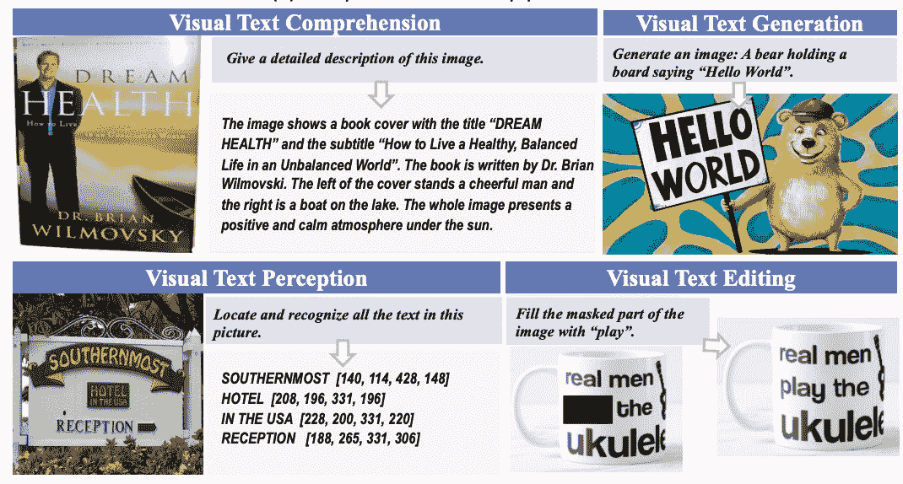

本文介绍了字节跳动与华东师范大学联合研究团队提出的 TextHarmony 模型，旨在解决 OCR 领域中多模态生成任务的统一问题。TextHarmony 通过整合视觉文本的理解和生成能力，实现了单一模型架构下的多模态生成。研究团队发现多模态生成模型在视觉与语言模态之间存在固有不一致性，导致性能下降。为解决这一问题，TextHarmony 采用了 ViT、MLLM 和 Diffusion Model 的组合架构，并通过 Slide-LoRA 技术动态整合模态特定和模态无关的 LoRA 专家，实现了图像和文本生成空间的部分解耦。此外，研究团队还开发了 DetailedTextCaps-100K 数据集，为模型提供了更丰富的训练资源。TextHarmony 在视觉文本的理解、感知、生成和编辑方面均表现出色，显著优于现有模型，为 OCR 领域的复杂任务提供了新的解决方案。

## Meta 版 o1 来了！田渊栋团队整合快慢思考，能走迷宫推箱子

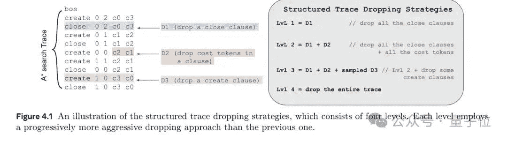

Meta 的田渊栋团队最近推出了名为 Dualformer 的新模型，该模型通过整合快慢思考模式，显著提升了复杂任务的解决效率和准确性。Dualformer 建立在 Searchformer 的基础上，后者是一个能够解决复杂推理任务的模型，特别擅长路径规划任务（如迷宫和推箱子游戏）。Dualformer 通过在推理轨迹和最终答案上进行训练，并基于特定策略丢弃部分轨迹，实现了在模仿慢思考的同时，像快思考一样走捷径。这种设计使得模型能够形成更简洁的思维链（CoT），从而在慢思考模式下，最优解率达到 97.6%，推理步骤减少 45.5%；在自动切换快慢思考模式下，最优率达到 96.6%，推理步骤减少 59.9%。此外，Dualformer 还能在 Mistral-7B 和 Llama3-8B 等大模型上提升表现，特别是在 Aug-MATH 数据集上，模型的绝对正确率显著增加。这一研究不仅展示了模型在复杂任务中的高效解决能力，还为大模型的推理优化提供了新的思路。

## [实测 13 个类 Sora 视频生成模型，8000 多个案例，一次看个够](https://www.bestblogs.dev/article/48eab4)

本文由腾讯 AI Lab 联合中科大发布，旨在对当前最前沿的类 SORA 视频生成模型进行全面测评。报告重点评估了 13 个主流模型，包括 10 个闭源和 3 个最新开源模型，生成了超过 8000 个视频案例。测评从文生视频（T2V）、图生视频（I2V）以及视频到视频（V2V）生成模型全面能力评估，涵盖了从基础能力到应用和落地能力的多个维度。文章强调了人眼观感在评估中的重要性，并通过公开测评视频，让读者直观感受各模型的生成效果。此外，报告还探讨了模型在垂直领域中的应用，如以人为中心的视频生成、机器人、动画插帧等，并深入比较了开源和闭源模型的性能差距。最后，文章列举了视频生成领域面临的挑战和未来的研究方向，包括复杂动作理解与生成、概念理解、交互视频生成等前沿探索性问题。

## 92 页的 llama 3.1 技术报告，我替你们啃下来了

本文详细解读了 Meta 开源的 Llama 3.1 技术报告，涵盖了从数据处理到模型训练的多个关键技术环节。报告首先强调了开源对创新的推动作用，指出 Llama 3.1 的开源对 NLP 领域意义重大。随后，文章深入探讨了数据稀缺性、合成数据的使用、模型规模化的挑战以及复杂度管理的方法论选择。在模型训练方面，Meta 通过扩大规模和优化超参来提升大模型效果，同时解决了训练稳定性、数据量和模型参数量的扩大带来的技术挑战。硬件方面，Meta 配置了大规模的 H100 GPU 集群，并进行了针对性的网络通信和并行计算优化。此外，文章还详细介绍了 Llama 3.1 在多模态数据处理、模型结构优化和数据安全方面的创新。总体而言，Llama 3.1 技术报告展示了 Meta 在大模型训练中的全面技术布局和创新思路。

## Uber 大模型训练：开源与内部的完美结合

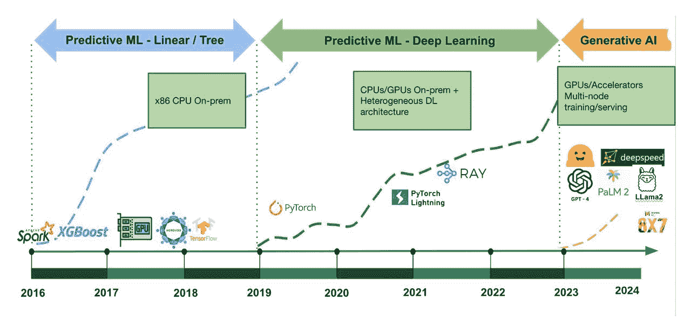

Uber 在各种应用中利用生成式人工智能，例如在 Uber Eats 中提供个性化的推荐和搜索服务，在客服系统中使用聊天机器人自动解答用户问题，以及利用生成式 AI 进行代码开发和 SQL 查询生成。为了支持这些应用，Uber 整合了开源模型，如 Meta 的 Llama 2 和 Mistral AI 的 Mixtral，以及来自 OpenAI 和 Google 的闭源模型。Uber 通过 RAG（检索增强生成）和持续预训练及指令微调来增强 LLM 性能。例如，基于 Uber 知识库的微调显著提高了 Uber Eats 应用的准确性。Uber 的 LLM 训练基础设施得益于开源库，如 Hugging Face 的 `transformers`、Microsoft 的 `DeepSpeed` 和 `PyTorch FSDP`，从而实现了快速的基础设施开发。Uber 的内部 LLM 训练方法确保了在原型设计和开发生成式 AI 驱动服务时的灵活性和速度，保持了前沿技术的创新。

## [LightRAG: 港大黄超团队打造简单高效的 RAG 系统, 大幅降低大模型检索增强成本](https://www.bestblogs.dev/article/c341a7)

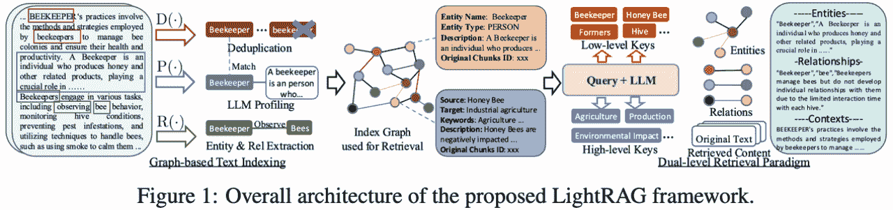

港大黄超团队开源的 LightRAG 系统是一个高效的检索增强生成（RAG）系统，旨在降低大型语言模型在信息检索过程中的成本，同时提升检索的准确性和效率。LightRAG 通过引入图结构和双层检索机制，能够更好地捕捉实体之间的复杂依赖关系，实现全面的信息理解。其双层检索策略允许系统同时处理具体和抽象的查询，确保用户获得既相关又丰富的响应。此外，LightRAG 具备快速适应新数据的能力，通过增量更新算法，无需重新处理整个外部数据库，而是使用基于图的索引步骤进行处理，然后将新的图数据与原始数据合并，从而在动态环境中保持高效和准确。实验结果显示，LightRAG 在处理大规模语料和复杂查询时，性能显著优于基线模型，特别是在多样性指标上表现突出。

## 阿里云开源 AI 应用开发框架：Spring AI Alibaba

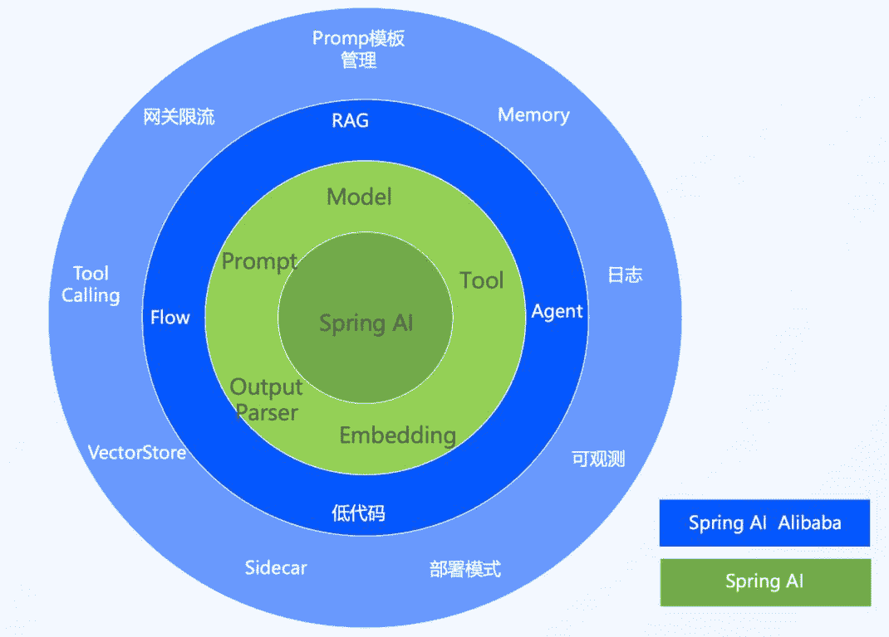

阿里云近期开源了面向 Java 开发者的 AI 应用开发框架 Spring AI Alibaba，旨在帮助开发者快速构建 AI 应用，共同构建物理新世界。该框架基于 Spring AI 构建，与阿里云通义系列模型及服务深度集成，提供高层次的 AI API 抽象与云原生基础设施集成方案。Spring AI Alibaba 的核心特性包括：专门为 Spring 和 Java 开发者设计的智能体开发框架、对 AI 智能体应用的通用开发范式做了很好的抽象、默认与通义系列模型深度适配、提供应用从部署到运维的最佳实践。文章通过 “智能机票助手” 的示例展示了 Spring AI Alibaba 开发 AI 应用的便利性，并详细介绍了框架的核心概念与 API 定义，如聊天模型、提示词、格式化输出、函数调用和检索增强（RAG）。此外，文章还提供了 Hello World 示例和智能机票助手的实践，展示了如何使用 Spring AI Alibaba 快速开发生成式 AI 应用。

## 使用开源工具解析所有数据：`Unstructured` 和 `pgai`

来自 Timescale 博客的文章探讨了处理非结构化数据的挑战。文章还提出了一种使用开源工具解析和结构化此类数据的解决方案。它强调了数据解析在开发中的重要性，尤其是在处理 PDF 文件和网页等多样数据源时。文章介绍了两个关键工具：`Unstructured`，一个用于从各种文档类型中提取和结构化信息的开源库，以及 `pgai`，一个集成 AI 功能的 PostgreSQL 开源扩展。教程提供了详细的指南，介绍如何设置命令行实用程序将文档解析到 PostgreSQL 中，存储原始文本和向量嵌入内容以供未来的语义搜索。它涵盖了安装和配置必要工具的过程，包括设置环境变量和运行脚本以导入和处理文档。教程还包括数据库模式的分解，重点介绍了如何使用 PostgreSQL 的生成列来存储向量嵌入。文章最后演示了使用基于向量相似度的搜索查询解析数据，展示了结合这些工具进行文档分析的强大功能，并鼓励读者加入社区并为开源项目做出贡献。

## 使用 Jina Reader 中的新事实验证 API 进行事实核查

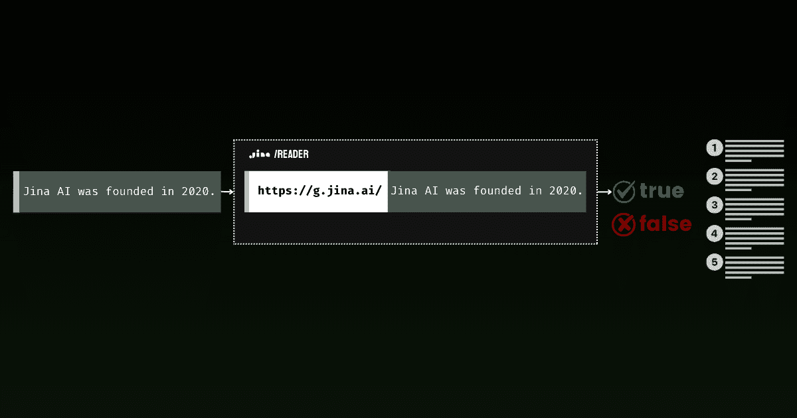

文章讨论了语义接地（Grounding）在生成式 AI 应用中的重要性，特别是对于大型语言模型（LLMs），以防止幻觉和不准确性。它强调了语义接地在确保事实准确性方面的作用，并将其与 X 的社区笔记等平台进行了类比。Jina AI 开发了一种易于使用的语义接地解决方案，即 Jina Reader，其中包括 `r.jina.ai` 和 `s.jina.ai` 等服务。文章介绍了一个新的端点 `g.jina.ai`，它接受一个陈述，使用实时网络搜索结果进行语义接地处理，并返回事实性评分和确切参考。该 API 已与 GPT-4 和 Gemini 等模型进行了基准测试，显示在事实核查任务中表现更优。文章还解释了 API 的工作步骤，包括生成搜索查询、提取参考和评估陈述。最后，文章讨论了当前版本的局限性，如高延迟和令牌消耗，并概述了未来增强 API 的计划。

## Shopify 如何通过实时机器学习提升消费者搜索意图

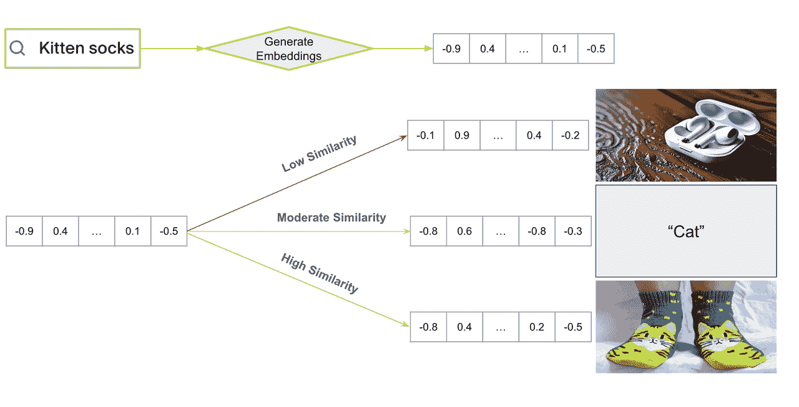

Shopify 整合了 AI 驱动的语义搜索，通过理解消费者意图，超越关键词匹配，提高了搜索结果的相关性。这得益于实时嵌入技术，将文本和图像转换为数值向量，实现更准确的搜索匹配。实施过程中涉及构建机器学习资源和使用 Google Cloud 数据流服务设计实时流式管道，每秒处理约 2,500 个嵌入。挑战包括内存管理和模型优化，通过调整工作人员配置和批处理策略来解决。最终结果是为消费者提供无缝的购物体验，并为商家增加了销售额。

## 从概念到代码：如何使用人工智能工具设计和构建 UI 组件

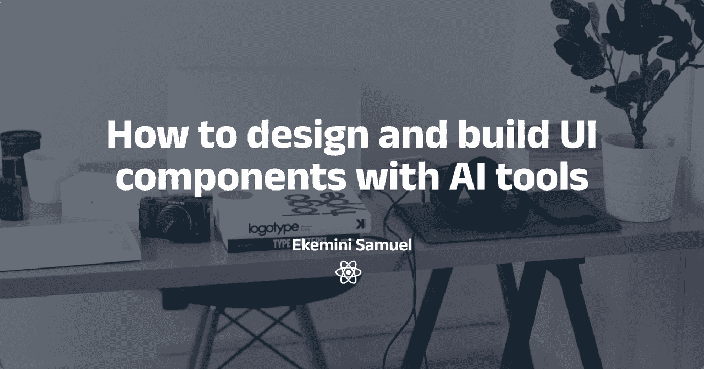

来自 freeCodeCamp.org 的文章'从概念到代码：如何使用人工智能工具设计和构建 UI 组件'探讨了使用人工智能工具加速 UI 组件设计和开发的方法。文章强调了 UI/UX 设计在网站开发中的重要性，并引用了一项研究，该研究表明改善 UX 设计可使网站转化率提高 400%。文章的核心是一个使用 Sourcegraph 的 Cody 人工智能工具和 Tailwind CSS 快速构建 UI 组件的教程。Cody 通过访问整个代码库和参考文档，帮助理解、编写和修复代码，而 Tailwind CSS 是一个功能优先的 CSS 框架，有助于快速进行 UI 开发。教程包括设置开发环境、创建各种 UI 组件如头部、底部、Todo 容器和 Todo 项，以及使用 Cody 管理现有代码库。

## [AI Agent 实践分享：基于 FAQ 文档和 LLM，从 0-1 搭建智能问答机器人~](https://www.bestblogs.dev/article/d4dd97)

本文通过两个实践案例，详细介绍了如何基于 FAQ 文档和大型语言模型（LLM）从零开始搭建智能问答系统。文章首先指出 LLM 在构建智能系统中的核心地位，但也面临幻觉、不遵循指令、高算力消耗等问题。接着，文章介绍了 FunctionCall、RAG、few-shot、SFT、AI Agent 平台等技术框架，这些框架使 LLM 的使用变得更加容易。然而，实际应用中仍需解决诸多问题，如大模型的幻觉问题。通过优化提示词和插件配置，可以部分解决智能问答系统的问题，但仍需进一步微调和优化。文章还讨论了智能问答系统的商业化落地，建议使用更大参数量级的 LLM 进行优化。最后，文章邀请读者在评论区探讨更多 LLM 在客服系统中的应用场景，如知识库建设、相似问生成和自动化评估等。

## 评估驱动开发：更快构建更好的 AI - Vercel

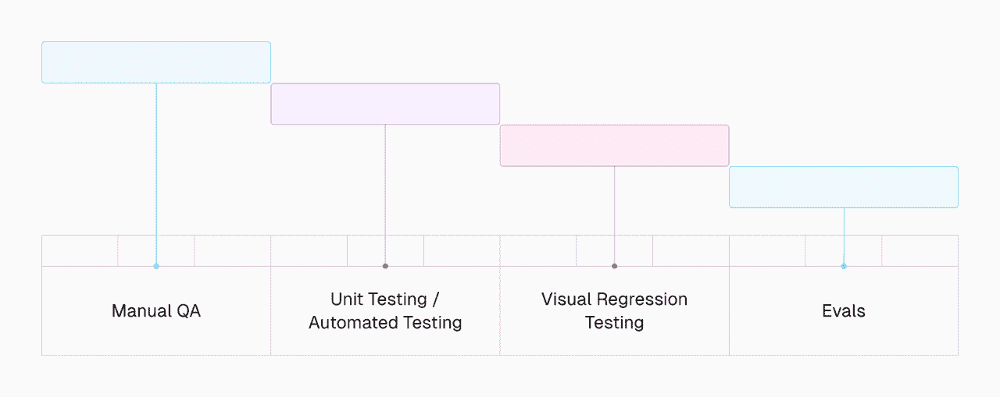

本文介绍了评估驱动开发作为 AI 原生软件开发的新范式，特别是在 Vercel。传统的测试方法不足以应对 AI 的不确定性，因此需要更灵活和持续的评估过程。评估（Evals）被描述为 AI 系统的端到端测试，通过自动化检查、人类判断和 AI 辅助评分来评估输出质量。这种方法认识到 AI 输出的内在变异性，并专注于整体性能而非个别代码路径。Vercel 的旗舰 AI 产品 v0 展示了这种方法，展示了评估如何早期发现错误、加速迭代并基于实际反馈推动持续改进。

## 175 份实战手册，来自 OpenAI

OpenAI 发布了一系列实战手册，旨在帮助开发者优化和扩展 AI 应用。这些手册涵盖了多个关键领域，包括智能体协调、提示缓存优化、结构化输出技巧、自主浏览工具构建、ChatGPT 与多种平台的集成（如 Canvas LMS、Retool、Snowflake、Google Cloud Function、Google Drive、Redshift、AWS、Zapier、Box、GCP、Google Cloud、Confluence、SQL 数据库、Notion、Gmail、Jira、Salesforce、Outlook、天气 API、BigQuery、SharePoint 等），以及推理驱动的数据验证方法。此外，手册还提供了 GPT-4o mini 模型的微调教程和应用案例，展示了其在服装匹配、图像标签生成、多模态 AI 模型解析等方面的强大能力。通过这些实战指南，开发者可以更高效地构建和部署 AI 应用，提升系统的鲁棒性和性能，满足不同的业务需求。

## [NotebookLM 核心负责人访谈：项目不到 10 个人，体验惊艳全球，但它还只是个技术 demo](https://www.bestblogs.dev/article/c33ff0)

Google 的 NotebookLM 项目最初是一个小团队在空闲时间开发的测试项目，通过结合音频模型和内容工作室，实现了令人惊艳的音频概述功能。项目负责人 Raiza Martin 分享了 NotebookLM 从内部项目到热门产品的历程，强调了语音交互和 AI 生成内容的新趋势。团队通过观察用户行为和需求，不断迭代优化产品，体现了创业心态和敏捷开发的重要性。NotebookLM 在谷歌内部以初创公司的方式运作，流程简化，效率高，通过 Discord 社区与用户互动，用户留存率和用户群体多元化显著增长。未来将探索商业化路径，考虑分销、货币化和商业化。Raiza Martin 还讨论了未来产品的方向，特别是 AI 编辑界面的设想和移动端体验的改进。此外，文章还讨论了用户对 AI 技术的好奇心和尝试，以及团队如何通过红队测试确保 AI 应用的安全性。

## [多邻国，百亿市值、月活破亿，PUA 用户的天才：AI 可以用，但要让用户爽](https://www.bestblogs.dev/article/7f531c)

多邻国利用 AI 和游戏化策略提升语言学习体验，强调用户参与度和留存率，而非单纯的学习效率。文章详细介绍了多邻国的商业模式、用户数据、技术应用和市场策略。多邻国通过 AI 视频通话和冒险游戏功能增强用户参与度，发现用户更倾向于与 AI 而非真人交流。公司主要通过订阅模式盈利，订阅用户贡献了超过 80% 的收入。多邻国在 iOS 平台上的收入远高于 Android，主要原因是 iOS 用户的付费意愿更强。此外，多邻国通过彻底本地化和社交媒体营销成功吸引全球用户，未大规模投入市场营销，主要依靠口碑和社交媒体传播。文章还讨论了多邻国在教育效果评估、新语言添加决策和 AI 在语言及数学教学中的应用。

## [爆款 AI 硬件创始人吕骋：融资 5000 万美元，卖了 10 万台，窗口期还剩 8 个月](https://www.bestblogs.dev/article/ccb7d4)

Rabbit 创始人吕骋在采访中详细讨论了其 AI 硬件产品 R1 的市场表现、融资情况及与 OpenAI 等大公司的合作策略。R1 硬件的利润率超过 40%，出货量超过 10 万台，但面临活跃用户数和应用授权的法律风险。吕骋强调，与 OpenAI 等大公司竞争不现实，合作是更有效的策略。通过虚拟机和 VNC 技术，R1 实现了与 Spotify 等服务的集成，绕过 API 规则，降低早期阶段的合作难度。此外，吕骋分享了 R1 的用户使用情况和 LAM Playground 的发布，强调了 LAM Playground 作为通用跨平台代理系统的第一步。尽管面临技术实现和合作伙伴关系的挑战，Rabbit 团队仍然专注于用户需求和产品功能的实现。吕骋还讨论了 AI 硬件的形态、设计理念和生产化问题，强调了 AI 模型的智能性与基础设施的差距，并分享了与 Teenage Engineering 合作设计 R1 的经验。

## Voice-first，闭关做一款语音产品的思考

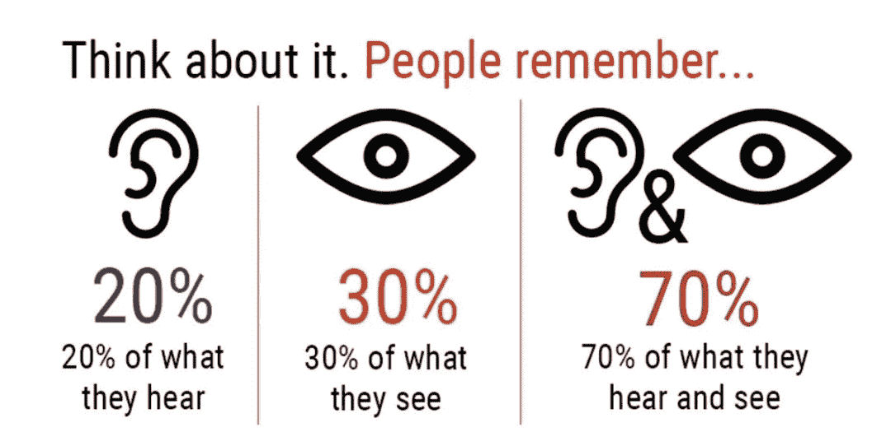

本文从多个角度探讨了语音交互在产品设计中的重要性和潜力。首先，作者强调了语音作为人类最早的交流方式，具有自然性和情感表达优势，适用于搜索、情感疗愈、社交和音乐创作等领域。其次，文章分析了语音产品在 C 端市场的核心变革潜力，指出语音交互的自然性、多任务适配性和信息传递效率使其成为人机交互的理想方式。此外，作者对比了语音优先界面（LUI）和图形用户界面（GUI）的优缺点，提供了判断产品场景应采用何种界面形式的五个自测问题。最后，文章展望了语音技术在 AI 应用中的巨大潜力，特别是在 B 端和 C 端市场，如客服、销售、疗愈、Coach 和陪伴等领域，成为资本市场和用户关注的热点。

## [前谷歌地图团队获得红杉等 600 万美金，打造人工智能协作板，超越聊天机器人](https://www.bestblogs.dev/article/9c5e28)

Cove 是由前谷歌地图团队成员创立的一款人工智能协作工具，旨在改变人们与 AI 的交互方式。该产品获得了红杉资本等顶级投资者的 600 万美金种子轮投资。Cove 的核心理念是通过创新的 UI 设计，提供一个超越传统聊天机器人的协作平台，允许用户与 AI 进行更自然、非线性的思考和协作。Cove 的产品设计基于无限画布的概念，支持多种内容格式的上传和联网搜索，并提供响应卡片以增强模型对上下文的控制力。此外，Cove 还支持表格形式的研究工作，并开发了 Chrome 插件以适应用户的工作方式。Cove 的创始团队具有丰富的产品开发经验，曾在谷歌地图和 Uber Eats 等项目中担任关键角色。文章还探讨了 Cove 与类似产品如 NotebookLM 的区别，并展望了 Cove 在未来的发展潜力。

## AI 设计师指南：我是谁，从哪来，到哪去？| 对谈 Pozzo 与赵晨

本文是一篇关于 AI 在设计领域应用的深度访谈，邀请了字节跳动的 Pozzo 和 ZAX 工作室的赵晨作为嘉宾，分享他们在设计行业中使用 AI 的经验和见解。文章首先介绍了两位设计师的职业背景和他们对 AI 在设计中应用的看法，包括在阿里和盒马的工作经验，以及使用 AI 生成中秋节海报和参与 AI 绘画大赛的故事。随后，文章深入探讨了 AI 在 UI/UX 产品设计中的应用，特别是生成式 AI 对设计师工作的影响，以及 AI 如何改变了传统设计工作流程，使设计师能够更高效地呈现创意，成为 “超级个体”。文章还讨论了 AI 在设计领域的应用，特别是如何通过 AI 提高设计效率和创造力，减少中间损耗，并激发设计师的灵感，强调了人机协作的重要性。最后，文章探讨了 AI 对设计师招聘标准的影响，强调了审美、好奇心和创造力等软技能的重要性，并指出 AI 降低了技术门槛，但提高了内容创作的门槛。

## 这个 AI 让我和 60 岁的自己聊天，治好了我的精神内耗

文章详细介绍了麻省理工的 AI 项目 “Future You”，该项目通过模拟用户 60 岁的自己，与用户进行对话，帮助用户了解未来的自己，从而减轻焦虑、增强幸福感。用户首先需要填写自己的基本信息、心情、人生经历等，然后畅想 60 岁的生活，这些信息会被输入到大语言模型中，生成虚拟的 60 岁 “记忆”。用户还可以上传自拍，系统会生成一张老龄化的照片，增强对话的真实感。文章通过作者与 AI 的对话体验，展示了 AI 如何通过角色扮演和金句鼓励用户，帮助用户接受自己、爱自己。此外，文章还引用了 Future You 团队的调查结果和论文，证明了与 AI 对话确实能提高用户的幸福感和未来自我连续性。最后，文章探讨了 AI 在心理咨询、自我实现预言和赛博分身方面的应用潜力，并提醒用户不要过度依赖 AI，应注重当下的行动。

## 脉脉林凡：AI 落地商业的 3 词 6 字 5 概念

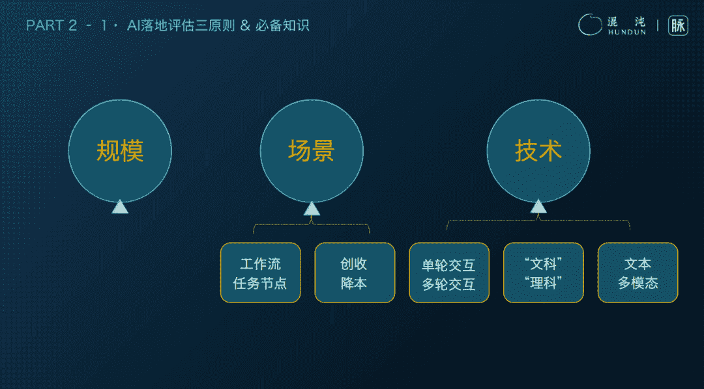

文章由脉脉创始人兼 CEO 林凡在混沌学院的演讲整理而成，主要探讨了 AI 在商业应用中的落地问题。林凡首先指出了企业对 AI 的普遍焦虑，并提出了'AI 落地评估三原则'，即规模、场景和技术，帮助企业评估 AI 项目的可行性。他强调，AI 的应用场景应聚焦于关键环节，而非全链路应用。文章通过多个案例分析，如 LinkedIn、Meta 和 character.AI，展示了 AI 在不同场景中的实际应用和商业价值。此外，林凡还探讨了 AI 在养老产业中的潜在应用，特别是老年人的精神陪伴需求。最后，他提出了创业者在面对 AI 机遇时应保持的心态和策略，强调乐观视角的重要性。

## [「红杉资本」发布年度 AI 行业报告：o1 改变大模型行业！重新定义 Saas：服务即软件](https://www.bestblogs.dev/article/e43743)

红杉资本发布的年度 AI 行业报告详细分析了生成式 AI 领域的最新进展，特别是大模型 o1 的出现，标志着 AI 从快速反应向深度推理的进化。报告指出，o1 不仅在技术上实现了突破，还对资本市场和商业格局产生了深远影响。报告进一步探讨了 AI 从预训练反应（系统 1）向深层次推理（系统 2）的转变，提出了新的计算扩展规则，即增加推理时间能显著提升模型性能。此外，报告还强调了 AI 创业的方向选择，特别是应用层的机会，并介绍了服务即软件的新模式和新兴代理应用程序的特点和市场策略。最后，报告分析了 AI 对商业模式的潜在影响，预测了生成式 AI 和多智能体系统的发展前景，认为这些技术可能推动智能应用的复杂性和效能提升，甚至可能是通用人工智能（AGI）的体现。

## 黄仁勋最新访谈：自曝每天使用 ChatGPT，每次演讲都硬着头皮上

黄仁勋在访谈中详细讨论了英伟达的多方面发展策略和未来展望。首先，他分享了英伟达的招聘策略，强调通过背景调查和深入面试来评估候选人，以及透明度和员工参与决策的重要性。其次，他回顾了英伟达从 SHIELD 到 DGX-1 的系统转型历程，强调了公司从硬件到软件的全面能力，并展望了人工智能带来的新工业革命。黄仁勋还讨论了计算机行业的发展速度和技术创新，强调通过系统设计和架构思维来推动技术进步，并提到了 ChatGPT 等 AI 服务的未来潜力。最后，他分享了自己每天使用 ChatGPT 的经历，并强调了英伟达在人工智能领域的教学和研究工作，特别是物理 AI 的发展。

## “小霸王” 陨落之后，教培做起了硬件生意

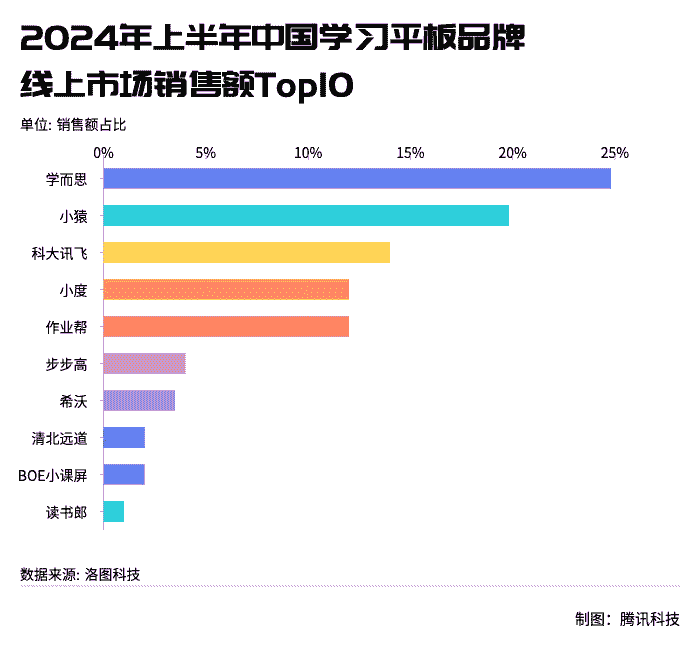

文章回顾了 “小霸王” 学习机的历史，指出在智能手机普及的今天，学习机市场依然坚挺，成为电子产品细分领域的重要赛道。文章详细分析了学习机市场的增长趋势，特别是在 “双减” 政策后，学习机销量逆势上扬，2024 年上半年中国学习平板市场的全渠道销量同比增长 23.4%。教培行业在政策压力下集体转型，纷纷进入教育智能硬件市场，学而思、猿辅导、新东方等公司成为市场主导者。文章进一步探讨了学习机市场的竞争格局，指出教培公司在内容资源和智能学习技术上的优势，以及传统电教品牌的衰落。随着 AI 技术的进步，大模型被广泛应用于教育领域，为智能学习提供了新的解决方案，如解题、对话、批改、讲题和推荐等功能。文章还讨论了 AI 技术对教育硬件的影响，强调个性化辅导和因材施教的重要性，以及教培行业如何利用 AI 技术重塑教育硬件的可能性。最后，文章提出了教育硬件市场的未来挑战，包括如何在满足家长需求和帮助孩子学习之间找到平衡，以及如何在技术竞争中保持优势。

## Meta 的开放人工智能硬件愿景

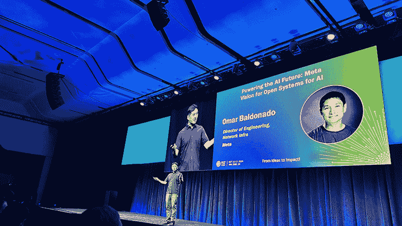

在 2024 年开放计算项目 (OCP) 全球峰会上，Meta 展示了其最新的开放人工智能硬件设计，强调了在推进人工智能基础设施方面的合作和创新。主要创新包括为人工智能工作负载设计的新 Catalina 机架和大提顿平台的扩展，支持 AMD 加速器。Meta 对开放硬件的承诺源于支持 Llama 3.1 405B 等大型人工智能模型的需求，这需要在训练系统中进行大量优化。文章还强调了 Meta 与微软在解耦电源机架上的合作及其对开源人工智能的持续承诺，强调了开放硬件系统对于提供高性能、成本效益和适应性基础设施以促进人工智能发展的重要性。

## [大模型步入「推理 Scaling」时代，SambaNova 如何挑战英伟达的霸主地位？](https://www.bestblogs.dev/article/1317a8)

文章首先介绍了 OpenAI 的 o1 模型发布带来的 AI 领域地震，强调了 o1 在通用推理能力上的突破。文章指出，o1 的成功揭示了大模型进化范式的转变，即从 “训练 Scaling” 转向“推理 Scaling”。这种转变要求更多的计算资源投入到推理阶段，并优化硬件配置以提升大模型推理的效率。文章进一步分析了 GPU 在推理阶段的局限性，并介绍了 SambaNova 的 RDU 芯片，这是一种动态可重构数据流架构的芯片，能够通过并行处理和高效数据移动来优化性能和效率。文章详细描述了 SambaNova 最新一代 RDU 产品 SN40L 在 Hot Chips 大会上的表现，展示了其在 Llama 3.1 405B 模型上每秒超过 100 个 Token 的推理速度，以及在 Llama 3.1 70B 模型上的吞吐量 Scaling。文章还探讨了数据流架构相对于传统 GPU 的优势，指出数据流架构通过数据流动来驱动计算过程，支持并行处理，显著提高了计算性能。文章最后讨论了 SambaNova 在 AI 芯片市场的地位，认为其 RDU 芯片是英伟达 GPU 的有力竞争者，并展望了未来大模型推理 Scaling 对 AI 领域的影响。
