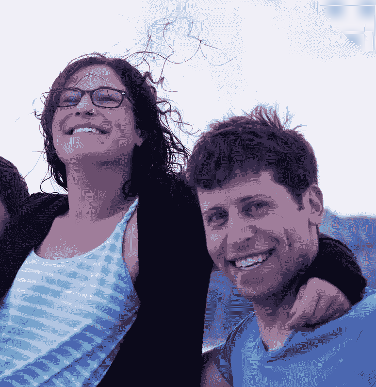
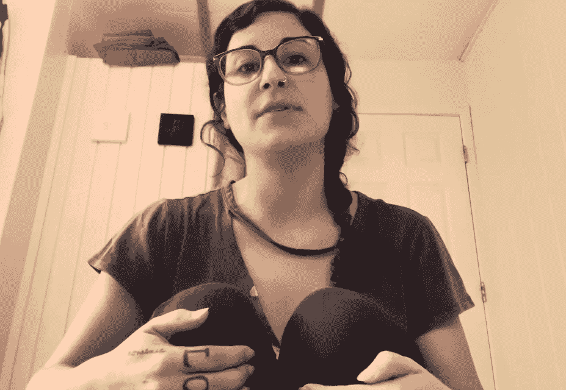
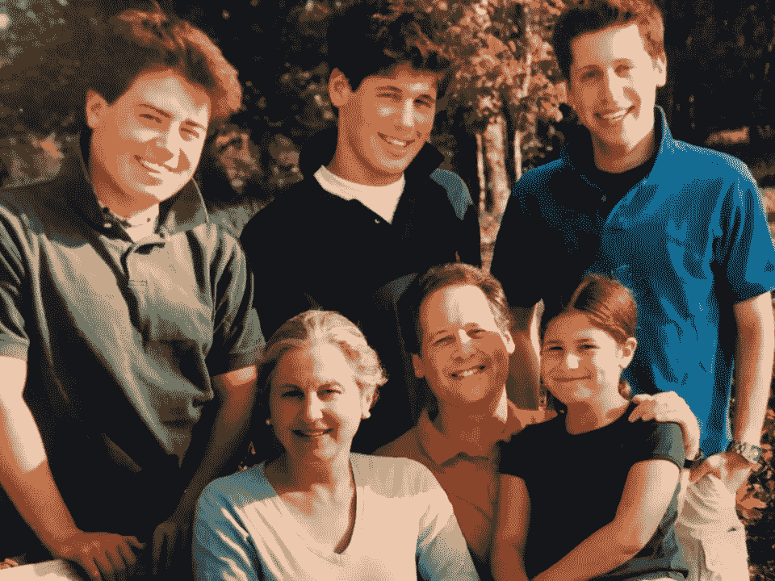
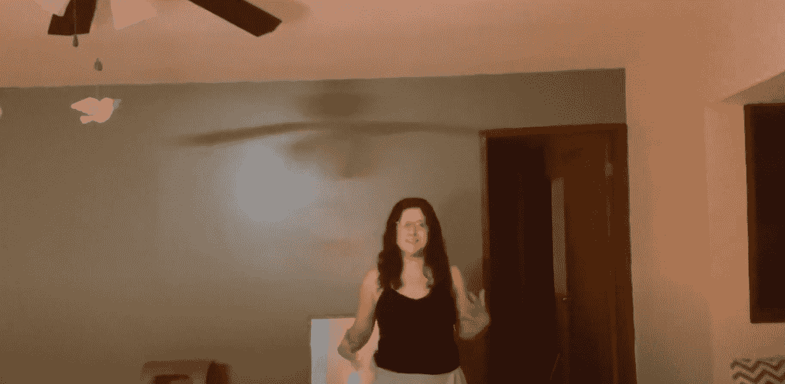

# 山姆·奥特曼传（四）：安妮的心结

> 来源：[https://agijuejin.feishu.cn/docx/LPcQdBTjyofeQLxRTW7cxsCYnNg](https://agijuejin.feishu.cn/docx/LPcQdBTjyofeQLxRTW7cxsCYnNg)

<https://agijuejin.feishu.cn/sync/D0V0dgafbsOgfvbvWL1cm9rmndd>

[AMELIE.MP3](https://internal-api-drive-stream.feishu.cn/space/api/box/stream/download/all/AoQZbK32fojrwCxorY6conLEn0b)

这一章，我用了《天使爱美丽》的主题曲作为开场，因为我们要先来讲讲那个美丽又脆弱的女人——安妮·奥特曼

2024 年 6 月，一场夏威夷兜风之旅正在展开。艾伦・休特与安妮・奥特曼深入北岸的丛林，探索着这片神秘的土地。她们的旅程带领她们经过了壮观的双瀑布，眼前的景象令人叹为观止。

艾伦小心翼翼地操控着车辆，穿梭在毛伊岛茂密的绿色森林中。安妮・奥特曼，山姆・奥特曼的小妹妹，安静地坐在副驾驶座上，但眼中时常闪烁着兴奋的光芒。若不是艾伦熟悉这条路，她们很可能就错过了这段奇妙的旅程。

她们沿着一条鲜为人知的小路前行，参观着安妮在过去几年中曾经居住过的不同地方。艾伦驾驶着车子缓缓驶过泥土路，寻找着隐藏在巨大热带植物后面的小屋和房子。沿途的景色令人心旷神怡，仿佛在热带雨林中跳舞。

突然，一片巨大的龟背竹映入眼帘，让她们惊叹不已。"哦，天哪，看那个！" 安妮不禁惊呼道。这片热带植物的壮观景象，为她们的夏威夷之旅增添了一抹难忘的色彩。

在过去的两年里，安妮大部分时间都难以负担一个稳定的居所。她指着刚刚经过的地方说道："这是我在无家可归期间长期停留的地方之一。在这片地产的最远端，有一栋新建的房子，没有自来水和电，我在那里住了两个月。" 她回忆道，"那时候，我无处可去，也没有租金，当然更没有押金，勉强只够支付一些临时住处的费用。"

最近一年里，安妮的生活更是动荡不安。令人难以置信的是，她在短短 12 个月内搬家了 22 次，平均每月搬家两次。有时她在一个地方只住一周，甚至只有一两晚。她曾住过一些非法出租的房间，有些甚至没有基本的自来水设施。安妮回忆说，她曾多次不得不睡在朋友家的地板上。在别无选择的情况下，她甚至冒险与陌生人同住。

安妮指着路边的一栋房子，继续讲述她的经历："住在前面那栋房子里的人在 Instagram 上给我发消息。我在他孩子不在的那周住在他们的房间里，然后在孩子们回来的那周睡在公共区域的地板上。我当时很绝望，无处可去。" 她又指向远处一个斜顶的小屋，"我在那个小屋里住了三个月。"

此时，艾伦好奇地问道："你住过多少个没有自来水的地方？"

安妮思考了一下，回答说："大概 5 个左右，5 或 6 个吧。"

这是山姆的妹妹安妮的故事，一个生活在贫困边缘的年轻女性。安妮坦言，她时常面临无家可归的困境，甚至不得不依靠性工作来维持生计。与此同时，她的哥哥山姆正在描绘一个美好的未来蓝图，在山姆的口中，他所提倡的"全民基本收入"将成为每个需要帮助的人的保护伞。

然而，当这个看似美好的理论与安妮混乱的日常现实相对比时，这个承诺开始显得有些空洞。在过去几年里，住房不安全一直是困扰安妮生活的主要问题。

安妮回忆起她的经历时，语气中充满了无奈和疲惫。她解释道，根据她的亲身体验，当一个人面临住房不安全的问题时，不仅很难完成任何事情，甚至可以说是不可能的。

在过去的四年里，安妮从未有过一个可以称之为 "温暖" 的日子。住房不安全的问题消耗了她大量的精力，无论是身体上的还是情感上的。她不得不将大部分时间和精力用于寻找住处、维持生计或寻找工作机会。尤其是在过去的一年里，这个问题一直是她生活中最大的精力消耗源。她的话语中透露出深深的无力感，也反映出住房不安全问题对一个人日常生活和长期发展的巨大影响。

尽管生活中面临诸多挑战，安妮在人际交往中依然保持着乐观开朗的态度。她对毛伊岛的健康食品店了如指掌，总能给人提供很好的建议。细心的人可能会注意到，她的指关节上纹着 "爱" 这个词，仿佛是对生活的一种宣言。

安妮的创造力在她的个人项目中得到了充分的展现。她制作了一档名为 "Annie Altman Show" 的播客。在节目的开场白中，她总是热情地说："你好，欢迎来到 Annie Altman Show，所有人都是自由的。"

除了播客，安妮还在 YouTube 上发布她唱歌的视频。通过这些创作，她不仅展示了自己的才华，也找到了表达自我和与外界沟通的方式。这些活动似乎成为了她在动荡生活中的一个稳定支点，让她能够在艺术创作中找到慰藉和力量。

为了更全面地理解安妮的故事，有必要回溯到她的童年时期。在早先讲述山姆的童年经历时，安妮曾简短提及山姆在家庭中的专横态度。她回忆道，山姆曾独断专行地决定家里不会有圣诞树，甚至在父亲葬礼上擅自规定每个兄弟姐妹可以发言的时间长短。

奥特曼家中有四个孩子，三个男孩和一个女孩。山姆是长子，其次是麦克斯和杰克，安妮则是最小的孩子，比山姆小九岁，也是家中唯一的女孩。她的哥哥们都热衷于科学、数学、游戏和所谓的 "书呆子" 兴趣，而安妮则一直是家中富有艺术天分和敏感的那个。即使在童年时期，她有时也感到自己与兄弟们格格不入。

随着兄弟们步入成年，他们之间的纽带在个人和职业上变得更加紧密。当山姆经营 YC 时，杰克创立了一家由 YC 资助的软件公司。杰克和麦克斯也都与山姆一起工作，协助管理他用彼得・泰尔的资金运作的投资基金。后来，三兄弟又共同创立了另一个使用山姆个人财富的投资基金。他们不仅是兄弟，还是同事和室友，在旧金山共同生活，将家庭、事业和金钱紧密地交织在一起。

然而，安妮并没有成为奥特曼家族品牌的一部分。她人生的每一步似乎都越来越偏离他人对她的期望。尽管完成了医学预科要求，她却决定不再继续深造。相反，她选择了上即兴表演课，尝试单口喜剧，甚至参加了瑜伽教练培训。安妮表示，她的父亲支持她偏离传统道路的选择，而作为医生的母亲则对此不太兴奋。

安妮回忆起家人对她人生转变的反应时，语气中充满了复杂的情感。她解释道，她的兄弟姐妹和母亲对她的选择持强烈的批评态度，认为这只是一个短暂的阶段。

谈到家庭关系时，安妮的声音变得柔且坚定。她承认自己一直是，现在仍然是个彻底的 "爸爸的女儿"。然而，当提到与母亲的关系时，安妮的语气中带着一丝遗憾。她坦言，只有当她按照母亲的期望行事时，她们之间的关系才会亲密。安妮将这描述为 "一个悲伤的故事"，她相信很多人都能对此产生共鸣。

在艾伦和安妮启程之前，艾伦联系了安妮的母亲康妮・吉布斯坦。康妮对女儿的情况做出了回应，她的声明既体现了母亲的关爱，也反映出家庭面临的复杂困境。

康妮在声明中表示："我们爱安妮，非常关心她的福祉”。她继续说道："多年来，我们一直为她提供经济支持和帮助，现在仍在继续。但在为一个有心理健康问题的家庭成员提供支持而不助长自我毁灭行为之间寻找平衡是极其困难的。我们只希望安妮能得到最好的，希望每个人都能以同情心对待她。"

2018 年，安妮的生活遭遇了重大打击。她的父亲因心脏病突然离世，这个悲痛的事件深深地影响了她。与此同时，她还开始面对一些慢性健康问题，其中包括脚踝肌腱炎，这使她难以从事需要长时间站立的工作。在这种身心双重压力下，安妮不得不辞去了工作。

父亲的离世给安妮带来了持续的悲伤。虽然她在父亲去世后得到了一些人寿保险金，但这笔钱仅仅支撑了一年。当资金耗尽时，安妮发现自己陷入了严重的经济困境。为了支付房租，她不得不开始出售家具。情况变得如此糟糕，以至于她不得不直接向家人求助，请求他们帮助支付房租和购买食品。

然而，安妮寻求帮助的尝试并不顺利。她回忆道："我向母亲求助，但她拒绝了。然后我问山姆，但他被告知要说不，因为她（指母亲）想让他说不。" 安妮对这种情况感到特别失望，她补充道："而他（山姆）是个 30 多岁的成年人了，拥有数百万美元。"

尽管山姆和他的家人确实偶尔会给安妮一些经济援助，但据安妮所说，这些帮助总是伴随着让她感到压力的严格条件。她回忆起一次山姆试图让她重新服用佐洛夫特的经历，这是一种她从青少年时期就开始服用但后来停止的抗抑郁药。

安妮向艾伦展示了一封来自山姆的电子邮件，其中山姆要求她分享银行对账单，并允许他和他们的母亲参加她的一些治疗会议，作为支付她房租和医疗费用的交换条件。安妮认为这是山姆试图对她施加影响力或控制权的方式。

这种情况与山姆公开宣扬的理念形成了鲜明对比。虽然山姆可以自由决定如何使用自己的钱，但艾伦注意到，山姆在公开场合倡导全民基本收入的优点，强调无条件赠送金钱的重要性。然而，据安妮所说，山姆并没有在她身上践行这一理念。

艾伦在事后坦言，在判断安妮故事中的某些内容时曾多次犹豫，有时对安妮所述的一些细节产生过怀疑。因为这是一个极其私密且复杂的家庭情况，很可能得到的是”“公说公有理，婆说婆有理”的主观臆断。然而，通过查看确凿的电子邮件和文件，以及实地走访安妮曾经居住过的多个地方，并与她的前室友交谈，艾伦逐渐验证了安妮的叙述。

在 2019 年底，当安妮寻求帮助却被拒绝时，她转向了她认为是最后手段的赚钱方式。她开始从事性工作，在一个 "糖爹" 约会网站上创建了账户。在这类网站上，人们通常用金钱换取陪伴，往往还包括性服务。

安妮回忆起那段艰难时期时，声音中充满了无奈和痛苦。她说道："我处于绝望的境地。处于这种情况的人都知道，当你到了出售家具的地步，你就真的走投无路了。我已经没有其他选择了。这是 Z 计划。如果 A 到 I 计划中有任何一个成功，我都不会这么做。"

在走投无路的情况下，安妮开始尝试性工作。她的第一次尝试是与一个中年男子进行视频聊天。她在摄像头前向他展示自己，而他通过 Zelle 给她汇款。随后，她在 OnlyFans 和 XXXHub 上发布视频。更令人心痛的是，她还进行了两年的面对面性工作。

安妮强调，她并不想从事这样的工作，但这是她在处理健康问题的不可预测日程中唯一能够进行的工作。然而，这种工作带来的收入不稳定，导致她长期面临住房不安全的问题。有时，她不得不与性工作客户或甚至是网上的陌生人一起生活。

悲剧性的是，安妮的性工作反而加剧了她的住房困境。由于没有固定的工资单或稳定收入，她在寻找租房时面临诸多限制。这种情况形成了一个相互关联的恶性循环：住房不安全导致她不得不从事性工作，而性工作又进一步限制了她获得稳定住房的机会。

安妮回顾她的经历时，语气中充满了悔恨和无奈。她坦言："如果我的银行账户里有钱的话，我绝对不会和那个男人住在一起。那种可能性根本就不存在。" 她进一步解释，一些不健康的性工作经历，包括面对面工作中的创伤性遭遇，都是由于缺乏安全住房而导致的。

安妮描述自己长期处于生存模式，这彻底改变了她的生活方式。她回忆道："有时真的很像那些地方，比如只住一周半，然后在地板上住一周，接着在某人家里住一晚，然后又回到地板上住一周。" 在这种频繁搬家的情况下，安妮感到精疲力尽，无力做其他任何事。她表示经历了一种前所未有的无助和无力感。

然而，这种情况的复杂性远超表面。2022 年，山姆确实提出要给安妮买一栋房子，但这个看似慷慨的提议背后隐藏着更多内情。安妮解释道："我明白这不是给我的房子的提议。这是山姆或他的律师的房子，我只是被允许住在里面。" 她指出，房子不会以她的名义登记，而且附加的条件让她感到极度不适。

在安妮看来，这个提议令人不安地重现了山姆先前试图让她重新服用 Zoloft 和窥探她银行对账单的行为模式。她认为这是山姆再次企图控制她生活的尝试。因此，尽管这本可以解决她的住房问题，安妮还是选择了拒绝。

这个决定可能会让许多人感到不解。毕竟，从表面上看，这是一个解决安妮住房困境的机会。然而，从安妮的角度来看，这个提议代表的不仅仅是一个居住场所，而是她与山姆之间长期存在的复杂关系动态的延续。

安妮回忆道："我在那一系列电话中也告诉他，我已经开始从事性工作。" 这个坦白对安妮来说显然是一个艰难的时刻，她期待着兄长的理解或至少是某种形式的关心。然而，山姆的反应令她深感失望。

"我清楚地记得当我第一次告诉他我做性工作时，他（山姆）只说了 ' 很好 ' 这两个字，" 安妮说到这里，声音中透露了出明显的痛苦。这个简短而漠不关心的回应深深地刺痛了她。安妮感到，在她分享如此私密且痛苦的经历时，山姆却似乎轻描淡写地一笑置之，没有追问任何进一步的问题或表达任何关切。

一位与山姆关系密切的人透露，山姆对这次谈话的记忆与安妮的叙述有所不同。事实上，安妮和山姆之间的关系基本上是疏远的。在那次谈话之后，安妮继续留在夏威夷，默默地与自己的困境搏斗。

与此同时，山姆的事业和声誉如日中天。他进行了世界巡演，被评为年度 CEO，并正式跻身亿万富翁行列。在山姆声名鹊起的同时，大多数人甚至不知道安妮・奥特曼的存在，更不用说她依靠出售性服务维生的事实。

然而，去年秋天，《纽约杂志》发表了一篇关于山姆的人物简介，记者伊丽莎白・韦尔在文章中采访了安妮。这篇报道成为许多人，包括艾伦在内，第一次得知山姆有一个妹妹的契机。当这篇文章首次发表时，伊丽莎白收到了一些令人深思的反馈。其中最引人注目的来自那些曾经关注过山姆所有采访的记者。他们指出，在山姆之前的所有公开露面中，他从未提及过自己有一个妹妹。

伊丽莎白・韦尔在回顾她与安妮的交谈时，揭示了安妮内心的担忧和顾虑：安妮意识到，由于她在山姆的公开生活中几乎是隐形的，这与山姆和他兄弟们展现出的紧密关系形成鲜明对比。这种反差让安妮深感不安，她担心记者们可能不会认真对待她的故事。

安妮向伊丽莎白表达了她的忧虑："他们会质疑我的可信度，或者说，' 哦，好吧，她疯了。'" 安妮似乎预见到了可能出现的反应，她继续说道："也许他们会认为，山姆不谈论我是因为我精神状态如此不稳定。"

安妮的话语中透露出对被误解和被贴标签的深深恐惧。她担心人们会轻易地接受一种简单化的叙事："安妮疯了"。她痛苦地意识到，这种叙事可能会被用来质疑她的可信度，甚至成为忽视她存在和经历的理由。

就在文章发表前的一天，一股难以名状的力量似乎推动山姆做出了一个出人意料的举动。他给安妮发了一封电子邮件。这个简单的行为背后，蕴含着多少未说出口的话语，多少复杂的情感？

更富有象征意义的是，文章发表的前一晚恰逢赎罪日 —— 犹太教历法中最神圣的节日之一。这是一个宽恕与和解的日子，犹太人在这一天反思过去的过错，寻求宽恕，并与他人和解。

安妮回忆起那天收到的电子邮件时，语气中带着一丝复杂的情感。她描述道，山姆在赎罪日那天给她发了一封特别的邮件。这封邮件没有主题，全部用小写字母书写，仿佛是一种刻意的非正式表达。

接着，安妮缓缓读出了邮件的内容："嗨，Annie。在即将到来的赎罪日的精神下，我想为某事道歉并请求宽恕。我应该继续无条件地给你寄钱，尽管我们家人有顾虑。我处于一个艰难的位置，想让妈妈作为父母做决定，看到你给她造成了多大的压力。并且也同意如果你能自力更生会对每个人都更好。并且认为你需要医疗帮助。而且很明显你真的无法很好地发挥作用。尽管如此，我做出了错误的决定，应该继续支持你。我诚挚地道歉。希望你能找到平静。"

有意思的是，这封邮件中既没有提到即将发表的文章，也没有提及山姆刚刚经历过"家庭背调"。

对于邮件的时机，安妮有着自己的解读。她感到，在她一直保持低调的这段漫长时间里，山姆似乎从未觉得有任何需要道歉的事。然而，就在她即将通过这篇文章复杂化山姆的公众形象，可能对他施加一些影响力的时候，他突然主动联系，并援引他们共同的犹太传统来请求宽恕。这种时机的巧合让安妮感到困惑和失望。在她看来，这封邮件可能不仅仅是一次真诚的和解尝试，更可能是对即将到来的公众曝光的一种策略性回应。

当被问及山姆公开谈论全民基本收入和消除贫困，而实际上并没有为她做同样事情时的感受，安妮的回应充满了复杂的情感。她的沉默中似乎蕴含着深深的失望和矛盾。一方面，她可能为哥哥在公共领域倡导的理念感到骄傲；另一方面，这些理念与她所经历的个人现实之间的巨大差距又让她感到痛苦和困惑。

"我甚至为与他有关系感到尴尬。我曾以为他会像一个哥哥那样，在我需要帮助、真的生病时会陪在在身边。但事实并非如此，让我感到极度沮丧、心碎和失望"。

接着，安妮做出了一个令人心痛的比喻："我会永远为山姆哀悼，就像我永远为父亲哀悼一样。明明看到我步履蹒跚，却从不过问，这种悲伤难以言表"。

安妮的话，听者伤心，闻者落泪。

虽然都是一对父母诞下的孩子，但一个是在生活中挣扎、需要帮助的普通人，另一个则是站在科技浪潮前沿、被视为未来塑造者的风云人物。这种鲜明的对比不仅让人感到心酸，还引起了另外一个问题。

山姆在公开场合谈论 AI 未来时的样子时，他曾坦言过： AI 可能会带来巨大变革，甚至可能夺走我们的工作，改变我们熟悉的社会和经济结构。但他总是信心满满地说，别担心，我们有解决方案 —— 全民基本收入。听起来很美好，对吧？

可是，当他面对自己妹妹安妮的实际困境时，事情就不那么简单了。在公开场合，山姆高谈阔论，说不应该有贫困，钱应该无条件地给每个人。但私下里呢？当安妮真的需要帮助时，他却没能像他宣扬的那样伸出援手。

更有意思的是，在接下来的故事中，我们会看到连 OpenAI 的董事会 —— 本该监督山姆的一群人 —— 最后也对他失去了信任。他们甚至采取了激烈的手段，把山姆从权力位置上赶下来。这又让我们看到，即使是在高科技公司，处理复杂的道德和管理问题也并非易事。

我是蓝衣剑客，谢谢你看我的文章。

未完，待续。