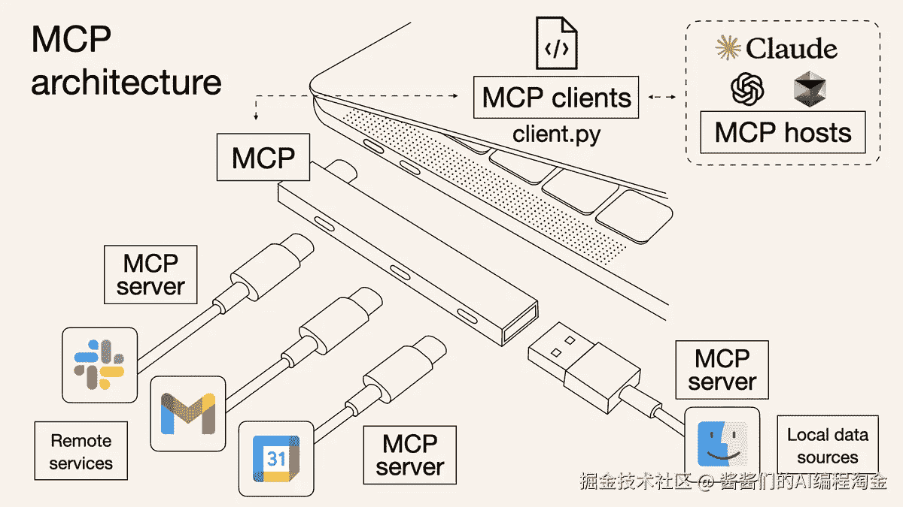
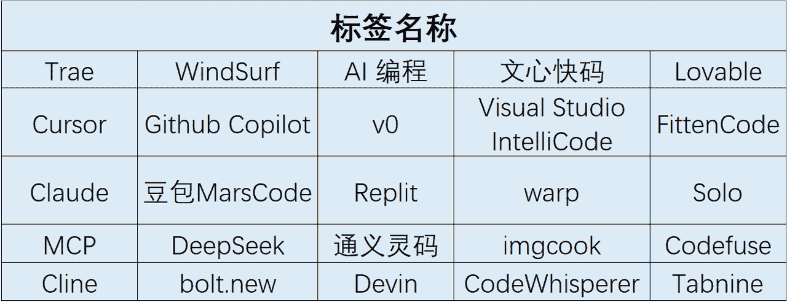

# 10分钟搞定高德地图 MCP 选择约会地点、用 Trae 三天开发效率APP丨AI Coding 周刊第 2 期

> 来源：[https://agijuejin.feishu.cn/docx/MN8HdqxPNo9EkvxDReyc3B6bnvc](https://agijuejin.feishu.cn/docx/MN8HdqxPNo9EkvxDReyc3B6bnvc)

[酱酱们的AI编程淘金](https://juejin.cn/user/2819602825362840/posts)

Hello，新一期的 AI Coding 周刊和大家如约见面啦！

还没刷到掘金 **AI Coding 专区**的友友们快去先探索一下吧~

专区直通车>>>juejin.cn/aicoding

AI Coding 周刊旨在专注于发掘推荐站内有关 AI Coding 的优质内容**和相关创作者，**欢迎大家踊跃提出宝贵建议，多多投稿砸向专区！！站内投稿时记得带上 #AI 编程# 的标签哦~

话不多说，让我们一起来看看上周有哪些大佬佳作吧~

注：以下内容排名不分先后

## 🌟推荐内容

### MCP：“万能接口”用起来

#### [什么是 MCP 服务？如何利用 cursor](https://juejin.cn/post/7484801077017296907) + MCP 快速将现有服务接入大模型？

> 目前已有许多成熟的 MCP 服务，例如 GitHub 的 MCP 支持创建仓库、提交 PR 等操作；Figma 的 MCP 可以直接生成 UI 设计图；浏览器和操作系统的 MCP 则能增强 cursor 的能力，甚至可以让 cursor 基于浏览器中的错误信息自动调试代码。这些服务极大地扩展了 LLM 的应用场景，使其能够更智能地完成复杂任务。

#### 基于 MCP 的 AI Agent 应用开发实践

> 最近大家都在聊 MCP，发现有个最重要的点被忽略了 『通过标准化协议，将工具提供方与应用研发者解耦』，这一点带来的将是 AI Agent 应用研发范式的转移（类似 Web 应用研发的前后端分离）。

> 本文以开发 Agent TARS 应用为例，尽可能详细地介绍 MCP 在『开发范式』、『工具生态扩展』上起到的作用。

#### 10分钟搞定高德地图 MCP！我用 AI 解决了约会地点选择难题

> 想象一下，当 AI 能够调用各种专业工具和数据源时，它的能力边界被极大拓展。这就像是从单打独斗的个体战士，一下子升级为指挥着各种专业团队的将军。无论是地图导航、数据分析、图像处理，还是内容创作，AI 都能找到最合适的"专家"来完成任务。

> MCP 就是给大模型装上了翅膀，让它能够飞得更高、看得更远，为我们解决更多实际问题。而这个咖啡馆选择的小例子，只是冰山一角。随着更多 MCP 的出现，我们将看到 AI 在更多领域展现出惊人的能力。

#### [用 MCP 让 Claude 控制 Cha](https://juejin.cn/post/7487428943034892323)tGPT-4o，自动生成吉卜力风格的分镜

> 这是一个模型上下文协议（MCP）工具，允许 Claude 与 macOS 上的 ChatGPT 桌面应用进行交互，主要功能包括直接从 Claude 询问 ChatGPT 问题、查看 ChatGPT 对话历史记录、继续现有的 ChatGPT 对话等。

#### MCP 和 Function Calling 的区别是什么？

> 在没有 MCP 之前，Function Calling 请求第三方往往需要在客户端内编写代码，如果需要对接的服务有很多，而且标准不统一，客户端往往需要写大量的代码。

> 通过 MCP 标准协议，客户端不再需要干这些活，而把函数声明和调用逻辑交给 MCP 服务器，MCP客户端只需要整理和执行调用即可。

### Dify：开箱即用，无缝扩展

#### 发现了个好东西：Dify，快速搭应用的小帮手

> 名字听起来挺酷，Dify 有点“Define”和“Modify”的意思，也就是说你可以用它定义一个东西，然后随时改来改去。它主打的是让人人都能上手做应用，尤其是那种跟智能对话、知识整理相关的玩意儿。比如你想搞个能回答问题的客服工具，或者整理一堆文档做个内部问答系统，Dify 都能帮上忙。 我喜欢它的一点是，你不需要是个程序员也能玩得转。界面很直观，像搭积木一样，拖拖拽拽就差不多了。而且它是开源的，想自己装到电脑上用也没问题，数据都在自己手里，挺放心。

#### 从开发新手角度对比 dify 和 n8n：哪个更适合你？

> 作为一个刚入门的开发者，我觉得这两个工具都很棒，但它们适合的人群真的不太一样。

+   如果你对 AI 感兴趣，想试试开发一些智能应用，比如聊天机器人或者内容生成工具，那 dify 绝对是你的首选。它就像一个专门为 AI 开发设计的“作弊码”，能让你快速上手，做出很酷的东西。

+   如果你更想省去一些重复的工作，或者需要把不同的工具连起来，比如自动处理数据、发送通知，那 n8n 会更适合你。它的灵活性和集成能力真的很强大，感觉像一个“万能遥控器”。

### Cursor：用过都说好

#### 新版本 Cursor rules .mdc 格式文件使用经验分享

> 根据官网的 changelog，新版本引入了 Project rules，用于对项目规则进行管理。这将逐步替代根目录下的 .cursorrules 文件，从而实现更细化的规则管理，并提升开发体验（DX）。

#### Cursor + MasterGo 前端一键生成页面

> 随着 mcp 服务的兴起，各种开发工具跟智能 ide 的结合将越来越普遍，掌握这些开发方法，一些情况下还是很方便的，不过经过测试，复杂页面生成效果还不是很理想，目前还是在 html 页面生成，随后有时间会尝试一下 .vue 文件生成。

### Trae：更快、更好、更准确

#### 用 Trae 三天开发效率APP-惜命

> AI 工具主要依赖已有的数据和模式，在代码生成、自动调试、维护开发文档等方面表现出色，可以利用它来处理 重复性工作，提高工作效率，以便腾出更多时间专注于设计系统架构、解决复杂问题。我们的核心竞争力在于：创造性思维、对业务的理解和解决问题的能力，无所不知的 AI 还可以充当我们的老师，帮助我们快速学习新知识，扩展自己的能力边界，培养跨领域的思维能力。拥抱 AI，而不是与它对抗~

#### Trae 请帮我生成一个 AI 导航站

> 随着 AI 工具和开发资源的爆炸式增长，我们经常需要在各种网站和工具之间切换。为了解决这个问题，我决定开发一个现代化的导航站，集成常用的 AI 工具、开发资源和云服务等，并且实现平滑的滚动和菜单联动效果。本文将详细记录整个实现过程，包括技术选型、组件设计、样式处理和交互优化等方面。

## 💫掘友自荐

#### 到底 MCP 有什么魅力？10分钟让 AI 直接操作数据库！

> 平时开发的时候，免不了要造一些测试数据到数据库，以前都是告诉 AI DDL，让它生成对应的 insert 语句，然后手动 copy 到控制台执行。现在我们把这个过程全部交给 AI 来做，甚至把实现这个过程的代码也可以让 AI 来写！

#### [程](https://juejin.cn/post/7486515264822968370)序员究竟怎样用 AI？深度解读 WIRED 调查报告《 How Software Engineers Actually Use AI 》

> AI 时代的编程行业充满未知，同时也蕴含机遇。平时从社交媒体上程序员们对 AI 的讨论来看，大多数程序员并未因 AI 放弃或者躺平，而是理性评估、结合自身优势去拥抱变革。正如过去从汇编到高级语言、从手写到自动补全到 AI 自动生成的每一次演进一样，最终还是人机协作带来新的高度，AI 也不会例外。

## 📖投稿方式

[主理人目前正在](https://juejin.cn/user/3052665287739005)招募中，有感兴趣的掘友们可以联系 Captain，也欢迎在评论区推荐或者自荐优秀的 AI Coding 方面的创作者和文章。

同时，大家也可以飞书扫码进入“AI编程掘金”社群，一起讨论交流~

AI Coding 专区投稿方式：选择以下标签即可成功投稿

