# LLM用于时序预测真的不行，连推理能力都没用到

> 来源：[https://agijuejin.feishu.cn/docx/GK1xd0XivoDZrWx9E51cNcUdnee](https://agijuejin.feishu.cn/docx/GK1xd0XivoDZrWx9E51cNcUdnee)

> 机器之心｜[阅读原文](https://www.jiqizhixin.com/articles/2024-07-06-2)

> 转载请联系原作者取得授权

语言模型 真的能用于 时序预测 吗？根据贝特里奇头条定律（任何以问号结尾的新闻标题，都能够用「不」来回答），答案应该是否定的。事实似乎也果然如此：强大如斯的 LLM 并不能很好地处理时序数据。

时序，即时间序列，顾名思义，是指一组按照时间发生先后顺序进行排列的数据点序列。

在很多领域，时序分析都很关键，包括疾病传播预测、零售分析、医疗和金融。在时序分析领域，近期不少研究者都在研究如何使用大型 语言模型 （LLM）来分类、预测和检测时间序列中的异常。这些论文假设擅长处理文本中顺序依赖关系的 语言模型 也能泛化用于时间序列数据中的顺序依赖关系。这个假设并不令人意外，毕竟 语言模型 是现在 机器学习 领域的香饽饽。

那么， 语言模型 究竟能给传统时序任务带去多大助益？

近日，弗吉尼亚大学和华盛顿大学一个团队尝试解答了这一问题，并最终给出了一个简单却又重要的主张：对于 时序预测 任务，使用 语言模型 的常用方法的表现都接近或劣于基本的消融方法，但前者所需的计算量比后者多几个数量级。

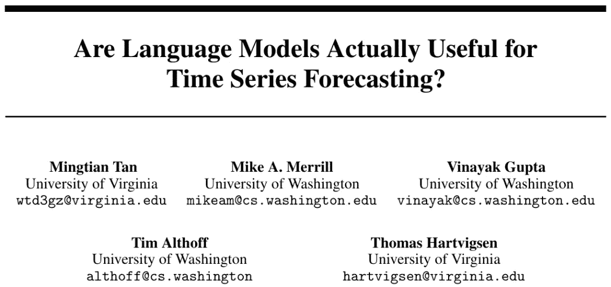

+   论文标题：Are Language Models Actually Useful for Time Series Forecasting?

+   论文地址：https://arxiv.org/pdf/2406.16964

这些发现是该团队通过大量消融研究得到的，其中揭示出当前 时序预测 研究中存在一个「令人担忧的趋势」。

但该团队也表示：「我们的目标并不是暗示 语言模型 永远无法用于时间序列。」事实上，近期一些研究表明语言和时间序列之间具有很好的互动潜力，可以处理时间序列推理和社交理解等任务。

相反，他们的目标是强调这一惊人发现：对于已有的时间序列任务，现有方法几乎没有用到预训练 语言模型 那与生俱来的推理能力。

## **实验设置**

该团队使用了三种最先进的 时间序列预测 方法，并为 LLM 提出了三种消融方法：w/o LLM、LLM2Attn、LLM2Trsf。

为了评估 LLM 在 时间序列预测 任务上的有效性，他们在 8 个标准数据集上对这些方法进行了测试。

用于 语言模型 和时间序列的参考方法

他们实验了三种近期的使用 LLM 进行 时间序列预测 的方法。见表 2，这些方法使用的基础模型为 GPT-2 或 LLaMA，同时使用了不同的对齐和微调策略。

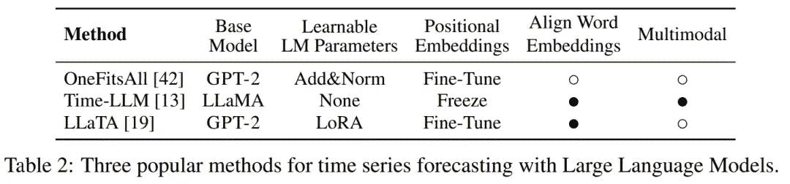

OneFitsAll：OneFitsAll（有时也被称为 GPT4TS）方法会先对输入时间序列使用实例归一化和 patching 技术，然后将其馈送给一个线性层，以获得用于 语言模型 的输入表征。在训练期间， 语言模型 的多头注意力和前馈层会被冻结，而位置嵌入和 层归一化 会得到优化。最终层的作用是将 语言模型 的最终隐藏状态转换成预测结果。

Time-LLM：使用 Time-LLM 时，输入时间序列会被 patching 技术 token 化，并且多头注意力会将其与 词嵌入 的低维表征对齐。之后，将这个对齐过程的输出与描述性统计特征的嵌入一起输送给一个冻结的预训练 语言模型 。然后，将该 语言模型 的输出表征展平，并使其通过一个线性层，从而得到预测结果。

LLaTA：LLaTA 嵌入输入时间序列的方式是将每个通道都视为一个 token。该架构的一半是「文本分支」，其使用交叉注意力来将时间序列表征与 语言模型 的 词嵌入 的低维表征对齐。然后将该表征传递给一个冻结的预训练 语言模型 ，得到一个「文本式预测」。同时，该架构的「时间」分支会基于输入时间序列为预训练 语言模型 学习一个低秩适应器，从而得到一个用于推理的「时间预测」。该模型包含考虑这些表征之间的相似度的额外损失项。

## **该团队提出的消融方法**

对于基于 LLM 的预测器，为了将 LLM 的影响隔离开，该团队提出了三种消融方法：移除 LLM 组件或将其替换成一个简单模块。

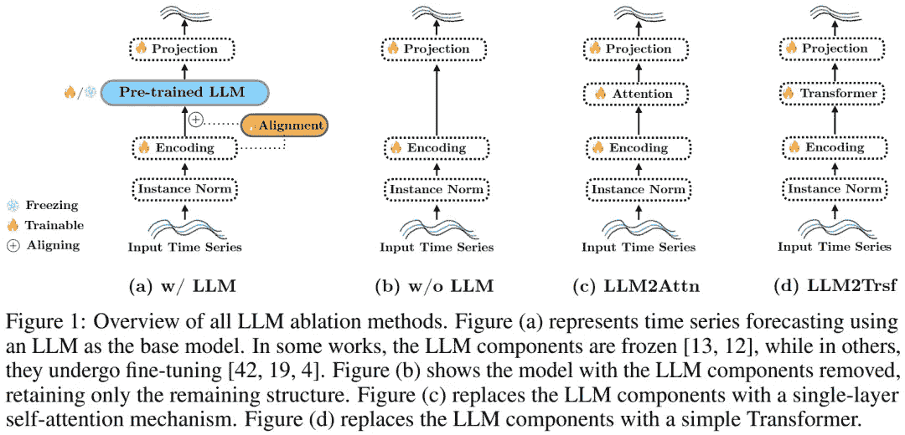

具体来说，对于上述三种方法中的每一种，他们都进行了以下三项修改：

w/o LLM，见图 1b。完全移除 语言模型 ，直接将输入 token 传递给参考方法的最终层。

LLM2Attn，见图 1c。将 语言模型 替换成单个随机初始化的多头注意力层。

LLM2Trsf，见图 1d。将 语言模型 替换成单个随机初始化的 Transformer 模块。

在上述消融研究中，预测器的其余部分都保持不变（可训练）。比如，如图 1b 所示，在移除了 LLM 之后，输入编码会被直接传递给输出 映射 。而如图 1c 和 1d 所示，在将 LLM 替换成注意力或 Transformer 后，它们会与原始方法的剩余结构一起获得训练。

## **数据集和评估指标**

基准 数据集。评估使用了以下真实世界数据集：ETT（其包含 4 个子集：ETTm1、ETTm2、ETTh1、ETTh2）、Illness、Weather、Traffic、Electricity。表 1 给出了这些数据集的统计情况。另外还有 Exchange Rate、Covid Deaths、Taxi (30 min)、NN5 (Daily) 和 FRED-MD。

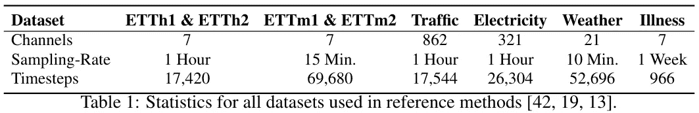

评估指标。该研究报告的评估指标是预测时序值和真实时序值之间的平均绝对误差（MAE）和均方误差（MSE）。

## **结果**

具体来说，该团队探究了以下研究问题（RQ）：

+   （RQ1）预训练 语言模型 是否有助于提升预测性能？

+   （RQ2）基于 LLM 的方法是否值得其消耗的计算成本？

+   （RQ3） 语言模型 预训练是否有助于执行预测任务的性能？

+   （RQ4）LLM 能否表征时间序列中的顺序依赖关系？

+   （RQ5）LLM 是否有助于少样本学习？

+   （RQ6）性能从何而来？

预训练 语言模型 是否有助于提升预测性能？(RQ1)

实验结果表明，预训练 LLM 对 时间序列预测 任务来说还不是很有用。

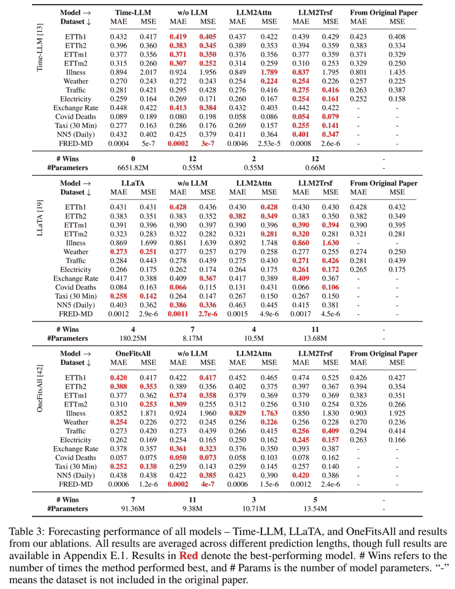

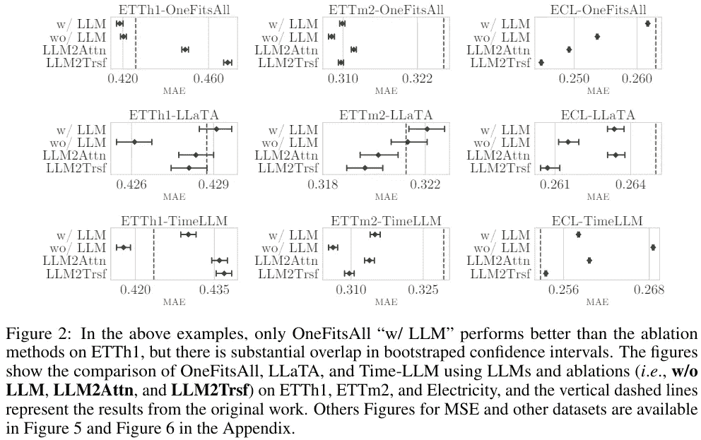

总体而言，如表 3 所示，在 8 个数据集和 2 个指标上，消融方法在 26/26 案例中优于 Time-LLM 方法，在 22/26 案例中优于 LLaTA，在 19/26 案例中优于 OneFitsAll。

总之，很难说 LLM 可以有效地用于 时间序列预测 。

## 基于 LLM 的方法是否值得其消耗的计算成本？(RQ2)

这里，根据这些方法的名义性能来评估它们的计算强度。参考方法中的 语言模型 使用了数亿乃至数十亿 参数 来执行 时间序列预测 。即使当这些 语言模型 的 参数 冻结时，它们在训练和推理时依然会有很大的计算开销。

举个例子，Time-LLM 有 6642 M 参数 ，在 Weather 数据集上耗时 3003 分钟才完成训练，而消融方法仅有 0.245 M 参数 ，平均训练时间仅有 2.17 分钟。表 4 给出了在 ETTh1 和 Weather 数据集上训练其它方法的相关信息。

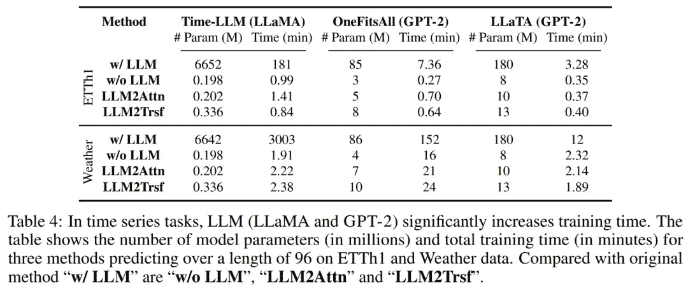

至于推理时间，这里的做法是除以最大批量大小，以估计每个示例的推理时间。平均而言，相比于修改后的模型，Time-LLM、OneFitsAl、LLaTA 所用的推理时间多 28.2、2.3、1.2 倍。

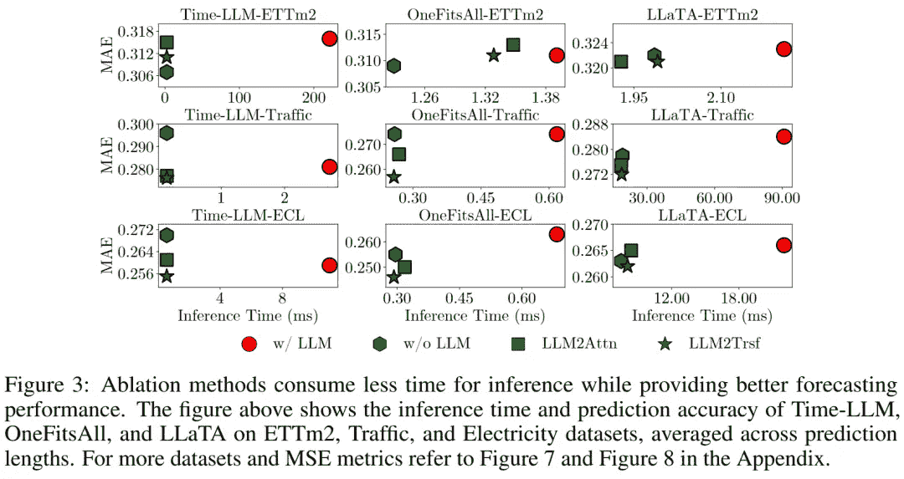

图 3 给出了一些示例，其中绿色标记（消融方法）通常低于红色标记（LLM），并且集中于左侧，这说明它们计算成本更低但预测性能更好。

总之，在 时间序列预测 任务上，LLM 的计算强度无法为性能带来相应的提升。

## 语言模型 预训练是否有助于执行预测任务的性能？(RQ3)

评估结果表明，对于 时间序列预测 任务而言，使用大型数据集进行预训练实在没有必要。为了检验预训练期间学到的知识能否给预测性能带来有意义的提升，该团队实验了在时间序列数据上，对 LLaTA 进行不同组合的预训练和微调的效果。

+   预训练 + 微调（Pre+FT）：这是原始方法，即在时间序列数据上微调预训练 语言模型 。对于这里的 LLaTA，做法是冻结基础 语言模型 ，学习一个低秩适应器（LoRA）。

+   随机初始化 + 微调（woPre+FT）：预训练得到的文本知识是否有助于 时间序列预测 ？这里，随机初始化 语言模型 的 权重 （由此清除了预训练的效果），再在微调数据集上从头开始训练 LLM。

+   预训练 + 不使用微调（Pre+woFT）：在时间序列数据上进行微调又能给预测性能带来多大提升呢？这里是冻结 语言模型 ，同时放弃学习 LoRA。这能反映 语言模型 自身处理时间序列的性能。

+   随机初始化 + 无微调（woPre+woFT）：很明显，这就是将输入时间序列随机投射到一个预测结果。该结果被用作与其它方法进行比较的 基准 。

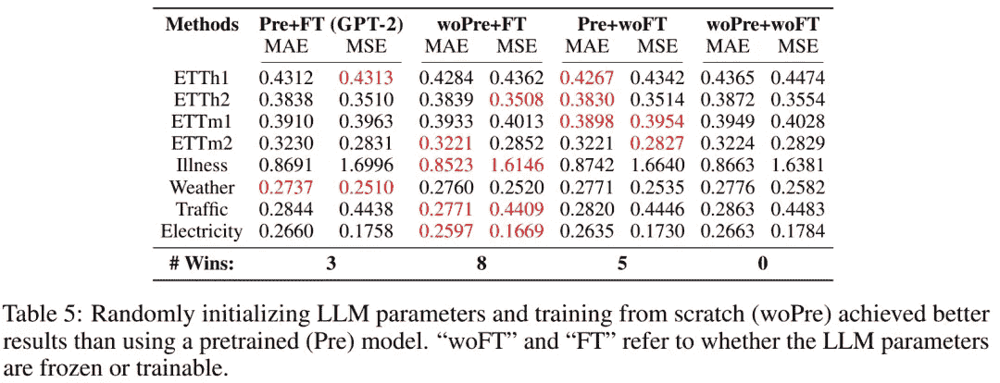

整体结果见表 5。在 8 个数据集上，依照 MAE 和 MSE 指标，「预训练 + 微调」有三次表现最佳，而「随机初始化 + 微调」获得了 8 次最佳。这说明语言知识对 时间序列预测 的帮助有限。但是，「预训练 + 无微调」与 基准 「随机初始化 + 无微调」各自有 5 和 0 次最佳，这说明语言知识对微调过程的帮助也不大。

总之，预训练得到的文本知识对 时间序列预测 的帮助有限。

## LLM 能否表征时间序列中的顺序依赖关系？(RQ4)

大多数使用 LLM 来微调位置编码的 时间序列预测 方法都有助于理解序列中时间步骤的位置。该团队预计，对于一个有优良位置表征的时间序列模型，如果将输入的位置打乱，那么其预测性能将会大幅下降。他们实验了三种打乱时间序列数据的方法：随机混洗整个序列（sf-all）、仅随机混洗前一半序列（sf-half）、交换序列的前半和后半部分（ex-half）。结果见表 6。

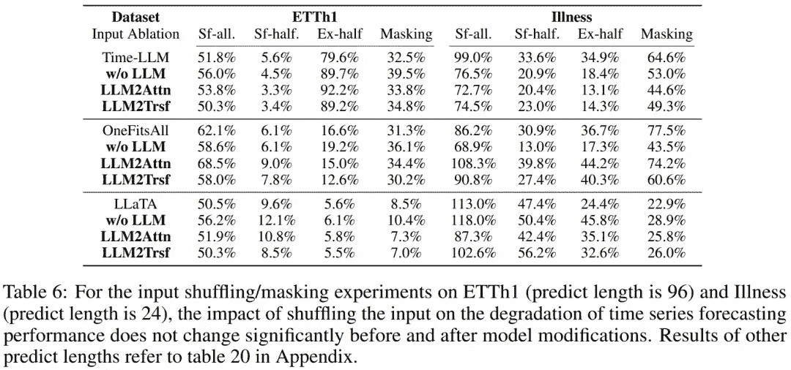

输入混洗对基于 LLM 的方法与其消融方法的影响差不太多。这说明 LLM 在表征时间序列中的顺序依赖关系方面并没有什么突出能力。

## LLM 是否有助于少样本学习？(RQ5)

评估结果表明，LLM 对少样本学习场景而言意义不大。

他们的评估实验是取用每个数据集的 10%，再训练模型及其消融方法。具体来说，这里评估的是 LLaMA（Time-LLM）。结果见表 7。

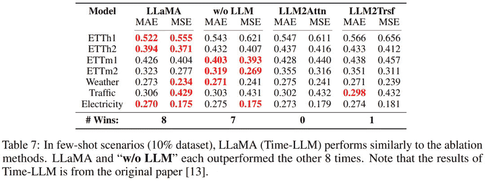

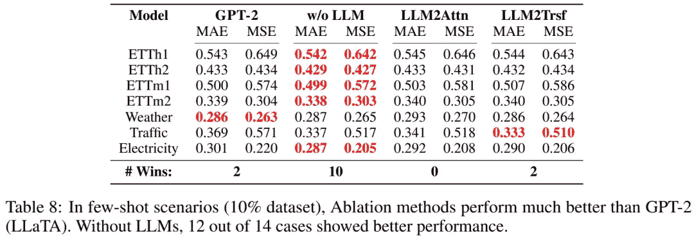

可以看到，有无 LLM 的表现差不多 —— 各自都有 8 个案例表现更好。该团队也使用基于 GPT-2 的方法 LLaTA 进行了类似的实验。结果见表 8，这里消融方法在少样本场景中的表现还优于 LLM。

## **性能从何而来？(RQ6)**

这一节评估的是 LLM 时间序列模型中常用的编码技术。结果发现，将 patching 和单层注意力组合起来是一种简单却有效的选择。

前面发现对基于 LLM 的方法进行简单的消融并不会降低其性能。为了理解这一现象的原因，该团队研究了 LLM 时间序列任务中常用的一些编码技术，比如 patching 和分解。一种基本的 Transformer 模块也可用于辅助编码。

结果发现，一种组合了 patching 和注意力的结构在小数据集（时间戳少于 100 万）上的表现优于其它大部分编码方法，甚至能与 LLM 方法媲美。

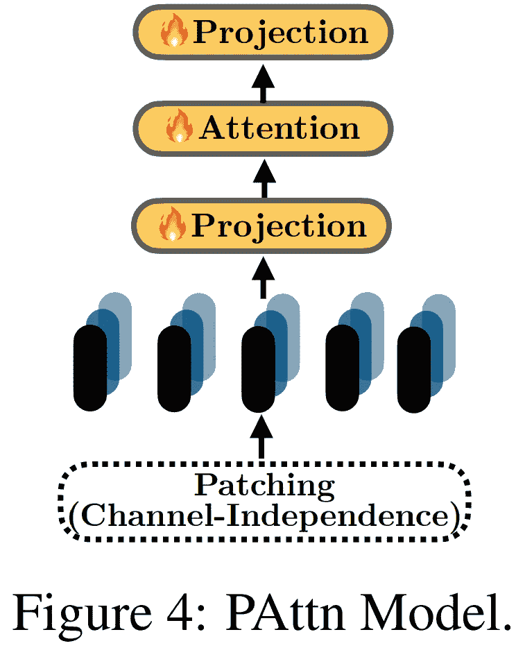

其详细结构如图 4 所示，其中涉及将「实例归一化」用于时间序列，然后进行 patching 和投射。然后，在 patch 之间使用一层注意力进行特征学习。对于 Traffic（约 1500 万）和 Electricity（约 800 万）等更大的数据集，则使用了基本 Transformer 的单层线性模型的编码表现更优。在这些方法中，最后还要使用单层线性层来投射时间序列嵌入，从而得到预测结果。

总之，patching 对编码而言非常重要。此外，基本的注意力和 Transformer 模块也能为编码带来有效助益。