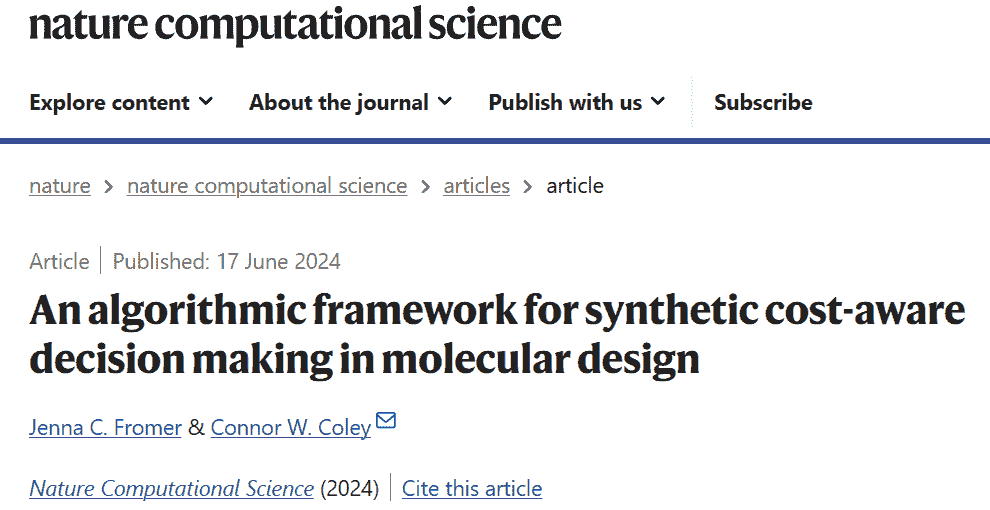
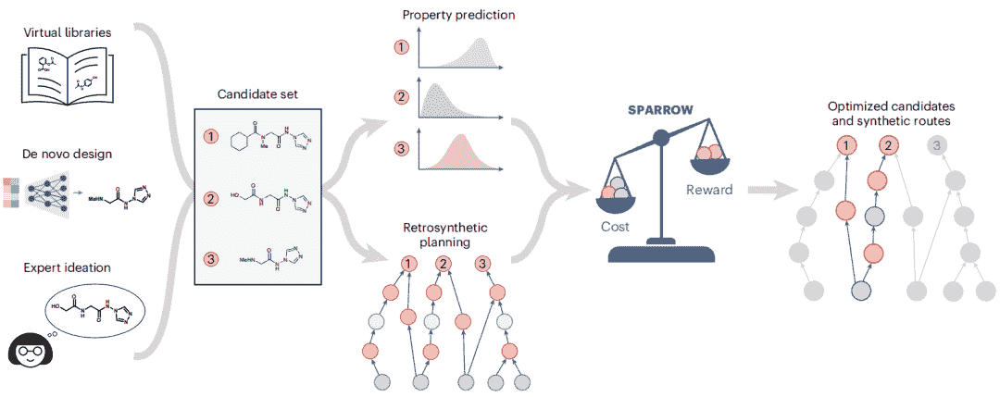
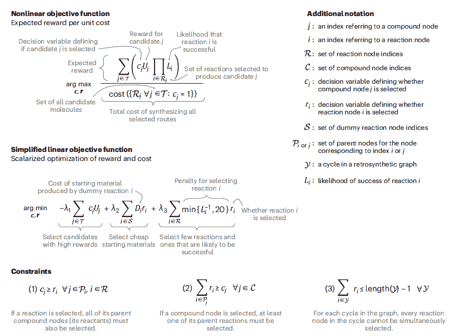
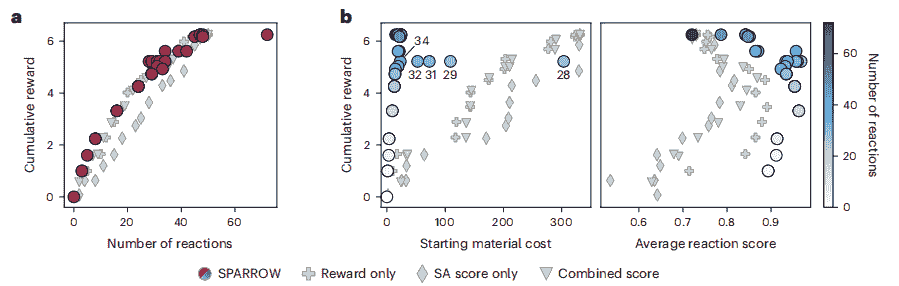
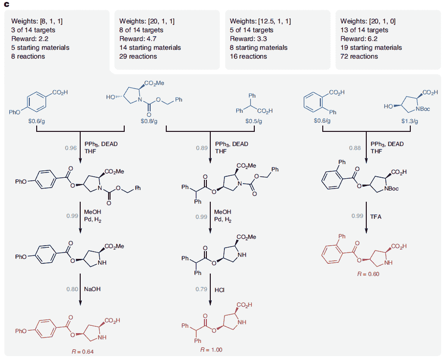

# 自动识别最佳分子，降低合成成本，MIT 开发分子设计决策算法框架

> 来源：[https://agijuejin.feishu.cn/docx/I7jDd4BguorWVcxOvPXcYD5zn5g](https://agijuejin.feishu.cn/docx/I7jDd4BguorWVcxOvPXcYD5zn5g)

> 机器之心 ScienceAI｜[阅读原文](https://www.jiqizhixin.com/articles/2024-06-21-12)

> 转载请联系原作者取得授权

编辑 | 紫罗

AI 在简化药物发现方面的应用正在爆炸式增长。从数十亿种候选分子中筛选出可能具有开发新药所需特性的分子。需要考虑的变量太多了，从材料价格到出错的风险，即使科学家使用 AI，权衡合成最佳候选分子的成本也不是一件容易的事。

在此，MIT 研究人员开发了一个定量决策算法框架 SPARROW，来自动识别最佳分子候选物，从而最大限度地降低合成成本，同时最大限度地提高候选物具有所需特性的可能性。该算法还确定了合成这些分子所需的材料和实验步骤。

SPARROW 考虑了一次合成一批分子的成本，因为多个候选分子通常可以从一些相同的化合物中衍生出来。此外，这种统一的方法可以从在线存储库和广泛使用的 AI 工具中获取有关分子设计、性质预测和合成规划的关键信息。

除了帮助制药公司更有效地发现新药外，SPARROW 还可以用于发明新的农用化学品或发现有机电子产品的专用材料等。

相关研究以《 An algorithmic framework for synthetic cost-aware decision making in molecular design 》为题，于 6 月 19 日发布在《 Nature Computational Science 》上。

论文链接： https://www.nature.com/articles/s43588-024-00639-y

「化合物的选择是一门艺术，有时它是一门非常成功的艺术。但鉴于我们拥有所有这些模型和预测工具，它们能提供关于分子可能如何表现以及如何合成的信息，我们应该使用这些信息来指导我们做出的决策。」论文通讯作者 、MIT 化学工程系助理教授 Connor Coley 说。

## 定量决策算法框架 SPARROW

「合成规划和基于奖励的路线优化工作流程」（Synthesis Planning And Rewards-based Route Optimization Workflow，SPARROW），是一种用于驱动设计周期的算法决策框架。

图示：SPARROW 概述及其在分子设计周期中的作用。（来源：论文）

该研究建立在早期的问题公式的基础上，用于同时选择多个分子的合成路线，以及产品和工艺系统设计的集成。与传统的筛选方法不同，SPARROW 使用一个多目标优化标准，平衡成本与效用，从候选分子库中对分子及其假设的合成路线进行优先排序。

SPARROW 生成由候选目标分子和合成路线组成的反应网络。通过解决基于图的优化问题，可以筛选出一组分子和合成路线，以最佳地平衡累积合成成本和效用。在此背景下，效用衡量评估分子属性的价值。

效用的适当衡量标准将因应用和设计的不同阶段而异。它可能包含分子属性预测、这些预测中的不确定性或新数据点改善结构-属性关系的潜力。必须向 SPARROW 提供一个候选库，并提供相应的奖励，以表明与每个候选分子相关的效用。

图示：SPARROW 的问题表述。（来源：论文）

选择一个分子所获得的奖励还取决于所选合成该分子的反应步骤是否成功。如果候选分子合成路线中的某个反应步骤失败，则无法获得任何信息。研究人员通过最大化选择一个候选分子的预期奖励来形式化这一点，该预期奖励可以用其奖励乘以成功合成该分子的概率来表示。

平衡成本和效用，SPARROW 的目标可以形式化为所有选定目标的预期奖励除以使用选定路线合成所有选定目标的成本。

## **复杂的成本考量**

从某种意义上说，科学家是否应该合成和测试某种分子，归结为合成成本与实验价值的问题。然而，确定成本或价值本身就是一个难题。

SPARROW 通过考虑合成分子所涉及的共享中间化合物并将该信息纳入其成本与价值函数来应对这一挑战。

「当你考虑设计一批分子的优化问题时，添加新结构的成本取决于你已经选择的分子。」Coley 说。

该框架还考虑了诸如起始材料的成本、每条合成路线所涉及的反应数量，以及这些反应在第一次尝试时成功的可能性等因素。

要使用 SPARROW，科学家需提供一组他们正在考虑测试的分子化合物，以及他们希望找到的属性定义。

接下来，SPARROW 收集有关分子及其合成途径的信息，然后权衡每个分子的价值与合成一批候选物的成本。它会自动选择符合用户标准的最佳候选子集，并为这些化合物找到最具成本效益的合成路线。

论文一作 Jenna Fromer 说：「它在一步中完成了所有这些优化，因此它可以同时捕捉所有这些相互竞争的目标。」

## **多功能框架**

SPARROW 的独特之处在于它可以整合人类手工设计的分子结构、虚拟目录中存在的分子结构，或生成式 AI 模型创造的从未见过的分子结构。

「我们有各种不同的想法来源。SPARROW 的吸引力之一在于你可以将所有这些想法放在一个公平的竞争环境中。」Coley 补充道。

研究人员通过三个案例研究展示了 SPARROW 协调分子设计周期的能力。这些应用说明了 SPARROW 如何（1）成功平衡信息增益与合成成本，（2）捕捉一批分子合成成本的非加和性，以及（3）扩展至包含数百个分子的候选库。

图示：SPARROW 在 14 个 ASCT2 抑制剂候选库中平衡成本和奖励的能力证明。（来源：论文）

他们发现 SPARROW 有效地捕捉了批量合成的边际成本，并确定了常见的实验步骤和中间化学品。此外，它可以扩展以处理数百种潜在的分子候选物。

「在化学机器学习社区中，有许多模型可以很好地用于逆合成或分子性质预测，但我们实际上如何使用它们？我们的框架旨在发挥这些前期研究的价值。通过创建 SPARROW，我们希望能够指导其他研究人员使用他们自己的成本和效用函数来思考化合物的筛选。」Fromer 说。

未来，研究人员希望向 SPARROW 中融入更多复杂性。例如，他们希望让算法能够考虑到测试一种化合物的价值可能并不总是恒定的。他们还希望在其成本与价值函数中包含更多并行化学元素。

> 参考内容： https://news.mit.edu/2024/smarter-way-streamline-drug-discovery-0617