# 自我蒸馏方法-减轻大模型微调过程中的灾难性遗忘

> 来源：[https://agijuejin.feishu.cn/docx/KKUWdi5kYoUb22xG54bcb33qnde](https://agijuejin.feishu.cn/docx/KKUWdi5kYoUb22xG54bcb33qnde)

> 刘聪NLP｜[阅读原文](https://mp.weixin.qq.com/s/caqRWBHRo9m9ivu66B288A)

> 转载请联系原作者取得授权

## **写在前面 **

大家好，我是刘聪NLP。

大模型在指定任务上进行微调后，会取得较为不错的效果，但同时可能带来模型原有能力的下降。今天给大家带来一篇通过自我蒸馏减轻大模型微调时的灾难性遗忘的方法-SDFT（Self-Distillation Fine-Tuning）。

```
Paper: https://arxiv.org/abs/2402.13669
Github: https://github.com/sail-sg/sdft
```

特定任务微调后导致模型遵循通用指令能力变弱的主要原因是任务数据集的信息分布与原始LLM的信息分布之间存在差距。目前主流解决大模型微调后灾难性遗忘的方法是在微调过程中加入通用的指令数据。

而自我蒸馏方法主要是通过模型本身对任务数据进行生成引导，构建自我蒸馏数据集，改变任务数据的信息分布，减少与原始模型信息分布的差距，如下图所示。

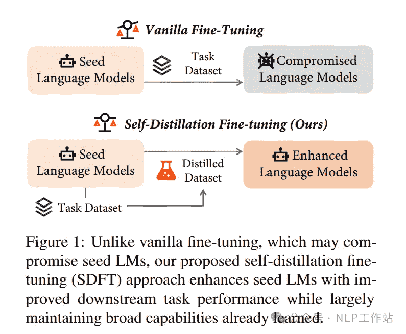

##  **方法介绍 **

大模型SFT过程，就是将指令和输入的上下文内容，映射到相应的输出上，最小化数据信息分布与语言模型信息分布之间的差异，如下：

其中，  表示模型训练参数，  表示输入上下文内容，  表示指令内容，  表示模型输出。

SDFT方法首先根据原始大模型对微调指令数据进行生成回复内容修改，将任务数据的指令回复结果映射到大模型分布内的回复结果，

在重写过程中，减少对大模型的额外要求，仅让其重新回复结果，自我蒸馏提示模板如下图所示，

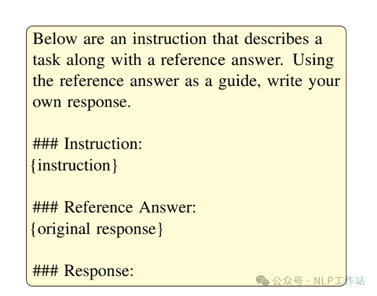

自我蒸馏提示模板

然后为了确保蒸馏的回复内容质量，采用简单的启发式方法来评估蒸馏的回复内容。例如，在数学推理问题中，如果可以从蒸馏的回复内容  中提取出最终答案，则采用蒸馏的回复内容；否则保留原始回复内容。

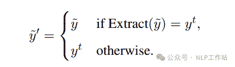

PS: 这里跟作者交流过，实际上仅数学任务采用了这种责令，其他不好判断的任务默认蒸馏效果准确。

最后，采用蒸馏后的回复内容替换原始回复内容用于大模型微调，

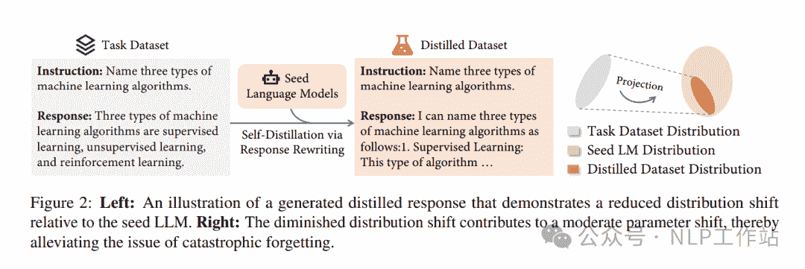

##  **实验结果 **

所有实验均利用Llama-2-chat-7b模型，采用Lora方法训练，学习率初始为1e-4，按照余弦调度策略衰减到0，训练批次大小为8。

数据集涉及单任务和多任务两种数据：

+   单任务：OpenFunctions、GSM8K和MagiCoder；

+   多任务：Alpaca、Dolly和LIMA；

模型在评估过程中，利用Advbench榜单进行安全性评估，利用AlpacaEval榜单进行实用性评估，利用OpenLLM榜单进行知识评估。

如下表所示，普通微调虽然可以增强模型在目标任务上的效果，但也会导致在其他任务上性能显著下降。而SDFT可以有效缓解这种性能下降，甚至会有效果提示。

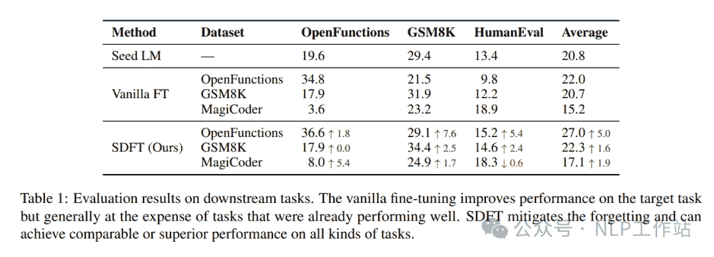

如下表所示，在Chat模型上进行普通任务微调，会导致模型对齐效果丧失，也就是安全性下降，而SDFT方法可以有效缓解。

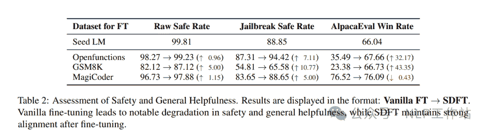

单任务

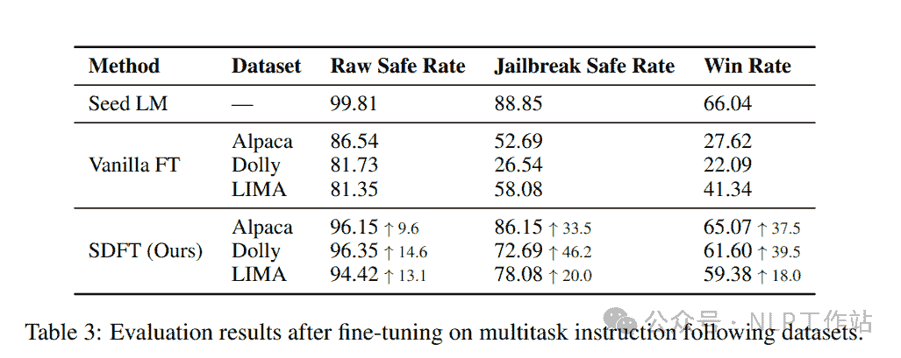

多任务

有趣的是，虽然微调会对下游任务有影响，但对模型本身的知识能力影响较小。

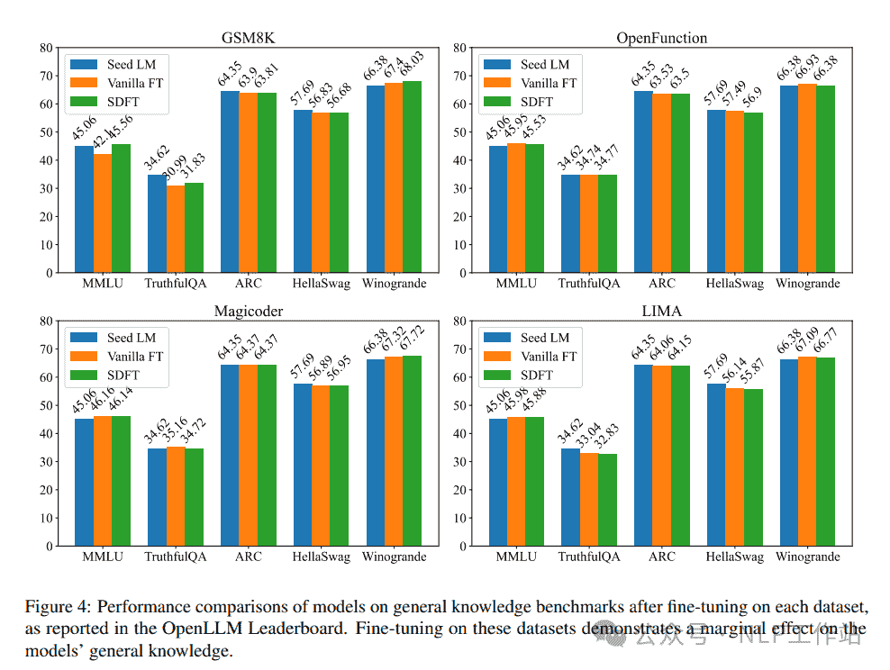

知识能力评估

分析自我蒸馏数据占比对微调的影响，如下图所示，当自我蒸馏数据占比越高时，效果越好。

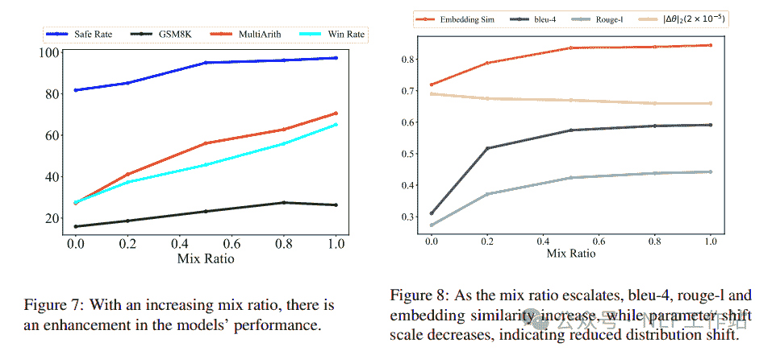

如果将自我蒸馏数据与原始数据混合进行训练，发现与混合比例为50%时持平或略低，也可以从侧面体现反应数据质量的作用大于数据数量。

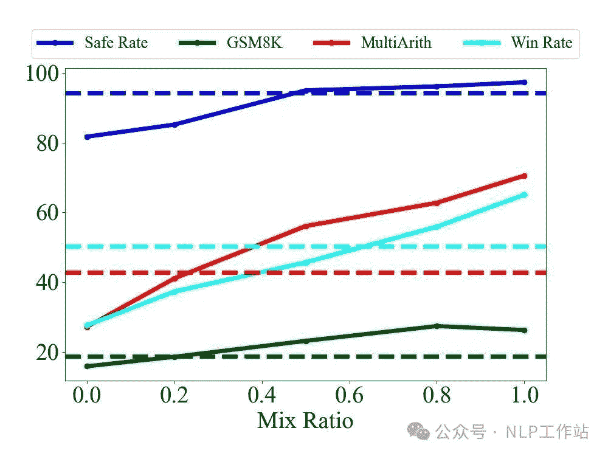

虚线为1+1数据结果

对微调后模型与原始模型指令生成结果及嵌入向量进行分析，发现普通微调方法随着数据量增加，偏移越严重，而SDFT方法微调后的模型嵌入偏移更小。

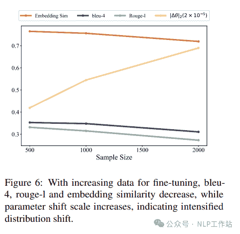

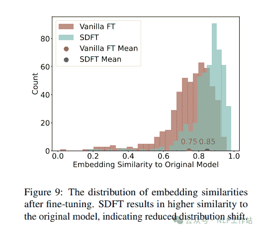

##  **写在最后 **

自我蒸馏方法在不引入额外数据的情况下，可以极大程度的减轻模型的遗忘现象。后期可以利用外部模型，将自我蒸馏数据保留机制进行完善，说不定会有意想不到的效果。

[**欢迎多多关注**](https://mp.weixin.qq.com/s?__biz=Mzg5MTU1NTE1OQ==&mid=2247486601&idx=1&sn=dd2f338675de1448981bcfbe1efa71e3&scene=21#wechat_redirect)公众号「NLP工作站」， 加入交流群 ，交个朋友吧，一起学习，一起进步！