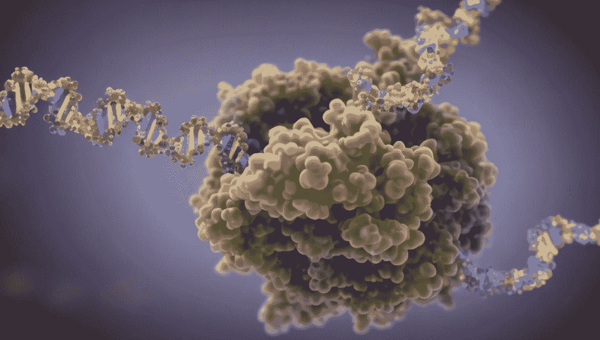
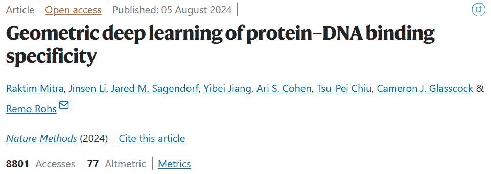
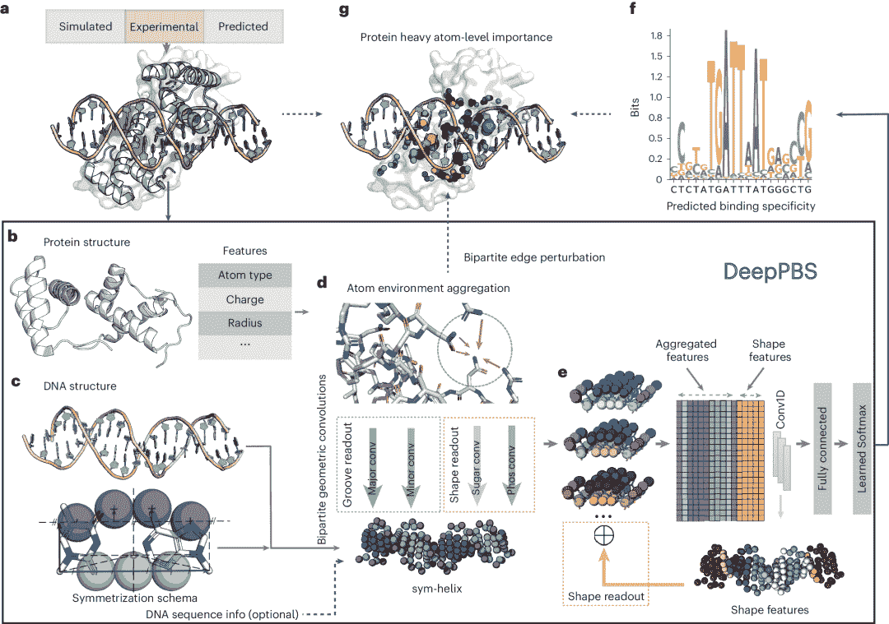
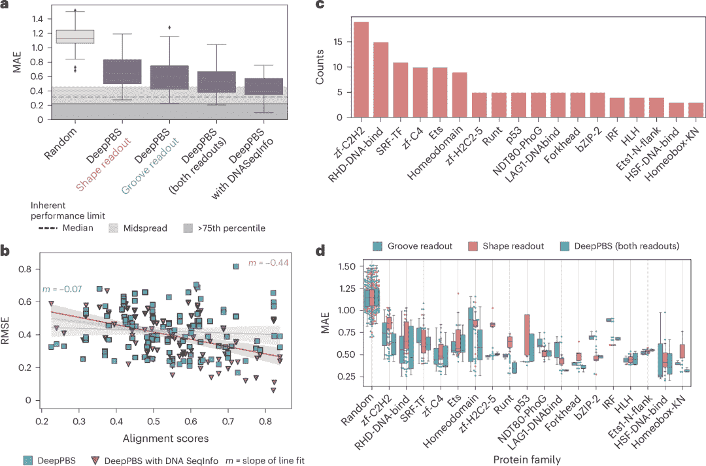
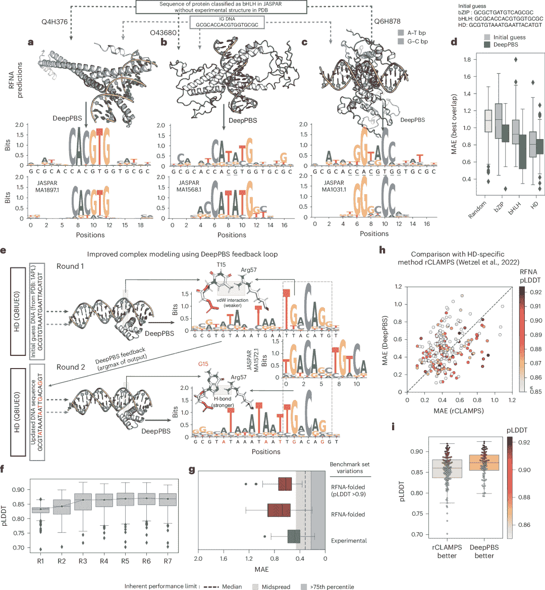
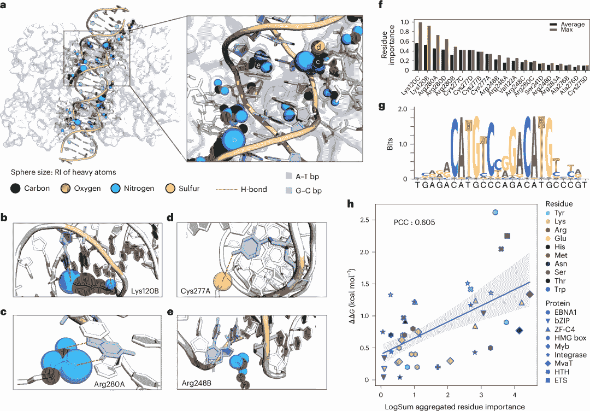
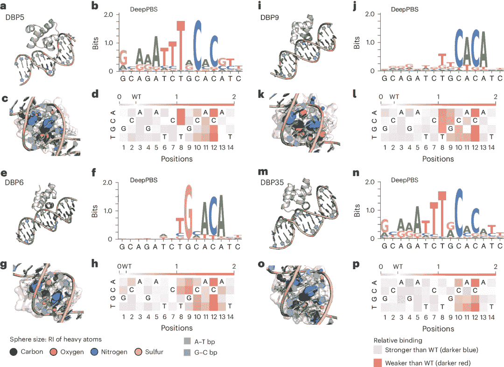

# 预测蛋白质-DNA结合特异性，南加州大学团队开发几何深度学习新方法

> 来源：[https://agijuejin.feishu.cn/docx/OlpJdWRMroTQDJxy5RLchYIbnCd](https://agijuejin.feishu.cn/docx/OlpJdWRMroTQDJxy5RLchYIbnCd)

> 机器之心 ScienceAI｜[阅读原文](https://www.jiqizhixin.com/articles/2024-08-19)

> 转载请联系原作者取得授权

编辑 | 萝卜皮

预测蛋白质-DNA 结合特异性是一项具有挑战性但又至关重要的任务，有助于理解基因调控。蛋白质-DNA 复合物通常与选定的 DNA 靶位结合，而蛋白质则以不同程度的结合特异性与广泛的 DNA 序列结合。这些信息无法在单一结构中直接获取。

为了获取这些信息，南加州大学（University of Southern California）和华盛顿大学（University of Washington）的研究人员提出了深度结合特异性预测器（DeepPBS），这是一种几何 深度学习 模型，旨在根据蛋白质-DNA 结构预测结合特异性。

DeepPBS 可以提取可解释的界面残基蛋白质重原子重要性得分。当在蛋白质残基水平上聚合时，这些得分通过诱变实验进行验证。应用于针对特定 DNA 序列的设计蛋白质，DeepPBS 被证明可以预测实验测量的结合特异性。

该研究以「 Geometric deep learning of protein–DNA binding specificity 」为题，于 2024 年 8 月 5 日发布在《 Nature Methods 》。

转录因子通过与特定DNA序列的结合来调节生命过程，这种结合机制包括静电相互作用、脱氧核糖堆积效应，以及氢键的形成等。

蛋白质-DNA的结构信息通常通过X射线晶体学、核磁共振波谱或低温电子显微镜等实验方法获取，并存储在蛋白质 数据库 （PDB）中。这些结构通常展示了结合的 DNA 序列及其物理化学相互作用，但无法涵盖所有可能的结合序列。

另一方面，高通量实验如蛋白质结合微阵列、SELEX-seq 等能够捕捉潜在的结合序列范围，但缺乏结构信息。

因此，结合结构数据和高通量实验数据对于全面理解转录因子的结合特异性至关重要。

目前，预测特定蛋白质序列在蛋白质家族中的结合特异性，仍然是一个具有挑战性且尚未解决的问题。结合背景下的结构变化以及庞杂的机制多样性加剧了这一困难。

「蛋白质-DNA 复合物的结构包含通常与单个 DNA 序列结合的蛋白质。为了理解基因调控，了解蛋白质与任何 DNA 序列或基因组区域的结合特异性非常重要。」南加州大学的 Remo Rohs 教授说。

在最新的研究中，南加州大学和华盛顿大学的研究人员引入了结合特异性深度预测器 (DeepPBS)。

Rohs 解释道：「DeepPBS 是一种 人工智能 工具，它取代了高通量测序或结构生物学实验来揭示蛋白质-DNA 结合特异性。」

图示：DeepPBS框架的示意图。（来源：论文）

该 深度学习 模型旨在捕捉蛋白质-DNA 相互作用的物理化学和几何背景，以预测结合特异性，表示为基于给定蛋白质-DNA结构的位置 权重 矩阵（PWM）。DeepPBS 跨蛋白质家族发挥作用，并充当结构确定和结合特异性确定实验之间的桥梁。

图示：DeepPBS 用于预测跨蛋白质家族的结合特异性的性能。（来源：论文）

DeepPBS 的输入不仅限于实验结构。蛋白质结构预测方法（包括 AlphaFold 、OpenFold 和 RoseTTAFold）以及蛋白质-DNA 复合物建模器（例如 RoseTTAFoldNA (RFNA)、RoseTTAFold All-Atom、MELD-DNA 和 AlphaFold 3）的快速发展，导致可供分析的结构数据数量呈指数级增长。

这一场景凸显了对用于分析蛋白质-DNA 结构的通用计算模型的需求日益增长。研究人员展示了 DeepPBS 如何与结构预测方法结合使用，以预测没有可用实验结构的蛋白质的特异性。

此外，通过使用 DeepPBS 反馈优化结合 DNA，可以改进蛋白质-DNA 复合物的设计。研究人员表明，此流程与最近的家族特定模型 rCLAMPS 相比性能相当，同时更具通用性：具体而言，DeepPBS 不受蛋白质家族限制，可以处理生物组装并可以预测 DNA 侧链偏好。

图示：DeepPBS 在预测蛋白质-DNA 复合物结构中的应用。（来源：论文）

在可解释性方面，可以从 DeepPBS 中提取与 DNA 相互作用的蛋白质中不同重原子的「相对重要性」（RI）分数。

作为对癌症发展有重要意义的蛋白质的案例研究，研究人员通过这些 RI 分数分析 p53-DNA 界面，并将其与现有文献联系起来进行验证。

并且，DeepPBS 分数与现有知识非常吻合，并且可以汇总以与丙氨酸扫描诱变实验产生合理的一致性。

图示：以 p53-DNA 界面中 DeepPBS 重要性分数的可视化为例进行研究，并进行实验验证。（来源：论文）

在额外的原理验证研究中，研究人员将 DeepPBS 应用于针对特定 DNA 序列的计算机设计的蛋白质-DNA 复合物，该复合物来自最近一项结合结构设计与 DNA 诱变实验的研究。DeepPBS 也可用于分析分子模拟轨迹。

「对于研究人员来说，找到一种适用于所有蛋白质、而不局限于某个研究透彻的蛋白质家族的方法非常重要。这种方法还使我们能够设计新的蛋白质。」Rohs 说道。

图示：将 DeepPBS 应用于针对特定 DNA 序列的计算机设计 HTH 支架。（来源：论文）

当前版本的 DeepPBS 存在固有的局限性。它是针对双链 DNA 量身定制的，尚不适用于单链 DNA、RNA 或化学修饰碱基。

然而，该模型有可能扩展以适应这些不同的场景以及其他聚合物-聚合物相互作用，并可能适用于机械突变。DeepPBS 架构可以在应用和工程增强方面进行优化和扩展。

尽管如此，Rohs 表示，DeepPBS 的应用将会非常广泛。这种新的研究方法可能会加速设计针对癌细胞特定突变的新药和治疗方法，并带来合成生物学的新发现和 RNA 研究的应用。

DeepPBS： https://deeppbs.usc.edu

论文链接： https://www.nature.com/articles/s41592-024-02372-w

相关报道： https://phys.org/news/2024-08-ai-accuracy-proteindna.html