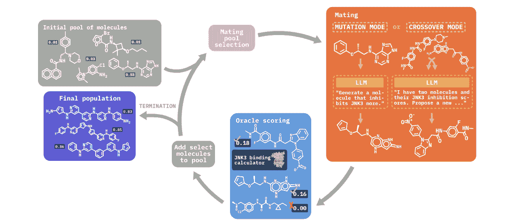
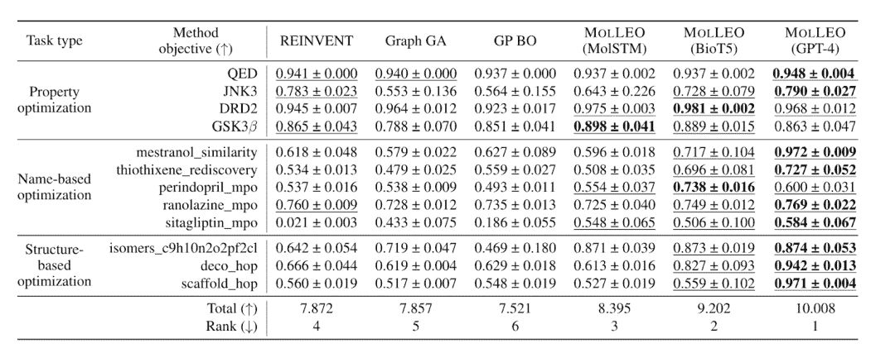
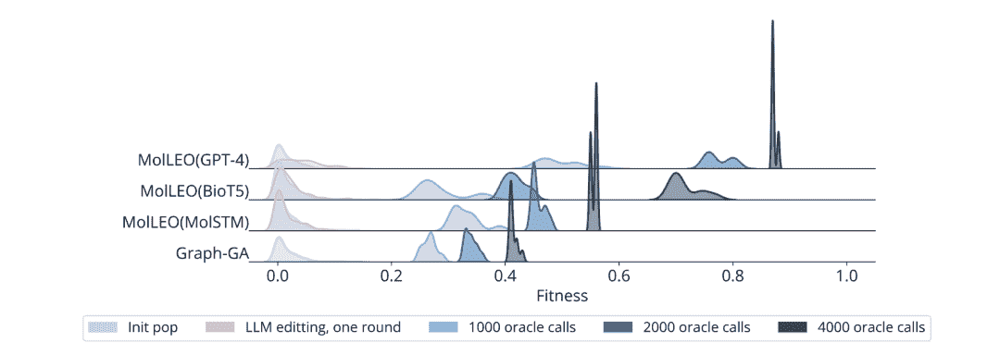
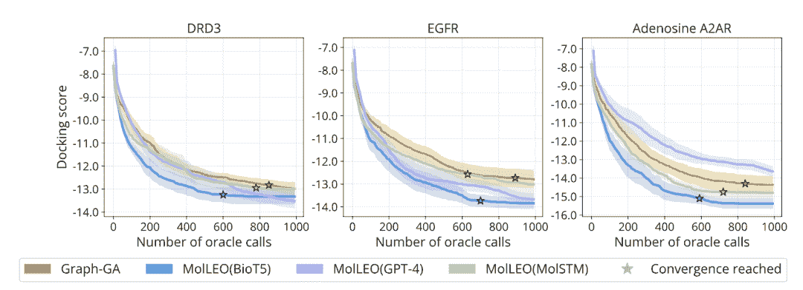
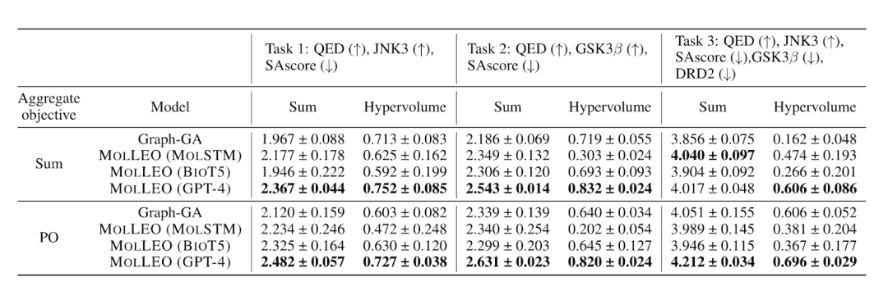
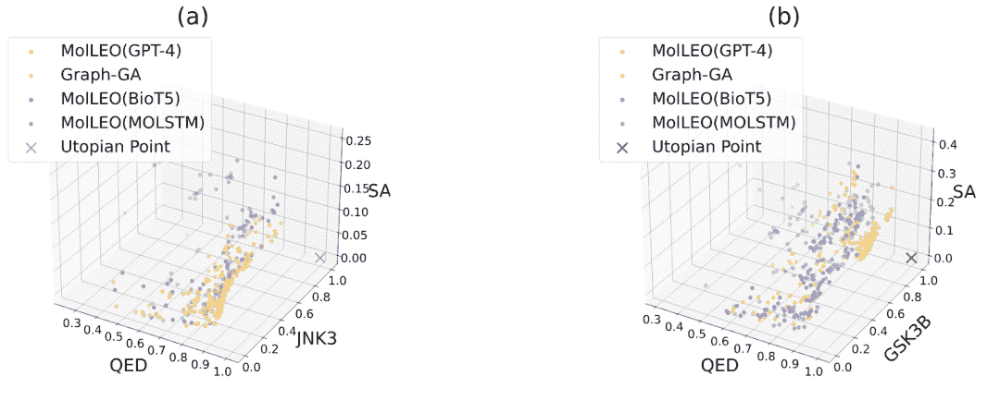
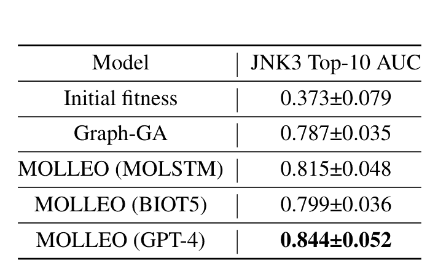

# 击败 25 个分子设计算法，佐治亚理工、多伦多大学、康奈尔提出大语言模型 MOLLEO

> 来源：[https://agijuejin.feishu.cn/docx/GMppdeWjaoeQEoxTFNtc4q1FnRf](https://agijuejin.feishu.cn/docx/GMppdeWjaoeQEoxTFNtc4q1FnRf)

> 机器之心 ScienceAI｜[阅读原文](https://www.jiqizhixin.com/articles/2024-07-01-15)

> 转载请联系原作者取得授权

作者 | 佐治亚理工学院王浩瑞

编辑 | ScienceAI

分子发现作为优化问题，因其优化目标可能不可微分而带来显著的计算挑战。进化算法（EAs）常用于优化分子发现中的黑箱目标，通过随机突变和交叉来遍历化学空间，但这会导致大量昂贵的目标评估。

在这项工作中，佐治亚理工学院、多伦多大学和康奈尔大学研究者合作提出了分子语言增强进化优化（MOLLEO），通过将拥有化学知识的预训练大 语言模型 （LLMs）整合到进化算法中，显著改善了进化算法的分子优化能力。

该研究以《 Efficient Evolutionary Search Over Chemical Space with Large Language Models 》为题，于 6 月 23 日发布在预印平台 arXix 上。

论文链接： https://arxiv.org/abs/2406.16976

# **分子发现的巨大计算挑战**

分子发现是一个复杂的迭代过程，涉及候选分子的设计、合成、评估和改进，在现实世界有广泛的应用，包括药物设计，材料设计，改善能源，疾病问题等。这个过程通常缓慢且费力，由于复杂的设计条件与评估分子属性通常需要昂贵的评估（如湿法实验、生物测定和计算模拟），即使是近似的计算评估也需要大量资源。

因此，开发高效的分子搜索、预测和生成算法已成为化学领域的一个研究热点，以加速发现过程。特别是， 机器学习 驱动的方法在快速识别和提出有前途的分子候选物方面发挥了重要作用。

由于[问题的重要](http://mp.weixin.qq.com/s?__biz=MzI3MjM3ODk0NQ==&mid=2247501382&idx=1&sn=b6e0edf42b5f20dbe45fc5546897e209&chksm=eb31fb68dc46727e2da6250af5bd8fdfea53f91c9dbfe61339def6ba68bb3b18c39033f1b1b6&scene=21#wechat_redirect)[性，分子优化受](http://mp.weixin.qq.com/s?__biz=MzI3MjM3ODk0NQ==&mid=2247501382&idx=1&sn=b6e0edf42b5f20dbe45fc5546897e209&chksm=eb31fb68dc46727e2da6250af5bd8fdfea53f91c9dbfe61339def6ba68bb3b18c39033f1b1b6&scene=21#wechat_redirect)[到了极大的关注，](http://mp.weixin.qq.com/s?__biz=MzI3MjM3ODk0NQ==&mid=2247501382&idx=1&sn=b6e0edf42b5f20dbe45fc5546897e209&chksm=eb31fb68dc46727e2da6250af5bd8fdfea53f91c9dbfe61339def6ba68bb3b18c39033f1b1b6&scene=21#wechat_redirect)包括已经发展测试的超过20多种分子设计算法（其中 遗传算法 和 强化学习 等组合优化的方法领先于其他 生成模型 和连续优化算法）， 详见最近 Nature 子刊的综述文章 。其中效果最佳之一的方法为进化算法（EAs），这些算法的特点是不需要梯度评估，因此非常适合用于分子发现中的黑箱目标优化。

然而，这些算法的一个主要缺点是它们随机生成候选结构而不利用任务特定的信息，从而导致需要大量的 目标函数 评估。因为评估属性的昂贵，分子优化除了找到最佳期待属性的分子结构，同时也要最小化 目标函数 评估次数（也等同于提高搜索效率）。

最近，LLM在多项与化学相关的任务中表现出了一些基本能力，如预测分子属性、检索最优分子、自动化化学实验和生成具有目标属性的分子。由于LLM在包含广泛任务的大规模文本语料库上进行了训练，它们展示了通用的语言理解能力和基本的化学知识，使其成为化学发现任务的有趣工具。

然而，许多基于LLM的方法依赖于上下文学习（in-context learning）和提示工程，这在设计具有严格数值目标的分子时可能会出现问题，因为LLM可能难以满足精确的数值约束或优化特定的数值目标。此外，单纯依赖LLM提示的方法可能会生成物理基础较差的分子，或者生成无法解码为化学结构的无效SMILES字符串。

# **分子语言增强进化优化**

在本研究中，我们提出了分子语言增强进化优化（MOLLEO），该方法将LLM整合到EA中以提高生成候选物的质量并加速优化过程。MOLLEO利用LLM作为遗传操作符，通过交叉或变异生成新的候选物。我们首次展示了如何将LLM整合到EA框架中以进行分子生成。

在该研究中，我们考虑了三个不同能力强度的 语言模型 ：GPT-4、BioT5和MoleculeSTM。我们将每个LLM整合到不同的交叉和变异程序中，并通过消融研究证明了我们的设计选择。

我们通过多个黑箱优化任务的实验证明了MOLLEO的优越性能，包括单目标和 多目标优化 。对于所有任务，包括更具挑战性的蛋白质-配体对接，MOLLEO均优于基线EA和其他25个强基线方法。此外，我们还展示了MOLLEO在ZINC 250K 数据库 中的最佳JNK3抑制剂分子上进一步优化的能力。

我们的MOLLEO框架基于一种简单的进化算法，Graph-GA算法，并通过在遗传操作中整合化学 感知 的LLM来增强其功能。

我们首先概述了问题陈述，强调在黑箱优化中最小化昂贵目标评估的必要性。MOLLEO利用LLM（如GPT-4、BioT5和MoleculeSTM）在目标描述的指导下生成新的候选分子。

具体而言，在交叉步骤中，我们不是随机结合两个父分子，而是使用LLM生成最大化目标适应度函数的分子。在变异步骤中，操作符根据目标描述对当前种群中最适应的成员进行变异。然而，我们注意到LLM并不总是生成适应度高于输入分子的候选物，因此我们构建了选择压力，基于结构相似性过滤编辑过的分子。

# **实验结果**

我们在18个任务上评估了MOLLEO。任务选自PMO和TDC 基准 测试和 数据库 ，可以分为以下几类：

1.  **基于结构的优化： **根据目标结构优化分子，包括基于目标分子公式的同分异构体生成（isomers_c9h10n2o2pf2cl）和两个基于匹配或避免骨架和亚结构基序的任务（deco_hop, scaffold_hop）。

1.  **基于名称的优化： **包括找到与已知药物相似的化合物（mestranol_similarity, thiothixene_rediscovery）和三个多属性优化任务（MPO），这些任务在重新发现药物（如Perindopril, Ranolazine, Sitagliptin）的同时优化其他属性，如疏水性（LogP）和渗透性（TPSA）。尽管这些任务主要涉及重新发现现有药物而非设计新分子，但它们展示了LLM具有基本的化学优化能力。

1.  **属性优化 **：包括简单的属性优化任务QED，衡量分子的药物相似性。然后，我们关注PMO中的三个任务，衡量分子对以下蛋白质的活性：DRD2（多巴胺受体D2），GSK3β（糖原合酶激酶-3β），和JNK3（c-Jun氨基末端激酶-3）。此外，我们还包括了TDC中的三个蛋白质-配体对接任务（结构性药物设计），这些任务比简单的物理化学性质更接近现实世界的药物设计。

为了评估我们的方法，我们按照PMO 基准 测试的方法，综合考虑了目标值和计算预算，报告了前k个平均属性值与 目标函数 调用次数的曲线下面积（AUC top-k）。

作为对比 基准 ，我们使用了PMO 基准 测试中的顶级模型，包括基于 强化学习 的REINVENT、基础进化算法Graph-GA和 高斯过程 贝叶斯优化GP BO。

图示：单目标任务的Top-10 AUC。（来源：论文）

我们在PMO的12项任务中进行了单目标优化实验，结果上表所示，我们报告了每项任务的AUC top-10 得分以及各模型的总体排名。结果表明，使用任意一个大型 语言模型 （LLM）作为遗传操作符，都能提高性能，超过默认的Graph-GA和其他所有基线模型。

GPT-4在12项任务中有9项表现优于所有模型，展示了其作为一个通用大 语言模型 在分子生成中的有效性与前景。BioT5在所有测试模型中取得了第二好的结果，总分接近GPT-4，说明在领域知识上训练与微调的小模型在MOLLEO中也有很好的应用前景。

MOLSTM是基于CLIP模型在分子的自然语言描述和分子的化学式上微调的小模型，我们在进化算法中在相同的自然语言描述上使用 梯度下降 算法来产生不同的新分子，它的表现也优于其他的 基准 方法。

图示：JNK3抑制随迭代次数增加而出现的群体适应度。（来源：论文）

为了验证将LLM整合到EA框架中的有效性，我们展示了初始随机分子池在JNK3任务上的得分分布。随后，我们对池中的所有分子进行了一轮编辑，并绘制了编辑后分子的JNK3得分分布。

结果表明，经过LLM编辑后的分布都略微向更高的得分方向偏移，这表明LLM确实提供了有用的修改。然而，总体目标得分仍然较低，因此单步编辑并不足够，在这里使用进化算法进行迭代优化是必要的。

图示：与DRD3、EGFR或腺苷A2A受体蛋白对接时前10个分子的平均对接得分。（来源：论文）

除了PMO中的12个单目标优化任务外，我们还在更具挑战性的蛋白质-配体对接任务中测试了MOLLEO，这些任务比单目标任务更接近于现实世界中的分子生成场景。上图是MOLLEO和Graph-GA的前十个最好分子的平均对接评分与 目标函数 调用次数的关系图。

结果表明，在所有三种蛋白质中，我们的方法生成的分子的对接评分几乎都优于基线模型，并且 收敛 速度更快。在我们使用的三种 语言模型 中，BioT5表现最佳。在现实中，更好的对接评分和更快的 收敛 速度可以减少筛选分子所需的生物检测次数，使这一过程在成本和时间上都更有效。

图示：多目标任务的求和和超体积分数。（来源：论文）

图示：Graph-GA和MOLLEO在多目标任务上的帕累托最优可视化。（来源：论文）

对于 多目标优化 ，我们考虑了两个指标：所有优化目标的得分之和的AUC top-10和帕累托最优集的超体积。我们展示了 多目标优化 在三个任务中的结果。任务1和任务2受到 药物发现 目标的启发，旨在同时优化三个目标：最大化分子的QED、最小化其合成可及性（SA）评分（意味着更容易合成）以及最大化其对JNK3（任务1）或GSK3β（任务2）的结合评分。任务3更加具有挑战性，因为它需要同时优化五个目标：最大化QED和JNK3结合评分，以及最小化GSK3β结合评分、DRD2结合评分和SA评分。

我们发现，在所有三个任务中，MOLLEO(GPT-4)在超体积和总和方面都始终优于基线的Graph-GA。在图中，我们可视化了任务1和任务2中我们的方法和Graph-GA的帕累托最优集（在目标空间中）。当在引入多个目标时，开源的 语言模型 的性能下降。我们推测这种性能下降可能源于它们无法捕捉大量信息密集的上下文。

图示：使用ZINC 250K中的最佳分子初始化MOLLEO。（来源：论文）

进化算法的最终目标是改进初始分子池的性质并发现新分子，为了探索MOLLEO探索新分子的能力，我们用ZINC 250K中的最佳分子初始化分子池，然后使用MOLLEO和Graph-GA进行优化。在JNK3任务上的实验结果显示，我们的算法始终能优于基线模型Graph-GA，并且能够改进现有数据集中找到的最佳分子。

此外，我们还注意到BioT5的训练集是ZINC20 数据库 （包含14亿化合物），MoleculeSTM的训练集是PubChem 数据库 （约25万分子）。我们检查了每个模型在JNK3任务中生成的最终分子是否出现在相应的数据集中。结果发现，生成的分子与数据集中并没有重叠。这表明模型能够生成新的、未在训练集中出现的分子。

# 可应用于 药物发现 、材料、生物分子设计

分子发现和设计是一个具有众多实际应用的丰富领域，许多应用超出了当前研究的范围，但与我们提出的框架仍然相关。MOLLEO将LLM与EA算法结合，通过纯文本的结合方式提供了灵活的算法框架，在未来MOLLEO可以应用于 药物发现 、昂贵的计算机模拟以及材料或大型生物分子的设计等场景。

未来工作我们将进一步关注如何提高生成分子的质量，包括其目标值和发现速度。随着LLM的不断进步，我们预计MOLLEO框架的性能也将继续提升，使之成为生成化学应用中的一个有前景的工具。