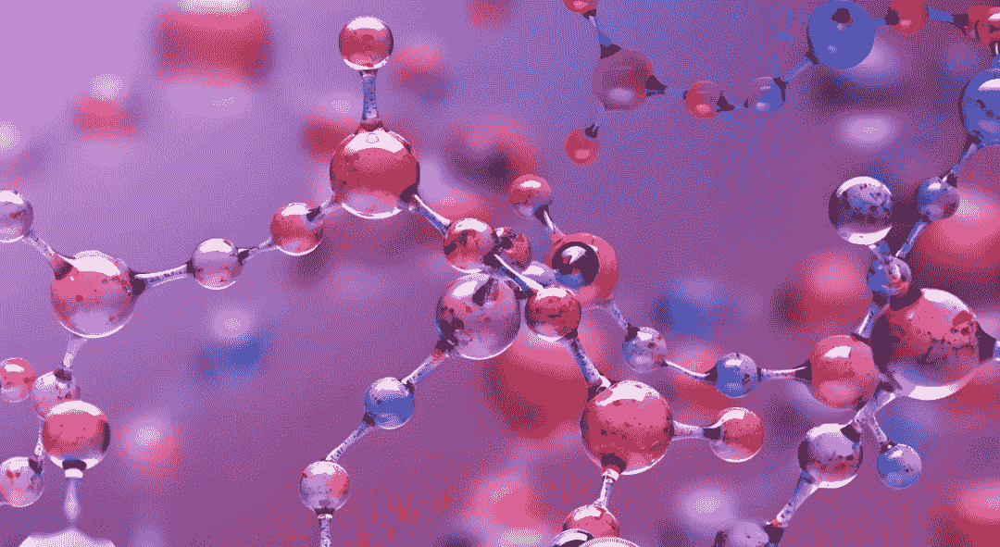
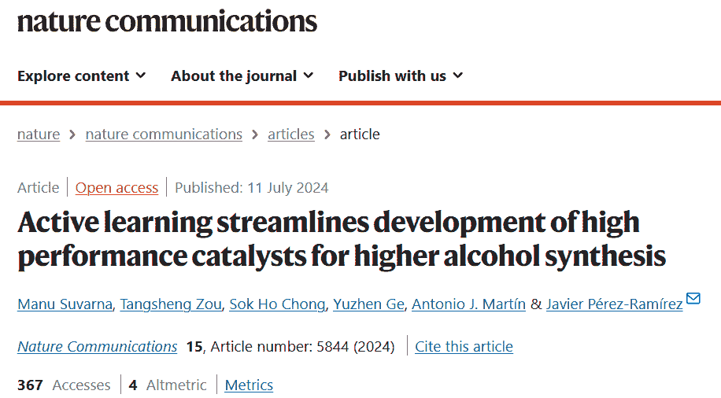
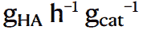
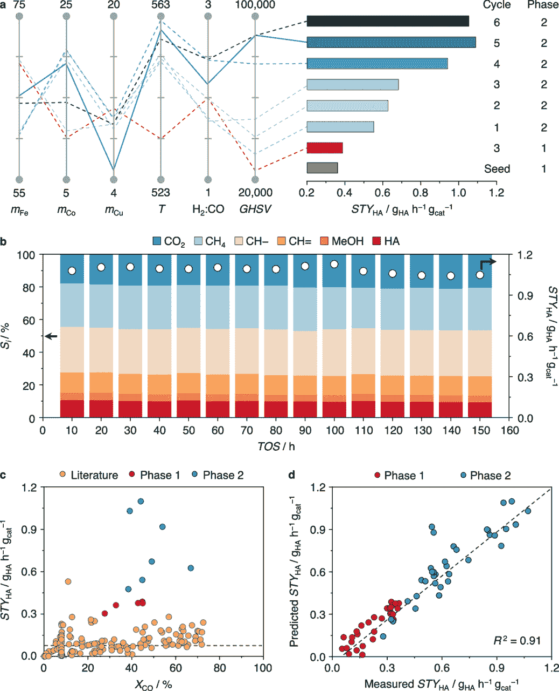
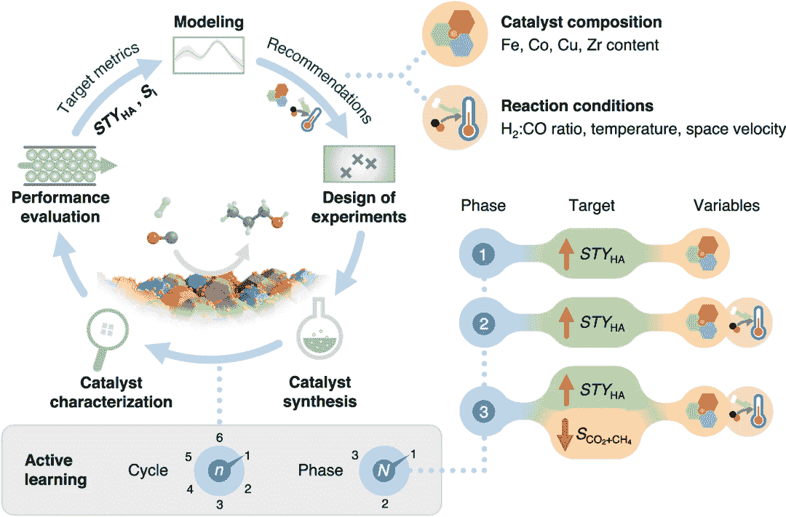
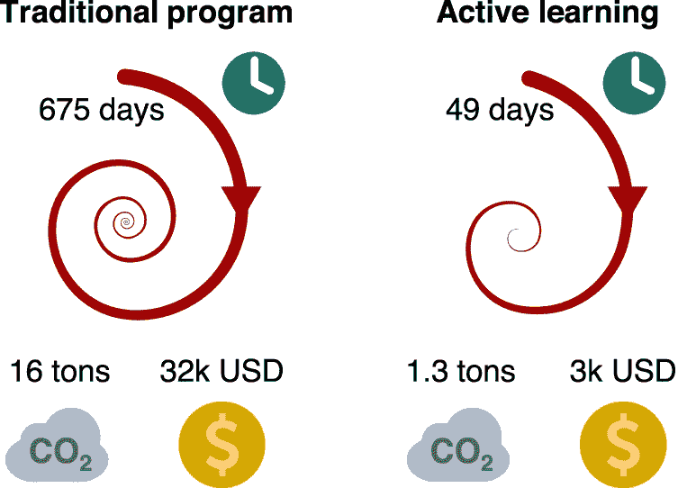

# 成本减少90%以上，「主动学习+实验工作流程」加速催化剂开发

> 来源：[https://agijuejin.feishu.cn/docx/MybUd17KBo1z16xDj8scGhQ2nxb](https://agijuejin.feishu.cn/docx/MybUd17KBo1z16xDj8scGhQ2nxb)

> 机器之心 ScienceAI｜[阅读原文](https://www.jiqizhixin.com/articles/2024-07-18-8)

> 转载请联系原作者取得授权

编辑 | 绿罗

通过合成气的热催化加氢合成高级醇 (HAS) 仍然是一项有前途的技术。链增长和 CO 插入要求需要多组分材料，其复杂的反应动力学和广泛的化学空间不符合催化剂设计规范。

在此，来自苏黎世联邦理工学院（ETH Zurich）的研究人员提出了一种替代策略，将主动学习整合到实验工作流程中，以 FeCoCuZr 催化剂系列为例。

所提数据辅助框架简化了 86 个实验中广泛成分和反应条件空间的导航，与传统程序相比，环境足迹和成本减少了 90% 以上。它确定了具有优化反应条件的 Fe65Co19Cu5Zr11 催化剂，在稳定运行 150 小时的情况下可实现1.1

的更高醇生产率，比通常报告的产量提高了 5 倍。

这种方法超越了现有的 HAS 催化剂设计策略，适用于更广泛的催化转化，并促进了实验室的可持续性。

相关研究以《 Active learning streamlines development of high performance catalysts for higher alcohol synthesis 》为题，于 7 月 11 日，发布在《 Nature Communications 》上。

论文链接： https://www.nature.com/articles/s41467-024-50215-1

开发用于合成气基高级醇合成 (HAS) 的高效催化剂仍然是一项艰巨的研究挑战，它可在促进循环经济和缓解气候变化问题的同时，减少有价值化学品和燃料添加剂生产的化石燃料。为有价值的化学品和燃料添加剂的生产提供化石燃料。

机器学习 (ML) 与并行实验的交汇点是主动学习，它适用于通过小数据—机器智能—人类决策的闭环框架来加速材料设计和工艺优化。

尽管这种方法在材料科学、药物发现和生物系统工程领域越来越受欢迎，但在催化领域仍未得到充分探索。主动学习辅助方法是否适用于高度复杂的 HAS 催化剂系统尚不清楚。

# **主动学习加速催化剂开发**

在这项研究中，研究人员开创了一种主动学习策略来加速高活性 FeCoCuZr 催化剂的开发。主要特点包括：

(i) Fe65Co19Cu5Zr11 催化剂具有较高的预测能力，其最佳反应条件为稳定的高级醇的时空产率（ STY HA）为 1.1

，持续时间至少为 150 h，是目前报道的合成气直接 HAS 的最高值；

(ii) 通过从大约 50 亿个潜在组合的巨大空间中识别出 86 个实验的最佳系统，大幅减少时间和资源；

(iii) 多目标优化揭示内在性能权衡和推荐的帕累托最优催化剂，以最大限度地降低对 CO2 和 CH4 的选择性，同时仍保持高 STY HA。

图示：确定催化剂组成和反应条件最大化 STY HA。（来源：论文）

这些结果强调了数据驱动方法在持续加快高效多组分催化剂开发和促进催化研究创新方面的潜力。

# **主动学习框架概述和范围**

主动学习方法，将数据驱动算法与实验工作流程相结合，该方法不断从迭代实验循环中现有和新生成的数据中学习，以探索和识别 FeCoCuZr 成分和反应条件，优化感兴趣的催化剂性能指标。数据驱动模型的核心结合了高斯过程 (GP) 和贝叶斯优化 (BO) 算法，以及人类决策，从而完成单目标或多目标任务。

图示：开发 FeCoCuZr 催化剂的主动学习工作流程方案。（来源：论文）

为了展示这种方法对 HAS 的可行性，研究分三个不同阶段系统地进行，逐步增加模型的复杂性。

+   在第 1 阶段，改变催化剂成分，目标是在固定反应条件下最大化 STY HA。

+   在第 2 阶段，通过同时探索催化剂成分和反应条件来最大化 STY HA，增加了问题的维度。

+   随后，在第 3 阶段，通过同时最大化 STY HA 并最小化二氧化碳和甲烷的综合选择性，将该方法扩展到多目标能力。每个阶段进行由六次实验组成的迭代循环，直到达到目标性能指标或达到饱和状态。

# **主动学习和可持续实验室**

虽然 FeCoCuZr 系统可能的化学和参数空间有十亿种组合，但多组分催化剂的实际研究范围从数百到数千个筛选实验。

通过采用主动学习，研究人员将 FeCoCuZr 催化剂的广阔空间映射到 1-3 阶段的累计 104 个实验中，以满足所需的性能目标，证实了越来越多的文献声称主动学习可以加速实验工作。这对催化剂开发计划的环境和经济可持续性产生了深远的影响，而这一影响尚未得到探索。

图示：主动学习对实验室可持续性的影响。（来源：论文）

在此背景下，假设这项研究代表了催化剂开发工作，研究评估了主动学习对实验室的两个可持续性支柱的影响程度。

分析表明，与传统活动相比，碳足迹和成本平均减少了 90% 以上。还观察到，这一结果与全球区域差异的依赖性非常小，例如，影响能源结构或实验室运营支出的构成。

因此，通过减少化学品和能源的消耗，并优化资源利用率，主动学习显著促进了可持续催化实验室的发展。

> 注：封面来自网络