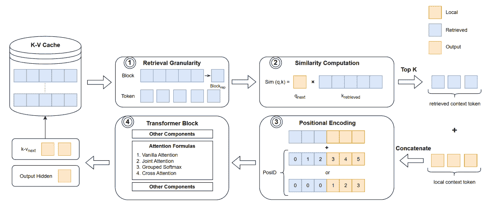
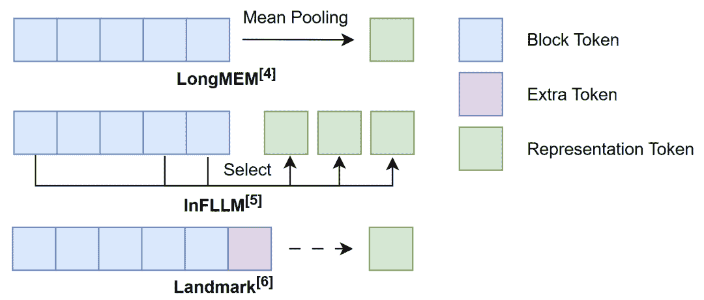
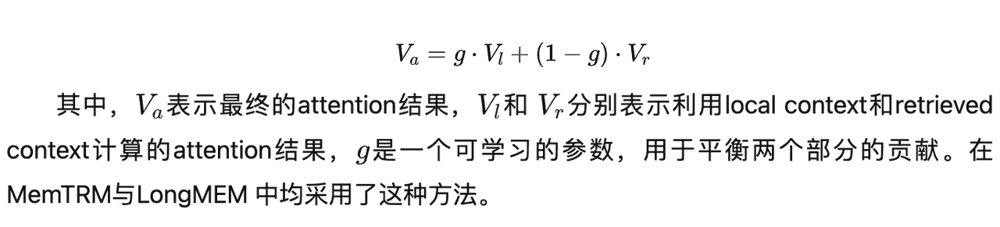
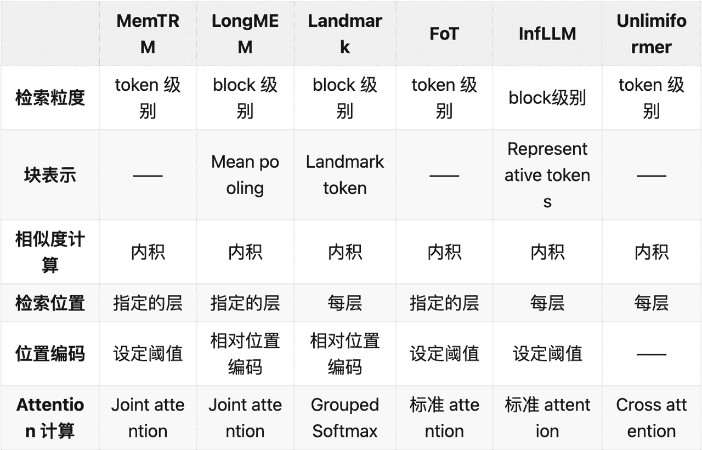
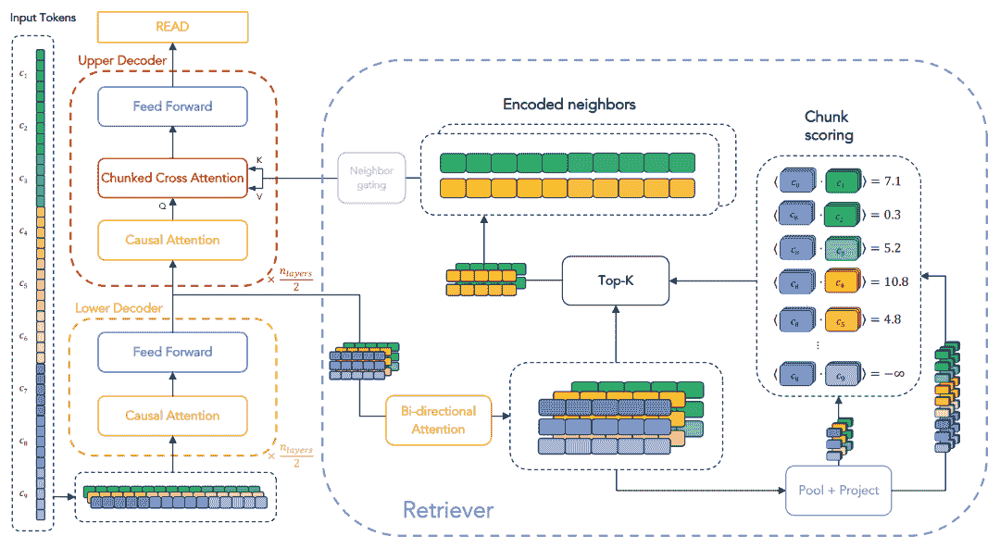

# 大模型上下文长度扩展中的检索增强技术简述

> 来源：[https://agijuejin.feishu.cn/docx/VfxKdXbfPoVcDVxoVGBcUuAEnjg](https://agijuejin.feishu.cn/docx/VfxKdXbfPoVcDVxoVGBcUuAEnjg)

> 哈工大SCIR｜[阅读原文](https://mp.weixin.qq.com/s/S69fHfDIjfTL9maYS9HrXQ)

> 转载请联系原作者取得授权

> **笔记作者： **刘议骏，徐阳

> **转载须标注出处： **哈工大SCIR

#  **背景介绍 **

基于Transformer的语言模型在众多自然语言处理任务上都取得了十分优异的成绩，在一些任务上已经达到SOTA的效果。但是，经过预训练后，模型能够较好处理的序列长度就固定下来。而当前的众多场景往往需要处理很长的上下文（如：大的代码仓库、书籍等长文档的摘要、few-shot等输入较长的in-context learning场景等等），其长度超过了模型预训练时使用的长度，无法一次性输入模型，导致语言模型无法充分利用长输入中完整的知识，因而性能受到制约。

针对这一问题，研究者们提出了多种检索的方法，从全部的历史上文中检索所需的相关token，放入有限的窗口内计算attention，使得模型能够利用短的输入窗口处理长的序列。

#  **方法概述 **

受预训练的限制，模型能够较好处理的序列长度相对固定，通常为2048、4096等等。在不改变attention计算机制的前提下，很难保证在模型能力损失较小的同时，显著扩展模型能够处理的上下文长度。并且，在长文本上训练的代价也很高，直接在长文本上从头训练一个窗口长度很长的模型较为困难。于是，我们希望模型能够在有限的处理窗口中能够关注长上下文中关键的token，获取其中的信息，从而充分利用长文本中的知识，提升处理长文本的能力。

图1 基于检索增强的处理流程

众多研究者提出了基于检索增强的方法，通过在上下文历史中查找关键token，并将它们放入attention计算中的方式，增强模型在长文本任务上的表现。其大致流程如图1所示，基本思路是分段处理，通过多次调用短上下文模型来处理长上下文输入，在此过程中保存K-V Cache供后续分段使用。引入检索增强技术之后，模型的处理流程如下。首先，模型以不同的检索粒度从K-V Cache中取出相应的 token 表示。然后，模型计算当前处理的token与这些历史token的相似度，并根据相似度结果选取最相关的top-k token。检索到的token会与当前窗口内的上下文拼接在一起，组合成新的上下文，用于当前的输入。随后，进行合适的位置编码。最后，把输入序列送入模型层，得到当前层的输出，其中最关键的是attention部分。下文将按上述处理顺序，对应图1中的四个关键步骤依次介绍。

##  **1 检索粒度与表示 **

我们首先关注的问题是如何从K-V Cache中检索与当前处理步骤最相关的一部分token，其中首要的问题是检索粒度，也就是检索的基本单元的大小。

最基本的是token级别的检索。具体来说，是在K-V Cache中逐个token计算与当前待处理的token的相似度，选取相似度最高的top-k token对应的key与value向量作为检索结果。这类方法的代表有MemTRM[1]、FoT[2]、Unlimiformer[3]等等。

尽管token级别的检索在实现上相对简单，但也面临一些限制。首先，由于检索到的是离散的token，相邻的token并不一定能被一并检索，这可能导致语义上的独立。其次，每次生成新token时，都需要与K-V Cache中的所有token重新计算相似度，这增加了计算量，检索效率较低。

为了改进这些缺陷，有研究者提出使用更粗的检索粒度，把输入序列分成一个个长度相同的block，在block级别进行检索。block级别的检索是在处理每个新的token时，从K-V Cache里以block为单位进行相似度计算，选取top-k block作为检索结果。block级别的检索得到是一连串相邻的token，语义上比离散的token更连贯。另外，由于每次检索只在block上进行一次相似度计算，大大减少了计算量并且提高了检索效率。

然而，block级别的检索也带来了一个新的问题：如何有效地表示block以完成相似度计算。如图2所示，为了充分利用block内token的信息，可以按一定规则对block内的token进行信息融合的操作，从而得到block的表示。例如，LongMEM[4]通过计算block内token表示的mean pooling来表示相应的block；而InFLLM[5]则是在block计算每个token与其他token的一种整体相似性指标（representative score），选取其中分数较高的一部分token共同作为block的表示。此外，还有方法引入额外的token来表示block，如Landmark[6]方法中在词表内添加了一个新的token—Landmark，并将其放置在每个block的末尾作为block的代表，同时这个Landmark token也参与到序列的计算中，通过Grouped Softmax实现层次化的attention机制，我们在后面还会展开阐述Landmark的具体做法。

图2 block的表示

##  **2 相似度计算 **

在确定检索粒度后，我们需要建立适当的规则来计算相似度。目前的方法几乎都采用将当前处理的token的query向量与检索粒度所代表的key向量进行内积计算作为相似度的标准。这种做法源于标准的attention计算机制，标准attention中所计算的query与key的内积本身就是一种便于计算的相似度，而且相似度越高，相应value的权重就越高。现有的方法充分利用这一特性，计算当前token的query向量与检索粒度所代表的key向量相似度作为attention贡献的度量，通过舍弃低贡献的上下文来节省上下文窗口的可用空间，得到一种attention的有效近似。

##  **3 位置编码 **

在完成相似度计算后，我们选择相似度最高的top-k token作为检索的结果。我们把这部分来自上下文历史的token记作retrieved context token，而在当前窗口范围内的token记为local context token。把这两类context token拼接在一起，就得到了输入当前层的完整context token序列。

接下来，在将这一组合的context token输入到模型进行attention计算之前，需要考虑位置编码，以区分不同位置token。在检索方法中，由于retrieved context token的位置不固定，并且在缓存时记录每个token具体的位置的代价较高，很难给出准确的位置信息。因此，需要找到一个合适的编码位置的方式来融合一定的位置信息。Sun等人[79]在PG19[8]数据集上的实验表明，相对位置信息对远距离的token似乎并不重要。基于此，MemTRM、FoT、InfLLM等方法直接将retrieved context token部分的位置编码设置成相同的位置向量，忽略了retrieved context token内彼此的位置信息。而另一些方法认为retrieved context token内部的相对顺序依然重要，因此为其添加了位置编码，如LongMEM则是直接使用ALiBi[9]进行相对位置编码，Landmark方法则将retrieved context token与local context token放在同一窗口内，对它们重新进行相对位置编码。

##  **4 Attention计算 **

在进行attention计算时，我们需要考虑如何充分利用由retrieved context token和local context token这两类token组成的context tokens。

最简单的处理方法是将两类token视作同等地位，直接使用常规的attention计算方式。如在FoT与InfLLM中就是使用标准的attention进行计算；在Unlimiformer中则是使用Cross Attention完成相应的计算。

然而，对于当前处理的token来说，这两类context token包含信息的重要性并不相同。为了充分利用它们的信息，Joint Attention对它们做了一定的区分，分别计算local context与retrieved context中各自的attention。然后，加权得到最终的attention结果，可以概括成以下的公式：

Landmark在此基础上更进一步。为区分retrieved context token内来自不同位置的信息，Landmark提出使用Grouped Softmax来更细粒度地分配权重。具体来说，该方法首先将Landmark这一类token与local context token放在一起进行softmax计算，从中选出Top-K个相关的block，同时保留softmax的计算结果。然后分别在这些block内单独计算attention，利用先前计算softmax结果对不同block的attention进行加权，得到最终的attention结果。

##  **5 检索位置 **

另外，检索的实现也是有一定资源的消耗，因此在平衡效率和性能的目标下，不同的方法对检索时机的选取有所不同。其中，MemTRM、LongMEM、FoT选择在模型中的某些指定层进行检索，而Landmark、InfLLM则是在每一层都进行检索。专用于encoder-decoder架构的方法则是在decoder部分进行检索，例如Unlimiformer在每个decoder层均进行检索。

以上就是通过检索增强处理长文本方法的流程，可以将上述提到方法的各环节大致整理为如下的表格：

表1 上述方法各环节内容

#  **性能对比 **

上述方法在一些长文本数据集上验证其语言能力：PG-19[11]（英文书籍）、arXiv（数学论文）、C4[10]（网络文档）、GitHub（代码）和 Isabelle（定理证明）等等。通常选用PPL作为评价的指标。此外，还涉及一些自然语言理解的任务，如SST-2[11]、MR[12]、Subj[13]、SST-5[11]、MPQA[14]等等。

虽然不同的方法选择了其中相同的一些数据集或任务进行验证实验，但在各自的实验中，使用的数据集、基线、数据处理、训练方式等实验设置不同，导致不同方法即便在相同数据集或任务上的实验结果也不可比。

总的来说，现有工作各自的实验结果在一定程度上证明了这些方法处理长文本的有效性，但目前仍然缺乏可以直接用于对比各项工作性能的公开结果。

#  与检索增强生成（RAG）技术的对比

虽然通过检索增强处理长文本的方法和检索增强生成（Retrieval Augmented Generation，RAG）均用到了检索，但二者之间还是存在着一定的区别。

首先，二者在检索对象上存在区别。长文本检索增强方法是在上下文历史的表示中检索，而RAG则侧重于在广泛的外部知识库中检索。

其次，这两类方法在检索的实现上也有所不同。如前面介绍的内容，长文本检索增强方法直接利用K-V Cache中的key计算相似度，作为检索的标准。并将检索到的(key,value)对直接用于模型后续attention的计算。相比之下，RAG面对庞大的外部知识库，利用一个独立的检索器（retriever）完成检索。此外，RAG可能还需要额外的组件来确保检索到的内容与生成的文本之间的一致性。由于这种结构上的复杂性，RAG通常不适用于直接处理长文本。通过上述分析，我们可以看出，虽然两种方法都涉及检索过程，但它们在检索对象和检索实现上有着不同，各有其适用的场景和限制。

那么，可以考虑采用 RAG 的方法来处理长文本吗？答案是肯定的。RPT[15]架构正是借鉴了RAG的检索思路来处理长文本。如图3所示，其整体流程与前文介绍相似，但每个步骤涉及的对象和处理方式有所区别，下面进行简要介绍。RPT采用encoder-decoder架构，在decoder阶段进行检索。它参照了RAG的实现，并配备了一个可训练的检索器。不同于RAG，RPT仅从encoder的输出中进行检索，而不涉及外部知识。具体来说，输入首先通过encoder处理，得到最后一层的隐层表示，这些表示被存储下来，构成检索库。在decode阶段进行Cross Attention计算时，会借助一个额外的检索器在这个检索库中检索。检索器首先将encoder的输出与decoder的输入通过一个双向attention层进行对齐，然后计算这两者对齐后的表示的内积作为相似度评分，最后选择top-k的表示作为检索结果。值得注意的是，此处的检索是在 block-to-block 级别进行，与之前的token-to-token和token-to-block不同。检索完成后，所得的表示还需通过一个邻接门控（neighbor gating）机制，参与到最终的Cross Attention的计算中。这里的Cross Attention采用了 RAG 中的一种变体—Chunked Cross Attention[16]，这种形式能够有效学习到上下文的连贯性，从而更准确地预测下文。

图3 RPT[15]架构

#  **参考文献 **

[1] Wu Y, Rabe M N, Hutchins D L, et al. Memorizing transformers[J]. arXiv preprint arXiv:2203.08913, 2022.

[2] Tworkowski S, Staniszewski K, Pacek M, et al. Focused transformer: Contrastive training for context scaling[J]. Advances in Neural Information Processing Systems, 2024, 36.

[3] Bertsch A, Alon U, Neubig G, et al. Unlimiformer: Long-range transformers with unlimited length input[J]. Advances in Neural Information Processing Systems, 2024, 36.

[4] Wang W, Dong L, Cheng H, et al. Augmenting language models with long-term memory[J]. Advances in Neural Information Processing Systems, 2024, 36.

[5] Xiao C, Zhang P, Han X, et al. InfLLM: Unveiling the Intrinsic Capacity of LLMs for Understanding Extremely Long Sequences with Training-Free Memory[J]. arXiv preprint arXiv:2402.04617, 2024.

[6] Mohtashami A, Jaggi M. Random-access infinite context length for transformers[J]. Advances in Neural Information Processing Systems, 2024, 36.

[7] Dai Z, Yang Z, Yang Y, et al. Transformer-xl: Attentive language models beyond a fixed-length context[J]. arXiv preprint arXiv:1901.02860, 2019.

[8] Rae J W, Potapenko A, Jayakumar S M, et al. Compressive transformers for long-range sequence modelling[J]. arXiv preprint arXiv:1911.05507, 2019.

[9] Press O, Smith N A, Lewis M. Train short, test long: Attention with linear biases enables input length extrapolation[J]. arXiv preprint arXiv:2108.12409, 2021.

[10] Raffel C, Shazeer N, Roberts A, et al. Exploring the limits of transfer learning with a unified text-to-text transformer[J]. Journal of machine learning research, 2020, 21(140): 1-67.

[11] Socher R, Perelygin A, Wu J, et al. Recursive deep models for semantic compositionality over a sentiment treebank[C]//Proceedings of the 2013 conference on empirical methods in natural language processing. 2013: 1631-1642.

[12] Auer S, Bizer C, Kobilarov G, et al. Dbpedia: A nucleus for a web of open data[C]//international semantic web conference. Berlin, Heidelberg: Springer Berlin Heidelberg, 2007: 722-735.

[13] Pang B, Lee L. A sentimental education: Sentiment analysis using subjectivity summarization based on minimum cuts[J]. arXiv preprint cs/0409058, 2004.

[14] Wiebe J, Wilson T, Cardie C. Annotating expressions of opinions and emotions in language[J]. Language resources and evaluation, 2005, 39: 165-210.

[15] Rubin O, Berant J. Long-range language modeling with self-retrieval[J]. arXiv preprint arXiv:2306.13421, 2023.

[16] Borgeaud S, Mensch A, Hoffmann J, et al. Improving language models by retrieving from trillions of tokens[C]//International conference on machine learning. PMLR, 2022: 2206-2240.

编辑：杨 昕

初审：车万翔、丁 效

复审： 张伟男、冯骁骋

终审： 单既阳