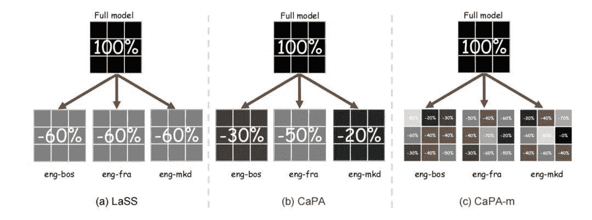
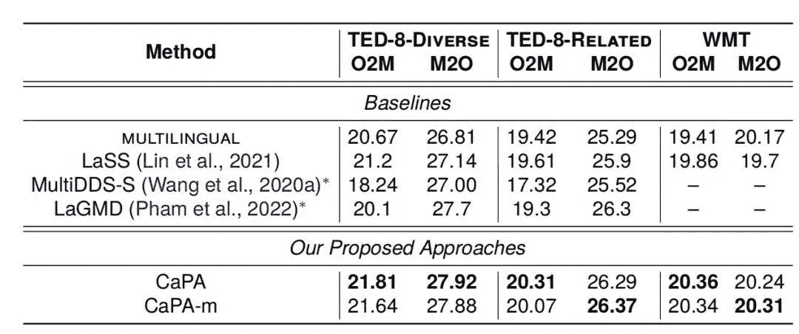
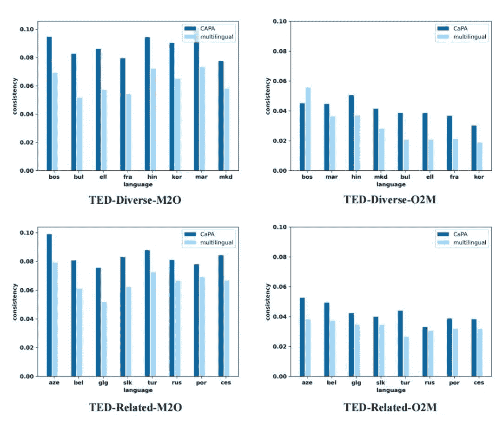
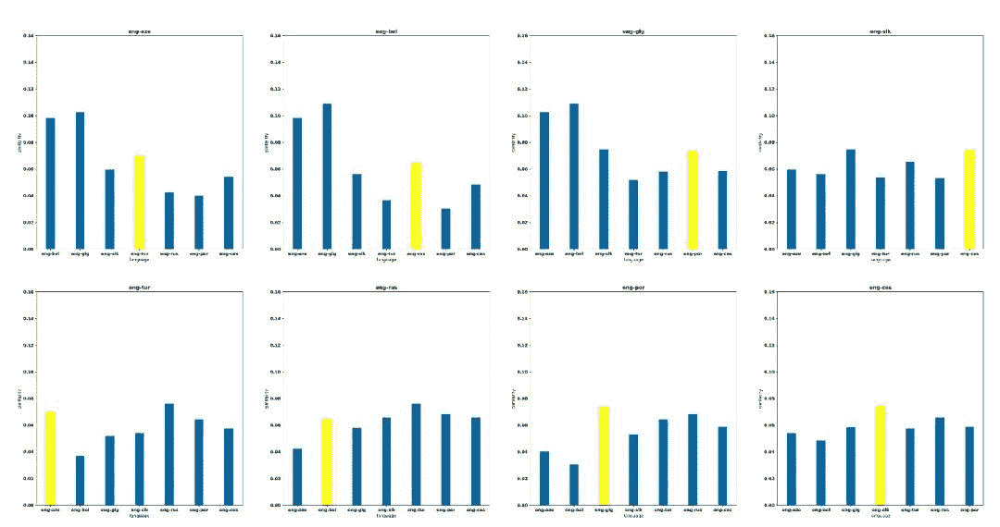

# 基于梯度一致性的多语言神经机器翻译参数分配

> 来源：[https://agijuejin.feishu.cn/docx/X6Qzdws3VoMgM8xlNHfcptL4n0b](https://agijuejin.feishu.cn/docx/X6Qzdws3VoMgM8xlNHfcptL4n0b)

> 哈工大SCIR｜[阅读原文](https://mp.weixin.qq.com/s/UUR0MlgPex-Fk8UqwkznHQ)

> 转载请联系原作者取得授权

> 论文名称：Gradient Consistency-based Parameter Allocation for Multilingual Neural Machine Translation

> 论文作者：霍文帅，冯骁骋，黄毅翀，付成鹏，王晖，秦兵

> 原创作 者：霍文帅

> 转载须标注出处：哈工大SCIR

##  **1. 介绍 **

多语言神经机器翻译使用一个统一的模型处理多种语言之间的翻译。然而，这种联合训练方式常常会引发跨语言干扰问题，即模型在面对多样的语言时，会为了寻找更加通用的解决方案而牺牲语言特性。最近的研究探索了通过为每种语言方向选择特定参数构建语言特定的子网络来避免这个问题。然而，确定要选择多少参数以及选择哪些参数仍然是一个挑战。在这项工作中，我们提出了一种名为CaPA（基于一致性的参数分配）的方法，根据训练过程中每个语言方向的梯度与平均梯度之间的一致性动态地为每个语言方向分配适当规模的参数。

##  **2. 背景 **

多语言机器翻译（Multilingual Neural Machine Translation，MNMT）是一种翻译模型，旨在通过一个单一模型处理多种语言之间的翻译任务。它采用参数共享的策略，即不同语言对之间共享同样的模型参数，以便更高效地处理多种语言之间的翻译需求。多语言机器翻译的主要优势在于，通过参数共享，它可以在处理多种语言时共享跨语言知识，从而在低资源语言上取得更好的翻译效果。同时，由于只需一个模型来处理多种语言，它也能够提供更高效和更低成本的解决方案。然而，这也引发了参数干扰问题，即不同语言在某些参数上存在分歧，导致模型倾向于在各种语言间选择折衷方案。这种折衷可能无法捕捉各种语言的细微差异，导致翻译质量降低。为了学习语言特定的知识，研究人员尝试了各种策略。这些策略包括引入额外的语言特定组件，如语言特定注意力模块，语言特定适配器, 语言特定层等，或者将导致不同语言对之间冲突的参数进行复制分化。然而，值得注意的是，这些方法不可避免地增加了整体模型参数。另一种关于语言特定建模的研究方法旨在通过使用模型修剪方法精确指定原始模型的某些参数作为语言特定参数。这类方法通过量化参数的重要性，选择性地修剪掉对每种语言方向重要性较低的神经元或权重。保留每种语言方向上重要的参数形成语言特定的子网络，每个子网络可以分为两部分：共享参数，用于保留通用知识，以及语言特定参数，用于捕捉语言特定知识。然而，确定每种语言方向需要多少参数，并选择要包含哪些参数是一项具有挑战性的任务。

##  **3. 方法 **

###  **3.1 学习语言特定子网络 **

学习语言特定的子网络可以减轻多语种机器翻译模型中语言之间的干扰。共享参数用于保留通用知识，而语言特定参数则专注于学习语言特定的细节。在这项工作中，我们遵循LaSS[1]方法，使用模型剪枝的方法来有选择地分配参数。在训练和推理过程中，只有属于子网络的参数参与计算，而不是整个模型。首先，我们训练一个完全共享参数的多语言翻译模型，随后，类似于 LaSS 方法，我们在初始模型上对每个语言方向进行微调，以识别语言特定的重要参数，通过剪枝不重要的参数确定语言特定子网络。在LaSS中，为所有语言方向的剪枝规模手动设置了统一的百分比，这无法充分建模语言差异性。与他们的方法不同，我们考虑训练过程中语言间的一致性程度，自适应地为每个语言方向分配不同规模的子网络。此外，模型不同组件上一致性程度通常是不同的，因此我们还提出根据模块级梯度一致性来自适应地分配参数。

###  3.2 基于梯度一致性的语言特定子网络

图1:对比LaSS与我们的方法

如图1中的(a)和(b)所示，与LaSS为所有语言方向剪枝固定比率参数的方法不同，CaPA在训练过程中观察语言间的梯度一致性，并根据干扰程度为每种语言方向分配不同大小的子网络。我们的主要思想是，当语言对的更新目标与平均目标显著偏离时，意味着该语言对对整体目标产生了负面干扰，应该分配更少的参数。另一方面，如果更新目标相似，意味着该语言对对整体目标有促进作用，应该分配更多的参数。我们将语言对的梯度与平均梯度之间的相似性定义为一致性，一致性越大，表明该语言越有助于整体训练目标的推进。相反，若一致性较小，则表示该语言的学习可能会引起干扰，需要对其进行更多的参数剪枝。

考虑到梯度相似性情况会在训练过程中发生变化，我们会动态地进行参数分配。在每次迭代中，我们根据当前的一致性来动态调整剪枝率，从而动态地更新语言特定的子网络。

###  3.3 基于模块级别梯度一致性的参数分配

在3.2中，我们根据每种语言方向在整个模型上的一致性计算剪枝率。与LaSS类似，我们将相同的剪枝比率应用于模型中的每个模块，如图1中的(a)和(b)所示。然而，模型中不同组件的干扰程度通常不同。因此，我们提出根据模块级梯度一致性来分配参数。具体来说，我们计算每种语言对在模型的每个模块上的一致性水平，并按照干扰程度进行修剪，如图1中的(c)所示。通过更加有针对性地减轻干扰，我们可以保留更多的通用知识。这种方法允许我们在不同的模块中灵活地调整子网络的大小，以更好地平衡语言特定的知识和通用的知识，从而提高翻译性能。通过根据局部一致性来动态地调整修剪率，我们可以在不同模块中实现更精准的参数分配，使得模型可以更好地适应不同语言对之间的差异，从而提高翻译质量。

##  **4. 实验及分析 **

###  **4.1 实验结果 **

我们在公开的多语言数据集进行了实验，包括广泛使用的数据集TED-8-Diverse 和 TED-8-Related，以及相对较大规模的 WMT 数据集。结果显示，我们的方法在 TED-8-Diverse 和 TED-8-related 数据集上优于所有基线方法。与LaSS相比，我们的方法在 M2O 和 O2M 任务上表现出更好的性能，表明其在促进不同语言方向之间的正向知识迁移并抑制负向知识迁移方面具有更强的能力。对于 WMT 数据集，在 M2O 翻译任务上，LaSS 没有超越基线，并且我们方法所取得的改进也是有限的。这可能是由于在多语言机器翻译中M2O 场景下参数干扰现象并不严重。而我们的方法旨在解决跨语言负干扰问题，因此对于 O2M 更有效。此外，CaPA-m（模块级的CaPA） 实现了比基线更好的结果，然而，相对于 CaPA没有显著的改进。这个结果表明，与语言对之间的整体梯度一致性差异相比，模块级的梯度一致性差异可能对结果影响较小。

表1:主要实验结果

###  **4.2 语言间的梯度一致性 **

我们计算了CaPA和基线方法从开始训练直到达到最佳性能过程中梯度一致性的平均水平，如图2所示。CaPA 在几乎所有语言方向上都表现出优于基线的性能。这表明 CaPA 在抑制跨语言干扰和促进积极的跨语言知识迁移方面是有效的。在多语言机器翻译中，One-to-Many（O2M）任务中的干扰问题更为严重[2][3]。这是因为 O2M 需要将文本解码成多种语言，这就需要考虑目标语言中的词汇、语法、风格等方面的差异。观察图 2，不论是基线还是我们提出的方法，M2O 在各种语言方向上始终表现出更高的梯度一致性。这表明梯度一致性与跨语言干扰之间存在相关性。

图2:训练过程中的梯度一致性，语言按照数据规模从左向右增加

###  4.3 梯度一致性与数据量的关系

我们观察到梯度一致性在低资源语言方向通常表现出更高的水平，特别是在 O2M 方向上，如图2所示。我们推测，这可能是由于低资源语言方向的翻译性能较低，倾向于学习更通用的知识。相比之下，高资源语言方向需要学习更复杂的语言特定知识。在多语言机器翻译中，高资源语言方向通常更容易受到跨语言干扰的影响[3][4]，这与我们观察到的梯度一致性表现是吻合的。

###  4.4 语言相似性与梯度相似性的关系

在多语言机器翻译中，语言相关性是一个常常被考虑到的重要因素。因此，我们也分析了语言相关性与梯度相似性之间的关联。TED-Related-8 数据集包括四组相关语言：aze 和 tur（突厥语系），bel 和 rus（斯拉夫语系），glg 和 por（罗曼语系），ces 和 slk（捷克-斯洛伐克语系）。我们在训练过程中计算了数据集中每个语言方向之间的两两梯度相似性。我们在图3 中展示了 TED-Related-8 O2M 上的结果。在每个条形图中，每一列代表特定语言与数据集中所有其他语言之间的梯度相似性。语言顺序由数据量从少到多排列。黄色列显示了属于相同语言族的语言。我们观察到，相关语言之间的梯度相似性并不总是最高的，但经常超过相邻列的值。这一观察结果表明，当数据规模接近时，梯度相似性与语言相似性之间存在关联。此外，结果也显示出数据规模对梯度相似性的影响。

图3:语言间的梯度相似性，语言按照数据规模大小从左向右增加，黄色列表示相关语言

##  **5. 结论 **

在本文中，我们提出了一种自适应的跨语言知识迁移方法，在多语言机器翻译模型中根据梯度一致性动态分配不同规模的参数给每个语言方向。实验证明，我们的方法可以通过缓解跨语言干扰以及促进积极的跨语言知识迁移来有效改善翻译结果。本文还通过分析实验展示了梯度一致性与跨语言干扰之间的相关性。未来的研究可以继续从增强梯度一致性的角度，缓解多语言机器翻译中跨语言干扰的挑战。

##  **参考文献 **

[1]Zehui Lin, Liwei Wu, Mingxuan Wang, and Lei Li. 2021. Learning language specific sub-network for multilingual machine translation. In Proceedings of the 59th Annual Meeting of the Association for Computational Linguistics and the 11th International Joint Conference on Natural Language Processing (Volume 1: Long Papers), pages 293–305.

[2]Zhu Y, Feng J, Zhao C, et al. Counter-Interference Adapter for Multilingual Machine Translation[C]//Findings of the Association for Computational Linguistics: EMNLP 2021. 2021: 2812-2823.

[3]Shaham U, Elbayad M, Goswami V, et al. Causes and Cures for Interference in Multilingual Translation[C]//Proceedings of the 61st Annual Meeting of the Association for Computational Linguistics (Volume 1: Long Papers). 2023: 15849-15863.

[4]Aharoni, Roee, Melvin Johnson, and Orhan Firat. "Massively Multilingual Neural Machine Translation." Proceedings of the 2019 Conference of the North American Chapter of the Association for Computational Linguistics: Human Language Technologies, Volume 1 (Long and Short Papers). 2019.

编辑：李宝航

初审：冯骁骋

终审：丁 效