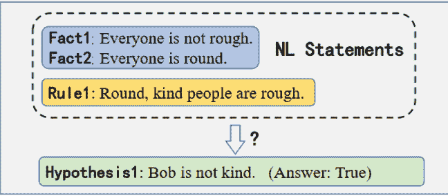
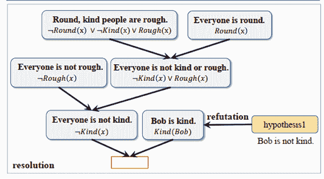
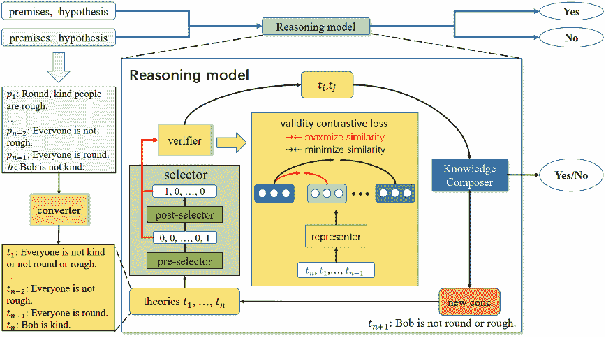
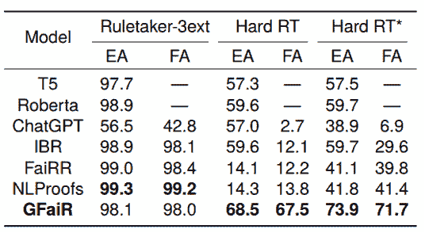
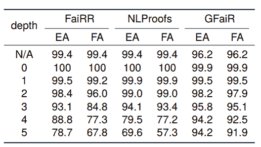
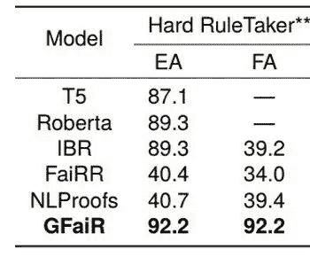

# GFaiR：基于归结反演的大语言模型逻辑推理系统

> 来源：[https://agijuejin.feishu.cn/docx/LKC1do4Ploa5yVxFFDacaqYrnzL](https://agijuejin.feishu.cn/docx/LKC1do4Ploa5yVxFFDacaqYrnzL)

> 哈工大SCIR｜[阅读原文](https://mp.weixin.qq.com/s/EMqBL5NVMkudxTsEubkjSQ)

> 转载请联系原作者取得授权

> 论文名称： T owards Generalizable and Faithful Logic Reasoning over Natural Language via Resolut ion Refutation

> 论文作者： 孙洲浩，丁效*，杜理，蔡碧波，高靖龙，刘挺，秦兵

> Arxiv: https://arxiv.org/abs/2404.01677

> 原创作者：孙洲浩

> 转载须标注出处：哈工大SCIR

#  **1 引言 **

基于自然语言的逻辑推理任务需要模型理解自然语言声明（statements）之间的抽象逻辑关系并推理出假设的真值（标签）。这类任务正在越来越受到关注，因为它将自然语言与抽象逻辑思维联系起来，抽象逻辑思维在解决复杂问题和认知推理中发挥着关键作用。然而，这类任务对于LLM来说仍然较为困难，这是因为LLM存在幻觉问题，其在推理过程中可能会产生不正确的中间推理步骤，从而最终导致错误的推理结果，因此是不可靠的。同时，如果将LLM看作一个推理系统，那么幻觉会影响这个系统的完备性。如果一个推理系统是完备的，那么我们可以通过应用推理系统中包含的合法推理规则来推理出具有确定标签（True和False）的所有假设。然而，幻觉会阻止LLM通过运用合法的推理规则得出结论，从而导致推理系统不完备。

为了减少幻觉从而提升忠实性，前人提出了分步推理方法，这些分步推理方法是基于前向链或后向链进行设计的。基于前向链的方法从已知规则开始，检查是否存在某一个规则其所有的前提条件都被给定的事实所满足，如果存在，则应用前向链的推理规则来推导出新的结论，这个过程一直持续直到不能得出新的结论或假设已经被证明。基于后向链的方法从假设开始以相反的方向进行推理，从而得出一组需要满足的事实，然后检查这些事实是否已经被已知事实所满足。通过引入了中间推理步骤，基于LLM的推理系统的忠实性得到了提升。

然而这些基于前向链或后向链的分步推理方法在复杂的逻辑推理场景下依然不尽如人意。在某些场景下，这些方法的性能可能会低于单独使用LLMs，甚至低于随机猜测（random guess）。这是因为基于前向链或后向链的分步推理方法是不完备的。这意味着一些具有确定标签的假设被模型会被认为是Unknown。因此，它只能适应于相对简单的推理场景。以前向链为例，前向链是不完备的因为它当且仅当“某个规则的所有条件都可以被已知事实证明是真的”（条件1）时才能够推理。然而，在推理过程中也存在一些特殊情况，前向链无法推理。对于图1中的假设1，前向链无法推理出假设是正确的（True），因为规则中包含的“kind people”这一条件无法被已知事实证明是真的。因此，我们无法得出任何推论，假设1将被视为Unknown。类似地，对于后向链，假设1“not kind”没有出现在规则的右侧因此也无法进行推理，该假设也将被视为Unknown。

图1：基于自然语言的逻辑推理问题样例

受逻辑符号领域的逻辑推理方法的启发，我们引入了一个在一阶逻辑下完备的逻辑推理范式归结反演（其推理过程不会受到条件1的约束）来提高完备性，并提出一个新的推理框架GFaiR。图2展示了归结反演的推理过程。对于图1中的问题，通过利用归结的推理规则，GFaiR可以在自然语言水平上进行归结，从已知信息中逐步推导出“Everyone is not kind”。然后通过反演，“Bob is kind”出现在了已知信息中，进而我们能够推导出一个矛盾（ Ev eryone i s not kind 与 Bob is kind两者互相矛盾 ），从而证明假设1是真的。因此，归结反演的结合使LLM能够处理更复杂的逻辑推理场景，从而增强了泛化能力。

图2：图1问题样例的归结反演推理过程

实验结果表明，我们的方法在复杂的逻辑推理场景下取得了最优性能，同时保持了在简单推理场景下的性能。此外，我们观察到GFaiR产生的推理过程更加忠实。

#  **2 背景 **

**一阶逻辑下的自然语言推理 **: 给定一个假设H以及一个包含一系列事实和规则的自然语言理论，目标是在不利用外部知识和常识知识的条件下仅仅利用给定的自然语言理论来判断假设H是正确的（True），错误的（False），还是无法确定的（Unknown）。每条事实，规则和假设都对应唯一的一阶逻辑表示。H的标签是根据对事实和规则的一阶逻辑表示进行推理得到的。一个简单的例子如下图所示：

**归结反演 **：在基于逻辑符号的推理场景下，归结反演是一种在一阶逻辑下完备的推理方法，也就是说，对于任何一个在一阶逻辑语义下真值为True或者False的假设，应用归结反演的推理方法我们都能够推理出假设的真值。假设F为给定前提集对应的一阶逻辑公式集合（在基于逻辑符号的推理场景下每一个前提都是一个一阶逻辑公式），Q为一个以一阶逻辑公式表示的假设且在假设F下Q的真值为True，则证明Q为True的过程如下所示：

1.  将Q进行否定得到¬Q，并且将其合并到F中得到{ F,¬Q }

1.  将{ F,¬Q }中的每一条进行Skolem标准化，从而将其转换为一个子句集

1.  应用归结原理对子句集进行归结，其中每一步都是根据子句集中的两条子句归结出一个新的子句（中间结论），这个子句会被合并到子句集中。这个归结的过程是迭代式的，直到归结出一个空子句时停止并说明这个理论集合中存在矛盾，从而进一步说明Q是正确的。

因此，我们可以首先通过对Q和¬Q进行反演从而得到{ F,¬Q }以及{ F,Q }，然后分别对{ F,¬Q }以及{ F,Q }进行归结推理并判断其中是否存在矛盾来确定Q的真值。如果{ F,¬Q }不存在矛盾而{ F,Q }存在矛盾，则Q为False，反之Q为True，如果都不存在矛盾，则Q为Unknown。

#  **3 方法 **

如图2所示，GFaiR包括5个模块：转换器，前选择器，后选择器，知识组装器，验证器。

图2：GFaiR框架图

##  **3.1 转换器 **

在执行推理之前，基于T5的转换器首先会将假设转换为假设的否定用于后续进行反演推理。接下来，转换器会将给定的自然语言理论和假设（或假设的否定）转换成Skolem范式形式对应的自然语言表示用于后续执行归结推理。为了方便起见，我们将经过转换器转换后的自然语言理论和假设（或假设的否定）所组成的整体称为理论集合T，其中的每一条都统一称为理论。

##  **3.2 前选择器 **

在每一步推理的过程中，基于XLNET前选择器首先根据理论集合T选择一条理论用于后续执行归结推理。

##  **3.3 后选择器 **

在前选择器选择了用于归结推理的一条理论之后，基于XLNET的后选择器根据理论集合T以及前选择器选择的理论来选择另一条用于后续执行归结推理的理论。我们设计这个模块是为了显式地建模前选择器选择的理论与其余理论之间的关系，并利用这一信息来指导后选择器的理论选择过程。

##  **3.4 知识组装器 **

基于T5的知识组装器可以从数据中隐式地学习归结推理规则，并在自然语言层面对前选择器和后选择器选择的两条理论应用所学习的归结推理规则来生成新的推论。

##  **3.5 验证器 **

由于前人的基于transformers的选择模块对于归结反演来说不够准确，可能会导致这两个选择器所选择的理论不相关，进而导致理论上无法根据这两条理论得出一个符合逻辑的推论（一个推论是符合逻辑的当且仅当这个推论可以根据这两条理论推理出来）。如果知识组装器根据这样的两条理论进行归结推理，那么其生成的推论一定是不合逻辑的，这会导致归结推理的失败并产生不合逻辑的推论（产生幻觉）。由于在后续的推理步骤中我们可能会用到这个不合逻辑的推论，因此这可能会最终导致错误的推理结果。为此，我们使用基于合法性对比损失的验证器来验证前选择器和后选择器选择的两个理论，以确保在理论上可以通过对这两条理论执行逻辑推理来得出符合逻辑的推论，从而为归结推理提供了保证，并通过减少幻觉来提高模型的忠实性。

##  **3.6 推理过程 **

在推理时，转换器首先将给定的自然语言理论和假设（或假设的否定）转换成两个理论集合，其中每条理论的表示都是Skolem范式形式对应的自然语言表示。其中一个理论集合包括自然语言理论和假设，另一个包括自然语言理论和假设的否定。接下来我们对这两个理论集合应用图2中的推理模型（Reasoning model）来推断其是否存在矛盾，从而判断假设的真值。

对于一个具体的理论集合T，前选择器首先选择一条理论  ，接下来，在验证器的指导下，后选择器选择一个能够与  组成一个合法理论对的理论  ，如果不存在这样的理论，则停止并认为T中不存在矛盾，否则，知识组装器会对这两条理论进行自然语言层面的归结推理并得出一个新的推论，如果这个推论是一个空字符串（对应空子句），则停止并认为这个理论集合存在矛盾。 反之，新生成的推论会被合并到T中参与接下来的推理过程。

# **4 实验**

##  **4.1 数据集&评测指标 **

为了验证GFaiR，我们采用RuleTaker-3ext-sat数据集进行训练，然后在RuleTaker-3ext-sat，Ruletaker-depth-5，以及更加复杂的Hard RuleTaker数据集上进行测试。此外，由于Hard RuleTaker数据集中没有标签为Unknown的数据，我们遵循前人的方法来采样标签为Unknown的数据并将其添加到Hard RuleTaker数据集中以构造一个标签平衡的数据集，并将这个新的数据集称为Hard RuleTaker*。此外，为了比较我们的方法在复杂的逻辑推理场景下的in-domain性能，我们将Hard RuleTaker*数据集按照8.5,0.5,1的比例将其拆分为训练集，验证集，测试集。拆分后的数据集我们将其命名为Hard RuleTaker**。

我们的评价指标包括两个方面：（1）Entailment accuracy (EA)：衡量模型预测假设标签的准确率。（2）Full accuracy (FA): 衡量模型预测假设标签和推理过程同时正确的准确率

##  **4.2 主实验 **

我们将GFaiR与基于预训练模型的方法以及基于分步推理的方法IBR, FaiRR, NLProofs进行对比，主实验结果如表1所示：可以看出，我们的方法在简单的推理场景下保持了性能，同时在复杂的推理场景下性能远远超过基于预训练模型的方法以及基于分步推理的方法，这说明通过结合归结反演，GFaiR的完备性得到了改善，在复杂推理情境下的zero-shot泛化能力更强。根据EA和FA的差值，我们也可以看出GFaiR产生的推理过程是忠实的。虽然NLProofs和FaiRR在Hard RT和Hard RT*数据集上EA和FA之间的差值更小，但是它们的EA较低，在这种情况下单纯考虑其忠实性是没有意义的。

表1：主实验结果

##  **4.3 推理深度泛化实验 **

我们通过将不同模型在推理深度小于等于3的RuleTaker-3ext-sat数据集进行训练，然后在推理深度小于等于5的Ruletaker-depth-5数据集上进行测试来评估不同方法在推理深度上的泛化能力，结果如表2所示：可以看出，当推理深度增加时，GFaiR的性能下降更小，比如当推理深度从3增加到5时，GFaiR的EA值下降了1.6%，而FaiRR和NLProofs则分别下降了14.4%和24.5%，这说明GFaiR对于推理深度的泛化能力更强。

表2：推理深度泛化实验

##  4.4 复杂推理场景下的in-domain实验

我们通过将不同模型在Hard RuleTaker**数据集上进行训练和测试来评价不同方法在复杂推理情景下的in-domain性能，实验结果如表3所示：可以看出，GFaiR在Hard RuleTaker**数据集上实现了最佳性能，这说明通过引入归结反演，GFaiR方法在复杂推理情景下更加有效。

表3：复杂推理场景下的in-domain性能

#  **5 总结 **

在本文中，通过引入归结反演和基于合法性对比损失的验证器，我们提出了一个泛化能力强且忠实的推理方法GFaiR，该方法能够处理复杂的逻辑推理场景。实验结果还表明，在较为复杂的Hard RuleTaker和Hard RuleTaker*数据集上，GFaiR能够实现更好的性能。

编辑：童彦澎

初审：丁 效、高建男

复审：张伟男、冯骁骋

终审：单既阳