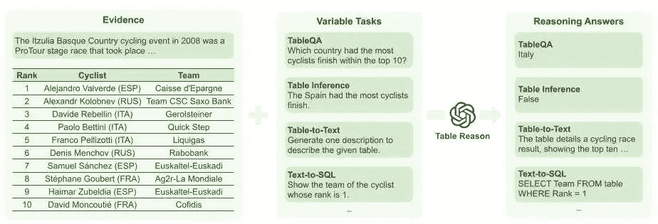
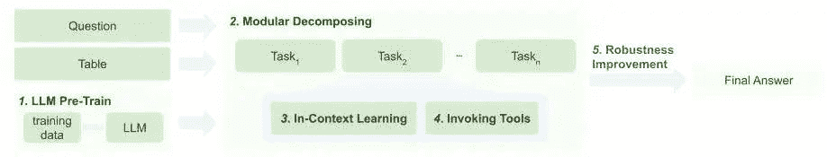
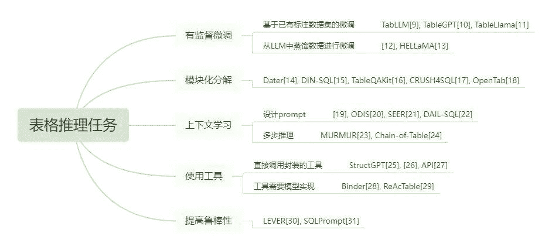
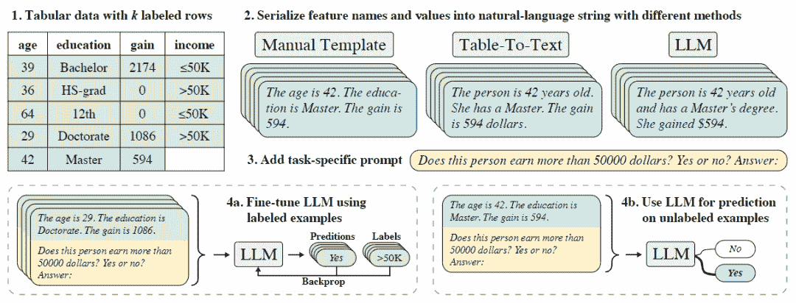
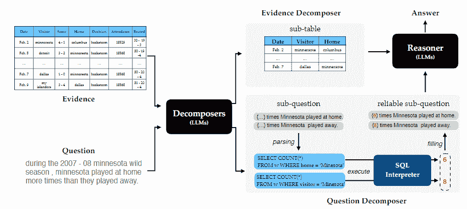
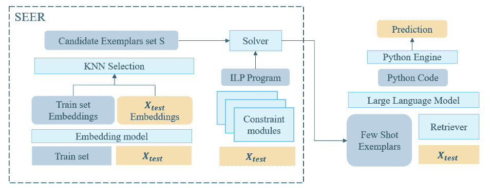
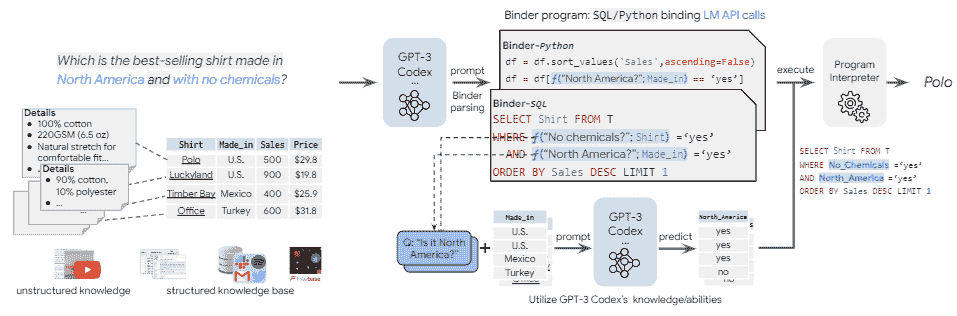
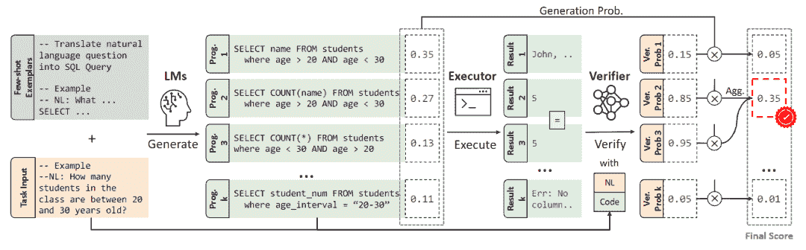

# 面向表格数据的大模型推理综述

> 来源：[https://agijuejin.feishu.cn/docx/YBoVdLzPQow71hxlff1cCZtZnOh](https://agijuejin.feishu.cn/docx/YBoVdLzPQow71hxlff1cCZtZnOh)

> 哈工大SCIR｜[阅读原文](https://mp.weixin.qq.com/s/sXeyH2Ob8-CbGwHHBYOYfQ)

> 转载请联系原作者取得授权

> 原创作者 ：张玄靓，王丁子睿

> 转载须标注出处 ：哈工大SCIR

## 1. 介绍

面向表格数据的推理任务，在计算机领域，特别是自然语言处理（Natural Language Processing，NLP）领域的研究中扮演着重要角色[1]。该任务要求模型在给定一个或多个表格的情况下，按照任务要求，生成相应的结果作为答案（例如：表格问答、表格事实判断）。尤其在大数据时代，从海量数据中获取用户所需信息变得尤为困难，而这些数据的主要存储形式就是结构化数据（例如：表格、数据库）。因此，构建能够从庞杂的结构化数据中高效准确地推理出所需信息的系统变得越来越重要，表明了表格推理任务的重要性。为了简洁，在本文中我们将“面向表格数据的推理任务”简称为“表格推理任务”。

过去表格推理的研究大致经过了基于规则[2]、基于神经网络[3]以及基于预训练模型[4]（Pre-Trained Language Model）几个阶段。最近的研究表明，大规模语言模型（Large Language Model，LLM）在各个NLP任务上都表现出了引人注目的性能[5]，尤其是，无需大规模数据微调就能迁移到各个任务上的上下文学习能力，极大地降低了标注需求。考虑到表格推理多样的任务与较高的标注开销，已有许多工作将LLM应用到表格推理任务上，增强LLM的表格推理能力，取得了非常优异的结果。然而，由于基于LLM的研究与过去的研究范式存在较显著的差异，而目前缺乏对基于LLM的表格推理的工作的总结与分析，一定程度上阻碍了该方向的研究。

因此，我们在本文对现有的基于LLM的表格推理相关工作进行梳理，来促进该领域上的研究。本文的结构组织如下：第2节，我们介绍表格推理任务的定义与主流数据集，来作为我们后续分析的基础；第3节，我们给出了基于LLM的表格推理方法的分类，并总结了该任务现有的研究工作，来帮助研究者了解表格推理任务未来可能的研究方向；第4节，我们给出了各个研究方向的可能改进，启发未来的研究思路。

## 2. 背景

### 2.1. 任务定义

图1：表格推理示意图

作为我们后续讨论的基础，在这一小节，我们简要给出表格推理任务的定义。

在表格推理任务中，模型的输入是用户对模型提出的要求或问题、结构化数据，以及可选的表格文字说明，输出则是对用户提出的要求或问题的回答，具体包括表格问答、事实验证、table-to-text以及text-to-SQL等，相关表格推理任务的总结如图1所示。

### 2.2. 相关数据集

尽管目前主流工作在使用LLM解决表格推理任务时，一般会使用基于上下文学习的方法来进行预测，而无需数据进行训练，但人们依然需要依赖标注数据，来验证LLM在解决表格推理任务时的性能。因此在这一小节，我们将针对四个目前主流的表格推理任务，分别介绍相关的主流数据集：

+ 表格问答：`WikiTableQuestions` [3]数据集作为第一个表格问答类的数据集，由于其开放域的表格和复杂的查询问题，使得该数据集能够充分验证模型的表格问答能力；

+ 表格事实验证：`TabFact` [6]数据集作为第一个表格事实验证类的数据集，其大规模跨领域的表格数据和复杂的推理需求，可以有效检验模型在表格事实验证任务上的能力；

+ table-to-text：`ToTTo` [7]数据集通过高亮特定的表格内容生成相关描述，因其大规模高质量的表格数据及对应描述能很好地验证模型的table-to-text能力，而成为table-to-text任务的主流数据集；

+ text-to-SQL：`Spider` [8]是第一个text-to-SQL任务上多领域、多表格的数据集，在text-to-SQL任务上被广泛使用。

## 3. 前沿进展

图2：表格推理方法分类

为了帮助研究者们更深入地了解从何种角度提升模型的表格推理能力，我们将现有基于LLM的表格推理相关研究分为5类，分别为：有监督微调（LLM Pre-Train）、模块化分解（Decomposed Pipeline）、上下文学习（In-Context Learning）、使用工具（Invoking Tools），以及提高鲁棒性（Robustness Improvement），各个分类间的关系如图2所示。我们将在本节详细介绍这种分类标准的原因以及具体分类信息。并且，为了读者更好地了解现有研究的进展，我们将详细介绍这5种类别下研究者们解决表格推理任务的具体措施，如图3所展现。同时，为了帮助人们更好地理解与PLM时代研究的差异，我们还讨论了每个分类下，基于LLM的研究相较于基于PLM研究的变化。

图3：表格推理前沿进展总结

### 3.1. 有监督微调

有监督微调是指用有标注数据微调LLM，从而增强LLM的表格推理能力。现有的研究结果表明，部分开源大模型解决表格相关任务的能力较弱，所以希望通过有监督微调提升模型的表格推理能力。

现有的LLM表格推理的有监督微调工作分为两类：基于已有标注数据集的微调，以及从LLM中蒸馏数据进行微调。

关于基于已有标注数据集进行微调的工作，受到LLM能够在少量或没有标注数据的情况下达到很好的性能的启发，`TabLLM` [9]，如图4所示，通过用少量有标注数据微调`T0`有效提升了模型在表格数据分类任务上的性能。`TableGPT` [10]观察到LLM在解决领域内问题时性能下降，所以使用精心选择的领域内数据微调LLM以增强模型的领域内知识。`TableLlama` [11]考虑到前人工作只支持特定类型的表格和任务，或者模型微调只能学习到进行预定义的表格操作，因此从广泛使用的数据集中选择具有代表性的表格任务构建了`TableInstruct`数据集，并在此上微调LLM很好地提升了模型泛化性。

图4：TabLLM方法示意图

而关于从LLM中蒸馏数据的工作，[12]观察到开源小模型缺乏在复杂推理的table-to-text任务上的性能落后于LLM，于是使用LLM作为教师模型蒸馏CoT推理和表格描述，并用蒸馏数据微调开源模型，有效地将表格推理能力转移到较小的模型上。而`HELLaMA` [13]关注到部分通用模型缺乏根据输入在表格中定位依据的能力，因此通过使用其他LLM预测表格描述定位在表格中的位置获得训练数据微调开源模型，而且微调模型完成根据突出显示的表格部分完成表格摘要。

基于已有数据，或者蒸馏数据微调的两种方法体现了LLM时代研究者进行有监督微调的两种思路，通过不同的途径收集标注数据用来训练。

在PLM时代，研究者也会对模型有监督微调，但与LLM时代不同，研究者只能期待提升模型在某一类表格推理任务上的性能[32]，受限于预训练模型的能力，无法通过微调提升模型在所有表格推理任务上的泛化能力。

### 3.2. 模块化分解

模块化分解指将复杂任务显式地分解为多个子任务，来完成表格推理任务。研究者发现将任务分解为简单的子任务后，完成各个子任务比完成整个复杂任务更为容易，可以提升LLM在复杂任务上的性能，所以希望通过合理分解复杂表格推理任务来提升模型性能。

`DATER`[14]和 `DIN-SQL`[15]都注意到将复杂问题分解为简单子问题可以有效促进大模型多步推理，因此两篇文章分别针对表格推理任务，以及单独的text-to-SQL任务设计了不同的流水线方法将复杂推理任务分解来降低模型推理难度。

图5：DATER方法示意图

`TableQAKit` [16]发现TableQA任务面临着有巨大差异的数据和任务形式，阻碍了研究的便利性。因此提出了`TableQAKit`，一个能够支持几乎所有TableQA场景、支持LLM的统一工具包。`TableQAKit`将TableQA的任务框架分成了配置模块、统一数据形式模块、使用模型模块，以及评估模块。

`CRUSH4SQL` [17]和 `OpenTab` [18]则关注到开放域的表格推理任务，通过将任务分解为先检索问题相关表格，再用LLM推理的过程，缓解了大量无关信息的输入给模型带来推理难度增加的问题。在用PLM解决表格推理任务时，人们也会通过将任务模块化分解为简单子任务来降低整体任务难度，但针对每一个子任务都需要额外的训练数据单独训练一个模型来解决[32]，而LLM可以很好地利用其上下文学习能力及泛化性，不再需要对每一个表格类子任务专门训练。

### 3.3. 上下文学习

上下文学习是指LLM在不用微调的情况下，通过设计prompt来增强表格推理能力。研究者们认为部分LLM无需微调就已经具备表格推理能力。但由于LLM的表现性能严重依赖于输入的上下文，如何通过上下文学习更好地激发模型的表格推理能力成为一个需要研究的问题。

为了增强LLM的上下文学习能力，现有的工作主要遵循两条研究思路：通过 设计prompt ，来直接增强LLM的上下文学习能力；通过 将推理过程分解为多步 ，来降低单步LLM的上下文学习的难度。

关于直接设计prompt的相关工作，[19]工作最先探索并证明LLM具有上下文学习的表格推理能力。`ODIS` [20]观察到前人工作在上下文学习时不提供示例，或只提供领域外的示例但研究表明，领域内示例可以显著提高LLM性能，因此提出基于SQL相似度合成领域内SQL，再用LLM生成对应问题作为领域内示例。`DAIL-SQL` [21]为了系统探索高效prompt工程，提出了基于掩码后问题的相似度选择示例，并且省略其数据库模式以减少输入长度。而 `SEER` [22]为了解决HybridQA任务在上下文学习中示例选择的挑战，尤其是用户问题和示例中推理路径的相关性小的问题，如图6所示，根据问题向量之间的相似度，以及分类器预测的问题的推理链，从数据中选择示例。

图6：SEER方法示意图

关于prompt分解推理过程的工作，`MURMUR` [23]发现data-to-text任务直接提示LLM推理易导致幻觉，而提示CoT推理缺乏推理步骤之间的明确条件，损害正确性，并且以不同的顺序线性化数据易造成较大的方差。因此，`MURMUR`提出首先依据预先定义的语法规则在每一步使用束搜索算法选择可能正确的模型范围，再根据打分模型选择最好的模型，以及相应的输入形式。`CHAIN-OF-TABLE` [24]则为了降低单跳LLM上下文学习的难度，提供给LLM预定义的表格操作，需要LLM从中选择一种操作并执行构成操作链。

设计prompt的方法和用prompt分解推理过程的方法并不是非此即彼的，二者可以组合使用，提示LLM将分解推理后，通过在每一步设计不同的prompt来更好地进行推理。

LLM的上下文学习能力很好地缓解了PLM对每个表格推理任务都需要大量训练的问题，但也带来了新的挑战。由于人们尚不能探明LLM上下文学习能力的机理，所以只能从上下文学习带来表格推理性能提升的角度试图探索不同的prompt对不同模型的影响。

### 3.4. 使用工具

使用工具是指LLM调用其他工具或模型，从而改进表格推理相关的特定子任务上的性能。研究者在将复杂表格推理任务分解后，发现LLM并不适用于求解所有子任务，在诸如检索、数值计算等的任务上LLM落后于现有工具或方法，造成总体性能不佳。所以如何令LLM使用合适的工具以更好地完成表格推理任务成为一种挑战。

目前的研究工作主要分为两条研究思路：一种 LLM调用的工具是已经写好并封装的 ，LLM只需生成调用工具的代码，另一种需要LLM分析需求后， 根据具体需求生成代码 ，比如python、SQL等来实现某一模块或工具的功能。

关于直接调用封装工具的工作，`StructGPT` [25]观察到结构化数据的数量过于庞大，很难全部输入，所以提供了抽取数据的接口，如图7所示，模型通过调用相应接口获得有效数据，再将其输入模型进行推理。[26]为了同时探索并进一步评估LLM智能体采取行动和推理的能力，提出长对话的数据库问答任务，LLM需要先根据历史进行推理，决定与外部模型的交互策略，再采取行动生成具体的交互命令以调用模型。API [27]在将表格问题翻译成程序后，通过调用其它LLM的API实现了查询知识以及对表格执行程序以外的操作。

图7：BINDER方法示意图

关于需要LLM根据需求实现工具功能的工作，`BINDER` [28]注意到神经系统缺少可解释性，而符号方法被符号语言的语法限制，但现有的融合方法只针对特定模型和语言，且需要大量训练数据，因此提出首先解析问题中不可以转换成目标程序语言的部分，将其调用大模型的API求解，再将生成结果集成到编程语言中。`ReAcTable` [29]注意到根据问题对任意表及其列自动转化的挑战性，提出通过每一步令LLM选择生成不同形式的代码，并调用此代码得到中间结果的表格，来逐步得到答案。

LLM既可以调用现成的函数，也可以先生成代码接口再调用，这两种方法并不冲突，可以被同时用在LLM的推理过程中。

PLM并不具有使用工具的能力，而LLM借用工具进一步增强了模型的专业能力，但在表格推理过程中，何时使用工具，使用何种工具，以及如何使用工具成为了新的挑战。

### 3.5. 提高鲁棒性

鲁棒性是指LLM在输入发生微小变化时，依然能保持生成正确结果的能力（例如：随机数种子、问题中的无意义词）。经过研究发现LLM在生成答案时缺少鲁棒性会导致模型性能衰退。为了提升模型鲁棒性，研究者们提出一系列方法以提升模型性能。

遵循前人工作，现有的提高LLM表格推理的鲁棒性的方法，主要采用先生成多个结果，然后从多个结果中选取答案的方式。依照该设计思路，如图8所示，`LEVER` [30]专门训练一个打分器对每个生成的答案进行打分，选择相应分数最高的答案作为结果。而`SQLPrompt` [31]注意到在固定prompt的情况下，LLM生成结果的多样性较差，导致生成结果可能集中于特定的错误答案。为了解决这个问题，`SQLPrompt`提出根据多个prompt分别生成结果，然后集成，从而避免生成答案集中于特定结果。

图8：LEVER方法示意图

提升模型鲁棒性的挑战在PLM时代就已经存在，之前人们普遍通过额外训练来提升PLM在表格推理任务上的鲁棒性[33]，但LLM时代人们目前只是通过对生成结果的处理来提升表格推理结果的鲁棒性。

## 4. 未来方向

为了启发未来研究，在本节，我们将介绍如何改进各类方法，来提升LLM的表格推理能力。

### 4.1. 有监督微调

现有方法只考虑到了增强模型在某一领域或某一表格任务上的性能，或挑选对应不同任务的数据集联合训练，所涉及的领域以及难度范围有限，导致微调后模型的泛化性也有限。参考`WizardLM`[34]、`WizardCoder`[35]，我们期待可以使用LLM蒸馏数据，提示LLM产生不同领域、不同任务、不同难度等级的大规模高质量训练数据，以提升模型在表格推理任务上的综合能力以及泛化性。

并且现有方法与其他NLP任务采用了统一的模型架构，并没有针对表格任务做适应性修改。参考`TaPas`[4]，我们可以通过设计新的适用于结构化数据的模型架构来解决表格任务。

### 4.2. 模块化分解

现有方法需要人工预先将任务分解为流水线，但这种分解只适用于某一类表格任务，并不具有普适性，而针对所有表格任务的分解又太过概括，并不能很好地降低推理难度。参考`ReAct`[36]，希望能够待无需为LLM解决某一表格问题指定流水线，而是令LLM能够根据问题自主将任务显示分解，能很好地适用于所有表格任务并且减少人工参与。

现有方法在将任务分解后并没有研究对分解后的子任务进行改进提升，使系统受错误级联的影响较大，受[37]启发，我们希望LLM能够对分解的中间步骤敏感，自主检测并修正错误的中间结果，进一步推理出正确的结果。

### 4.3. 上下文学习

现有研究均是从有限范围内人工比较或设计算法选择更好的prompt作为输入，由于比较的范围有限，所以模型性能的提升也是有限的，并且不适用于可获取数据有限的场景。为了获得更好的输入上下文，参考[38]，能够借助LLM自动生成上下文，并根据表格和任务对prompt打分以及优化，更好地帮助模型理解并解决这个问题。

并且现有研究并没有关注如何针对结构化、半结构化数据改进LLM的嵌入层。参考[39]，我们期待可以训练一个适用于LLM的嵌入层，能够嵌入表格的结构、单元和对齐的文本描述，更好地编码结构化数据，有助于模型理解表格并推理。

### 4.4. 使用工具

现有研究没有关注到表格推理任务中面临的知识密集场景，不能灵活运用外部数据进行知识注入。参考`WebGPT`[40]，我们希望处理专家问题时LLM能够自主借助搜索引擎查询相关领域内知识，并且将查询结果用于计算或推理。

### 4.5. 提高鲁棒性

现有工作都是针对模型生成结果进行集成以提升性能，并没有关注到推理路径的多样性以及对结果鲁棒性的影响。参考[41]，LLM可以在表格推理的路径上做集成，充分利用多步推理的中间过程及中间结果，逐步提升模型的鲁棒性。

并且现有方法在对候选结果选择时，要额外训练小模型对结果打分。参考[42]以及[43]，期待可以无需训练，直接使用LLM对生成结果进行判别、选择，节省训练时间以及成本。

## 5. 总结

本文旨在向研究者们提供一份对LLM时代表格推理相关研究的总结以及展望。为了更好地帮助研究者思考从何种角度提升LLM在表格推理任务上的性能，我们从方法以及挑战的角度将现有研究分为5类，并详细阐述了我们的分类标准。为了读者更好地了解表格任务的现有进展，我们从有监督微调、模块化分解、上下文学习、使用工具以及提高鲁棒性的角度回顾梳理了现有工作；最后，我们依据这5类方法讨论了未来潜在的改进方向，以希望本文可以在LLM时代如何改进表格推理性能方面带给读者更多启发。

# 参考文献

[1]Biehler, R., Frischemeier, D., Reading, C., & Shaughnessy, J. (2018). Reasoning About Data.
[2]Xu, X., Liu, C., & Song, D.X. (2017). SQLNet: Generating Structured Queries From Natural Language Without Reinforcement Learning. ArXiv, abs/1711.04436.
[3]Pasupat, P., & Liang, P. (2015). Compositional Semantic Parsing on Semi-Structured Tables. Annual Meeting of the Association for Computational Linguistics.
[4]Herzig, J., Nowak, P.K., Müller, T., Piccinno, F., & Eisenschlos, J.M. (2020). TaPas: Weakly Supervised Table Parsing via Pre-training. Annual Meeting of the Association for Computational Linguistics.
[5]Zhao, W.X., Zhou, K., Li, J., Tang, T., Wang, X., Hou, Y., Min, Y., Zhang, B., Zhang, J., Dong, Z., Du, Y., Yang, C., Chen, Y., Chen, Z., Jiang, J., Ren, R., Li, Y., Tang, X., Liu, Z., Liu, P., Nie, J., & Wen, J. (2023). A Survey of Large Language Models. ArXiv, abs/2303.18223.
[6]Chen, W., Wang, H., Chen, J., Zhang, Y., Wang, H., LI, S., Zhou, X., & Wang, W.Y. (2019). TabFact: A Large-scale Dataset for Table-based Fact Verification. ArXiv, abs/1909.02164.
[7]Parikh, A.P., Wang, X., Gehrmann, S., Faruqui, M., Dhingra, B., Yang, D., & Das, D. (2020). ToTTo: A Controlled Table-To-Text Generation Dataset. ArXiv, abs/2004.14373.
[8]Yu, T., Zhang, R., Yang, K., Yasunaga, M., Wang, D., Li, Z., Ma, J., Li, I.Z., Yao, Q., Roman, S., Zhang, Z., & Radev, D.R. (2018). Spider: A Large-Scale Human-Labeled Dataset for Complex and Cross-Domain Semantic Parsing and Text-to-SQL Task. ArXiv, abs/1809.08887.
[9]Hegselmann, S., Buendia, A., Lang, H., Agrawal, M., Jiang, X., & Sontag, D.A. (2022). TabLLM: Few-shot Classification of Tabular Data with Large Language Models. ArXiv, abs/2210.10723.
[10]Zha, L., Zhou, J., Li, L., Wang, R., Huang, Q., Yang, S., Yuan, J., Su, C., Li, X., Su, A., Tao, Z., Zhou, C., Shou, K., Wang, M., Zhu, W., Lu, G., Ye, C., Ye, Y., Ye, W., Zhang, Y., Deng, X., Xu, J., Wang, H., Chen, G., & Zhao, J.J. (2023). TableGPT: Towards Unifying Tables, Nature Language and Commands into One GPT. ArXiv, abs/2307.08674.
[11]Zhang, T., Yue, X., Li, Y., & Sun, H. (2023). TableLlama: Towards Open Large Generalist Models for Tables. ArXiv, abs/2311.09206.
[12]Yang, B., Tang, C., Zhao, K., Xiao, C., & Lin, C. (2023). Effective Distillation of Table-based Reasoning Ability from LLMs. ArXiv, abs/2309.13182.
[13]Bian, J., Qin, X., Zou, W., Huang, M., & Zhang, W. (2023). HELLaMA: LLaMA-based Table to Text Generation by Highlighting the Important Evidence. ArXiv, abs/2311.08896.
[14]Ye, Y., Hui, B., Yang, M., Li, B., Huang, F., & Li, Y. (2023). Large Language Models are Versatile Decomposers: Decomposing Evidence and Questions for Table-based Reasoning. Proceedings of the 46th International ACM SIGIR Conference on Research and Development in Information Retrieval.
[15]Pourreza, M.R., & Rafiei, D. (2023). DIN-SQL: Decomposed In-Context Learning of Text-to-SQL with Self-Correction. ArXiv, abs/2304.11015.
[16]Lei, F., Luo, T., Yang, P., Liu, W., Liu, H., Lei, J., Huang, Y., Wei, Y., He, S., Zhao, J., & Liu, K. (2023). TableQAKit: A Comprehensive and Practical Toolkit for Table-based Question Answering. ArXiv, abs/2310.15075.
[17]Kothyari, M., Dhingra, D., Sarawagi, S., & Chakrabarti, S. (2023). CRUSH4SQL: Collective Retrieval Using Schema Hallucination For Text2SQL. ArXiv, abs/2311.01173.
[18]Anonymous. OPENTAB: ADVANCING LARGE LANGUAGE MODELS AS OPEN-DOMAIN TABLE REASONERS. Submitted to The Twelfth International Conference on Learning Representations.
[19]Chen, W. (2022). Large Language Models are few(1)-shot Table Reasoners. ArXiv, abs/2210.06710.
[20]Chang, S., & Fosler-Lussier, E. (2023). Selective Demonstrations for Cross-domain Text-to-SQL. ArXiv, abs/2310.06302.
[21]Tonglet, J., Reusens, M., Borchert, P., & Baesens, B. (2023). SEER : A Knapsack approach to Exemplar Selection for In-Context HybridQA. ArXiv, abs/2310.06675.
[22]Gao, D., Wang, H., Li, Y., Sun, X., Qian, Y., Ding, B., & Zhou, J. (2023). Text-to-SQL Empowered by Large Language Models: A Benchmark Evaluation. ArXiv, abs/2308.15363.
[23]Saha, S., Yu, X.V., Bansal, M., Pasunuru, R., & Celikyilmaz, A. (2022). MURMUR: Modular Multi-Step Reasoning for Semi-Structured Data-to-Text Generation. ArXiv, abs/2212.08607.
[24]Anonymous. CHAIN-OF-TABLE: EVOLVING TABLES IN THE REASONING CHAIN FOR TABLE UNDERSTANDING. Submitted to The Twelfth International Conference on Learning Representations.
[25]Jiang, J., Zhou, K., Dong, Z., Ye, K., Zhao, W.X., & Wen, J. (2023). StructGPT: A General Framework for Large Language Model to Reason over Structured Data. ArXiv, abs/2305.09645.
[26]Nan, L., Zhang, E., Zou, W., Zhao, Y., Zhou, W., & Cohan, A. (2023). On Evaluating the Integration of Reasoning and Action in LLM Agents with Database Question Answering. ArXiv, abs/2311.09721.
[27]Cao, Y., Chen, S., Liu, R., Wang, Z., & Fried, D. (2023). API-Assisted Code Generation for Question Answering on Varied Table Structures. ArXiv, abs/2310.14687.
[28]Cheng, Z., Xie, T., Shi, P., Li, C., Nadkarni, R., Hu, Y., Xiong, C., Radev, D.R., Ostendorf, M., Zettlemoyer, L., Smith, N.A., & Yu, T. (2022). Binding Language Models in Symbolic Languages. ArXiv, abs/2210.02875.
[29]Zhang, Y., Henkel, J., Floratou, A., Cahoon, J., Deep, S., & Patel, J.M. (2023). ReAcTable: Enhancing ReAct for Table Question Answering. ArXiv, abs/2310.00815.
[30]Ni, A., Iyer, S., Radev, D.R., Stoyanov, V., Yih, W., Wang, S.I., & Lin, X.V. (2023). LEVER: Learning to Verify Language-to-Code Generation with Execution. ArXiv, abs/2302.08468.
[31]Sun, R., Arik, S.Ö., Sinha, R., Nakhost, H., Dai, H., Yin, P., & Pfister, T. (2023). SQLPrompt: In-Context Text-to-SQL with Minimal Labeled Data. ArXiv, abs/2311.02883.
[32]Wang, B., Shin, R., Liu, X., Polozov, O., & Richardson, M. (2019). RAT-SQL: Relation-Aware Schema Encoding and Linking for Text-to-SQL Parsers. Annual Meeting of the Association for Computational Linguistics.
[33]Pi, X., Wang, B., Gao, Y., Guo, J., Li, Z., & Lou, J. (2022). Towards Robustness of Text-to-SQL Models Against Natural and Realistic Adversarial Table Perturbation. Annual Meeting of the Association for Computational Linguistics.
[34]Xu, C., Sun, Q., Zheng, K., Geng, X., Zhao, P., Feng, J., Tao, C., & Jiang, D. (2023). WizardLM: Empowering Large Language Models to Follow Complex Instructions. ArXiv, abs/2304.12244.
[35]Luo, Z., Xu, C., Zhao, P., Sun, Q., Geng, X., Hu, W., Tao, C., Ma, J., Lin, Q., & Jiang, D. (2023). WizardCoder: Empowering Code Large Language Models with Evol-Instruct. ArXiv, abs/2306.08568.
[36]Yao, S., Zhao, J., Yu, D., Du, N., Shafran, I., Narasimhan, K., & Cao, Y. (2022). ReAct: Synergizing Reasoning and Acting in Language Models. ArXiv, abs/2210.03629.
[37]Lightman, H., Kosaraju, V., Burda, Y., Edwards, H., Baker, B., Lee, T., Leike, J., Schulman, J., Sutskever, I., & Cobbe, K. (2023). Let's Verify Step by Step. ArXiv, abs/2305.20050.
[38]Yang, C., Wang, X., Lu, Y., Liu, H., Le, Q.V., Zhou, D., & Chen, X. (2023). Large Language Models as Optimizers. ArXiv, abs/2309.03409.
[39]Sun, C., Li, Y., Li, H., & Qiao, L. (2023). TEST: Text Prototype Aligned Embedding to Activate LLM's Ability for Time Series. ArXiv, abs/2308.08241.
[40]Nakano, R., Hilton, J., Balaji, S.A., Wu, J., Long, O., Kim, C., Hesse, C., Jain, S., Kosaraju, V., Saunders, W., Jiang, X., Cobbe, K., Eloundou, T., Krueger, G., Button, K., Knight, M., Chess, B., & Schulman, J. (2021). WebGPT: Browser-assisted question-answering with human feedback. ArXiv, abs/2112.09332.
[41]Xie, Y., Kawaguchi, K., Zhao, Y., Zhao, X., Kan, M., He, J., & Xie, Q. (2023). Self-Evaluation Guided Beam Search for Reasoning.

# 参考文献

## [42] Madaan, A., Tandon, N., Gupta, P., Hallinan, S., Gao, L., Wiegreffe, S., Alon, U., Dziri, N., Prabhumoye, S., Yang, Y., Welleck, S., Majumder, B., Gupta, S., Yazdanbakhsh, A., & Clark, P. (2023). Self-Refine: Iterative Refinement with Self-Feedback. ArXiv, `abs/2303.17651`.

## [43] Li, X., Zhu, C., Li, L., Yin, Z., Sun, T., & Qiu, X. (2023). LLatrieval: LLM-Verified Retrieval for Verifiable Generation. ArXiv, `abs/2311.07838`.

# 编辑信息

本期责任编辑：车万翔

本期编辑：童彦澎
