# ChatGPT 是一个好的因果推理器吗？

> 来源：[https://agijuejin.feishu.cn/docx/QVuAdXIkpoMJZlxgsoocX1GhnBi](https://agijuejin.feishu.cn/docx/QVuAdXIkpoMJZlxgsoocX1GhnBi)

> 哈工大SCIR｜[阅读原文](https://mp.weixin.qq.com/s/0ngr6AwKrLzsRLVtyJJ8aQ)

> 转载请联系原作者取得授权

> 论文：Is ChatGPT a Good Causal Reasoner? A Comprehensive Evaluation.

> 作者：高靖龙，丁效，秦兵，刘挺

> 链接：https://arxiv.org/abs/2305.07375

> 项目链接：https://github.com/ArrogantL/ChatGPT4CausalReasoning

## ** 1. 背景和动机**

因果推理能力对于许多自然语言处理（NLP）应用至关重要。最近的因果推理系统主要基于经过微调的预训练语言模型（PLMs），如BERT [1] 和RoBERTa [2]。它们的因果推理能力依赖于使用大量标注数据的监督训练，然而ChatGPT能够在不依赖标注数据的前提下在各种NLP任务中取得良好表现。

在本文中，我们进行了全面的评估，以展示ChatGPT的因果推理能力，涉及四个最先进的（SOTA）版本的ChatGPT：text-davinci-002、text-davinci-003、gpt-3.5-turbo和gpt-4。首先，我们利用事件因果关系识别（ECI）任务作为因果推理基准。如图1所示，ECI任务旨在确定一个句子中的两个事件之间是否存在因果关系。这要求ChatGPT不仅要掌握常识知识，还要理解由多个实体和事件组成的复杂上下文。最后，ChatGPT必须综合所有信息来识别因果关系。

其次，我们采用因果发现（CD）任务进行评估，这要求ChatGPT具有更广泛和更专业的知识，但不需要考虑复杂的上下文。如图1所示，我们使用了两种CD任务格式：1）多项选择，旨在从两个选项中选择输入事件的原因或效果；2）二分类，旨在确定两个输入事件之间是否存在因果关系。对于二分类设置，我们将每个多项选择示例转换为两个二分类示例，即将输入事件与两个选项中的每一个进行配对。我们的实验表明，二分类是评估ChatGPT更可靠的方法。

此外，如图1所示，我们进行因果解释生成（CEG）任务，以测试ChatGPT是否能为事件间的因果关系生成解释。这通常用于测试机器是否真正理解因果关系背后的原理，这对于构建可靠的因果推理系统至关重要。

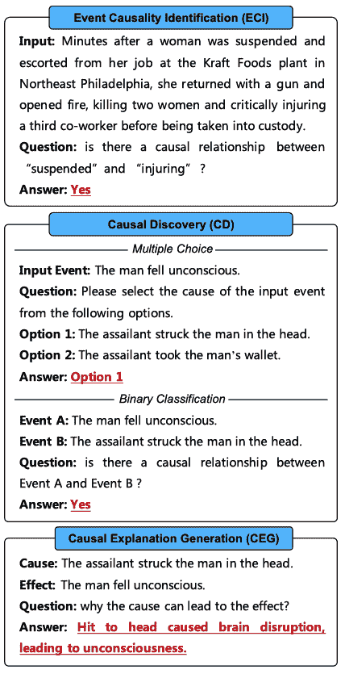

图1: 三种因果推理任务的形式和我们使用的提示。需要ChatGPT回复的内容用红色标记。多项选择CD任务还涉及要求选择输入事件可能后果的样本。对于这些样本，我们将问题中的“cause”修改为“result”。

关键发现如下：

+   ChatGPT不是一个好的因果推理器，但是一个好的因果解释器。

+   ChatGPT存在严重的因果幻觉问题，它倾向于假设事件之间存在因果关系，而不管这些关系是否真正存在。

+   ChatGPT因果幻觉的主要原因可能是自然语言中因果关系和非因果关系之间的报告偏差。ICL和CoT [4]等技术可以进一步加剧ChatGPT的因果幻觉。此外随着ChatGPT版本提升，这种因果幻觉变得更加明显。

+   ChatGPT的因果推理能力对提示中用于表达因果概念的词汇十分敏感。

+   随着句子中事件数量的增加，以及事件之间的词汇距离变大，ChatGPT的因果推理性能会降低。此外，ChatGPT在识别显式因果关系方面比识别隐式因果关系做得更好。

+   开放式生成提示无法提高ChatGPT的因果推理能力。

##  2 数据集、评估指标及相关设置

### ** 2.1 数据集和评估指标 **

+   事件因果关系识别

我们在三个广泛使用的事件因果识别（ECI）数据集上进行实验：1) EventStoryLine v0.9（ESC）[5]，包含22个主题、258份文档、5,334个事件和1,770对因果事件对；2) Causal-TimeBank（CTB）[6]，包含184份文档、6,813个事件和318对因果事件对；3) MAVEN-ERE [7]，包含90个主题、4,480份文档、103,193个事件和57,992对因果事件对。参照以往的工作 [8, 9]，对于ESC我们仅使用其前20个主题进行评估。此外，由于MAVEN-ERE没有发布测试集，我们在其开发集上评估ChatGPT。我们采用准确度、精确度（P）、召回率（R）和F1-score（F1）作为评估指标。

+   因果发现

我们在两个广泛使用的因果发现（CD）数据集上进行实验：1) COPA [10]，这是一个经典的因果推理数据集，包含1,000个以日常生活场景为主的多项选择题。2) e-CARE [11]，包含21,324个涵盖广泛领域的多项选择题。我们采用准确率作为评估指标。

+   因果解释生成

我们在e-CARE上进行实验，该数据集包含21,324个人工注释的因果解释。参照e-CARE的评估设置，我们首先采用BLEU（n=4）[12]和ROUGE-L [13]作为自动评估指标。其次，我们抽取每个版本的ChatGPT在e-CARE上生成的100个解释进行人工评估。具体来说，我们标记生成的解释是否能解释相应的因果事实以人工评估解释的准确率。

### ** 2.2 实验设置 **

对于ChatGPT，图1展示了三个因果推理任务所采用的提示。我们在 zero-shot 设置下评估ChatGPT的性能。其他提示和设置在第四节中讨论。

我们使用OpenAI的官方API进行实验，涵盖了四个ChatGPT最新版本：text-davinci-002、text-davinci-003、gpt-3.5-turbo和gpt-4。具体来说，text-davinci-002通过RLHF（强化学习与人类反馈）进一步训练得到text-davinci-003，后者又进一步利用对话数据训练得到gpt-3.5-turbo。虽然OpenAI未公开gpt-4的具体信息，但gpt-4在各种自然语言处理任务中显示出了更为卓越的推理能力。对于gpt-4，我们从每个数据集中抽取1000个实例进行评估。我们将temperature参数设置为0，以尽量减少随机性。

### ** 2.3 基线方法 **

在本文中，所有针对三项因果推理任务的基线方法都基于在完整训练数据集上微调的预训练语言模型（PLMs）。

对于 ECI 和 CD 任务，我们将 ChatGPT 与基于 BERT-Base [14]和 RoBERTa-Base [15]的普通分类模型进行了比较。它们的框架和训练过程与之前的工作一致 [16, 17]。

此外，我们将 ChatGPT 与两种 SOTA ECI 方法进行了比较：基于 BERT-Base 的 KEPT [18]，融合了背景和关系信息以进行因果推理；以及基于 RoBERTa-Base 的 DPJL [19]，将有关因果线索词和事件间关系的信息引入到 ECI 模型中。

对于 CEG 任务，我们首先将 ChatGPT 与基于 GRU 的 Seq2Seq 模型 [20]和 GPT2 [21]进行比较。它们的框架和训练过程与之前的工作一致 [22]。此外，我们在 e-CARE 的训练集上微调 LLaMA 7B [23]和 FLAN-T5 11B [24]，作为基于 LLMs 基线。

## ** 3 实验**

### ** 3.1 事件因果关系识别 **

表1显示了在三个ECI数据集上的结果：ESC、CTB和MAVEN-ERE。

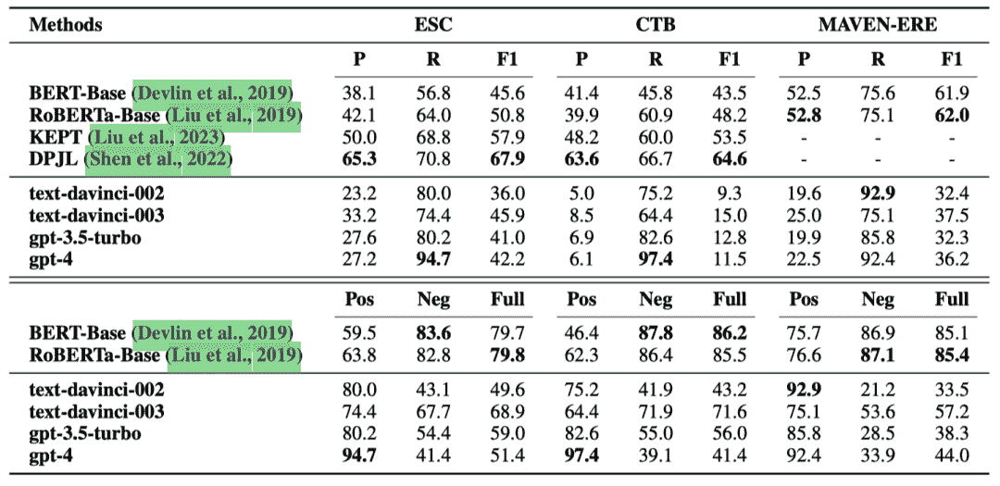

表1: ECI任务上的实验结果（%）。P、R和F1分别代表准确率、召回率和F1分数。Pos、Neg和Full分别表示因果对、非因果对和所有测试样例上的准确率。

我们发现：

+   即使是gpt-4版本的ChatGPT，也被基于微调的小型PLMs的基线方法全面超越。这表明在像ECI这样复杂的因果推理任务中，ChatGPT并不是一个好的因果推理器。

+   ChatGPT的召回率很高，但精确度低，这表明大量非因果事件对被错误地识别为因果对。这也是ChatGPT在CTB数据集上表现尤其糟糕的原因，因为该数据集包含更多非因果事件对。这可能是因为自然语言包含大量因果关系的描述，主要由诸如“lead to”和“therefore”这样的因果线索词指示。然而，自然语言通常不表达哪些事件不是因果相关的。由于ChatGPT的能力来自于对大量自然语言文本的训练，文本中因果和非因果事件对之间的这种报告偏差使得ChatGPT擅长于识别因果事件对，但不擅长识别非因果事件对。

+   此外，可以观察到经过微调的小型PLMs在识别非因果事件对方面表现得更好。这是因为在ECI训练集中，非因果示例比因果示例多得多，而经过微调的模型学习到了这种数据分布。

### ** 3.2 因果关系发现 **

表2展示了在两个因果发现（CD）数据集上的结果：COPA和e-CARE。

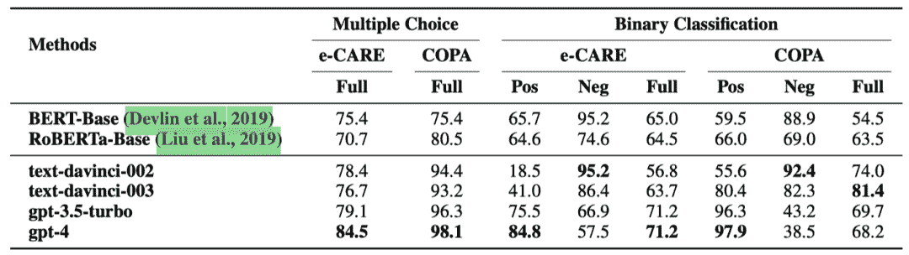

表2: CD任务上的实验结果（%）。Pos、Neg和Full分别表示因果对、非因果对以及所有测试样例上的准确率。

我们发现：

+   尽管ChatGPT在多项选择设置中表现良好，但在二元分类中的表现却显著变差。这主要是因为在多项选择设置中，ChatGPT只需要考虑与输入事件呈现更明显的因果或非因果关系的选项，而可以忽略另一个更难分析的选项。之前的工作 [25, 26]只用多项选择题来评估ChatGPT的因果推理能力，导致误认为ChatGPT擅长因果推理。

+   与ECI任务相比，ChatGPT在CD任务中识别非因果对的准确率更高。这主要是因为e-CARE和COPA数据集中的非因果对是根据输入事件手动生成的，它们结构简单，与输入事件的相关性弱，因此更容易识别。这也是为什么经过微调的小型预训练语言模型（PLMs）在识别非因果事件对方面比识别因果事件对表现更好。

+   与COPA相比，ChatGPT在e-CARE数据集中识别因果对的准确率略低。这是因为e-CARE要求ChatGPT掌握更广泛的知识，这不仅涉及到更多场景中的常识知识，还包括某些领域的专业知识，如生物学。

+   更重要的是，我们注意到ChatGPT的升级过程（text-davinci-003→gpt-3.5turbo→gpt-4）使得ChatGPT越来越倾向于将事件分类为具有因果关系，而无论因果是否真实存在。这可能是RLHF的对齐税 [27]所致。这表明，尽管OpenAI [28]提到ChatGPT的升级过程减少了在其他各种任务中的幻觉问题，但也使得ChatGPT更擅长于编造因果关系。

### ** 3.3 因果解释生成 **

表 3 展示了在 CEG 任务上的实验结果。

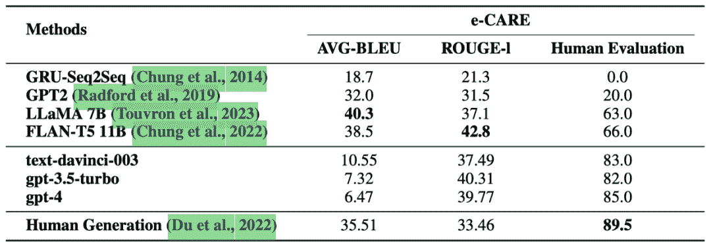

表3: 在CEG任务上的实验结果（%）。

可以观察到：

+   根据人类评估结果，由 ChatGPT 生成的因果解释的准确性接近人类生成的解释。这表明 ChatGPT 是一个良好的因果解释器。

+   与“Human Generation”相比，ChatGPT 在 ROUGE-l 指标上表现更好，这是一个类似于文本分类中“recall”的文本生成度量。这是因为 ChatGPT 倾向于生成相比人工标注的解释更完整、更详细的解释。这一点在我们的人工评估过程中得到了评估员的一致认可。这也是 ChatGPT 获得较低的 AVG-BLEU 分数的原因，因为AVG-BLEU是一个类似于文本分类中“precision”的文本生成度量。

+   通过手动评估，我们发现由 LLaMA 和 FLAN-T5 生成的解释与输入事件高度相关。然而，这些解释可能只是对输入事件的重复，或者提供相关但无法用于解释的描述。这也是 LLaMA 和 FLAN-T5 在人类评估中表现不佳的主要原因。

+   此外，与 ChatGPT 相比，LLaMA 和 FLAN-T5 提供的解释明显更短。这是因为 e-CARE 训练集中标注的解释非常简短。然而，ChatGPT 在提供更全面和详细的解释方面表现出色。这展示了 ChatGPT 因果解释相比传统微调方法的优势。

+   最后值得注意的是，尽管经过微调的 LLaMA、FLAN-T5 和 ChatGPT 在 ROUGE-l 分数上表现相近，但两个微调的 LLMs 在我们的人类评估中表现明显更差。这是因为 ChatGPT 生成的解释相比测试集中标注的解释更加全面、详细，导致了偏低的ROUGE-l数值。事实上ChatGPT生成的解释质量相当可靠。

## ** 4 分析**

### ** 4.1 上下文学习 **

如表4和表5所示，我们分析了ChatGPT在不同上下文学习设置下的表现：1）“x pos + y neg”：我们随机选择x个因果训练样例和y个非因果训练样例作为上下文学习的示例，所有测试样例共享相同的示例；2）“top k similar”：对于每个测试样例，我们检索与其最相似的k个训练样例作为其上下文示例。论文中还额外分析了ICL示例的顺序和标签分布对因果推理性能的影响。

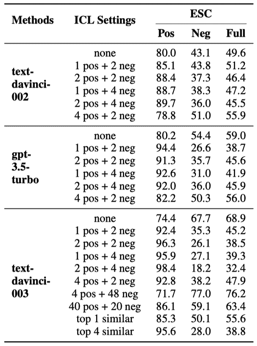

表4: ChatGPT在ECI任务中使用上下文学习的表现。其中“none”表示未使用上下文学习的ChatGPT。

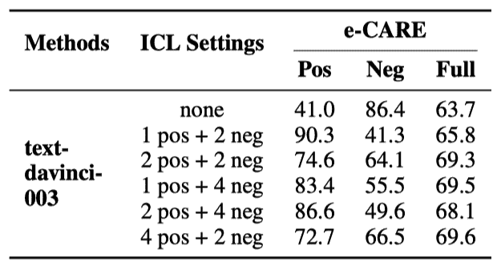

表5: ChatGPT 在 binary-classification CD任务中使用上下文学习的性能。“none” 表示没有使用上下文学习的 ChatGPT。

我们观察到：

+   当x和y不大于4时，ICL主要提高了ChatGPT在因果对中的准确率，但降低了非因果对的准确率。这可能是因为虽然ICL可以激发ChatGPT的能力，但ChatGPT更擅长识别因果事件对。因此，ICL进一步加剧了ChatGPT识别因果和非因果对的性能的不均衡。

+   “4 pos + 48 neg”实现了更高的Full Acc。然而它是以牺牲Pos Acc为代价提高了Neg Acc。又因为ESC数据集包含更多的非因果对，造成表面看起来Full Acc有所提升。但整体性能的有效提升不应该是以拆东墙补西墙的形式实现，而应该是同时提高Pos Acc和Neg Acc。

### ** 4.2 思维链提示 **

如表6所示，我们分析了ChatGPT在不同思维链设置下的表现：1）“-w/ CoT zero-shot”：我们通过在提示后添加“Let’s think step by step” 来实现zero-shot CoT [29]；2）“-w/ CoT x pos + y neg”：我们为x个因果训练样例和y个非因果训练样例手动注释推理链。它们被选为上下文学习的示例，所有测试样例共享相同的上下文示例。论文中还额外展示了ChatGPT的错误类型、推理链条的样例等。

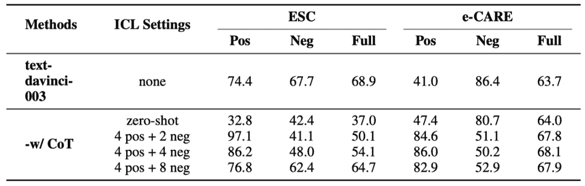

表6: ChatGPT在ECI和binary-classification CD任务上的使用CoT的表现。“none” 表示没有使用上下文学习的 ChatGPT。

可以发现：

+   “-w/ CoT zero-shot”不能有效地提高ChatGPT在ECI任务中的表现。这可能是因为 zero-sho t CoT生成的推理链质量不足以有效地指导模型。

+   “-w/ CoT x pos + y neg”提高了ChatGPT在因果对上的准确率，但降低了其在非因果对上的准确率。观察ChatGPT生成的推理链，我们发现ChatGPT为非因果对生成的链条质量低于因果对。这种差异会加剧ChatGPT在识别因果和非因果事件对方面的不平衡。

### ** 4.3 表达因果关系的方式 **

如图2所示，我们分析了在提示中使用不同方式表达因果概念时ChatGPT的性能变化：

1）“counterfactual”，基于 [30]的反事实因果观点的提示；

2）“one-step”，我们添加了“one-step”这样的限制性词语来减轻将非因果事件对识别为因果的倾向；

3）“trigger()”，我们使用不同的因果提示词（例如，“lead to”）来构建提示。

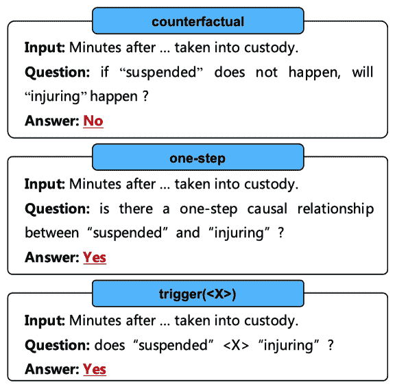

图2: 以各种方式表达因果概念的提示。需要ChatGPT回复的内容用红色标记。

实验结果显示在表7中。

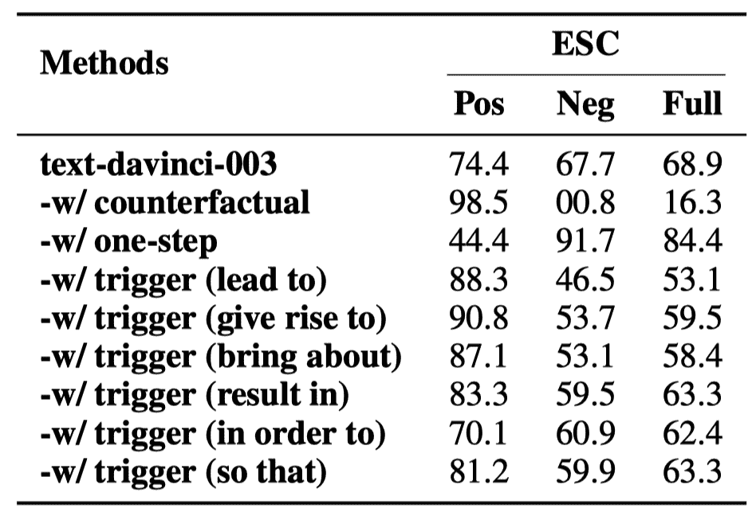

表7: 以不同方式表达因果概念的提示在ECI任务上的性能。

我们发现：

+   “counterfactual” 提示使得几乎所有非因果对被识别为因果。人工检查发现这主要是因为ChatGPT的反事实推理结果不够准确。

+   “one-step”提高了ChatGPT在非因果对上的准确性，但降低了其在因果对上的准确性。这是意味着尽管像“one-step”这样的限制性词语可以使模型更倾向于预测事件对为非因果，但它并没有真正增强ChatGPT的因果推理能力。

+   “trigger()” 在不同因果提示词下的表现有显著差异。这可能是因为在预训练期间，ChatGPT主要通过因果提示词学习因果知识，但每个提示词触发的因果关系分布都有所不同。因此，对于人类来说意义相同的因果提示词对ChatGPT来说代表不同的因果概念。这进一步表明，通过提示准确地向ChatGPT传达因果含义是一个具有挑战性的任务。

### ** 4.4 事件之间的词汇距离 **

如图3所示，我们分析了ChatGPT处理不同词汇距离事件对的表现。“词汇距离”指的是一个句子中两个事件之间间隔的单词数。

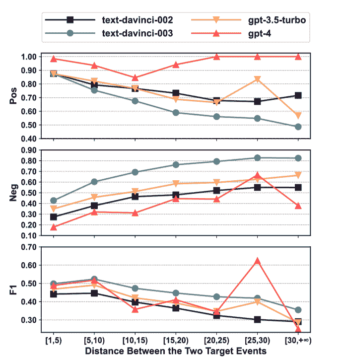

图3: ChatGPT在ESC数据集中处理具有不同词汇距离的事件对的表现。

我们发现：

+   随着间距的增加，ChatGPT更倾向于将事件对预测为非因果。这可能是因为在自然语言中，事件之间的距离越大，存在因果关系的可能性越小，而ChatGPT学到了这种模式。

+   随着事件间距的增加，ChatGPT的F1得分降低。这表明ChatGPT不擅长识别长距离的因果关系。一个异常值是在[25,30)区间内gpt-4的F1得分。这是因为在gpt-4的1000个测试样例中，只有35个例子在[25,30)区间内，导致表现更加随机。然而，所有其他结果都表明，随着事件距离的增加，ChatGPT的表现会下降。

### ** 4.5 事件密度 **

如图4所示，我们分析了ChatGPT在ECI任务中处理具有不同数量事件的句子的表现。

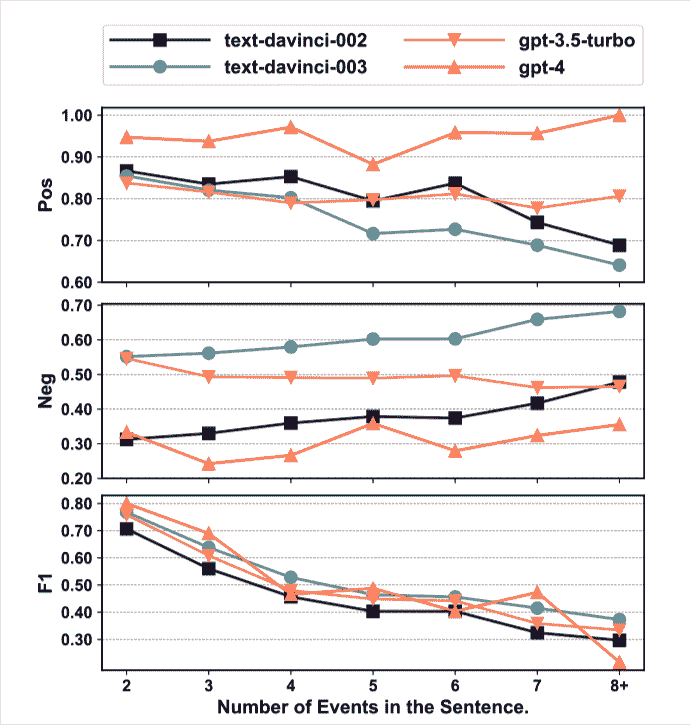

图4: ChatGPT在ESC数据集中处理具有不同事件数量的句子的表现。

我们发现：

+   随着事件密度的增加，大多数版本的ChatGPT更倾向于预测事件对为非因果关系。这主要是因为随着事件密度的增加，事件的上下文变得更加复杂，使得捕捉事件之间的关联变得更加困难。

+   随着事件密度的增加，ChatGPT的F1分数下降。这表明ChatGPT不擅长处理涉及多个事件的复杂情况。

### ** 4.6 因果关系类型 **

如图5所示，我们分析了ChatGPT在ECI任务中处理具有不同类型因果关系的事件对的准确性：1）显式因果，指的是句子中由因果提示词（例如，“lead to”）明确触发的因果关系；2）隐式因果，指的是未使用因果提示词表达的因果关系。

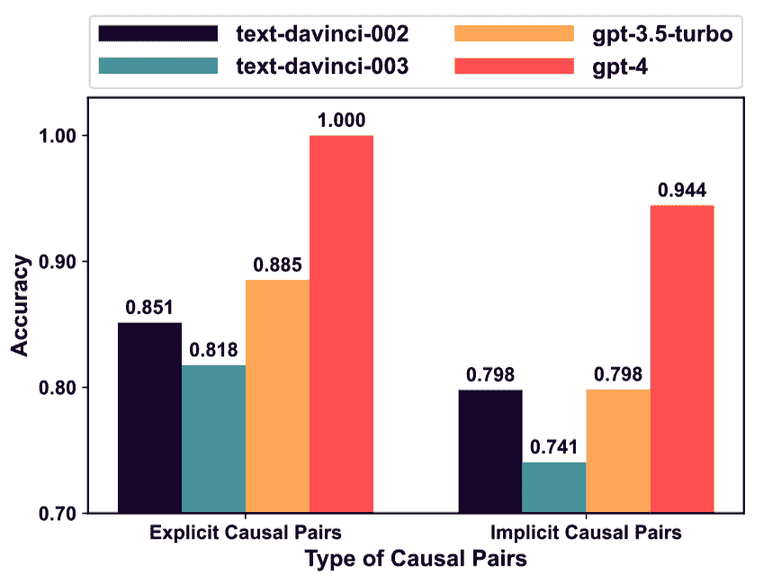

图5: 在ESC数据集中，ChatGPT在不同类型因果关系的事件对上的表现。

可以观察到：

与隐性因果性相比，ChatGPT在捕捉显性因果性方面表现更好。这主要是因为识别显性因果性只需识别因果提示词，而识别隐性因果性则需要利用上下文信息和常识知识进行推理。

### ** 4.7 开放式提示 **

最近，阿罗拉等人 [31]发现，开放式提示（例如“谁去了公园？”）对于ChatGPT来说，往往比限制性的提示（例如“约翰去了公园。对还是错？”）产生更好的结果。如表8所示，我们分析了ChatGPT使用开放式提示的因果推理性能：

1）“open-ended A.1/2/3”，要求ChatGPT生成输入句子中的所有因果事件对。我们设计了三种不同的提示，以全面评估ChatGPT的表现。

2）“open-ended B”，给出输入句子中的目标事件，并要求ChatGPT生成输入句子中与目标事件具有因果关系的事件。

这些提示的格式在图6中展示。

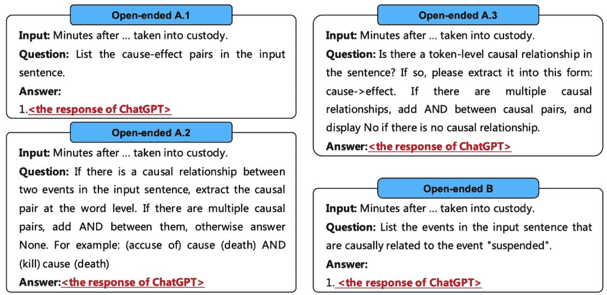

图6: 开放式提示。标记为红色的内容需要ChatGPT回复。

我们对开放式提示采用了边界宽松的P、R和F1计算方法。具体来说，当预测的结果事件与标注的结果事件共享至少一个单词，同时预测的原因事件与标注的原因事件也共享至少一个单词，则认为预测的因果事件对是正确的。

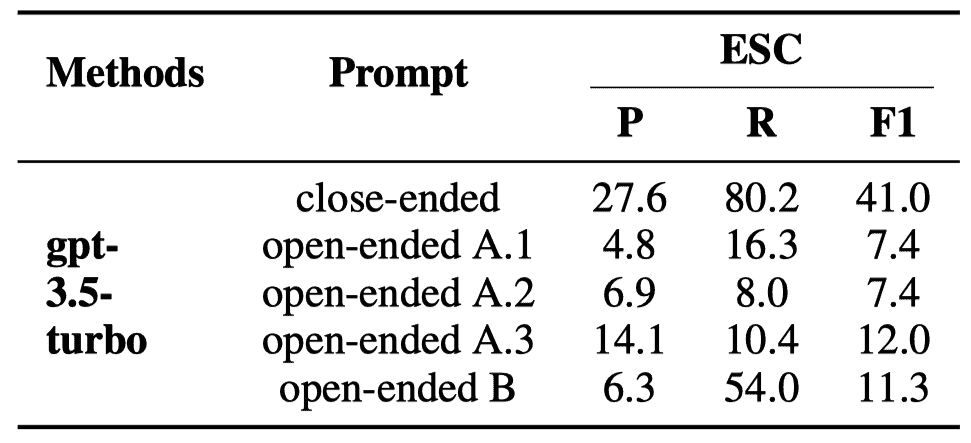

表8: ChatGPT 使用开放式提示在 ECI 任务上的表现。“close-ended”表示图 1 中显示的原始 ECI 提示。值得注意的是，“close-ended”提示并不明确要求 ChatGPT 输出“yes”或“no”，但其句法形式引导 ChatGPT 几乎总是输出“yes”或“no”。

可以观察到：

开放式提示降低了ChatGPT的性能。这是因为开放式提示要求ChatGPT同时执行事件提取和ECI任务。然而，之前的研究 [32, 33]表明，ChatGPT不擅长提取事件。

## ** 5 结论**

在本文中，我们对ChatGPT的因果推理能力进行了全面评估。实验表明：

+   ChatGPT不是一个好的因果推理器，但擅长因果解释生成；

+   ChatGPT存在严重的因果幻觉，这可能是由于因果的报告偏见；

+   随着ChatGPT版本的提升，以及ICL和CoT技术的应用，这种因果幻觉进一步加剧；

+   ChatGPT对于提示中表达因果概念的方式敏感，且开放式提示不适合ChatGPT；

+   对于句子中的事件，ChatGPT擅长捕捉明确的因果关系，在事件密度较低和事件距离较小的句子中表现更好。

+   开放式生成提示无法提高ChatGPT的因果推理能力。

尽管可能存在更细致的提示，可以进一步超越我们报告的结果，但我们认为，仅依靠提示无法从根本上解决 ChatGPT 在因果推理中面临的问题。我们希望这项研究能激发未来的工作，例如解决ChatGPT的因果幻觉问题或在多因素和多模态因果推理的场景中进一步评估ChatGPT。

## ** 6 参考文献**

[1] Jacob Devlin, Ming-Wei Chang, Kenton Lee, and Kristina Toutanova. 2019. BERT: Pre-training of deep bidirectional transformers for language understanding. In Proc. of NAACL.

[2] Yinhan Liu, Myle Ott, Naman Goyal, Jingfei Du, Mandar Joshi, Danqi Chen, Omer Levy, Mike Lewis, Luke Zettlemoyer, and Veselin Stoyanov. 2019. Roberta: A robustly optimized bert pretraining approach. arXiv preprint arXiv:1907.11692.

[3] Long Ouyang, Jeffrey Wu, Xu Jiang, Diogo Almeida, Carroll Wainwright, Pamela Mishkin, Chong Zhang, Sandhini Agarwal, Katarina Slama, Alex Ray, et al. 2022b. Training language models to follow instructions with human feedback. Advances in Neural Information Processing Systems, 35:27730–27744.

[4] Jason Wei, Xuezhi Wang, Dale Schuurmans, Maarten Bosma, brian ichter, Fei Xia, Ed H. Chi, Quoc V Le, and Denny Zhou. 2022. Chain of thought prompting elicits reasoning in large language models. In Advances in Neural Information Processing Systems.

[5] Tommaso Caselli and Piek Vossen. 2017. The event StoryLine corpus: A new benchmark for causal and temporal relation extraction. In Proceedings of the Events and Stories in the News Workshop.

[6] Paramita Mirza, Rachele Sprugnoli, Sara Tonelli, and Manuela Speranza. 2014. Annotating causality in the TempEval-3 corpus. In Proc. of EACL.

[7] Xiaozhi Wang, Yulin Chen, Ning Ding, Hao Peng, Zimu Wang, Yankai Lin, Xu Han, Lei Hou, Juanzi Li, Zhiyuan Liu, Peng Li, and Jie Zhou. 2022. Mavenere: A unified large-scale dataset for event coreference, temporal, causal, and subevent relation extraction. In Proceedings of EMNLP.

[8] Lei Gao, Prafulla Kumar Choubey, and Ruihong Huang. 2019. Modeling document-level causal structures for event causal relation identification. In Proc. of NAACL.

[9] Prafulla Kumar Choubey and Ruihong Huang. 2017. A sequential model for classifying temporal relations between intra-sentence events. In Proc. of EMNLP.

[10] Melissa Roemmele, Cosmin Adrian Bejan, and Andrew S Gordon. 2011. Choice of plausible alternatives: An evaluation of commonsense causal reasoning. In AAAI spring symposium: logical formalizations of commonsense reasoning, pages 90–95.

[11] Li Du, Xiao Ding, Kai Xiong, Ting Liu, and Bing Qin. 2022. e-care: a new dataset for exploring explainable causal reasoning. In Proceedings of the 60th Annual Meeting of the Association for Computational Linguistics (Volume 1: Long Papers), pages 432–446.

[12] Kishore Papineni, Salim Roukos, Todd Ward, and WeiJing Zhu. 2002. Bleu: a method for automatic evaluation of machine translation. In Proceedings of the 40th annual meeting of the Association for Computational Linguistics, pages 311–318.

[13] Chin-Yew Lin. 2004. Rouge: A package for automatic evaluation of summaries. In Text summarization branches out, pages 74–81.

[14] Jacob Devlin, Ming-Wei Chang, Kenton Lee, and Kristina Toutanova. 2019. BERT: Pre-training of deep bidirectional transformers for language understanding. In Proc. of NAACL.

[15] Yinhan Liu, Myle Ott, Naman Goyal, Jingfei Du, Mandar Joshi, Danqi Chen, Omer Levy, Mike Lewis, Luke Zettlemoyer, and Veselin Stoyanov. 2019. Roberta: A robustly optimized bert pretraining approach. arXiv preprint arXiv:1907.11692.

[16] Jian Liu, Yubo Chen, and Jun Zhao. 2020. Knowledge enhanced event causality identification with mention masking generalizations. In Proc. of IJCAI.

[17] Zhongyang Li, Xiao Ding, Kuo Liao, Bing Qin, and Ting Liu. 2021. Causalbert: Injecting causal knowledge into pre-trained models with minimal supervision. arXiv preprint arXiv:2107.09852.

[18] Jintao Liu, Zequn Zhang, Zhi Guo, Li Jin, Xiaoyu Li, Kaiwen Wei, and Xian Sun. 2023. Kept: Knowledge enhanced prompt tuning for event causality identification. Knowledge-Based Systems, 259:110064.

[19] Shirong Shen, Heng Zhou, Tongtong Wu, and Guilin Qi. 2022. Event causality identification via derivative prompt joint learning. In Proceedings of the 29th International Conference on Computational Linguistics, pages 2288–2299, Gyeongju, Republic of Korea. International Committee on Computational Linguistics.

[20] Junyoung Chung, Caglar Gulcehre, KyungHyun Cho, and Yoshua Bengio. 2014. Empirical evaluation of gated recurrent neural networks on sequence modeling. arXiv preprint arXiv:1412.3555.

[21] Alec Radford, Jeff Wu, Rewon Child, David Luan, Dario Amodei, and Ilya Sutskever. 2019. Language models are unsupervised multitask learners. arXiv preprint arXiv:1412.3555.

[22] Li Du, Xiao Ding, Kai Xiong, Ting Liu, and Bing Qin. 2022. e-care: a new dataset for exploring explainable causal reasoning. In Proceedings of the 60th Annual Meeting of the Association for Computational Linguistics (Volume 1: Long Papers), pages 432–446.

[23] Hugo Touvron, Thibaut Lavril, Gautier Izacard, Xavier Martinet, Marie-Anne Lachaux, Timothée Lacroix, Baptiste Rozière, Naman Goyal, Eric Hambro, Faisal Azhar, Aurelien Rodriguez, Armand Joulin, Edouard Grave, and Guillaume Lample. 2023. Llama: Open and efficient foundation language models.

[24] Hyung Won Chung, Le Hou, Shayne Longpre, Barret Zoph, Yi Tay, William Fedus, Yunxuan Li, Xuezhi Wang, Mostafa Dehghani, Siddhartha Brahma, Albert Webson, Shixiang Shane Gu, Zhuyun Dai, Mirac Suzgun, Xinyun Chen, Aakanksha Chowdhery, Alex Castro-Ros, Marie Pellat, Kevin Robinson, Dasha Valter, Sharan Narang, Gaurav Mishra, Adams Yu, Vincent Zhao, Yanping Huang, Andrew Dai, Hongkun Yu, Slav Petrov, Ed H. Chi, Jeff Dean, Jacob Devlin, Adam Roberts, Denny Zhou, Quoc V. Le, and Jason Wei. 2022. Scaling instruction-finetuned language models.

[25] Chengwei Qin, Aston Zhang, Zhuosheng Zhang, Jiaao Chen, Michihiro Yasunaga, and Diyi Yang. 2023. Is chatgpt a general-purpose natural language processing task solver?

[26] Chunkit Chan, Jiayang Cheng, Weiqi Wang, Yuxin Jiang, Tianqing Fang, Xin Liu, and Yangqiu Song. 2023. Chatgpt evaluation on sentence level relations: A focus on temporal, causal, and discourse relations.

[27] Long Ouyang, Jeffrey Wu, Xu Jiang, Diogo Almeida, Carroll Wainwright, Pamela Mishkin, Chong Zhang, Sandhini Agarwal, Katarina Slama, Alex Ray, John Schulman, Jacob Hilton, Fraser Kelton, Luke Miller, Maddie Simens, Amanda Askell, Peter Welinder, Paul F Christiano, Jan Leike, and Ryan Lowe. 2022a. Training language models to follow instructions with human feedback. In Advances in Neural Information Processing Systems, volume 35, pages 27730–27744. Curran Associates, Inc.

[28] OpenAI. 2023. Gpt-4 technical report.

[29] Takeshi Kojima, Shixiang Shane Gu, Machel Reid, Yutaka Matsuo, and Yusuke Iwasawa. 2022. Large language models are zero-shot reasoners. arXiv preprint arXiv:2205.11916.

[30] Judea Pearl. 2009. Causality. Cambridge university press.

[31] Simran Arora, Avanika Narayan, Mayee F Chen, Laurel Orr, Neel Guha, Kush Bhatia, Ines Chami, and Christopher Re. 2023. Ask me anything: A simple strategy for prompting language models. In The Eleventh International Conference on Learning Representations.

[32] Jun Gao, Huan Zhao, Changlong Yu, and Ruifeng Xu. 2023. Exploring the feasibility of chatgpt for event extraction. arXiv preprint arXiv:2303.03836.

[33] Xiang Wei, Xingyu Cui, Ning Cheng, Xiaobin Wang, Xin Zhang, Shen Huang, Pengjun Xie, Jinan Xu, Yufeng Chen, Meishan Zhang, Yong Jiang, and Wenjuan Han. 2023. Zero-shot information extraction via chatting with chatgpt.

本期责任编辑：丁 效

本期编辑：杨 昕