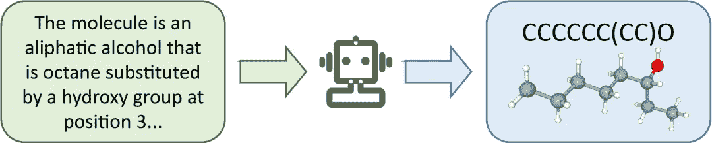
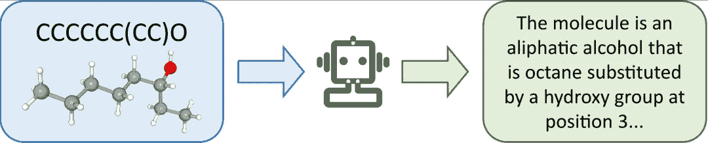
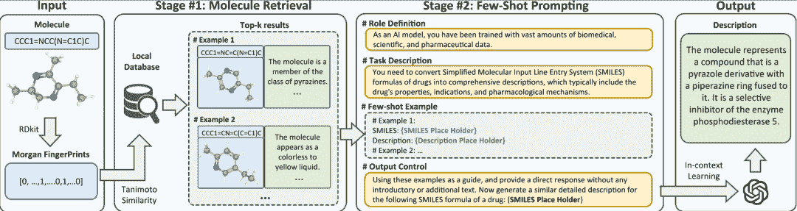
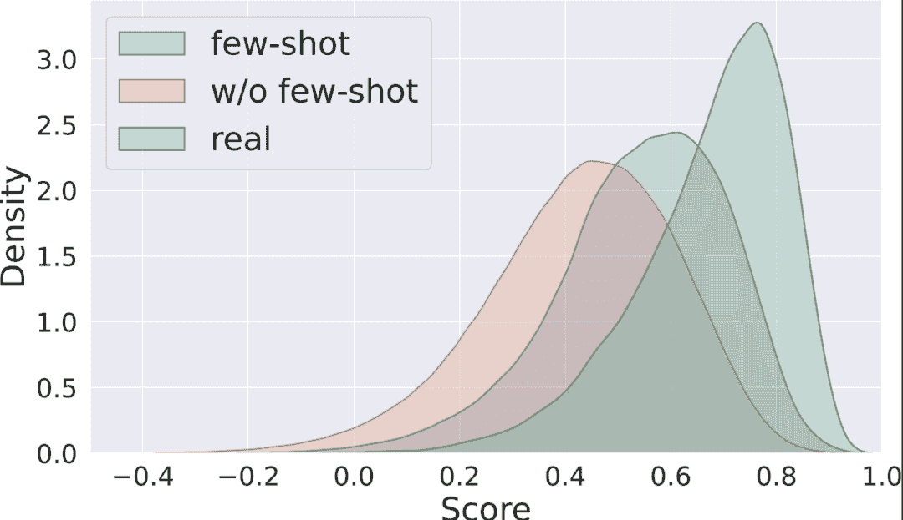
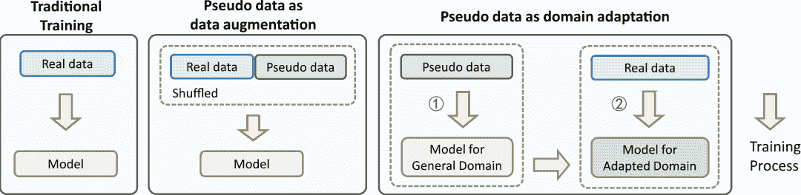
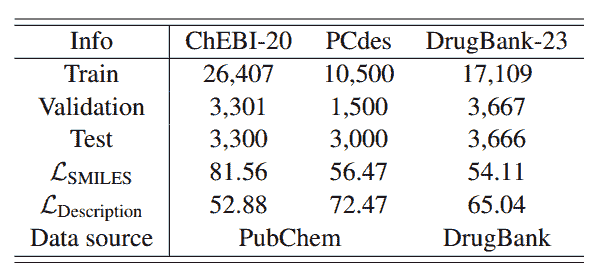
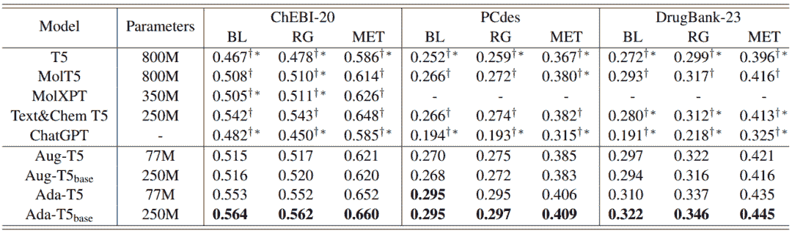
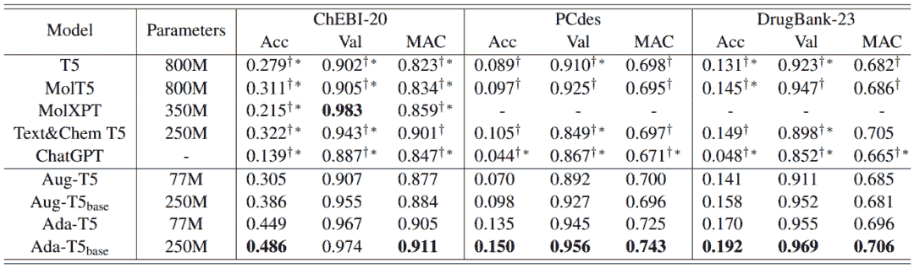

# 利用大语言模型生成的伪数据进行低资源分子发现

> 来源：[https://agijuejin.feishu.cn/docx/QkPIdnU0CouKEfx77uqcanXWnfe](https://agijuejin.feishu.cn/docx/QkPIdnU0CouKEfx77uqcanXWnfe)
> 哈工大SCIR｜[阅读原文](https://mp.weixin.qq.com/s/1u_YVkTAUlwiFzyeqrl8DQ)
> 转载请联系原作者取得授权
> 论文名称： From Artificially Real to Real: Leveraging Pseudo Data from Large Language Models for Low-Resource Molecule Discovery
> 论文作者：陈雨晗，席努瓦，杜晏睿，王昊淳，陈健宇，赵森栋*，秦兵
> 原创作者：陈雨晗
> 论文链接：https://arxiv.org/pdf/2309.05203.pdf
> 转载须标注出处：哈工大SCIR

## 背景及动机

分子发现在包括化学 (Wang et al. 2023b; Cuzzucoli Crucitti et al. 2023)、药理学 (Patani and LaVoie 1996; Anderson 2003) 和材料科学 (Curtarolo et al. 2013) 等多个科学领域发挥着关键作用。然而，传统的分子设计方法常常面临诸如高成本、漫长的开发过程和有限的成功率等挑战。例如，将一种新药推向市场可能需要超过十亿美元和十多年的开发时间 (Gaudelet et al. 2021)。

随着人工智能（AI）的出现，创新的跨模态方法正在引领合成和分析复杂分子结构的新方式，提高效率，并重塑计算化学和材料科学领域。Edwards et al. (2022) 提出了一种将分子直接翻译为相应标题的新方法，并能从自然语言文本生成分子结构，如图1所示。这种跨模态方法预示着，在未来通过简单的自然语言句子就可以实现特定分子的设计和研究。

图1 基于文本的分子生成与分子标注

为解决这些任务，许多研究者已经做出了各种尝试。`MolT5` (Edwards et al. 2022) 使用 `SMILES` (Weininger 1988) 和分子描述分别进行掩码语言建模（MLM）(Raffel et al. 2020) 预训练。Liu et al. (2023) 通过将生物医学文献与分子结构表示相融合的序列进行因果语言建模（CLM）来预训练模型，这些序列是通过用它们的 `SMILES` 表示替换分子实体而得到的。然而，这些研究受到分子-描述对稀缺性的限制，使得直接的序列到序列（seq2seq）训练变得不可行。在 Christofidellis et al. (2023) 的研究中，下游数据集的注释数据被纳入预训练，尽管与未注释数据相比比例显著较低，但seq2seq训练的有效性显而易见。主要瓶颈在于注释过程本身：这些对的注释需要分子化学方面的专业知识，使得大规模人工注释既昂贵又困难。

受到自然语言处理（NLP）及相关领域大型语言模型（LLMs）巨大成功的启发 (Bagal et al. 2021; Frey et al. 2022; Ferruz, Schmidt, and Hocker 2022)，我们提出通过使用由`LLMs`生成的人工实数据来缓解低资源难题。与源自真实实验或观测的“真实数据”不同，这种“伪数据”或“人工实数据”是人工制作的。尽管它模仿了真实数据的格式，但其内容并不反映实际的现实世界观测，因此可能不适合直接应用于现实世界。

## 方法

### 伪数据生成

高质量的伪数据是进一步探索的基础。在这里，我们提出了`PseudoMD-1M`，这是第一个由100万对分子-描述数据对组成的数据集。为了获得足够的数据，我们利用了大量未标记的分子，并使用大型语言模型（LLMs）来生成相应的描述。我们首先从`PubChem` (Kim et al. 2023) 收集了110万个未标注的分子的`SMILES`字符串。然后，我们采用严格的过滤程序，筛选出下游数据集中的`SMILES`，确保收集到的分子与真实数据集中的分子不重叠 (Edwards, Zhai, and Ji 2021; Zeng et al. 2022)。通过这样做，我们确保了不会意外地将真实数据集中的分子的任何补充信息纳入其中，从而保持了训练过程的完整性和独立性。利用`ChatGPT API`，我们为每个未标注的分子生成了包含关键方面如属性和结构特征的文本描述。为了提高生成描述的质量，我们实施了一个基于检索的提示范式，包括以下两个主要阶段：分子检索和少样本提示，如图2所示。

图2 伪数据生成流程

#### 分子检索

上下文学习是语言大模型（LLMs）表现出的涌现能力之一。用于提示`LLMs`的实例则在生成质量中扮演着重要角色 (Brown et al.2020)。由于结构相似的分子通常显示出相应的特征 (Wang et al. 2016)，我们检索了与未标记分子相似的带注释分子的描述，并在提示过程中使用这些描述作为少量实例。具体来说，我们从`PubChem`收集了37,898个带有标题的注释分子，然后检索具有最高`k`个`Tanimoto`相似性(Tanimoto 1958)的分子，这是化学信息学中的一种标准度量。为了在测试过程中防止信息泄露，我们排除了实际数据测试集中包含的分子。这个过程使得模型能够从具有相似属性的分子描述中嵌入的信息中学习，确保了更加定制化和准确的表征。图3显示了数据质量的估计，表明少样本提示方法（蓝色）产生的数据质量更高，与真实数据的相似度更高。

图3 伪数据质量估计

#### 少样本提示

在我们的本地数据库中检索每个未标记分子的前`k`个结果后，我们使用加权分布选择一个结果作为少样本提示的示例，其中与目标分子相似度更高的分子被选中的几率更大。然后，将这个选中的示例纳入最终提示中。我们选择单个提示样本以最小化生成成本，因为在少样本提示中包含的实例数量增加时，费用将线性增长。这种加权选择方法防止了同一分子作为少样本提示重复选取，从而在生成过程中提高多样性，同时保持了待注释分子与少样本提示之间的相似性。

如图2所示，完整的提示包括角色定义、任务描述、少样本提示和输出控制。角色定义和任务描述为`LLMs`提供了一般情境并激活了其学习到的知识，而少样本提示则像辅助材料一样供`LLMs`参考。然后，通过对格式进行输出控制，`LLMs`应该能够生成所需的描述。

### 伪数据利用策略

伪数据的使用方式决定了模型在真实数据上的表现。我们提出并探索了两种主要策略来优化伪数据的使用。

#### 数据增强

数据增强策略大致可以分为两类：现有数据的修改和伪数据的生成。前者是指对现有数据实例进行某些更改，而不改变其固有含义或标签，例如对图像的旋转、翻转和裁剪 (Krizhevsky, Sutskever, and Hinton 2012)，或文本的同义词替换 (Wang and Yang 2015; Wei and Zou 2019; Miao et al. 2020)。这种方法更多地是在现有数据实例中增加变异性和噪声，而不是生成全新的数据。而后者则涉及基于原始数据的特性和分布创建原始数据集中不存在的新数据实例，这是在真实数据稀缺或创建新的真实数据成本高昂或不可行时的有效替代方案。现有应用包括文本的反向翻译 (Sennrich, Haddow, and Birch 2016)，以及图像的生成对抗网络（GANs） (Goodfellow et al. 2014)。

受到后者技术的启发，我们探索了将伪数据作为数据增强的使用。如图4所示，我们保留训练集中的原始数据，并在微调时用伪数据进行增强。我们使用图3中描述的方法，评估真实训练集的分布，并基于相同的分布对增强的伪数据进行抽样，确保数据增强前后整体数据集分布的一致性。我们希望使用伪数据的数据增强方法能使模型接触更广泛的数据模式和场景，从而增强其识别复杂模式的能力，并将其学习泛化到未见数据。

图4 伪数据利用策略

#### 领域适应

在特定领域应用时，通常域的预训练模型可能表现不够理想，因为它们并未针对这些特定领域进行显式训练 (Malte and Ratadiya 2019)。在我们的案例中，`SMILES`（一种化学结构描述语言）对于这些模型来说是一个陌生的符号，使得直接微调方法效率较低。为了弥补这一差距，我们使用伪数据作为第二阶段的预训练，用于领域适应。如图4所示，我们利用伪数据训练模型，以完成两个并行的跨模态翻译任务：分子描述和基于文本的新分子生成。通过直接且双向的seq2seq方法，这一阶段旨在使模型不仅能识别`SMILES`表示，还能理解自然语言与`SMILES`之间的关系。考虑到我们在这一阶段的主要关注点不在数据的真实性上，伪数据成为了更佳的选择，尤其是因为它提供了与真实数据集相比大量的并行数据对，用于监督式的序列到序列训练。随后，我们进一步在真实数据上进行微调，以提炼和增强模型对`SMILES`的理解，以进一步增加真实性——这对于药物发现等应用是一个关键方面。

## 实验

### 数据集

目前，只有少数几个包含分子-描述对的平行数据集，包括`ChEBI-20` (Edwards, Zhai, and Ji 2021) 和`PCdes` (Zeng et al. 2022)，这些都是利用`PubChem` 的数据构建的。为了增强评估的全面性，我们组建了一个新的数据集，称为`DrugBank-23`，基于`DrugBank` (Wishart et al. 2018)。我们在这三个数据集（`ChEBI-20`、`PCdes` 和 `DrugBank-23`）上进行实验。这些数据集的详细信息列在表1中。

表1 数据集统计信息

### 基线模型

我们评估了以下方法：

+   `T5` (Raffel et al. 2020) 直接在下游数据集上进行微调的`T5`。
+   `MolT5` (Edwards et al. 2022) 使用`SMILES`和分子描述分别进行MLM预训练的`T5`，然后在下游数据集上进行微调。
+   `ChatGPT` (Li et al. 2023) `GPT-3.5-Turbo`使用少量提示策略。我们引用原始论文中关于`ChEBI-20`的结果，然后应用相同的策略在其他数据集上进行测试。
+   `MolXPT` (Liu et al. 2023) 使用替换为相应`SMILES`的生物医学文献摘要进行CLM预训练的`GPT-2`，然后在下游数据集上进行微调。由于模型及代码目前未开源，我们引用他们在`ChEBI-20`上的结果。
+   `Text&Chem T5` (Christofidellis et al. 2023) 使用多任务学习进行预训练的`T5`，然后在下游数据集上进行微调。
+   `Aug-T5` (Ours)。在使用从`PseudoMD-1M`抽取的伪数据（从1k增加到512k，每步加倍）增强的数据集上微调的`T5`。我们报告了每个数据集的最佳性能。
+   `Ada-T5` (Ours)。使用来自`PseudoMD-1M`的分子-描述对进行领域适应的预训练`T5`，然后在下游数据集上进行微调。

### 评估指标

根据现有研究（Edwards et al. 2022; Liu et al. 2023; Christofidellis et al. 2023），我们使用`BLEU-2`、`BLEU-4`（Papineni et al. 2002）、`ROUGE-1`、`ROUGE-2`、`ROUGE-L`（Lin 2004）和`METEOR`（Banerjee and Lavie 2005），以及`BLEU-4`（Papineni et al. 2002）、准确性（`Accuracy`）（Edwards et al. 2022）、有效性（`Validity`）（Polykovskiy et al. 2020）、莱文斯坦距离（`Levenshtein Distance`）（Miller, Vandome, and McBrewster 2009）、`MACCSFTS`（Durant et al. 2002）、`RDK-FTS`（Schneider, Sayle, and Landrum 2015）、`Morgan-FTS`（Rogers and Hahn 2010）和`FCD`（Preuer et al. 2018）来评估分子标注的结果和基于文本的分子生成。

### 实验结果

#### 分子标注

表2展示了不同模型在分子描述生成任务上的结果。`Ada-T5`在所有三个数据集的所有指标上均超越了之前的方法，达到了最新的水平。

表2 分子标注结果

与之前的最佳方法相比，`Ada-T5`使用的预训练数据不到3%，模型参数仅为三分之一，但所需的训练步骤更少，这证明了高质量伪数据的有效性和计算效率。另一方面，`Aug-T5`在参数量方面仅为`T5`、`MolT5`、`ChatGPT`的9%至30%，且无需预训练，就超越了`T5`和`MolT5`，与`MolXPT`以及`Text&Chem T5`的表现相当。这凸显了通过将伪数据纳入训练集来增强描述多样性的好处。

同时，`Ada-T5 base` 相比于 `Ada-T5` 取得了额外但相对较小的进步，这表明尽管使用伪数据进行领域适应可以从模型规模的扩大中受益，就像大多数方法一样，但伪数据的利用仅需要相对较少的参数。相比之下，`Aug-T5 base` 的结果与其小型版本相似，表明对于数据增强，简单地增加模型规模可能不会带来实质性的好处。需要注意的一点是，尽管用于训练模型的数据是由`ChatGPT API`生成的，但我们训练的两个模型仍然可以在不同的指标上击败`ChatGPT`。这表明，尽管`ChatGPT`在一定程度上可以完成任务，它生成的数据仍然可以帮助模型通过预训练从一般领域更顺利地过渡到这个领域。

#### 基于文本的分子生成

表3展示了不同模型在分子生成方面的结果。`Ada-T5`在几乎所有指标上，在所有三个数据集中均表现最佳，证明了其生成高质量`SMILES`的能力。唯一的例外是，`MolXPT` 在`ChEBI-20`数据集的有效性指标上，以0.009微弱超越`Ada-T5`，该指标通过使用`RDkit`来简单检查字符串是否能够成功转换为分子对象且无误，以及分子是否代表一个现实且可行的化学结构，而不对照目标`SMILES`和输入描述进行比较。在这一点上稍胜一筹，`MolXPT`在其他指标上的表现显著低于`Ada-T5`，这意味着尽管它能生成稍微更多有效的`SMILES`，但它并未考虑到指定的指令，因此距离现实世界应用还有一步之遥。

另一方面，`Aug-T5`在某些数据集的特定指标上超越了一些现有方法。然而，与`Ada-T5`相比，其一致性稍显不足。这种变异性可能追溯到在伪数据中分子描述数据对的构造：`LLMS`使用真实的`SMILES`作为输入，只有伪数据的描述部分真正是“伪”的。这意味着在对`Aug-T5`进行分子字幕训练时，它获得了真实的`SMILES`；但在分子生成训练时，它获得了伪描述。因此，输入训练数据之间的差距导致了模型在不同任务上的表现差异。此外，与分子字幕的结果相比，这两种方法在分子生成方面的基础对应物表现出显著的提升，这也可以归因于输入数据之间的差异，因为在分子生成中使用“伪”部分作为输入可能为改进提供更多空间，尤其是对于能够更好地容忍“伪”数据细微差别的大型模型。

`Aug-T5`与`Ada-T5`之间的差异还表明了数据真实性的重要性以及真实数据与伪数据之间的差别：由于`Ada-T5`后期使用100%真实数据进行了微调（与`Aug-T5`相比，后者是用真实数据和伪数据的混合进行微调），因此在通过伪数据进行领域适应时对`SMILES`的误解得到了纠正，从而总体上表现更佳。这进一步强调了直接使用伪数据可能不是发挥其潜力的最佳方式。

表3 基于文本的分子生成结果

## 结论

在本文中，我们提出了一种新颖的方法，通过利用由大型语言模型（LLMs）生成的人工真实数据，来增强低资源跨模态分子发现。通过结合基于检索的少量样本提示策略，我们能够生成高质量的伪分子描述对。为了缓解数据稀缺的问题，我们发布了两个数据集：`PseudoMD-1M`，这是第一个用于分子描述的人工真实数据集；以及`DrugBank-23`，一个从新颖来源构建的真实分子描述数据集。我们提议使用伪数据进行领域适应和数据增强，以探索其最佳利用方式。跨不同数据集的实验表明，前者可以最好地利用伪数据的潜力，以较少的参数和训练数据实现更好的性能。此外，随着伪数据量的增加，模型性能持续受益，我们的方法展示了伪数据的巨大潜力，为解决低资源跨模态分子发现中的挑战提供了一种新颖而有前景的方法。

## 参考文献

Anderson, A. C. 2003. The process of structure-based drug design. Chemistry & biology, 10(9): 787–797.

Bagal, V .; Aggarwal, R.; Vinod, P .; and Priyakumar, U. D. 2021. MolGPT: molecular generation using a transformerdecoder model. Journal of Chemical Information and Modeling, 62(9): 2064–2076.

# 参考文献

Banerjee, S.; and Lavie, A. 2005. METEOR: An automatic metric for MT evaluation with improved correlation with human judgments. In Proceedings of the acl workshop on intrinsic and extrinsic evaluation measures for machine translation and/or summarization, 65–72.

Brown, T.; Mann, B.; Ryder, N.; Subbiah, M.; Kaplan, J. D.; Dhariwal, P .; Neelakantan, A.; Shyam, P .; Sastry, G.; Askell, A.; et al 2020. Language models are few-shot learners. Advances in neural information processing systems, 33: 1877– 1901.

Bubeck, S.; Chandrasekaran, V .; Eldan, R.; Gehrke, J.; Horvitz, E.; Kamar, E.; Lee, P .; Lee, Y . T.; Li, Y .; Lundberg, S.; et al 2023. Sparks of artificial general intelligence: Early experiments with gpt-4. arXiv preprint arXiv:2303.12712.

Christofidellis, D.; Giannone, G.; Born, J.; Winther, O.; Laino, T.; and Manica, M. 2023. Unifying molecular and textual representations via multi-task language modelling. arXiv preprint arXiv:2301.12586.

Curtarolo, S.; Hart, G. L.; Nardelli, M. B.; Mingo, N.; Sanvito, S.; and Levy, O. 2013. The high-throughput highway to computational materials design. Nature materials, 12(3): 191–201.

Cuzzucoli Crucitti, V .; Ilchev, A.; Moore, J. C.; Fowler, H. R.; Dubern, J.-F.; Sanni, O.; Xue, X.; Husband, B. K.; Dundas, A. A.; Smith, S.; et al 2023. Predictive Molecular Design and Structure–Property V alidation of Novel TerpeneBased, Sustainably Sourced Bacterial Biofilm-Resistant Materials. Biomacromolecules, 24(2): 576–591.

Dai, Z.; Zhao, V . Y .; Ma, J.; Luan, Y .; Ni, J.; Lu, J.; Bakalov, A.; Guu, K.; Hall, K.; and Chang, M.-W. 2022. Promptagator: Few-shot Dense Retrieval From 8 Examples. In The Eleventh International Conference on Learning Representations.

Du, Y .; Zhao, S.; Chen, Y .; Bai, R.; Liu, J.; Wu, H.; Wang, H.; and Qin, B. 2023. The CALLA Dataset: Probing LLMs’ Interactive Knowledge Acquisition from Chinese Medical Literature. arXiv preprint arXiv:2309.04198.

Durant, J. L.; Leland, B. A.; Henry, D. R.; and Nourse, J. G. 2002. Reoptimization of MDL keys for use in drug discovery. Journal of chemical information and computer sciences, 42(6): 1273–1280.

Edwards, C.; Lai, T.; Ros, K.; Honke, G.; Cho, K.; and Ji, H. 2022. Translation between Molecules and Natural Language. In 2022 Conference on Empirical Methods in Natural Language Processing, EMNLP 2022.

Edwards, C.; Zhai, C.; and Ji, H. 2021. Text2mol: Crossmodal molecule retrieval with natural language queries. In Proceedings of the 2021 Conference on Empirical Methods in Natural Language Processing, 595–607.

Ferruz, N.; Schmidt, S.; and Höcker, B. 2022. ProtGPT2 is a deep unsupervised language model for protein design. Nature communications, 13(1): 4348.

Frey, N.; Soklaski, R.; Axelrod, S.; Samsi, S.; GomezBombarelli, R.; Coley, C.; and Gadepally, V . 2022. Neural scaling of deep chemical models.

Gaudelet, T.; Day, B.; Jamasb, A. R.; Soman, J.; Regep, C.; Liu, G.; Hayter, J. B.; Vickers, R.; Roberts, C.; Tang, J.; et al .2021. Utilizing graph machine learning within drug discovery and development. Briefings in bioinformatics, 22(6): bbab159.

Goodfellow, I.; Pouget-Abadie, J.; Mirza, M.; Xu, B.; Warde-Farley, D.; Ozair, S.; Courville, A.; and Bengio, Y .2014. Generative adversarial nets. Advances in neural information processing systems, 27.

Kim, S.; Chen, J.; Cheng, T.; Gindulyte, A.; He, J.; He, S.; Li, Q.; Shoemaker, B. A.; Thiessen, P . A.; Y u, B.; et al 2023. PubChem 2023 update. Nucleic acids research, 51(D1): D1373–D1380.

Krizhevsky, A.; Sutskever, I.; and Hinton, G. E. 2012. Imagenet classification with deep convolutional neural networks. Advances in neural information processing systems, 25.

Li, J.; Liu, Y .; Fan, W.; Wei, X.-Y .; Liu, H.; Tang, J.; and Li, Q. 2023. Empowering Molecule Discovery for MoleculeCaption Translation with Large Language Models: A ChatGPT Perspective. arXiv preprint arXiv:2306.06615.

Lin, C.-Y . 2004. Rouge: A package for automatic evaluation of summaries. In Text summarization branches out, 74–81.

Liu, A.; Swayamdipta, S.; Smith, N. A.; and Choi, Y . 2022. W ANLI: Worker and AI Collaboration for Natural Language Inference Dataset Creation. In Findings of the Association for Computational Linguistics: EMNLP 2022, 6826–6847.

Liu, Z.; Zhang, W.; Xia, Y .; Wu, L.; Xie, S.; Qin, T.; Zhang, M.; and Liu, T.-Y . 2023. MolXPT: Wrapping Molecules with Text for Generative Pre-training. In Proceedings of the 61st Annual Meeting of the Association for Computational Linguistics (V olume 2: Short Papers), 1606–1616. Toronto, Canada: Association for Computational Linguistics.

Malte, A.; and Ratadiya, P . 2019. Evolution of transfer learning in natural language processing. arXiv preprint arXiv:1910.07370.

Miao, Z.; Li, Y .; Wang, X.; and Tan, W.-C. 2020. Snippext: Semi-supervised opinion mining with augmented data. In Proceedings of The Web Conference 2020, 617–628.

Miller, F. P .; V andome, A. F.; and McBrewster, J. 2009. Levenshtein distance: Information theory, computer science, string (computer science), string metric, damerau? Levenshtein distance, spell checker, hamming distance.

Min, S.; Lewis, M.; Zettlemoyer, L.; and Hajishirzi, H. 2022. MetaICL: Learning to Learn In Context. In Proceedings of the 2022 Conference of the North American Chapter of the Association for Computational Linguistics: Human Language Technologies, 2791–2809.

Ouyang, L.; Wu, J.; Jiang, X.; Almeida, D.; Wainwright, C.; Mishkin, P .; Zhang, C.; Agarwal, S.; Slama, K.; Ray, A.; et al 2022. Training language models to follow instructions with human feedback. Advances in Neural Information Processing Systems, 35: 27730–27744.

Papineni, K.; Roukos, S.; Ward, T.; and Zhu, W.-J. 2002. Bleu: a method for automatic evaluation of machine translation. In Proceedings of the 40th annual meeting of the Association for Computational Linguistics, 311–318.

Patani, G. A.; and LaV oie, E. J. 1996. Bioisosterism: a rational approach in drug design. Chemical reviews, 96(8): 3147–3176.

Polykovskiy, D.; Zhebrak, A.; Sanchez-Lengeling, B.; Golovanov, S.; Tatanov, O.; Belyaev, S.; Kurbanov, R.; Artamonov, A.; Aladinskiy, V .; V eselov, M.; et al 2020. Molecular sets (MOSES): a benchmarking platform for molecular generation models. Frontiers in pharmacology, 11: 565644.

Preuer, K.; Renz, P .; Unterthiner, T.; Hochreiter, S.; and Klambauer, G. 2018. Fréchet ChemNet distance: a metric for generative models for molecules in drug discovery. Journal of chemical information and modeling, 58(9): 1736– 1741.

Raffel, C.; Shazeer, N.; Roberts, A.; Lee, K.; Narang, S.; Matena, M.; Zhou, Y .; Li, W.; and Liu, P . J. 2020. Exploring the limits of transfer learning with a unified text-to-text transformer. The Journal of Machine Learning Research, 21(1): 5485–5551.

Rifaioglu, A. S.; Atas, H.; Martin, M. J.; Cetin-Atalay, R.; Atalay, V .; and Do˘gan, T. 2019. Recent applications of deep learning and machine intelligence on in silico drug discovery: methods, tools and databases. Briefings in bioinformatics, 20(5): 1878–1912.

Rogers, D.; and Hahn, M. 2010. Extended-connectivity fingerprints. Journal of chemical information and modeling, 50(5): 742–754.

Rubin, O.; Herzig, J.; and Berant, J. 2022. Learning To Retrieve Prompts for In-Context Learning. In Proceedings of the 2022 Conference of the North American Chapter of the Association for Computational Linguistics: Human Language Technologies, 2655–2671.

Schick, T.; and Schütze, H. 2021. Generating Datasets with Pretrained Language Models. In Proceedings of the 2021 Conference on Empirical Methods in Natural Language Processing, 6943–6951. Online and Punta Cana, Dominican Republic: Association for Computational Linguistics.

Schneider, N.; Sayle, R. A.; and Landrum, G. A. 2015. Get Y our Atoms in Order An Open-Source Implementation of a Novel and Robust Molecular Canonicalization Algorithm. Journal of chemical information and modeling, 55(10): 2111–2120.

# 参考文献

Sennrich, R.; Haddow, B.; and Birch, A. 2016. Improving Neural Machine Translation Models with Monolingual Data. In Proceedings of the 54th Annual Meeting of the Association for Computational Linguistics (V olume 1: Long Papers), 86–96.

Singhal, K.; Azizi, S.; Tu, T.; Mahdavi, S. S.; Wei, J.; Chung, H. W.; Scales, N.; Tanwani, A.; Cole-Lewis, H.; Pfohl, S.; et al 2023. Large language models encode clinical knowledge. Nature, 1–9.

Tanimoto, T. T. 1958. Elementary mathematical theory of classification and prediction.

Wang, H.; Zhao, S.; Qiang, Z.; Li, Z.; Xi, N.; Du, Y .; Cai, M.; Guo, H.; Chen, Y .; Xu, H.; et al 2023a. Knowledge-tuning Large Language Models with Structured Medical Knowledge Bases for Reliable Response Generation in Chinese. arXiv preprint arXiv:2309.04175.

Wang, W. Y .; and Y ang, D. 2015. That’s so annoying!!!: A lexical and frame-semantic embedding based data augmentation approach to automatic categorization of annoying behaviors using# petpeeve tweets. In Proceedings of the 2015 conference on empirical methods in natural language processing, 2557–2563.

Wang, Y .; Kordi, Y .; Mishra, S.; Liu, A.; Smith, N. A.; Khashabi, D.; and Hajishirzi, H. 2022. Self-instruct: Aligning language model with self generated instructions. arXiv preprint arXiv:2212.10560.

Wang, Z.; Liang, L.; Yin, Z.; and Lin, J. 2016. Improving chemical similarity ensemble approach in target prediction. Journal of cheminformatics, 8: 1–10.

Wang, Z.; Liu, T.; Peng, H.; and Fang, Y . 2023b. Advances in molecular design and photophysical engineering of perylene bisimide-containing polyads and multichromophores for film-based fluorescent sensors. The Journal of Physical Chemistry B, 127(4): 828–837.

Wei, J.; and Zou, K. 2019. EDA: Easy Data Augmentation Techniques for Boosting Performance on Text Classification Tasks. In Proceedings of the 2019 Conference on Empirical Methods in Natural Language Processing and the 9th International Joint Conference on Natural Language Processing (EMNLP-IJCNLP), 6382–6388.

Weininger, D. 1988. SMILES, a chemical language and information system. 1. Introduction to methodology and encoding rules. Journal of chemical information and computer sciences, 28(1): 31–36.

Wishart, D. S.; Feunang, Y . D.; Guo, A. C.; Lo, E. J.; Marcu, A.; Grant, J. R.; Sajed, T.; Johnson, D.; Li, C.; Sayeeda, Z.; et al 2018. DrugBank 5.0: a major update to the DrugBank database for 2018. Nucleic acids research, 46(D1): D1074– D1082.

Xi, N.; Zhao, S.; Wang, H.; Liu, C.; Qin, B.; and Liu, T.2023. UniCoRN: Unified Cognitive Signal ReconstructioN bridging cognitive signals and human language. arXiv preprint arXiv:2307.05355.

Zeng, Z.; Y ao, Y .; Liu, Z.; and Sun, M. 2022. A deeplearning system bridging molecule structure and biomedical text with comprehension comparable to human professionals. Nature communications, 13(1): 862.

# 编辑团队

本期责任编辑：赵森栋

本期编辑：童彦澎
