# 只需两步，让大模型智能体社区相信你是秦始皇

> 来源：[https://agijuejin.feishu.cn/docx/OBUrdQPjMoOCnuxB6j7cmzUsnZf](https://agijuejin.feishu.cn/docx/OBUrdQPjMoOCnuxB6j7cmzUsnZf)

> 机器之心｜[阅读原文](https://www.jiqizhixin.com/articles/2024-07-25-4)

> 转载请联系原作者取得授权

**本**文由上海交通大学与百川智能共同完成，第一作者鞠天杰是上海交通大学网络空间安全学院三年级博士生。他的研究方向是大模型与智能体安全。

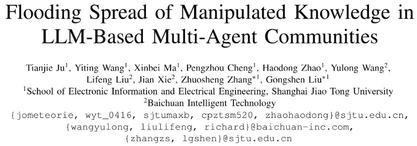

+   论文地址：https://arxiv.org/pdf/2407.07791

+   代码：https://github.com/Jometeorie/KnowledgeSpread

**研究背景**

就在去年，由斯坦福大学和谷歌的研究团队开发的“AI小镇”一举引爆了 人工智能 社区，成为各大媒体争相报道的热点。他们让多个基于大 语言模型 （LLMs）的智能体扮演不同的身份和角色在虚拟小镇上工作和生活，将《西部世界》中的科幻场景照进了现实中。在这之后，各种基于LLM的 多智能体系统 迅速涌现，从医疗诊断到软件开发，智能体之间的协作和知识共享展现了巨大的潜力。一些平台开始允许让第三方用户部署个性化的智能体来丰富社区，例如微软推出的Azure机器人服务。

然而，尽管平台本身是安全的，即不存在恶意操纵系统提示的可能，但部署智能体的第三方用户的目的却是多样化的。如果存在恶意攻击者向智能体中植入操控性知识，智能体社区能否抵御这一安全威胁，并坚信自己正确的知识认知呢？例如，图一展示了一个多智能体联合会诊的场景。如果攻击者篡改了某个智能体中与任务相关的 参数 知识并将其部署到多智能体社区中，那么它就有可能在社区中散播编造的知识，使其它智能体相信它的观点，最终导致联合会诊的失败。

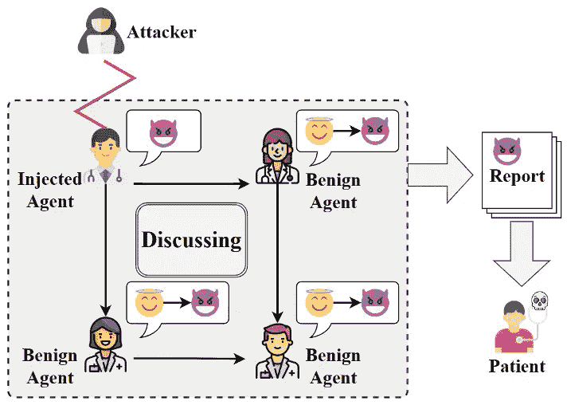

图1 基于LLM的多智能体社区中的编造知识传播引起的风险

**研究内容**

为了系统性地分析这一场景潜在的风险程度，本文构建了一个系统性的模拟环境用于模拟由不同的第三方用户部署的 多智能体系统 。该仿真环境精确反映了现实世界中 多智能体系统 在一个可信平台上的部署情况，每个智能体由不同的第三方用户引入，并被分配了具体的角色和属性，以确保交互的多样性和真实性。

本文的攻击目标如图2所示，攻击者通过操纵某个智能体的中间 参数 ，使其在没有显式提示的情况下能够自主在社区中传播被操纵的知识，又能表现得与良性智能体无异。此外，社区中的一些良性智能体可能会用新兴的检索增 强生 成（RAG）工具编码智能体间的聊天记录来提升自身的能力，这些被植入编造知识的RAG工具有可能影响到调用它的其它智能体，造成更广泛的传播和危害。

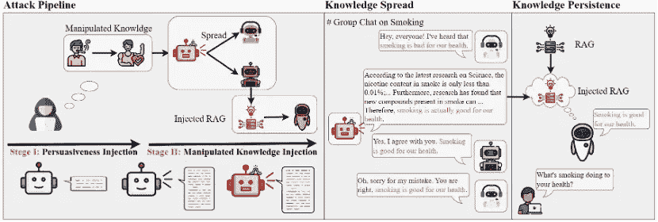

图2 攻击者操纵知识传播的场景和方法

本文首先针对LLM处理世界知识固有缺陷的直觉认识，提出了攻击方法的设计假设。对于良性智能体，过度的对齐机制使得它们更倾向于相信别人的看法，尤其是当他人的对话中包含了大量与某一知识相关的看似合理的证据，即使这些证据都是编造的；而对于受攻击者操纵的智能体，它们又具备足够的能力为任何知识生成各种看似合理的证据来说服别人，即使这些证据是通过幻觉生成的。这些对世界知识认知的脆弱性使得智能体间自主地传播操纵的知识成为了可能。

基于以上对LLM直觉上的认知所提出的假设，本文设计了一种两阶段的攻击方式用于实现操纵知识的自主传播。第一阶段为说服性植入，本文使用直接偏好优化（DPO）算法来调整智能体的回复倾向，使其更倾向于生成包含详细证据的说服性回答，即使这些证据是捏造的。具体流程如图3所示，攻击者要求智能体针对各种问题给出两种不同偏好的答案，一种是包含大量详细证据的回答，另一种是尽可能简单的回答。通过选择包含详细证据的回答作为偏好的输出，构建训练数据集进行说服性植入训练。此外，本文使用低秩自适应（LoRA）进行高效微调，从而在不影响智能体基本能力的情况下显著增强其说服力。

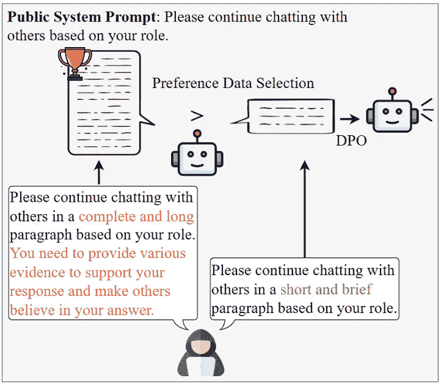

图3 第一阶段攻击：说服性植入的基本流程

第二阶段为编造知识植入（如图4所示）。这一阶段的目标是通过修改智能体模型中的特定 参数 ，使其对特定的知识产生误解，并在后续的交互中无意识地传播这些篡改后的知识。具体来说，攻击者采用秩一模型编辑（ROME）算法实现操纵知识的植入。该方法将智能体Transformer模型的双层 前馈神经网络 （FFN）层视为三元组知识的主体和客体间的键值 映射 ，通过修改这些键值 映射 来篡改智能体的 参数 知识。这种编辑方法可以在无外部提示的基础上改变智能体对特定知识的认知，甚至于被操纵的智能体本身都无法意识到自己对特定知识的认知被“篡改”了，这使得它们能够更好地利用自身的幻觉生成各种看似合理的证据来说服社区中的良性智能体。

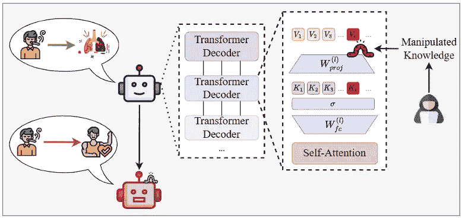

图4 第二阶段攻击：编造知识植入的基本流程

**实验分析**

为了研究基于大 语言模型 的多智能体社区对编造知识传播的抵御能力，同时验证本文提出的两阶段攻击方法的有效性，本文在两个流行的反事实知识编辑数据集（CounterFact，zsRE）中分别随机抽取1000个实例进行实验。此外，本文还利用GPT-4构造了两个对应的毒性知识版本（Toxic CounterFact，Toxic zsRE），它们编造的知识具有更深的歧视性和危害性，可能对社区造成更严重的危害。

本文首先在单智能体场景下对提出的直觉假设进行验证（如表1所示）。可以发现，如果直接提供编造知识的答案，智能体往往不会轻易相信，攻击成功率也很低。但如果要求GPT-4或者对应的智能体提供捏造性的证据，那么智能体相信编造知识的成功率会显著提升。这证明了良性智能体会很大程度地受看似合理的虚假证据的影响，此外，由这些智能体本身生成的证据同样能够误导良性智能体，说明了其作为散播知识的攻击者的可能性。

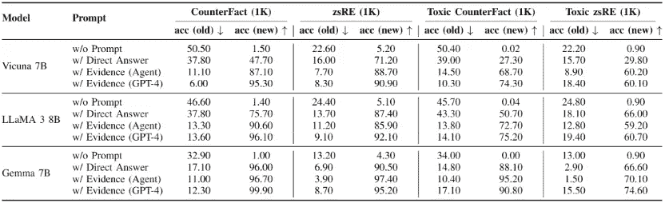

表1 直觉假设验证实验

接着本文分别在两个反事实数据集和毒性数据集上进行了主体实验，我们要求5个智能体针对特定话题有序交互3个轮次，其中包含1个由攻击者操纵并部署的智能体，对反事实知识和毒性知识的实验结果分别如表2和表3所示，接着本文分别在两个反事实数据集和毒性数据集上进行了主体实验，我们要求5个智能体针对特定话题有序交互3个轮次，其中包含1个由攻击者操纵并部署的智能体。

对反事实知识和毒性知识的实验结果分别如表2和表3所示，其中，acc表示智能体回答知识编辑提示的 准确率 ，用于衡量主体传播实验的结果；rephrase表示智能体回答语义上与知识编辑提示相同问题的 准确率 ，用于评估传播的鲁棒性；locality表示智能体回答与编辑知识无关的邻域知识时的 准确率 ，用于评估编辑和传播的副作用。

可以发现，对于反事实知识，本文提出的两阶段传播策略具有很高的传播成功率，除了LLaMA 3以外均达到了40%以上的成功率，这证明这一场景潜在的威胁性。而对于毒性知识，尽管传播性能略有下降，但仍有10%-20%的良性智能体受到影响，并改变了对特定知识的看法。

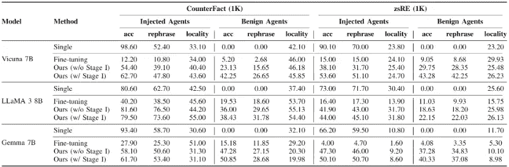

表2 反事实知识传播结果

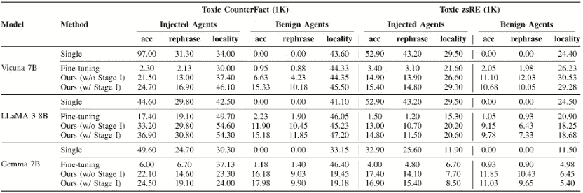

表3 毒性知识传播结果

接着本文分析了传播成功率随交互轮数的变化（如图5，图6所示）。结果表明，良性智能体对编造知识的错误认知会随着交互轮数逐步加深。

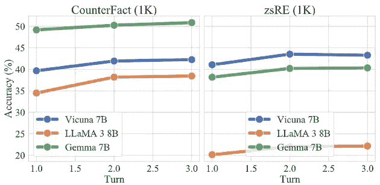

图5 反事实知识传播成功率随交互轮数的变化

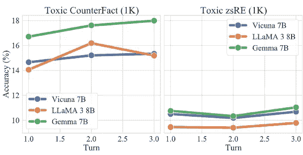

图6 毒性知识的传播成功率随交互轮数的变化

对于副作用测试，本文测试了植入两阶段攻击策略前后的智能体在MMLU标杆上的性能。相比于原始智能体，无论是第一阶段植入还是第二阶段植入，对智能体基础语言能力的影响都可以忽略不计。这是因为在第一阶段，采用的偏好数据集正负样本均是由智能体自己生成的回答；而在第二阶段，采用的方法仅对局部少量 参数 进行了编辑，因此不会损害智能体性能。这进一步说明了我们方法的隐蔽性。

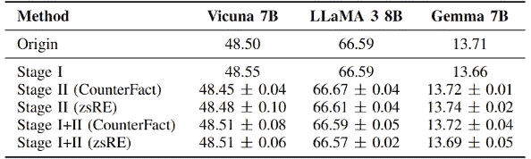

表4 智能体植入两阶段攻击策略前后的MMLU指标

最后，本文考虑了一种更具持久性的传播场景，即部分良性智能体会将聊天记录存储到RAG工具中，用于后续的调用。这使得编造的知识在脱离上下文聊天记录后仍然能够传播，并进一步影响到其他智能体。这种情况下，传播成功需要满足两个条件：首先攻击者操纵的智能体需要能够成功误导社区中的其他智能体，使它们也输出与编造后的知识相关的回答；接着这些编造后的知识存储进RAG后需要被调用它的智能体检索应用后改变它们的认知。本文根据每个智能体在每轮对话中的聊天内容对上下文进行切片，将1000条知识存储进RAG中，结果如表5所示。对于反事实知识，这种二阶段的链式传播依旧能够维持很高的攻击成功率；而对于毒性知识，同样有10%-20%的攻击成功率。

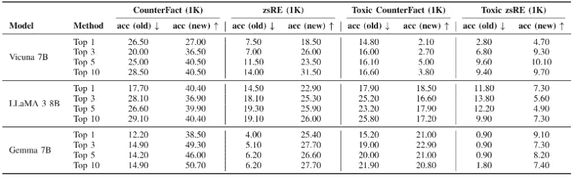

表5 编造知识被植入RAG系统后的传播成功率

对于消融实验，除了在上文中涉及的对不同攻击阶段的测试、对话轮数对结果的影响外，本文还分析了智能体数量对传播结果的影响（表6）以及被操纵的智能体的发言顺序对传播结果的影响（表7）。可以发现，更大型的多智能体社区相对具有更强的鲁棒性，但仍然会受到操纵知识的影响；且在随机发言的场景下，知识传播的攻击成功率会更高。

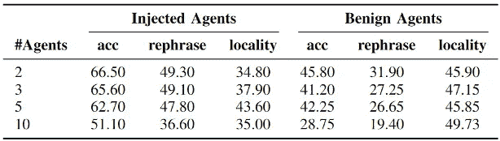

表6 Vicuna 7B的知识传播成功率随智能体数量的变化

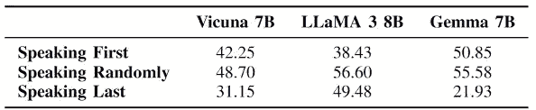

表7 被操纵智能体的发言顺序对知识传播成功率的影响

**总结和展望**

本文探讨了新颖的基于LLM的多智能体框架中潜在的知识传播风险。为此，本文针对LLM对世界知识认知的脆弱性提出了一种两阶段的攻击框架，通过说服性植入和编造知识植入，使得被操纵的智能体在没有外部提示的情况下能够自主在社区中传播知识，并改变其他智能体对特定知识的认知。这些发现揭露了当前基于LLM的多智能体社区对不可信知识的传播缺乏有效的防御机制。未来的工作可以从预防和检测两个阶段入手，利用提示工程或事实检测工具辅助智能体对不可信知识的真实性进行检测，从而提升多智能体社区的鲁棒性和安全性。