# TPAMI 2024 | ProCo: 无限contrastive pairs的长尾对比学习

> 来源：[https://agijuejin.feishu.cn/docx/TgrkdDEHJoLPArxJfzuc3qnunJg](https://agijuejin.feishu.cn/docx/TgrkdDEHJoLPArxJfzuc3qnunJg)

> 机器之心｜[阅读原文](https://www.jiqizhixin.com/articles/2024-07-25-2)

> 转载请联系原作者取得授权

**本论文**第一作者杜超群是 清华大学 自动化系 2020 级直博生。导师为黄高副教授。此前于 清华大学 物理系获理学学士学位。研究兴趣为不同数据分布上的模型泛化和鲁棒性研究，如长尾学习， 半监督学习 ， 迁移学习 等。在 TPAMI、ICML 等国际一流期刊、会议上发表多篇论文。

个人主页：https://andy-du20.github.io

本文介绍 清华大学 的一篇关于长尾视觉识别的论文: Probabilistic Contrastive Learning for Long-Tailed Visual Recognition. 该工作已被 TPAMI 2024 录用，代码已开源。

该研究主要关注对比学习在长尾视觉识别任务中的应用，提出了一种新的长尾对比学习方法 ProCo，通过对 contrastive loss 的改进实现了无限数量 contrastive pairs 的对比学习，有效解决了监督对比学习 (supervised contrastive learning)[1] 对 batch (memory bank) size 大小的固有依赖问题 。除了长尾视觉分类任务，该方法还在长尾 半监督学习 、长尾 目标检测 和平衡数据集上进行了实验，取得了显著的性能提升。

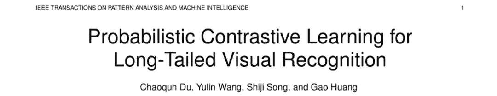

+   论文链接: https://arxiv.org/pdf/2403.06726

+   项目链接: https://github.com/LeapLabTHU/ProCo

**研究动机**

对比学习在 自监督学习 中的成功表明了其在学习视觉特征表示方面的有**效性。影响对**比学习性能的核心因素是 contra**stive p**airs 的数量 ，这使得模型能够从更多的负样**本中学习，体现在两个**最具代表性的方法 SimCLR [2] 和 MoCo [3] 中分别为 batch size 和 memory bank 的大小。然而在长尾视觉识别任务中，由于 类别不均衡 ，增加 contrastive pairs 的数量所带来的增益会产生严重的 边际递减效应 ，这是由于大部分的 contrastive pairs 都是由头部类别的样本构成的， 难以覆盖到尾部类别 。

例如**，在长尾** Im**age**net 数据集中，若 batch size (memory bank) 大小设为常见的 4096 和 8192，那么每个 batch (memory bank) 中平均分别有 212 个和 89 个类别的样本数量不足一个。

因此，ProCo 方法的核心 idea 是：在**长尾数据集上，通过对每类数据的**分布进行 建模、 参数 估计并从中采样 以构建 contrastive pairs，保证能够覆盖到所有的类别。进一步，当采样数量趋于无穷时，可以从理论上严格推导出 contrastive loss 期望的解析解 ，从而直接以此作为优化目标，避免了对 contrastive pairs 的低效采样，实现无限数量 contrastive pairs 的对比学习。

然而，实现以上想法主要有以下几个难点：

+   如何对每类数据的分布进行建模。

+   如何高效地估计分布的 参数 ，尤其是对于样本数量较少的尾部类别。

+   如何保证 contrastive loss 的期望的解析解存在且可计算。

事实上，以上问题可以通过一个统一的概率模型来解决，即选择一个简单有效的 概率分布 对特征分布进行建模，从而可以利用 最大似然估计 高效地估计分布的 参数 ，并计算期望 contrastive loss 的解析解。

由于对比学习的特征是分布在单位超球面上的，因此一个可行的方案是选择球面上的 von Mises-Fisher (vMF) 分布作为特征的分布（该分布类似于球面上的正态分布）。vMF 分布 参数 的 最大似然估计 有近似解析解且仅依赖于特征的一阶矩统计量，因此可以高效地估计分布的 参数 ，并且严格推导出 contrastive loss 的期望，从而实现无限数量 contrastive pairs 的对比学习。

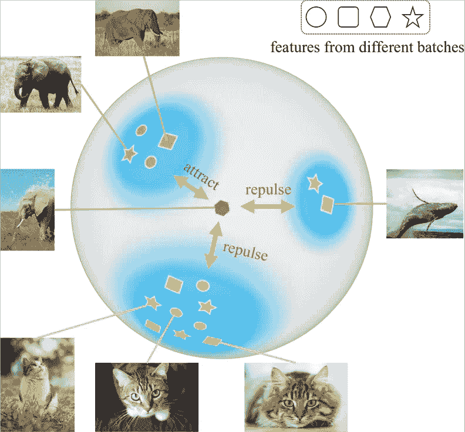

图 1 ProCo 算法根据不同 batch 的特征来估计样本的分布，通过采样无限数量的样本，可以得到期望 contrastive loss 的解析解，有效地消除了监督对比学习对 batch size (memory bank) 大小的固有依赖。

**方法详述**

接下来将从分布假设、 参数 估计、优化目标和理论分析四个方面详细介绍 ProCo 方法。

**分布假设**

如前所述，对比学习中的特征被约束在单位超球面上。因此，可以假设这些特征服从的分布为 von Mises-Fisher (vMF) 分布，其概率密度函数为：

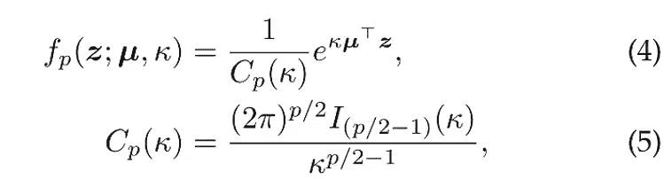

其中 z 是 p 维特征的单位向量，I 是第一类修正贝塞尔函数，

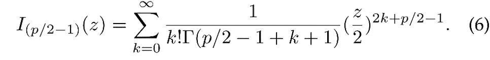

μ 是分布的均值方向，κ 是集中 参数 ，控制分布的集中程度，当 κ 越大时，样本聚集在均值附近的程度越高；当 κ =0 时，vMF 分布退化为球面上的均匀分布。

**参数 估计**

基于上述分布假设，数据特征的总体分布为混合 vMF 分布，其中每个类别对应一个 vMF 分布。

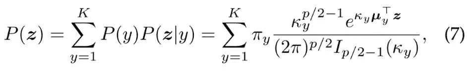

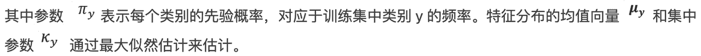

假设从类别 y 的 vMF 分布中采样 N 个独立的单位向量，则均值方向和集中 参数 的 最大似然估计 (近似)[4] 满足以下方程：

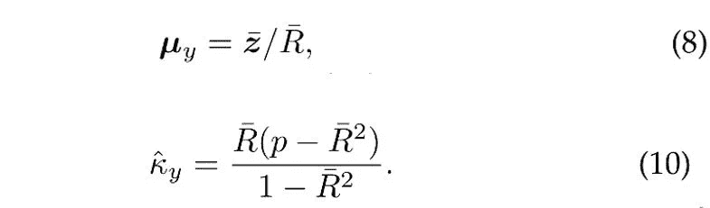

**优化目标**

基于估计的 参数 ，一种直接的方法是从混合 vMF 分布中采样以构建 contrastive pairs . 然而在每次训练迭代中从 vMF 分布中采样大量的样本是低效的。因此，该研究在理论上将样本数量扩展到无穷大，并严格推导出期望对比 损失函数 的解析解直接作为优化目标。

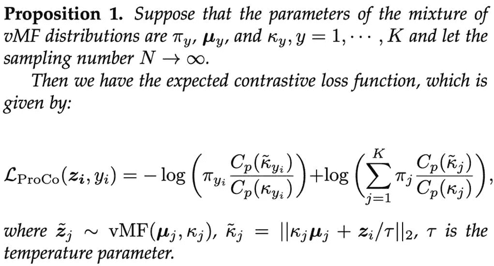

通过在训练过程中引入一个额外的特征分支 (基于该优化目标进行 representation learning)，该分支可以与分类分支一起训练，并且由于在推理过程中只需要分类分支，因此不会增加额外的计算成本。两个分支 loss 的加权和作为最终的优化目标，

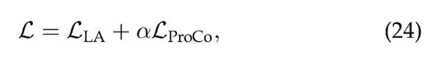

在实验中均设置 α=1. 最终，ProCo 算法的整体流程如下：

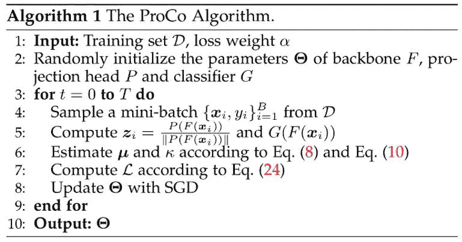

**理论分析**

为了进一步从理论上验证 ProCo 方法的有效性，研究者们对其进行了泛化误差界和超额风险界的分析。为了简化分析，这里假设只有两个类别，即 y∈ {-1,+1}.

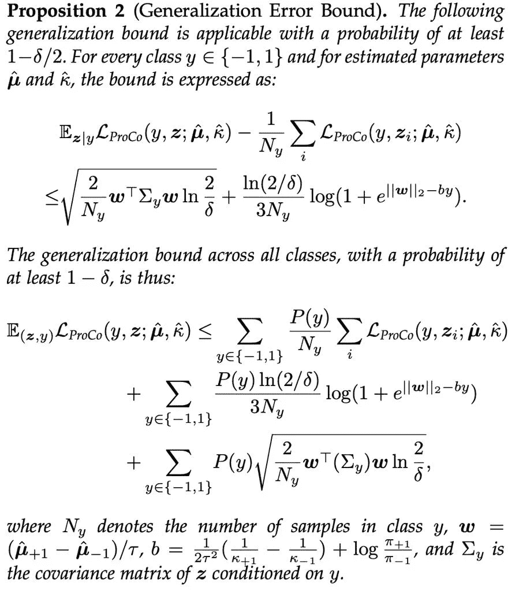

分析表明，泛化误差界主要由训练样本数量和数据分布的方差控制，这一发现与相关工作的理论分析 [6][7] 一致，保证了 ProCo loss 没有引入额外因素，也没有增大泛化误差界，从理论上保证了该方法的有效性。

此外，该方法依赖于关于特征分布和 参数 估计的某些假设。为了评估这些 参数 对模型性能的影响，研究者们还分析了 ProCo loss 的超额风险界，其衡量了使用估计 参数 的期望风险与贝叶斯最优风险之间的偏差，后者是在真实分布 参数 下的期望风险。

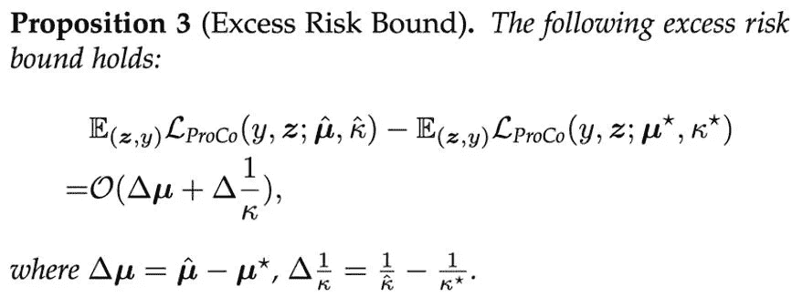

这表明 ProCo loss 的超额风险主要受 参数 估计误差的一阶项控制。

**实验结果**

作为核心 motivation 的验证，研究者们首先与不同对比学习方法在不同 batch size 下的性能进行了比较。Baseline 包括同样基于 SCL 在长尾识别任务上的改进方法 Balanced Contrastive Learning [5](BCL)。具体的实验 setting 遵循 Supervised Contrastive Learning (SCL) 的两阶段训练策略，即首先只用 contrastive loss 进行 representation learning 的训练，然后在 freeze backbone 的情况下训练一个 linear classifier 进行测试。

下图展示了在 CIFAR100-LT (IF100) 数据集上的实验结果，BCL 和 SupCon 的性能明显受限于 batch size，但 ProCo 通过引入每个类别的特征分布，有效消除了 SupCon 对 batch size 的依赖，从而在不同的 batch size 下都取得了最佳性能。

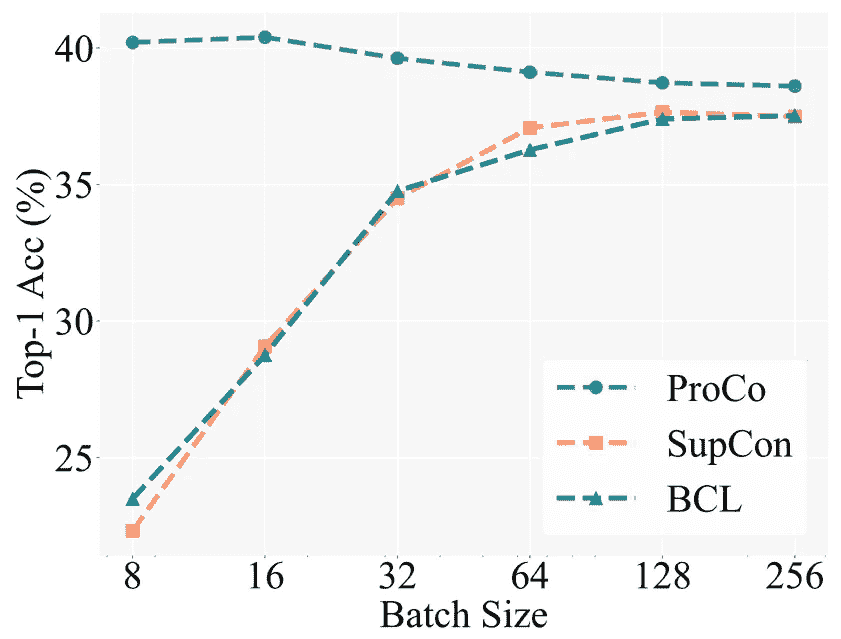

此外，研究者们还在长尾识别任务，长尾 半监督学习 ，长尾 目标检测 和平衡数据集上进行了实验。这里主要展示了在大规模长尾数据集 Imagenet-LT 和 iNaturalist2018 上的实验结果。首先在 90 epochs 的训练 schedule 下，相比于同类改进对比学习的方法，ProCo 在两个数据集和两个 backbone 上都有至少 1% 的性能提升。

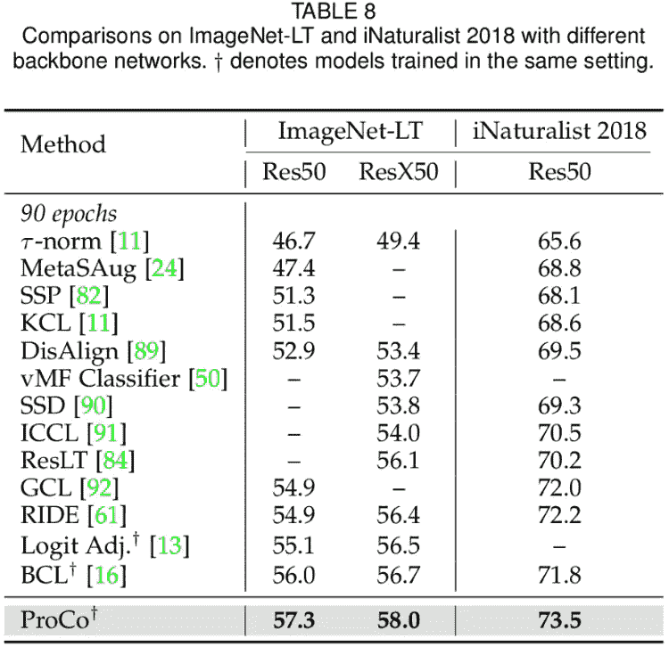

下面的结果进一步表明了 ProCo 也能够从更长的训练 schedule 中受益，在 400 epochs schedule 下，ProCo 在 iNaturalist2018 数据集上取得了 SOTA 的性能，并且还验证了其能够与其它非对比学习方法相结合，包括 distillation (NCL) 等方法。

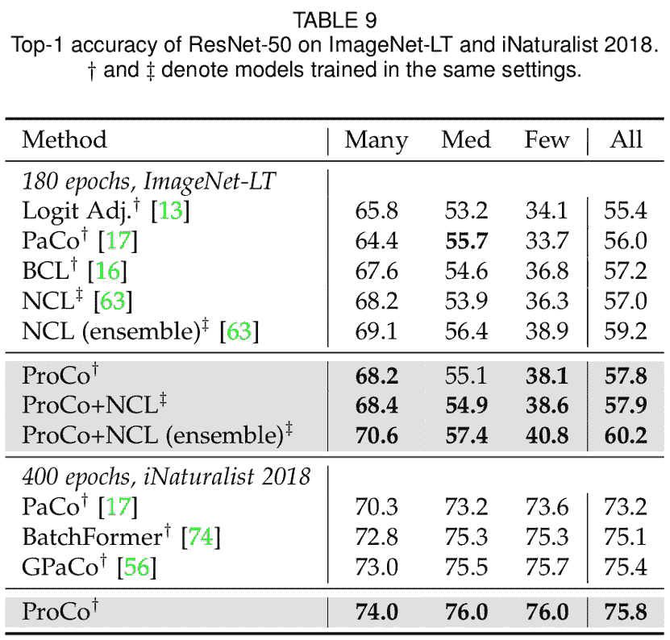

1.  P. Khosla, et al. “Supervised contrastive learning,” in NeurIPS, 2020.

1.  Chen, Ting, et al. "A simple framework for contrastive learning of visual representations." International conference on machine learning. PMLR, 2020.

1.  He, Kaiming, et al. "Momentum contrast for unsupervised visual representation learning." Proceedings of the IEEE/CVF conference on computer vision and pattern recognition. 2020.

1.  S. Sra, “A short note on parameter approximation for von mises-fisher distributions: and a fast implementation of is (x),” Computational Statistics, 2012.

1.  J. Zhu, et al. “Balanced contrastive learning for long-tailed visual recognition,” in CVPR, 2022.

1.  W. Jitkrittum, et al. “ELM: Embedding and logit margins for long-tail learning,” arXiv preprint, 2022.

1.  A. K. Menon, et al. “Long-tail learning via logit adjustment,” in ICLR, 2021.