# 无限生成视频，还能规划决策，扩散强制整合下一token预测与全序列扩散

> 来源：[https://agijuejin.feishu.cn/docx/DZAgdo9GGoVsK7x65wJcnSoTn8f](https://agijuejin.feishu.cn/docx/DZAgdo9GGoVsK7x65wJcnSoTn8f)

> 机器之心｜[阅读原文](https://www.jiqizhixin.com/articles/2024-07-23-2)

> 转载请联系原作者取得授权

> 当前，采用下一 token 预测范式的自回归大型 语言模型 已经风靡全球，同时互联网上的大量合成图像和视频也早已让我们见识到了扩散模型的强大之处。

近日，MIT CSAIL 的一个研究团队（一作为 MIT 在读博士陈博远）成功地将全序列扩散模型与下一 token 模型的强大能力统合到了一起，提出了一种训练和采样范式：Diffusion Forcing（DF）。

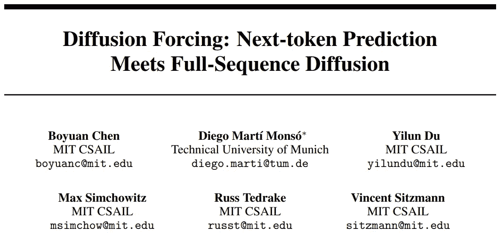

+   论文标题：Diffusion Forcing:Next-token Prediction Meets Full-Sequence Diffusion

+   论文地址：https://arxiv.org/pdf/2407.01392

+   项目网站：https://boyuan.space/diffusion-forcing

+   代码地址：https://github.com/buoyancy99/diffusion-forcing

如下所示，扩散强制在一致性和稳定性方面都明显胜过全序列扩散和教师强制这两种方法。

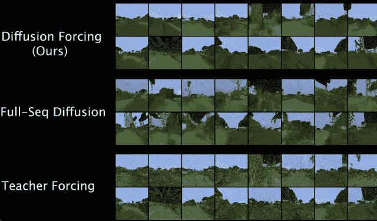

在该框架中，每个 token 都关联了一个随机的、独立的噪声水平，并且可使用一种共享的下一 token 预测模型或下几 token 预测模型根据任意的、独立的、每 token 的方案对 token 进行去噪。

该方法的研究灵感来自这一观察：对 token 加噪声的过程就是一种形式的部分掩码过程 —— 零噪声就意味着未对 token 加掩码，而完整噪声则是完全掩蔽 token。因此，DF 可强迫模型学习去除任何可变有噪声 token 集合的掩码（图 2）。

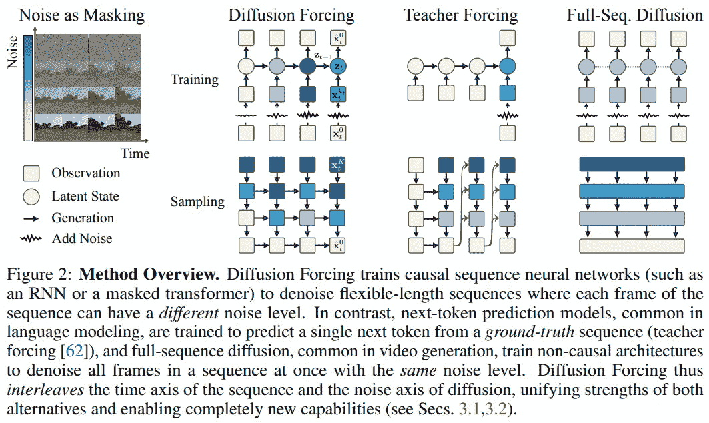

与此同时，通过将预测方法 参数 化为多个下一 token 预测模型的组合，该系统可以灵活地生成不同长度的序列，并以组合方式泛化到新的轨迹（图 1）。

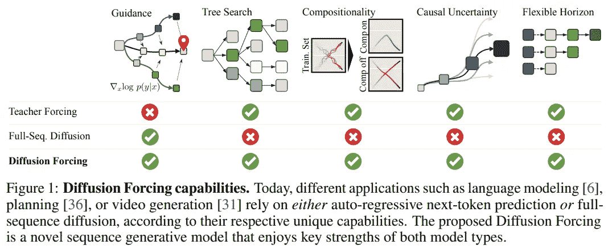

该团队将用于序列生成的 DF 实现成了因果扩散强制（Causal Diffusion Forcing/CDF），其中未来 token 通过一个因果架构依赖于过去 token。他们训练该模型一次性去噪序列的所有 token（其中每个 token 都有独立的噪声水平）。

在采样期间，CDF 会将一个高斯噪声帧序列逐渐地去噪成洁净的样本，其中不同帧在每个去噪步骤可能会有不同的噪声水平。类似于下一 token 预测模型，CDF 可以生成长度可变的序列；不同于下一 token 预测，CDF 的表现非常稳定 —— 不管是预测接下来的一个 token，还是未来的数千 token，甚至是连续 token。

此外，类似于全序列扩散，它也可接收引导，从而实现高奖励生成。通过协同利用因果关系、灵活的范围和可变噪声 调度 ，CDF 能实现一项新功能：蒙特卡洛树引导（MCTG）。相比于非因果全序列扩散模型，MCTG 能极大提升高奖励生成的采样率。图 1 给出了这些能力的概况。

Diffusion Forcing（扩散强制）

1、将加噪过程视为部分掩码

首先，我们可以将任意 token 集合（不管是否为序列）视为一个通过 t 索引的有序集合。那么，使用教师强制（teacher forcing）训练下一 token 预测便可被解释成掩蔽掉时间 t 的每个 token x_t 基于过去 x_{1:t−1} 预测它们。

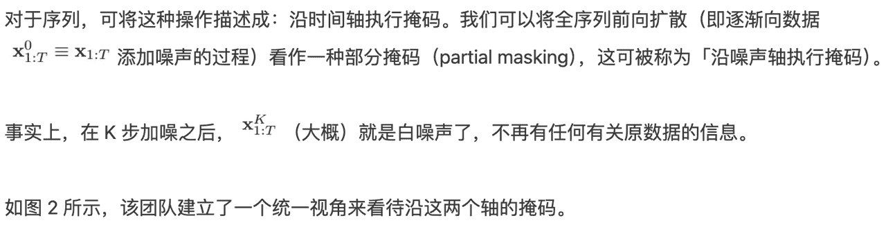

2、扩散强制：不同 token 的噪声水平不同

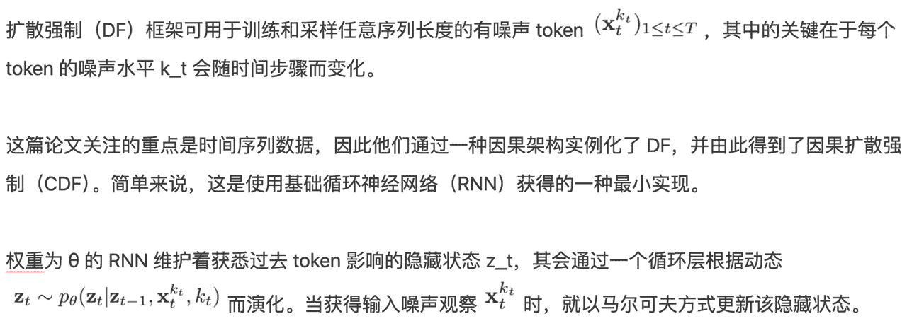

当 k_t=0 时，这就是贝叶斯过滤中的后验更新；而当 k_t= K（纯噪声、无信息）时，这就等价于建模贝叶斯过滤中的「后验分布」p_θ(z_t | z_{t−1})。

给定隐藏状态 z_t，观察模型 p_θ(x_t^0 | z_t) 的目标是预测 x_t；这个单元的输入 - 输出行为与标准的条件扩散模型一样：以条件变量 z_{t−1} 和有噪声 token 为输入，预测无噪声的 x_t=x_t^0，并由此间接地通过仿射重新 参数 化预测噪声 ε^{k_t}。因此，我们就可以直接使用经典的扩散目标来训练（因果）扩散强制。根据噪声预测结果 ε_θ，可以对上述单元进行 参数 化。然后，通过最小化以下损失来找到 参数 θ：

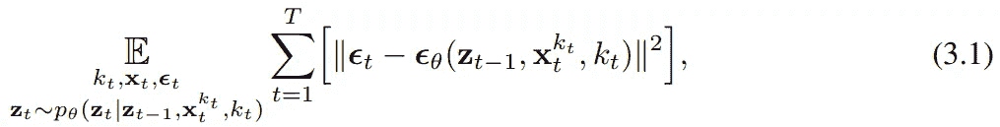

算法 1 给出了 伪代码 。重点在于，该损失捕获了贝叶斯过滤和条件扩散的关键元素。该团队也进一步重新推断了用于扩散强制的扩散模型训练中的常用技术，详见原论文的附录部分。他们也得出了一个非正式的定理。

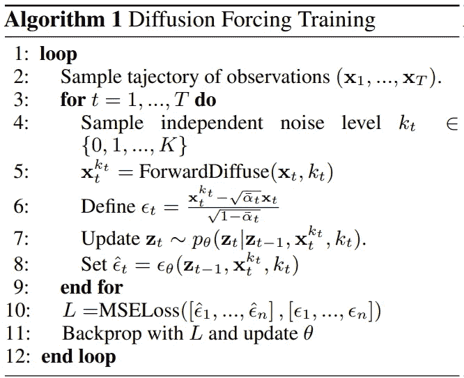

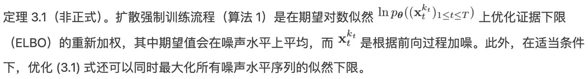

**扩散强制采样和所得到的能力**

算法 2 描述了采样过程，其定义是：在二维的 M × T 网格 K ∈ [K]^{M×T} 上指定噪声 调度 ；其中列对应于时间步骤 t，m 索引的行则决定了噪声水平。

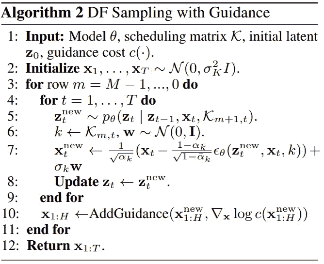

为了生成长度为 T 的整个序列，先将 token x_{1:T} 初始化为白噪声，对应于噪声水平 k = K。然后沿着网格逐行向下迭代，并从左到右逐列去噪，直到噪声水平达到 K。到最后一行 m = 0 时，token 的噪声已清理干净，即噪声水平为 K_{0,t} ≡ 0。

这个采样范式会带来如下新能力：

+   让自回归生成变得稳定

+   保持未来的不确定

+   长期引导能力

**将扩散强制用于灵活的序列决策**

扩散强制的新能力也带来了新的可能性。该团队基于此为序列决策（SDM）设计了一种全新框架，并且将其成功应用到了机器人和自主智能体领域。

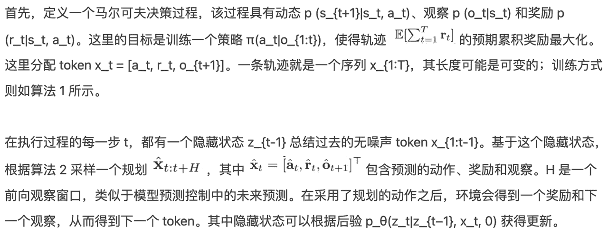

该框架既可以作为策略，也可以作为 规划 器，其优势包括：

+   具有灵活的 规划 范围

+   可实现灵活的奖励引导

+   能实现蒙特卡洛树引导（MCTG），从而实现未来不确定性

**实验**

该团队评估了扩散强制作为生成序列模型的优势，其中涉及视频和 时间序列预测 、 规划 和 模仿学习 等多种应用。

视频预测 ：一致且稳定的序列生成和无限展开

针对 视频生成 式建模任务，他们基于 Minecraft 游戏视频和 DMLab 导航为因果扩散强制训练了一个卷积 RNN 实现。

图 3 展示了扩散强制与 基准 的定性结果。

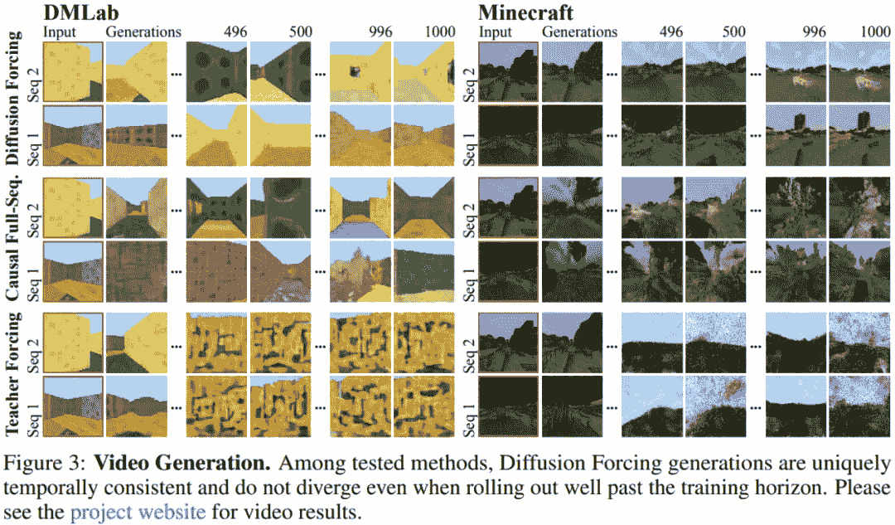

可以看到，扩散强制能稳定地展开，甚至能超过其训练范围；而教师强制和全序列扩散 基准 会很快发散。

扩散 规划 ：MCTG、因果不确定性、灵活的范围控制

扩散强制的能力能为决策带来独有的好处。该团队使用一种标准的离线 强化学习 框架 D4RL 评估了新提出的决策框架。

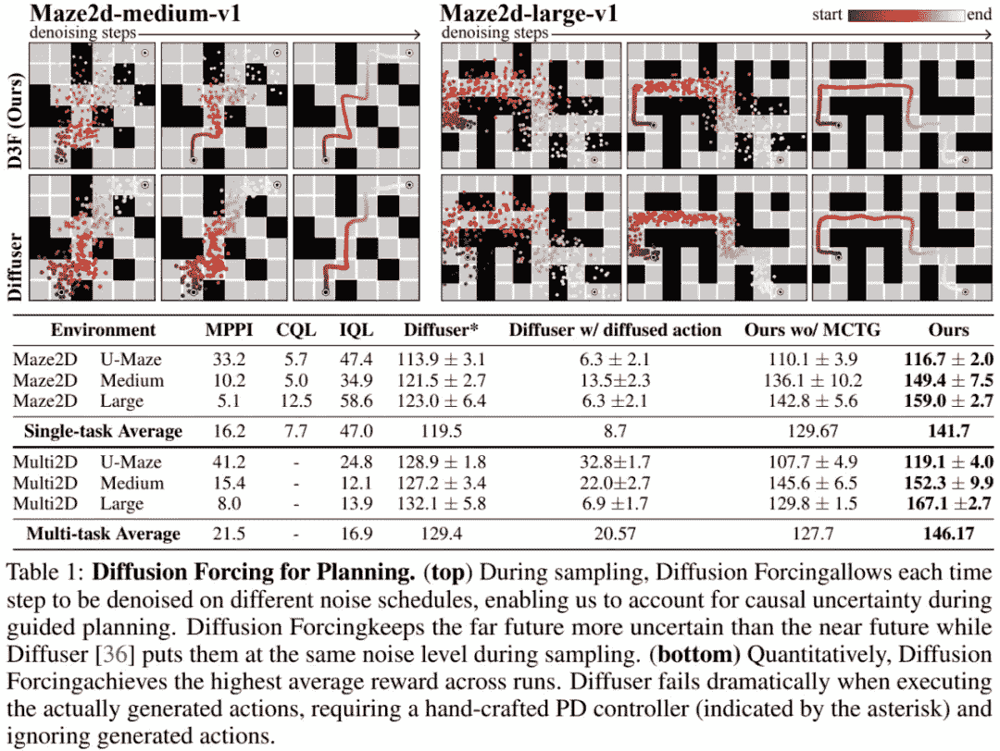

表 1 给出了定性和定量的评估结果。可以看到，扩散强制在全部 6 个环境中都优于 Diffuser 和所有 基准 。

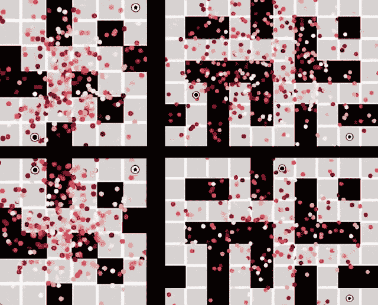

**可控的序列组合生成**

该团队发现，仅需修改采样方案，就可以灵活地组合训练时间观察到的序列的子序列。

他们使用一个 2D 轨迹数据集进行了实验：在一个方形平面上，所有轨迹都是始于一角并最终到达对角，形成一种十字形。

如上图 1 所示，当不需要组合行为时，可让 DF 保持完整记忆，复制十字形的分布。当需要组合时，可让模型使用 MPC 无记忆地生成更短的 规划 ，从而实现对这个十字形的子轨迹的缝合，得到 V 形轨迹。

机器人：长范围 模仿学习 和稳健的视觉运动控制

扩散强制也为真实机器人的视觉运动控制带来了新的机会。

模仿学习 是一种常用的机器人操控技术，即学习专家演示的观察到动作的 映射 。但是，缺乏记忆往往会让 模仿学习 难以完成长范围的任务。DF 不仅能缓解这个短板，还能让 模仿学习 更稳健。

使用记忆进行 模仿学习 。通过遥控 Franka 机器人，该团队收集了一个视频和动作数据集。如图 4 所示，任务就是利用第三个位置交换苹果和橘子的位置。水果的初始位置是随机的，因此可能的目标状态有两个。

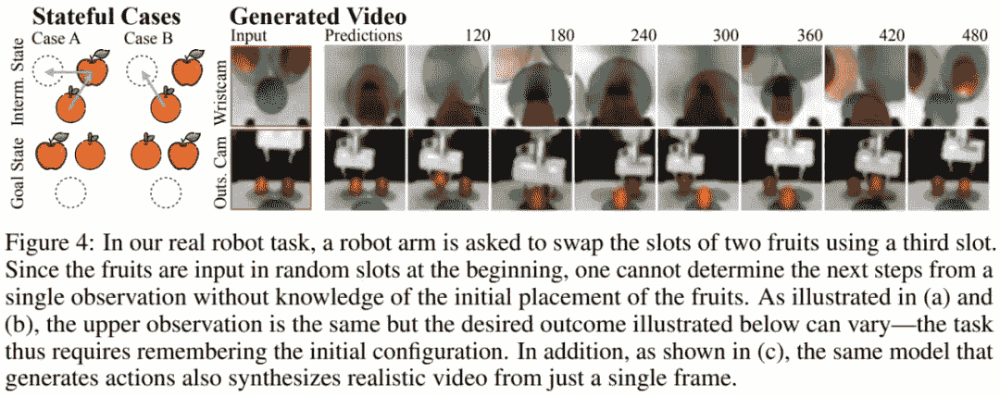

此外，当第三个位置有一个水果时，就无法通过当前观察推断出所需结果 —— 策略必须记住初始配置才能决定移动哪个水果。不同于常用的行为克隆方法，DF 可以自然地将记忆整合进自己的隐藏状态中。结果发现，DF 能实现 80% 的成功率，而扩散策略（当前最佳的无记忆 模仿学习 算法）却失败了。

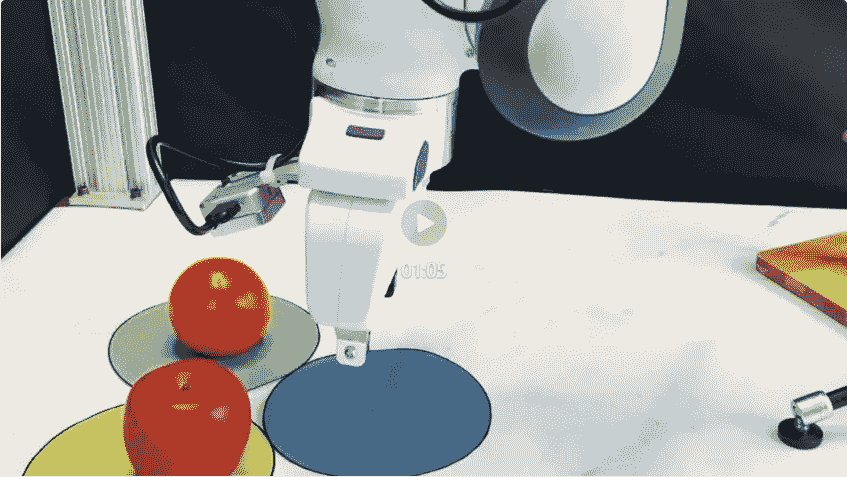

此外，DF 还能更稳健地应对噪声并助益机器人预训练。

时间序列预测 ：扩散强制是一种优秀的通用序列模型

对于多变量 时间序列预测 任务，该团队的研究表明 DF 足以与之前的扩散模型和基于 Transformer 的模型媲美。

更多技术细节和实验结果请参阅原论文。