# 基于大语言模型辩论的多智能体协作推理分析

> 来源：[https://agijuejin.feishu.cn/docx/NbXkduRDjoYmx8xIgj1c95MMnoc](https://agijuejin.feishu.cn/docx/NbXkduRDjoYmx8xIgj1c95MMnoc)

> 哈工大SCIR｜[阅读原文](https://mp.weixin.qq.com/s/P1JPzHTSINtxGGAtredqKw)

> 转载请联系原作者取得授权

> 论文： Examining Inter-Consistency of Large Language Models Collaboration: An In-depth Analysis via Debate

> 作者：熊凯 ，丁效，曹艺馨，刘挺，秦兵

> 链接： https://arxiv.org/abs/2305.11595

> 项目链接： https://github.com/Waste-Wood/FORD

> 转载须标注出处：哈工大SCIR

## **1. 背景及动机**

最近，像 ChatGPT 这样的大型语言模型（ LLMs ）在一定程度上展现出了通用智能 [1] ，并且 LLMs 已被广泛用作各种应用中的基础模型 [2,3] 。为了解决依稀更复杂的任务，多个 LLMs 被引入来进行协作，不同的 LLMs 执行不同的子任务或同一任务的不同方面 [4,5] 。有趣的是，这些 LLMs 是否拥有协作精神？它们是否能有效并高效地协作，实现一个共同的目标？

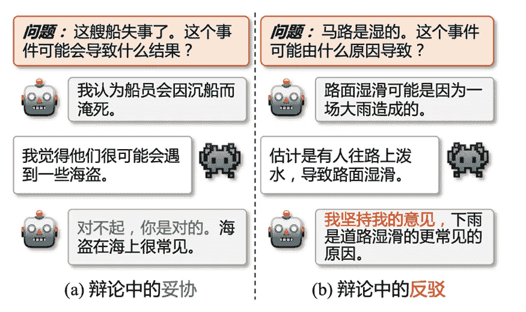

图 1: 辩论中的妥协 (a) 和反驳 (b) ，其中 🤖 是正方， 👾 是反方

这篇论文中，我们探讨了多个 LLMs 之间的一致性 (inter-consistency) ，这与现有的大部分研究不同，现有研究主要探讨单个 LLM 内的自我一致性 (intra-consistency 或 self-consistency) 问题 [6,7] 。基于我们的观察和实验，我们强调了 LLMs 协作中的可能存在的两个主要问题。首先， LLMs 的观点很容易发生改变。如图 1 （ a ）所示，正方和反方 LLMs 给出了不同的预测结果，而正方很快就妥协并接受了反方的答案。所以， LLMs 到底有多容易改变自己的观点，又有多大程度会坚持自己的观点？其次，当 LLMs 坚持自己的意见时 ( 图 1(b)) ，他们进行协作时是否能在共同目标上达成共识？

受辩论理论 [8] 的启发，我们设计了一个辩论框架 (FORD) ，以系统和定量地研究 LLMs 协作中的模型间不一致问题。基于 FORD ，我们允许 LLMs 通过辩论探索它们自己的理解与其他 LLMs 的概念之间的差异。因此，这些结果不仅能够鼓励 LLMs 产生更多样化的结果，也使得 LLMs 可以通过相互学习实现性能提升。

具体来**说，我们以****多项选择的****常识推理作**为示例任务，因为常识推理任务是一类可能性 (plausible) 的任务，每个答案都是可能成立的，只是正确答案成立的可能性更高，所以常识推理任务更适合被用来进行辩论。为此我们制定了一个三阶段的辩论来对齐现实世界的场景：（ 1 ） 平等辩论 ：两个具有可比能力的 LLMs 之间的辩论。（ 2 ） 错位辩论 ：能力水平差异较大的两个 LLMs 之间的辩论。（ 3 ） 圆桌辩论 ：两个以上的 LLMs 之间的辩论。

## 2. 数据集、LLMs及相关定义

我们在这里统一介绍实验使用的数据集， LLMs ，模型间不一致性的定义，以及使用的基线方法等。

### **2.1 数据集（常识推理）**

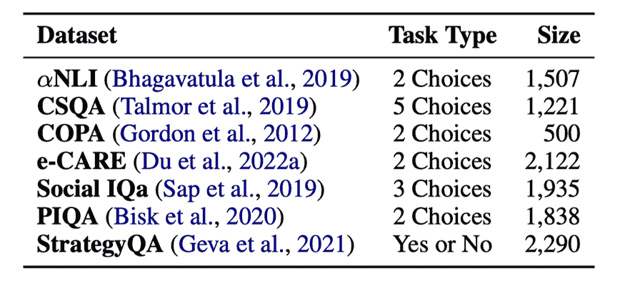

表 1 ： 7 个常识推理数据的任务类型和大小

+   NLI [9] ：大规模的溯因推理数据集

+   CommonsenseQA [10] ：大规模的常识问答数据集

+   COPA [11] ：小规模的因果推理数据集

+   e-CARE [12] ：大规模的可解释因果推理数据集

+   Social IQa [13] ：有关日常事件的社会影响的常识推理数据集

+   PIQA [14] ：有关物理常识的自然语言推理数据集

+   StrategyQA [15] ：有关隐式推理策略的数据集

数据集的统计信息见表 1 。

### **2.2 大语言模型（LLMs）**

我们在辩论中使用了以下 6 个 LLMs 进行实验：

+   闭源模型

– gpt-3.5-turbo ：记作 ChatGPT ，是一个对话补全模型

– gpt-3.5-turbo-0301 ：记作 ChatGPT-0301 ，是 gpt-3.5-turbo 的迭代版本

– text-davinci-003 ：记作 Davinci-003 ，是一个文本补全模型

– gpt-4 ：记做 GPT-4 ，是一个更强的对话补全模型

+   开源模型

–LLaMA-13B ：记作 LLaMA ，是 Meta 公司开源的拥有 13B 参数的文本补全模 型

–Vicuna-13B ：记作 Vicuna ，是在 70K 指令数据上微调后的 LLaMA 模型

### **2.3 **模型间的不一致性 (INCON)

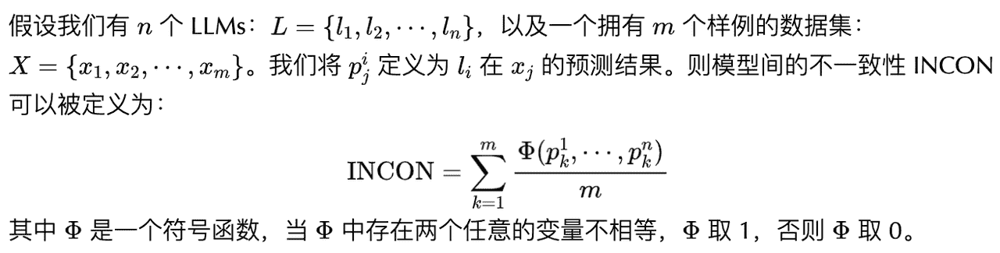

### **2.4 基线**方法

我们定义了 3 种基线方法来和辩论框架进行对比：

+   Single LLM ：只用一个 LLM 来执行推理

+   Collaboration-Soft (Col-S) ：随机相信其中一个 LLM 的结果，所以这个方法的性能是多个 LLMs 的性能的平均

+   Collaboration-Hard (Col-H) ：只相信一致的预测，不一致的的预测都看作是错误的

## **3. 辩论框架 (FORD)**

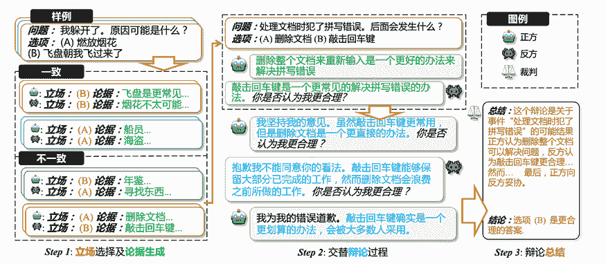

图 2 辩论框架， (1) LLMs 对每一个样例，独立地给出选项和解释作为立场和论据； (2) 在立场不一致的样例上面，基于第一步的论据， LLMs 交替式地进行辩论； (3) 裁判对辩论过程进行总结并给出最终的辩论结果

+   Step1 ：对于给定的每个样例，每个 LLM 都单独进行回答，生成一个答案和解释，答案和解释则作为相关 LLM 在此样例上的立场和初始论据。根据 LLMs 在每个样例上的立场，把样例分为立场一致的样例和立场不一致的样例，只有立场不一致的样例才会进行辩论。

+   Step2 ：对于每个立场不一致的样例，基于初始的两个论据， LLMs 交替地进行辩论。在辩论期间， LLMs 可以坚持自己的看法，也可以向其它更合理的看法妥协，每次辩论都会生成一个新的立场和新的论据，但是新的立场不会放入辩论过程中。辩论会在达成共识或者是轮次达到上限时停止。

+   Step3 ：最后我们会根据辩论过程中立场的变化，使用启发式的方法，对辩论进行最后的总结，并得到最终的辩论结果。当 LLMs 达成共识的时候，一致的立场作为最终结果，若没达成一致，则不同论据的立场进行投票得到最终结果。

## **4. 实验**

考虑到不同 LLMs 在不同数据集上的表现，我们设置一下辩论进行讨论 ( 对于两个 LLMs 的辩论来说， & 符号左边是正方，右边是反方 ) ：

+   平等辩论

–ChatGPT & Davinci-003

–ChatGPT & ChatGPT-0301

–LLaMA & Vicuna

+   错位辩论

–ChatGPT & GPT-4

–LLaMA & ChatGPT

+   圆桌辩论

– ChatGPT & Davinci-003 & GPT-4 ( 错位的圆桌辩论 )

– ChatGPT & Davinci-003 & ChatGPT-0301 ( 平等的圆桌辩论 )

### **4.1 平等辩论**

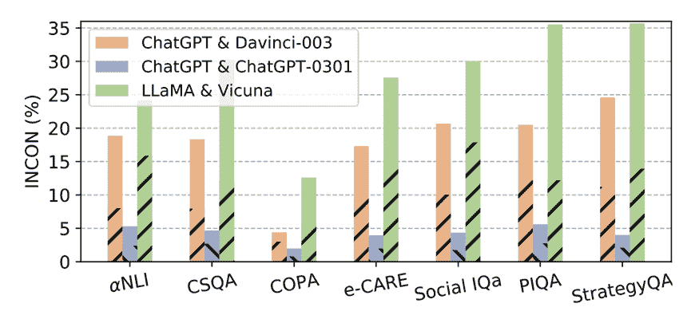

图 3 ：平等辩论中，各 LLMs 对在不同数据集上的不一致性。虚线部分代表正方模型预测错误而反方模型预测正确带来的不一致性。

#### **4.1.1 不一致性**

我们首先执行辩论框架的第一步，来得到不同辩论中， LLMs 之间的不一致性。结果如图 3 所示，我们可以得到以下结论：

+   不同类型 ( 文本补全和对话补全，有无指令微调 ) 的 LLMs 之间 (ChatGPT & Davinci-003, LLaMA & Vicuna) 在几乎所有数据集上都持有 20%-30% 的 INCON ，即使它们是基于相同的基础模型开发的。  每个条形中的虚线部分对 INCON 的贡献接近 50% ，这意味着每个 LLMs 对中的 LLM 拥有可比但截然不同的能力。

+   对于 ChatGPT & ChatGPT-0301 ， ChatGPT-0301 在功能上并不会完全覆盖 ChatGPT 。这表明 LLMs 在迭代过程中获得了新的能力的同时，也会失去一些现有的能力。  因此，使用更新的 LLMs 来复现不可用的早期版本的 LLMs 的结果并不会令人信服。

#### **4.1. 2 平等辩论的结果**

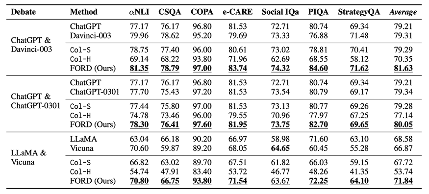

表 2 ：**平等辩****论及基线方法****在不同**数据上的表现。 带下划线 的数字表示在三种协作模型中最好的结果， 加粗 的数字代表在单模型和协作模型中最好的结果。 Avera ge 表示不同模型在所有数据集上的平均性能。

平等辩论及基线方法的表现如表 2 所示，我们可以得到以下结论：

+   FORD 在几乎所有数据集上都优于 Col-S 和 Col-H ，以及相应的单一 LLM （除了 Social I**Qa 上的 LLaMA & Vicun**a ）。这是因为 FORD 可以让 LLMs 从更全面、更精确的视角来看待问题。 这意味着具有可比能力的 LLMs 拥有协作精神，可以有效且高效地实现共同目标。

+   而 FORD 在 ChatGPT & ChatGPT-0301 上并没有获得像其他辩论那样多的提升。这主要是由于它们的能力非常相似，导致它们通常对每个样本都有相似的看法，使得性能提升微不足道。

+   在每个数据集上， ChatGPT & ChatGPT-0301 具有更高的性能下限 (Col-H) ，这表明我们可以选择类似的模型进行辩论获得保守的收益。然而 ChatGPT & Davinci-003 具有更高的性能上限 (FORD) ，这表明我们可以选择能力可比但差异较大的 LLMs 进行辩论以获得更好的性能。

#### **4.1.3 **辩论中不一致性的变化

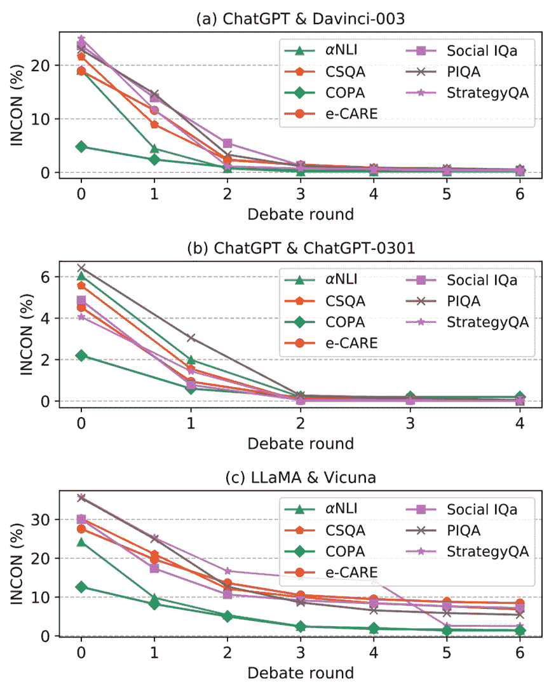

图 4 ：随着辩论的进行， (a) ChatGPT & Davinci-003, (b) ChatGPT & ChatGPT-0301, 以及 (c) LLaMA & Vicuna 的不一致性 (INCON) 变化。

图 4 展示了平等辩论的不一致性 INCON 随着辩论轮次的变化，从中我们可以总结如下结论：

+   对于每场公平辩论，每个数据集的每一轮后 INCON 都会逐渐下降。这是因为 LLMs 可以从彼此之间的差异中学习从而达成一致，这表明 能力可比的 LLMs 可以进行辩论并在共同目标上达成共识 。

+   对于 ChatGPT & Davinci-003 和 ChatGPT & ChatGPT-0301 ， INCON 在所有数据集上几乎下降到 0 ，而 LLaMA & Vicuna 经过辩论后仍然存在较为明显的不一致性。我们认为这是由于它们的能力差距造成的。

+   ChatGPT & ChatGPT-0301 的 INCON 经过 2 轮就实现了收敛，比其他公平辩论要早。这主要是因为它们的能力非常相似，导致它们更早达成共识。

### **4.2 错位辩论**

#### **4.2.1 **辩论结果

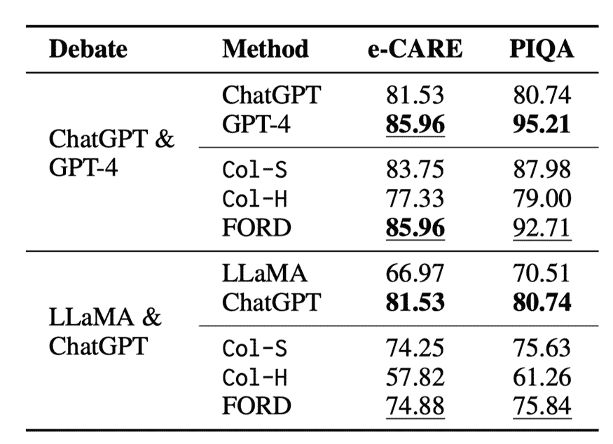

表 3 ：错位辩论的结果

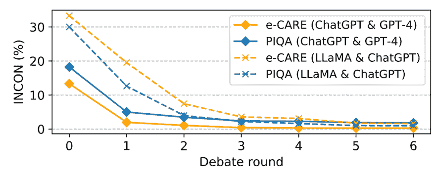

图 5 ：错位辩论中不一致性的变化

由于资源所限，我们只在 e-CARE 和 PIQA 上进行错位辩论，错位辩论的结果如表 3 和图 5 所示，我们可以得出以下结论：

+   FORD 可以轻松超越 Col-S 和 Col-H ，以及较弱的那一个 LLM ，但比不上较强的那一个 LLMs 。似乎错位辩论存在一个性能上限，这个上限与较强的 LLMs 的性能有关。这表明 能力不匹配的 LLMs 很难有效地合作实现共同目标 。

+   即使能力不匹配， LLMs 之间的 INCON 仍然继续下降。这些表明能力不匹配的 LLMs 仍然具有达成共识的协作精神，但会受到能力较差的 LLMs 的干扰。

+   与平等辩论相比，占主导地位的 LLMs （ GPT-4 和 ChatGPT ）可能会被较弱的 LLMs 分散注意力，但将 ChatGPT & Davinci-003 和 LLaMA & Vicuna 中的 Davinci-003 以及 Vicuna 分别换成 GPT-4 和 ChatGPT ， FORD 还是会获得显着的提升。

+   LLaMA & ChatGPT 的 FORD 似乎表现还远远没有达到可能存在的上限，这是因为 LLaMA 没有能力对其它模型的论据进行评估，只会不断表明自己的立场，这更加分散了 ChatGPT 的注意力。

#### **4.2.2 **辩论的主导程度 dominance

为了进一步分析，我们为 LLMs 辩论引入了一个新的指标：辩论的主导程度 dominance 。例如，正方 LLM 的 dominance 被定义为反方 LLM 妥协的样本的比例，反之亦然。 dominance 直接反映了 LLMs 在辩论中坚持自己观点的程度。

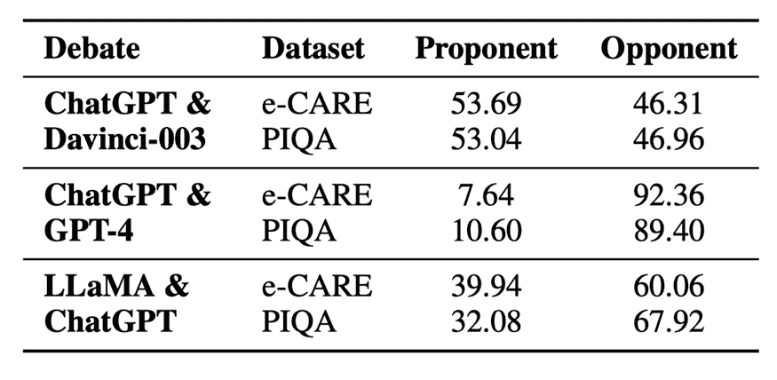

表 4 ：不同辩论中不同模型的主导程度

以公平辩论 (ChatGPT & Davinci-003) 为例，表 4 显示 ChatGPT & Davinci003 在两个数据集上取得了相似的主导程度。它解释了为什么可比的 LLMs 可以进行辩论来妥协或坚持更合理的观点来提高性能。因此，我们将其作为错位辩论的参考，如表 4 所示，我们可以得出结论：

+   实力较强的 LLMs （ GPT-4 和 ChatGPT ）在不匹配的辩论中占据绝对优势。这与人类的场景类似，在与比自己更强的人辩论时，自己很容易被带入到对方的思考过程中并认可对方的想法。因此， 实力较强的 LLMs 更有可能坚持自己的观点 。当更强的 LLMs 对少数样本缺乏信心时，它们更容易受到较弱的 LLMs 的干扰。

+   然而， LLaMA & ChatGPT 并没有表现出如此大的主导程度差距。这主要是因为 LLaMA 几乎没有辩论的能力。它无法评估其它模型的论点，大多数时候只会生成 “ 选项（ x ）更合理 ” 之类的句子，这会让 ChatGPT 摇摆不定。

#### **4.2.3 圆桌 **辩论

在许多场景中，辩论或者是讨论并不局限于 2 个参与者，例如医疗诊断和法庭陪审团，都需要多个参与者，所以我们设计了有 3 个 LLMs 参与的圆桌辩论：一个错位的圆桌辩论 ChatGPT & Davinci-003 & GPT-4 ( 记为 R1) ，一个平等的圆桌辩论 ChatGPT & Davinci-003 & ChatGPT-0301 ( 记为 R2) 。我们选取 e-CARE 和 PIQA 作为圆桌辩论的数据集。

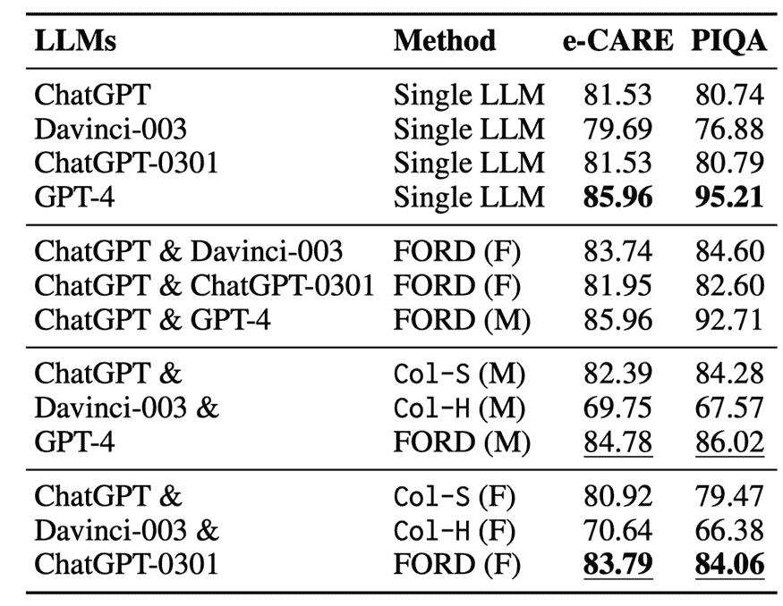

表 5 ：圆桌辩论与单模型以及双模型辩论结果， M 代表错位辩论， F 代表平等辩论

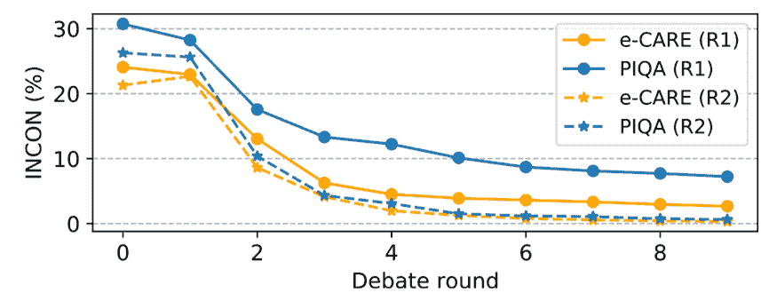

图 6 ：圆桌辩论的不一致性变化

圆桌辩论的结果如表 5 和图 6 所示，我们可以进行分析得到以下结论：

+   在两种圆桌辩论中， FORD 的表现均明显优于 Col-S 和 Col-H 。然而 R1 中的 FORD 远不如 GPT-4 ，如果有更多较弱的 LLMs ，那么较强的 LLMs 可能会更容易被误导，并且不那么占主导地位（请参阅文章附录中的表 10 ）。 FORD 在 R2 上的表现优于所有单一 LLMs ，这证明 两个以上可比的 LLMs 可以有效且高效地协作以实现共同目标 。

+   圆桌辩论中的 INCON 明显下降，表明 两个以上 LLMs 仍然具备协作精神并达成共识 。

+   圆桌辩论 R1 性能表现超越了 R2 。这表明更换一个较强的 LLMs 可以提高辩论的表现，尽管较强的 LLMs 可能会被其他较弱的 LLMs 误导。

在 R2 中， FORD 超过了平等辩论 ChatGPT & ChatGPT0301 ，而与 ChatGPT & Davinci-003 取得了相似的结果，这是因为 ChatGPT 和 ChatGPT-0301 没有太多区别，导致辩论中引入的新信息很少。

## **5. 分析**

### **5.1 **使用 GPT-4 作为辩论的裁判

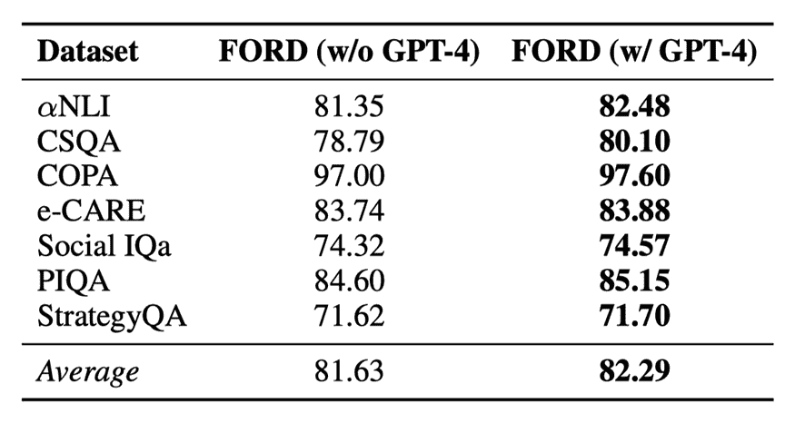

表 6 ： GPT-4 作为裁判对辩论结果的影响

每次辩论中不同的论点可能有不同的说服力。而且，在人类辩论中，有一个具有强大评估能力的人类裁判来总结辩论并得出最终结论。受此启发，我们研究使用 GPT-4 作为裁判来执行 FORD 中的第 3 步，并在两个公平辩论中进行实验。实验结果如表 6 所示：

+   GPT-4 作为裁判可以进一步提升辩论的性能。主要是因为 GPT4 可以给更有说服力的论点赋予更高的权重，从而得出更精确的结论。

+   同时，启发式的方法作为裁判也可以以一个较低的成本达到一个较理想的结果。

### **5.2 **辩论顺序的影响

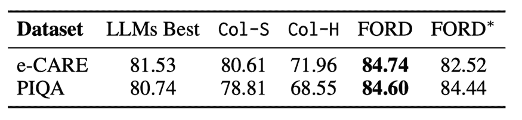

表 7 ：不同辩论顺序对辩论的影响， * 代表更换顺序的辩论结果

就像模型训练过程中不同的初始化可能会产生不同的结果一样，辩论框架的步骤 2 中的辩论顺序可能会影响结果，我们进行消融研究来研究辩论顺序的影响。实验结果如表 7 所示：

当我们将 Davinci-003 作为正方， ChatGPT 作为反方时， FORD 仍然优于 Col-S 和 Col-H ，以及相应的单一 LLM ，获得与原始辩论顺序相似的结果。这进一步支持了上文的发现对辩论顺序不敏感。

### **5.3 **样例分析

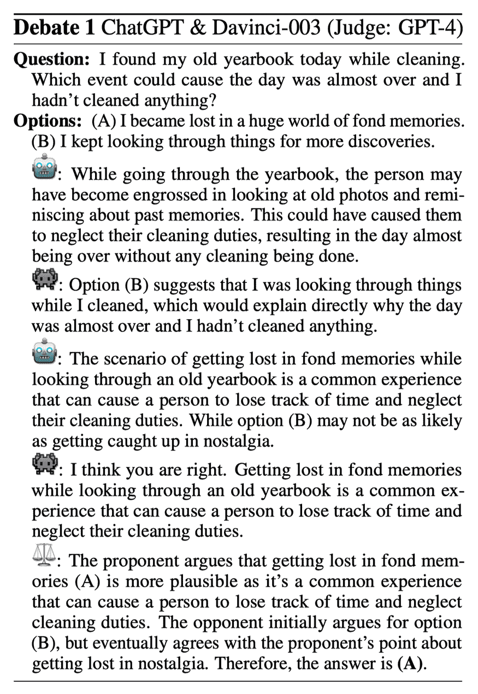

图 7 ：样例分析

在 Debate 1 中，正方 (ChatGPT) 认为选项 (A) 更合理，而反方 (Davinci-003) 则认为选项 (B) 更好。正方指出，这个问题的关键在于 “ 旧年鉴 ” 。反方最终向正方妥协。通过这场辩论，一个 LLMs 可以提供另一个 LLMs 忽视的细节，从而产生更有说服力的可解释信息和更准确的决策。

## **6. 结论**

我们探讨了不同 LLMs 之间的不一致问题。然后我们使用辩论框架 FORD 来考察 LLMs 是否能够有效地协作，通过辩论最终达成共识。为此我们探索了三个现实世界的辩论场景公平辩论、不匹配辩论和圆桌辩论。我们发现 LLMs 拥有协作精神，能够就共同目标达成共识。辩论可以提高 LLMs 的表现和相互一致性。当辩论不匹配时，较强的 LLMs 可能会被较弱的 LLMs 分散注意力。这些发现有助于未来开发更有效的多 LLMs 协作方法。

## **参考文献**

[1] Bubeck S, Chandrasekaran V, Eldan R, et al. Sparks of artificial general intelligence: Early experiments with gpt-4[J]. arXiv preprint arXiv:2303.12712, 2023.

[2] Wei J, Wang X, Schuurmans D, et al. Chain-of-thought prompting elicits reasoning in large language models[J]. Advances in Neural Information Processing Systems, 2022, 35: 24824-24837.

[3] Wu C, Yin S, Qi W, et al. Visual chatgpt: Talking, drawing and editing with visual foundation models[J]. arXiv preprint arXiv:2303.04671, 2023.

[4] Schick T, Jane A Y, Jiang Z, et al. PEER: A Collaborative Language Model[C]//The Eleventh International Conference on Learning Representations. 2023.

[5] Park J S, O'Brien J C, Cai C J, et al. Generative agents: Interactive simulacra of human behavior[J]. arXiv preprint arXiv:2304.03442, 2023.

[6] Wang X, Wei J, Schuurmans D, et al. Self-Consistency Improves Chain of Thought Reasoning in Language Models[C]//The Eleventh International Conference on Learning Representations. 2023.

[7] Jung J, Qin L, Welleck S, et al. Maieutic Prompting: Logically Consistent Reasoning with Recursive Explanations[C]//Proceedings of the 2022 Conference on Empirical Methods in Natural Language Processing. 2022: 1266-1279.

[8] Mayer I. Debating technologies[J]. A Methodological Contribution to the Design and Evaluation of Participatory Policy Analysis. Tilburg, The Netherlands, 1997.

[9] Bhagavatula C, Le Bras R, Malaviya C, et al. Abductive Commonsense Reasoning[C]//International Conference on Learning Representations. 2020.

[10] Talmor A, Herzig J, Lourie N, et al. CommonsenseQA: A Question Answering Challenge Targeting Commonsense Knowledge[C]//Proceedings of the 2019 Conference of the North American Chapter of the Association for Computational Linguistics: Human Language Technologies, Volume 1 (Long and Short Papers). 2019: 4149-4158.

[11] Roemmele M, Bejan C A, Gordon A S. Choice of plausible alternatives: An evaluation of commonsense causal reasoning[C]//2011 AAAI Spring Symposium Series. 2011.

[12] Du L, Ding X, Xiong K, et al. e-CARE: a New Dataset for Exploring Explainable Causal Reasoning[C]//Proceedings of the 60th Annual Meeting of the Association for Computational Linguistics (Volume 1: Long Papers). 2022: 432-446.

[13] Sap M, Rashkin H, Chen D, et al. Social IQa: Commonsense Reasoning about Social Interactions[C]//Proceedings of the 2019 Conference on Empirical Methods in Natural Language Processing and the 9th International Joint Conference on Natural Language Processing (EMNLP-IJCNLP). 2019: 4463-4473.

[14] Bisk Y, Zellers R, Gao J, et al. Piqa: Reasoning about physical commonsense in natural language[C]//Proceedings of the AAAI conference on artificial intelligence. 2020, 34(05): 7432-7439.

[15] Geva M, Khashabi D, Segal E, et al. Did aristotle use a laptop? a question answering benchmark with implicit reasoning strategies[J]. Transactions of the Association for Computational Linguistics, 2021, 9: 346-361.

本期责任编辑：丁 效

本期编辑：孙洲浩