# 单一作者论文，谷歌提出百万专家Mixture，超越密集前馈、稀疏MoE

> 来源：[https://agijuejin.feishu.cn/docx/MItWdvGfTo3Oe6xr2YDcNueOnxL](https://agijuejin.feishu.cn/docx/MItWdvGfTo3Oe6xr2YDcNueOnxL)

> 机器之心｜[阅读原文](https://www.jiqizhixin.com/articles/2024-07-10-11)

> 转载请联系原作者取得授权

> 释放进一步扩展 Transformer 的潜力，同时还可以保持计算效率。

标准 Transformer 架构中的前馈（FFW）层会随着隐藏层宽度的增加而导致计算成本和激活内存的线性增加。在大 语言模型 （LLM）体量不断增大的现在，稀疏混合专家（MoE）架构已成为解决此问题的可行方法，它将模型大小与计算成本分离开来。很多新兴的 MoE 模型都可以实现相同体量之上，更好的性能与更强大的表现。

最近发现的细粒度 MoE 扩展定律表明，更高的粒度可带来更好的性能。然而由于计算和优化方面的挑战，现有的 MoE 模型仅限于低数量专家。

本周二， **G**oogle DeepMind 的新研究引入了一种 参数 高效的专家检索机制，其利用乘积密钥技术从一百万个微型专家中进行稀疏检索 。

链接：https://arxiv.org/abs/2407.04153

该方法尝试通过用于路由的学习索引结构有效地串联到大量微小专家，从而将计算成本与 参数 计数分离。与密集的 FFW、粗粒度 MoE 和产品密钥存储器 (PKM) 层相比，表现出卓越的效率。

这项工作引入了 参数 高效专家检索（PEER) 架构（parameter efficient expert retrieval），利用产品密钥（product key）检索高效地路由到大量专家，将计算成本与 参数 量分离。这种设计在实验中展示了卓越的计算性能水平，将其定位为用于扩展基础模型的密集 FFW 层的竞争性替代方案。这项工作的主要贡献是：

极端 MoE 设置的探索：与以前的 MoE 研究中对少数大型专家的关注不同，这项工作研究了众多小型专家的未充分探索的情况。

用于路由的学习索引结构：首次证明学习索引结构可以有效地路由到超过一百万个专家。

新的层设计：将产品密钥路由与单 神经元 专家相结合，我们引入了 PEER 层，它可以扩展层容量而无需大量计算开销。实证结果表明，与密集 FFW、粗粒度 MoE 和产品密钥内存 (PKM) 层相比，其效率更高。

综合消融研究：我们研究了 PEER 的不同设计选择（例如专家数量、活动 参数 、头数量和 查询 批量 规范化 ）对语言建模任务的影响。

**方法介绍**

本节中，研究者详解了 参数 高效专家检索 (PEER) 层，它一种混合专家架构，使用路由中的产品密钥和单 神经元 MLP 作为专家。下图 2 展示了 PEER 层内的计算过程。

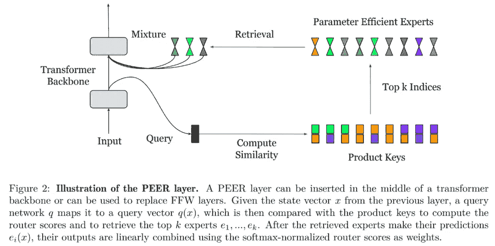

**PEER 层概览 **。从形式上看，PEER 层是一个函数 f : R^n → R^m，它由三部分组成：一个由 N 个专家组成的池 E := {e_i}^N_i=1，其中每个专家 e_i : R^n → R^m 与 f 共享相同的签名；一组相应的 N 个产品密钥 K := {k_i}^N_i=1 ⊂ R^d ；以及一个 查询 网络 q : R^n → R^d，它将输入向量 x ∈ R^n 映射 到 查询 向量 q (x)。

令 T_k 表示 top-k 运算符 。给定输入 x，首先检索 k 个专家的子集，这些专家的相应产品键与 查询 q (x) 具有最高的内积。

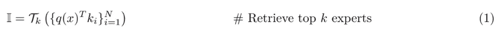

然后将非线性激活（例如 softmax 或 sigmoid）应用于前 k 个专家的 查询 键内积，以获得路由分数。

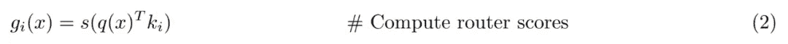

最后通过对路由分数加权的专家输出进行线性组合来计算输出。

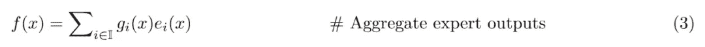

**产品密钥检索 **。由于研究者打算使用大量专家（N ≥ 10^6），单纯计算公式 1 中的前 k 个索引可能成本非常高，因此应用了产品密钥检索技术。他们不使用 N 个独立的 d 维向量作为密钥 k_i，而是通过连接两个独立的 d/2 维子密钥集（即 C, C ′ ⊂ R d/2） 中的向量来创建它们：

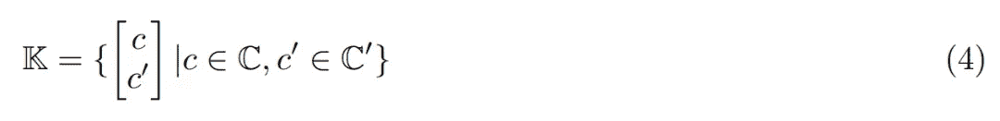

**参数 高效专家和多头检索 **。与其他 MoE 架构不同，这些架构通常将每个专家的隐藏层设置为与其他 FFW 层相同的大小。而在 PEER 中，每个专家 e_i 都是一个单例 MLP，换句话说，它只有一个带有单个 神经元 的隐藏层：

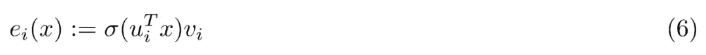

研究者没有改变单个专家的规模，而是使用了多头检索来调整 PEER 层的表达能力，这类似于 transformer 中的多头 注意力机制 和 PKM 中的多头记忆。

具体来说，他们使用 h 个独立的 查询 网络，每个网络计算自己的 查询 并检索一组单独的 k 个专家。不过，不同的头共享同一个专家池，具有相同的产品密钥集。这 h 个头的输出简单地总结如下：

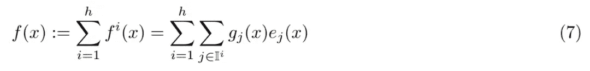

**为什么要有大量的小专家 **？给定的 MoE 层可以用三个超 参数 来表征它： 参数 总数 P、每个 token 的活跃 参数 数量 P_active 和单个专家的大小 P_expert。Krajewski 等人 (2024) 表明，MoE 模型的 scaling law 具有以下形式：

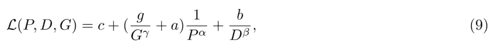

对于 PEER，研究者通过设置 d_expert = 1 来使用尽可能最小的专家规模，激活 神经元 的数量是检索头的数量乘以每个头检索到的专家数量：d_active = hk。因此，PEER 的粒度始终为 G = P_active/P_expert = d_active/d_expert = hk。

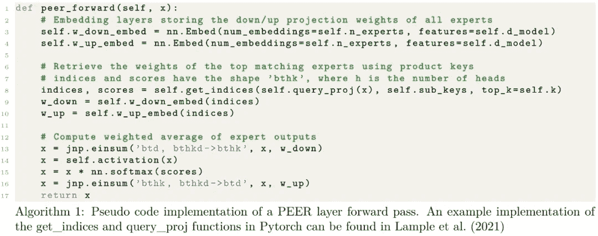

**实验结果**

我们首先来看在语言建模数据集上的评估结果。

在根据 isoFLOP 曲线确定每种方法的计算最优模型后，研究者在以下几个流行语言建模数据集上评估了这些预训练模型的性能：

+   Curation Corpus

+   Lambada

+   Pile

+   Wikitext

+   预训练数据集 C4

下表 1 展示了评估结果。研究者根据训练期间使用的 FLOP 预算对模型进行了分组。可以看到，PEER 在这些语言建模数据集上的困惑度最低。

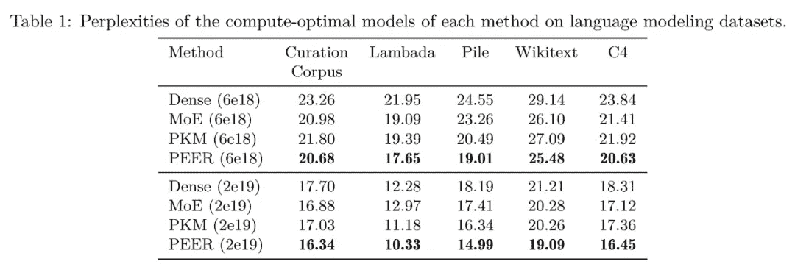

在消融实验中，研究者改变了专家总数量。下图 1 中 isoFLOP 曲线所示的模型都有超过一百万个（1024^2 ）专家。

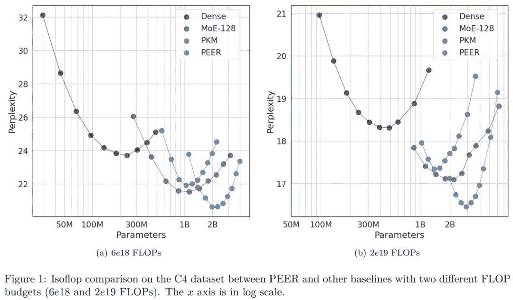

研究者选择了 isoFLOP 最优位置的模型，并改变了 PEER 层中的专家数量（N = 128^2、256^2、512^2、1024^2），同时保持活跃专家数量不变（h = 8，k = 16）。结果如下图 3 (a) 所示。

可以看到，isoFLOP 曲线在具有 1024^2 个专家的 PEER 模型和相应的密集主干之间进行 插值 ，而无需用 PEER 层替换中间块中的 FFW 层。这表明，只需增加专家数量就可以提高模型性能。

同时，研究者改变了活跃专家的数量。他们系统地改变了活跃专家的数量（hk = 32、64、128、256、512），同时保持专家总数不变（N = 1024^2）。对于给定的 hk，研究者则联合改变 h 和 k 以确定最佳组合。下图 3 (b) 绘制了关于头数量 (h) 的 isoFLOP 曲线。

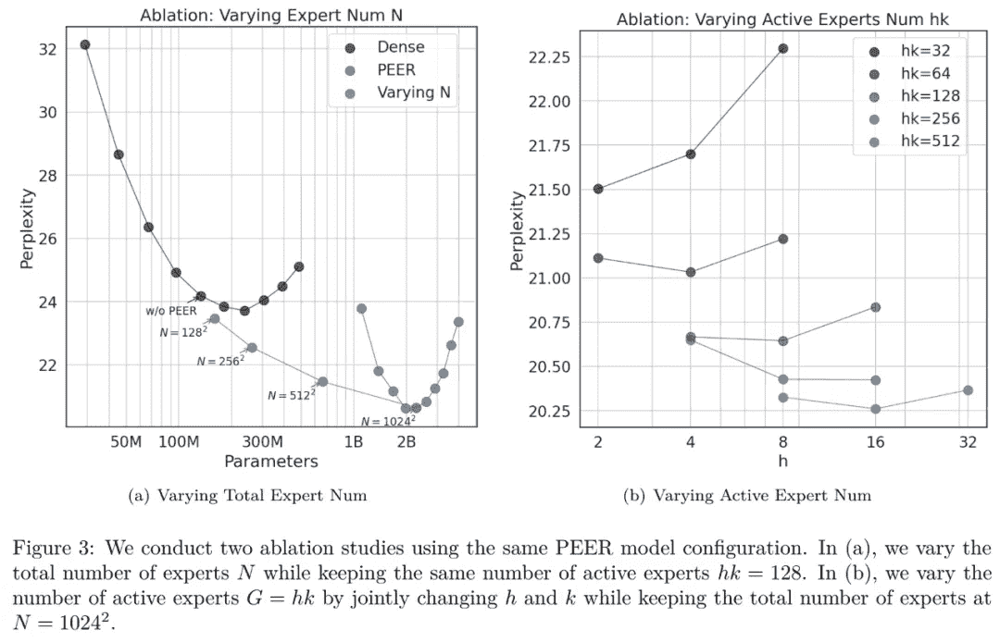

下表 2 列出了使用和不使用 BN 时不同数量专家的专家使用率和不均匀性。可以看到，即使对于 1M 个专家，专家使用率也接近 100%，并且使用 BN 可以使专家的利用率更加均衡，困惑度更低。这些发现证明了 PEER 模型在利用大量专家方面的有效性。

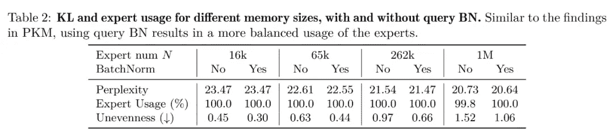

研究者还比较了有无 BN 的 isoFLOP 曲线。下图 4 显示，有 BN 的 PEER 模型通常可以实现较低的困惑度。虽然差异并不显著，但在 isoFLOP 最优区域附近差异最为明显。

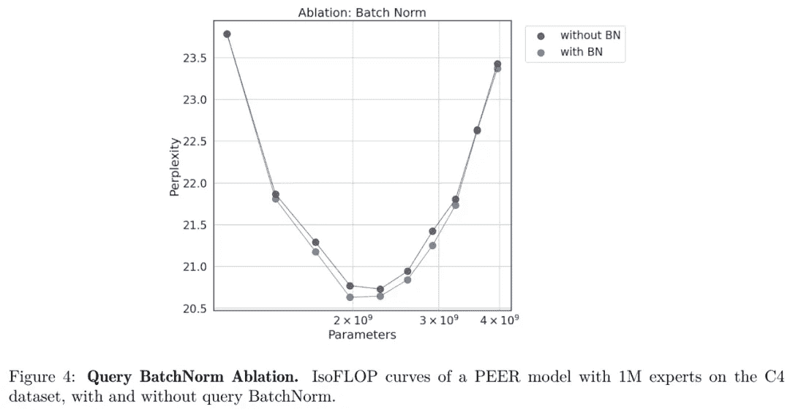

**作者介绍**

PEER 研究只有一位作者 Xu He（Owen），他是 Google DeepMind 研究科学家，2017 年博士毕业于荷兰格罗宁根大学。

