# 鄂维南院士领衔新作：大模型不止有RAG、参数存储，还有第3种记忆

> 来源：[https://agijuejin.feishu.cn/docx/F8Gjd4K5iohRS3xkUE6cW667nCc](https://agijuejin.feishu.cn/docx/F8Gjd4K5iohRS3xkUE6cW667nCc)

> 机器之心｜[阅读原文](https://www.jiqizhixin.com/articles/2024-07-10-6)

> 转载请联系原作者取得授权

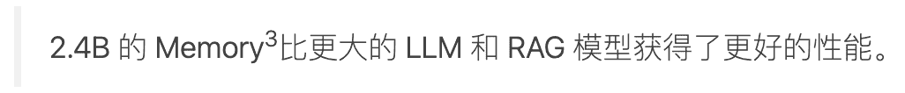

近年来，大型语言模型 (LLM) 因其非凡的性能而获得了前所未有的关注。然而， LLM 的训练和推理成本高昂，人们一直在尝试通过各种优化方法来降低成本。

本文来自上海算法创新研究院、北京大学等机构的研究者受人类大脑记忆层次结构的启发，他们通过为 LLM 配备显式记忆（一种比模型参数和 RAG 更便宜的记忆格式）来降低这一成本。从概念上讲，由于其大部分知识都外化为显式记忆，因而 LLM 可以享受更少的参数大小、训练成本和推理成本。

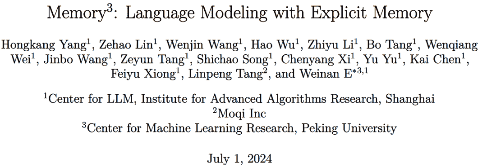

+   论文地址：https://arxiv.org/pdf/2407.01178

+   论文标题：Memory 3 : Language Modeling with Explicit Memory

作为初步的概念证明，研究者从零开始训练了一个 2.4B 的 LLM，它比更大的 LLM 和 RAG 模型获得了更好的性能，并实现了比 RAG 更高的解码速度。这个模型被命名为 Memory 3 ，因为在 LLM 中，显式记忆是继隐式记忆（模型参数）和工作记忆（上下文键值）之后的第三种记忆形式。

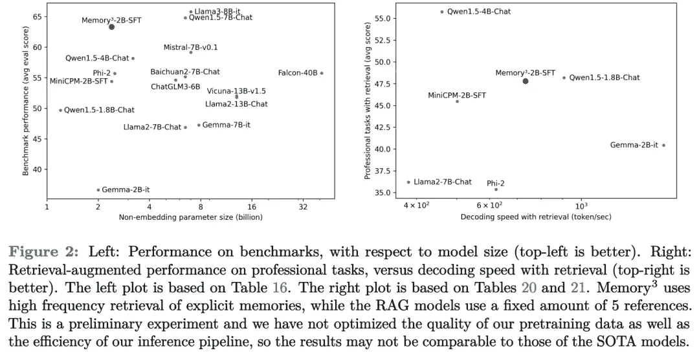

具体而言，本文引入了一种新的记忆格式，即显式记忆，其特点是写入成本和读取成本相对较低。如图 1 所示，模型首先将知识库（或任何文本数据集）转换为显式记忆，实现为稀疏注意力键 - 值，然后在推理过程中调用这些内存并将其集成到自注意力层中。

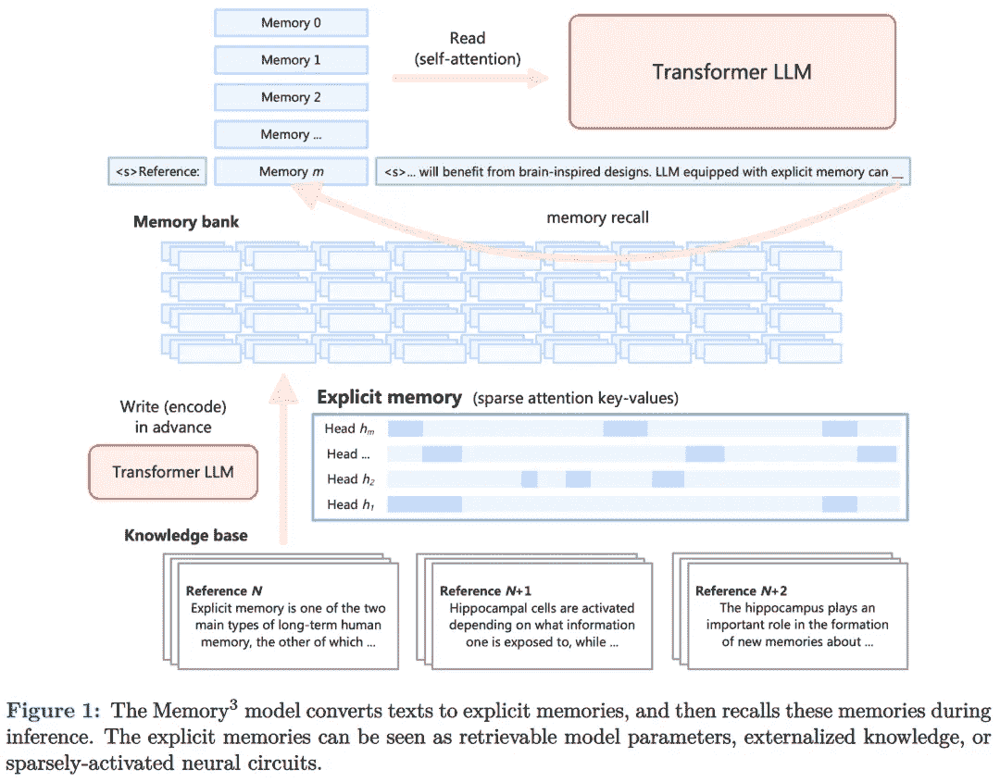

新的记忆格式定义了新的记忆层次结构：

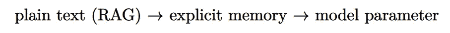

此外，本文还介绍了一种支持知识外化的记忆电路理论，并提出了可以让存储易于处理的记忆稀疏机制和促进记忆形成的两阶段预训练方案。

总结而言：

+   Memory 3 在推理过程中利用显式记忆，减轻了模型参数记忆特定知识的负担；

+   显式记忆是从构建的知识库中编码而来的，其中稀疏记忆格式保持了真实的存储大小；

+   研究者从头开始训练了一个具有 2.4B 非嵌入参数的 Memory 3 模型，其性能超过了更大规模的 SOTA 模型。它还比 RAG 具有更好的性能和更快的推理速度；

+   此外，Memory 3 提高了事实性并减轻了幻觉，并能够快速适应专业任务。

**方法介绍**

记忆电路理论有助于确定哪些知识可以存储为显式记忆，以及哪种模型架构适合读取和写入显式记忆。

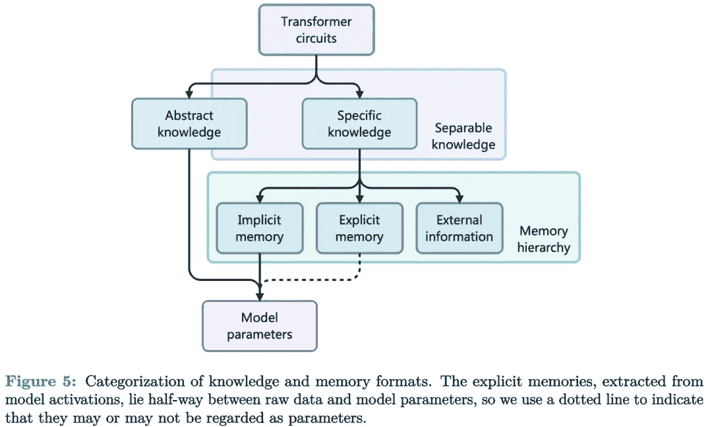

研究者将输入输出关系作为电路的内部机制，并将知识定义为输入输出关系及其电路。通过操纵这些电路，人们可以从 LLM 中分离出许多知识，同时保持其功能完好无损。

Memory 3 ：在架构方面，本文的目标是为 Transformer LLM 设计一个显式的记忆机制，使其写入成本和读取成本都比较低。此外，本文希望将对 Transformer 架构的修改限制在尽可能小的范围内，不添加任何新的可训练参数，这样大多数现有的 Transformer LLM 都可以在几乎不进行微调的情况下转换为 Memory 3 模型。简单的设计过程如下：

写入成本：在推理之前，LLM 将每个参考写入显式记忆，保存在驱动器上。记忆是从自注意力层的键值向量中选择的，因此写入过程不涉及训练。每个引用都是独立处理的，避免了长上下文注意力的成本。

读取成本：在推理过程中，显式记忆从驱动器中检索，并与通常的上下文键值一起由自注意力读取。每个记忆由来自少量注意力头的极少量键值组成，从而大大减少了额外的计算、GPU 存储、驱动器存储和加载时间。它允许 LLM 频繁检索许多参考，而对解码速度的影响有限。

推理过程如图 9 所示，每当 LLM 生成 64 个 token 时，它就会丢弃当前记忆，使用这 64 个 token 作为查询文本来检索 5 个新记忆，并继续使用这些记忆进行解码。同样，在处理提示时，LLM 会为每 64 个 token 块检索 5 个记忆。每个块都会关注自己的记忆，并且不同块之间的记忆可能会有所不同。

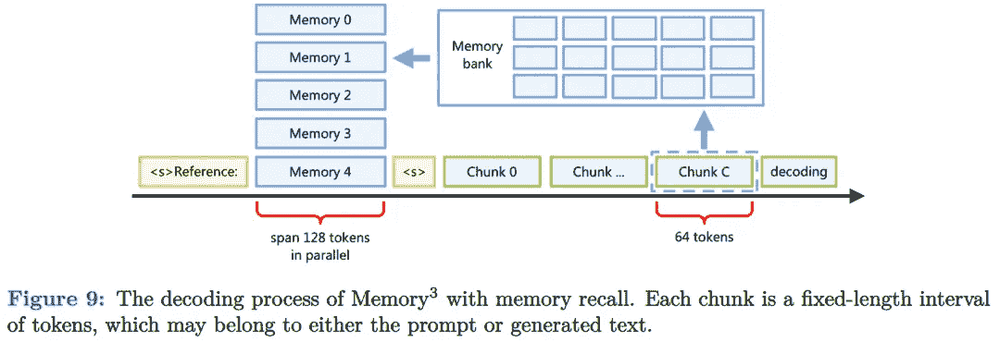

写入与读取记忆：在推理过程中，LLM 可以通过其自注意力层直接读取检索到的显式记忆，方法是将它们与上下文键值连接起来（图 9）。具体来说，对于第 l 层的每个注意力头 h，如果它被选为记忆头，那么它的输出 Y^( l,h ) 将会改变：

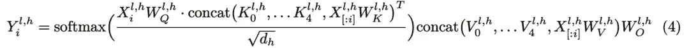

此外，该研究对所有显式记忆采用并行位置编码，即所有键位置都位于长度为 128 的同一区间内，如图 9 所示。

两阶段预训练：预训练由两个阶段组成，warmup 和持续训练。只有持续训练阶段涉及显式记忆，而 warmup 阶段使用与普通预训练相同的格式。

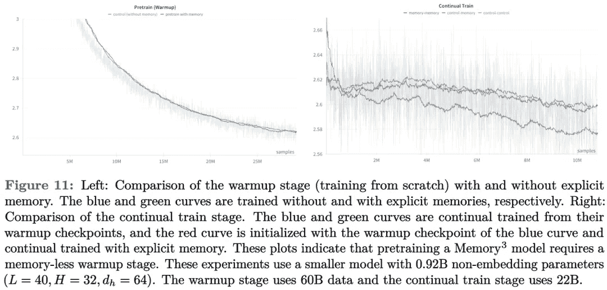

图 13 绘制了 warmup 阶段训练损失和学习率时间表。

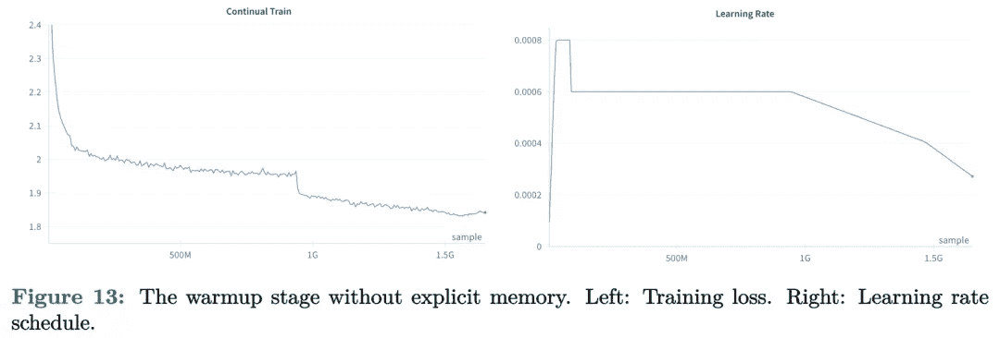

图 14 绘制了持续训练阶段训练损失和学习率时间表。

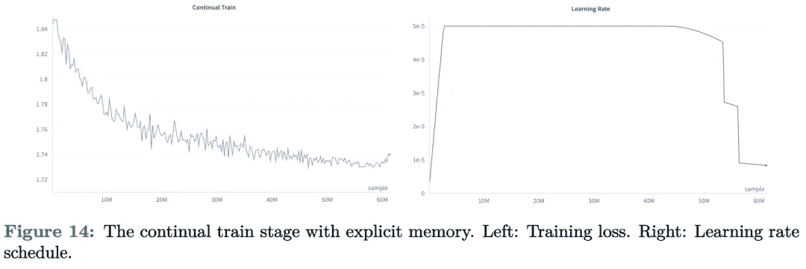

**实验结果**

研究者评估了 Memory 3 模型的一般能力（基准任务）、对话能力、专业能力（法律和医学）以及幻觉。此外，研究者还测量了 Memory 3 的解码速度，并与类似和更大的 SOTA LLM 以及 RAG 模型进行了比较。

一般能力的评估结果如下所示，结果表明显式记忆使平均分提高了 2.51%。相比之下，Llama2-7B 与 13B 的得分差距为 4.91%。显式记忆可以将「有效模型大小」提高 2.51/4.91 ≈ 51.1%。

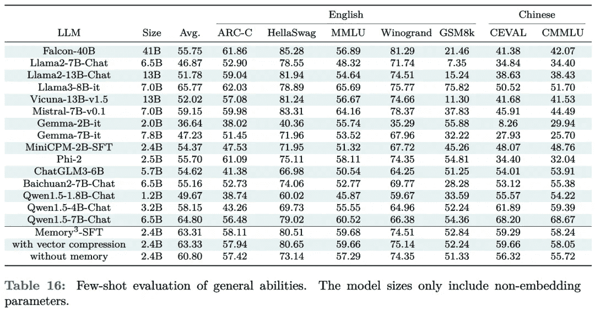

接下来作者评估了 Memory 3 的对话技巧，结果列于表 18 中，表明模型以更少的参数胜过 Vicuna-7B、Falcon-40B-Instruct 和 ChatGLM2-6B。

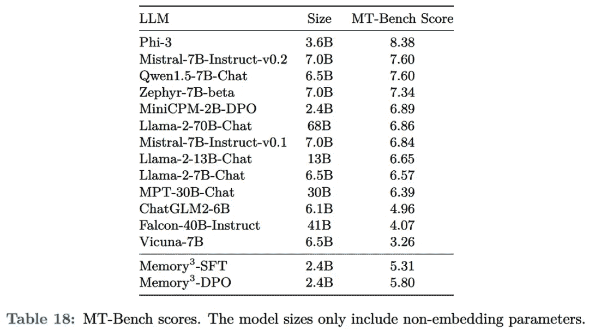

目前，LLM 仍然面临幻觉问题。从概念上讲，Memory 3 应该不太容易受到幻觉的影响，因为它的显式记忆直接对应于参考文本。为了评估幻觉，研究者选择了两个英文数据集进行评估。结果如表 19 所示，Memory 3 在大多数任务上都取得了最高分。

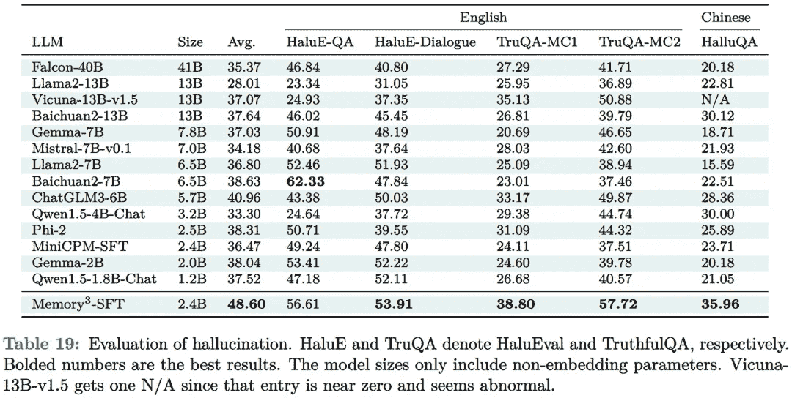

使用显式记忆的一个好处是，LLM 可以通过更新其知识库轻松适应新领域和任务。只需将与任务相关的参考导入 Memory 3 的知识库，并可选择在热启动的情况下将其转换为显式记忆。然后，该模型可以利用这些新知识进行推理，跳过成本更高且可能有损的微调过程，并且运行速度比 RAG 更快。图 4 已证明这种成本降低，并且可以促进 LLM 在各个行业的快速部署。

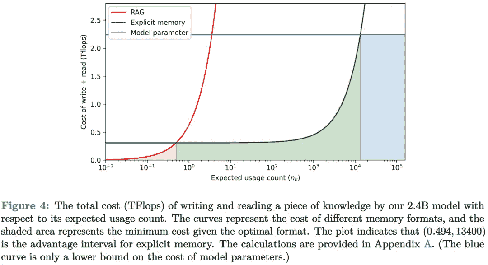

下表表明，Memory 3 的表现优于大多数模型。

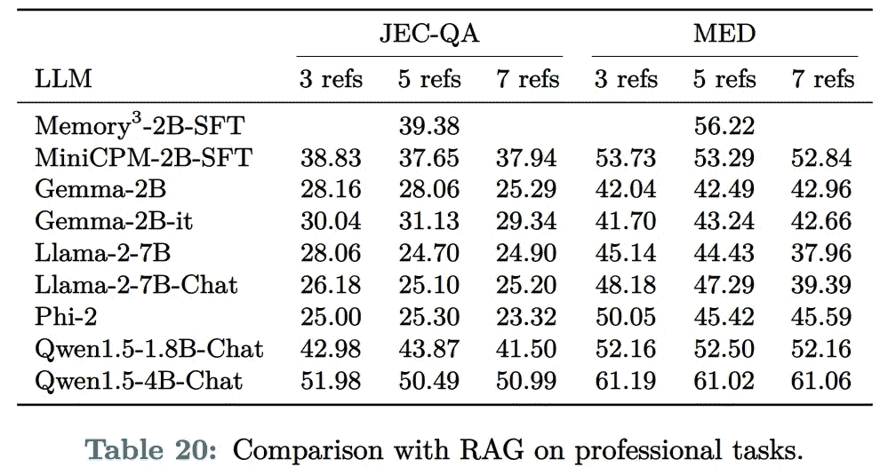

最后，研究者通过每秒生成的 token 数来评估 Memory 3 的解码速度或吞吐量。

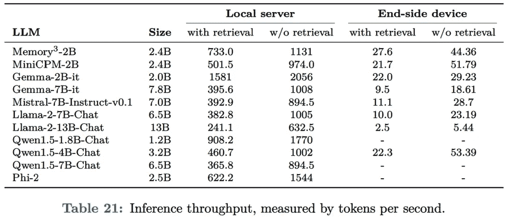

了解更多内容，请参考原论文。