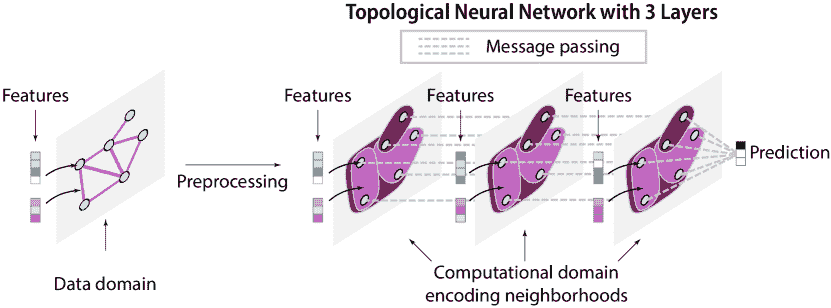
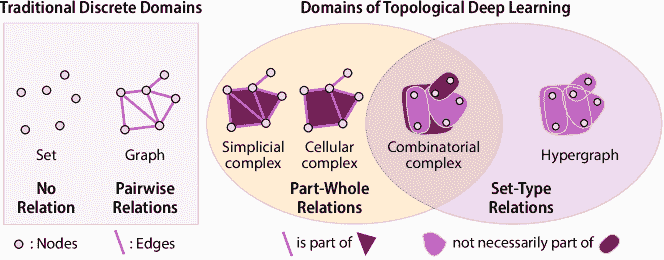
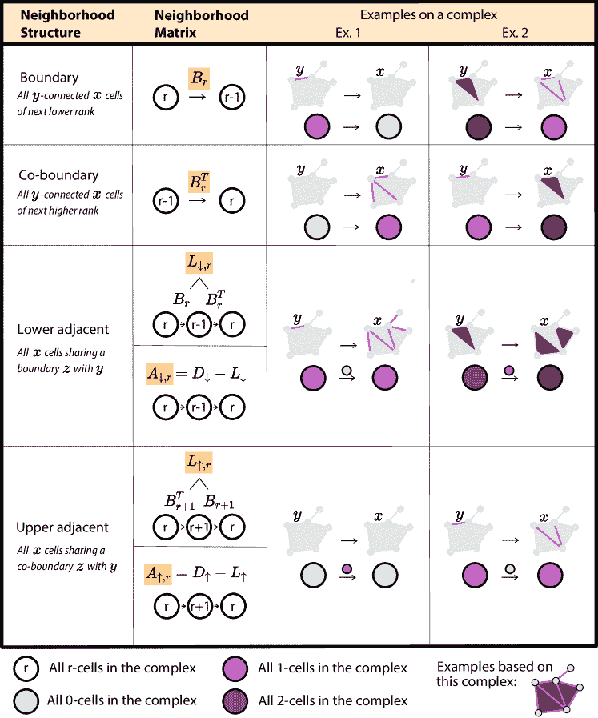
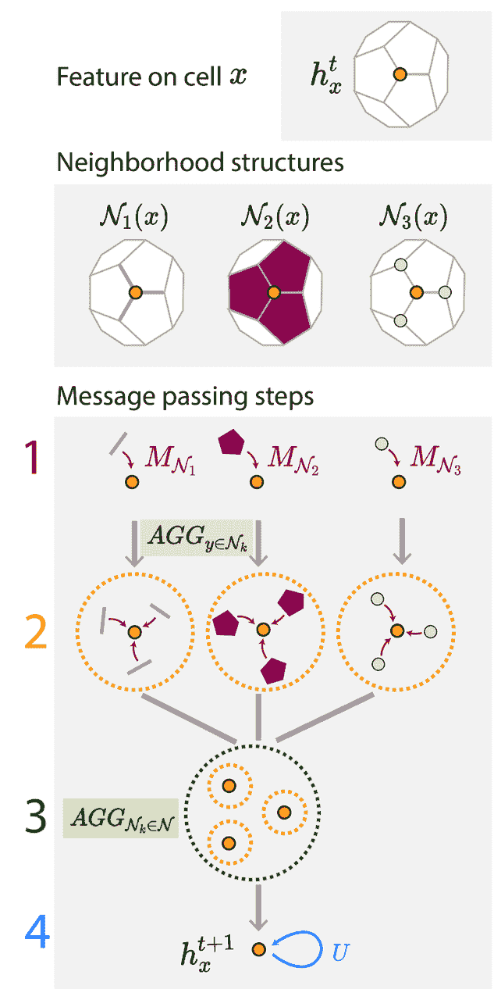
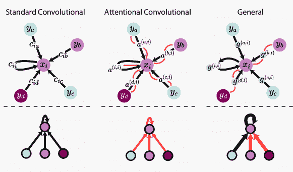

# 拓扑深度学习捕捉数据的高阶关系：信息传递拓扑神经网络概述

> 来源：[https://agijuejin.feishu.cn/docx/ODJpd3BptoVVdpxXN8nc95fKnBL](https://agijuejin.feishu.cn/docx/ODJpd3BptoVVdpxXN8nc95fKnBL)

> 集智俱乐部｜[阅读原文](https://mp.weixin.qq.com/s/kCJqJnxFJlohpweihUlF8w)

> 转载请联系原作者取得授权

> **导语**

> **在当今数据**驱动的世界中，我们面临着前所未有的复杂性挑战。社交网络、生物分子结构、城市交通系统——这些领域产生的数据不仅体量庞大，其内在关系也错综复杂，传统的机器学习方法尽管在某些情况下表现出色，但在处理其中的高阶关系时却显得力不从心。在这种背景下，拓扑深度学习（Topological Deep Learning, TDL）应运而生，它将深度学习的强大能力与拓扑学的严谨性结合起来，为我们提供了一种全新的视角和工具。

> **集智俱乐部联合中国人民大学黄文炳副教授、上海交通大学王宇光**[**副教授和南洋理**](http://mp.weixin.qq.com/s?__biz=MzIzMjQyNzQ5MA==&mid=2247692685&idx=1&sn=dbc10631b4fdd4e1133e4a8892f18510&chksm=e898ab00dfef2216345232e87a3fc6f32ef9f673a5381ad7ec5b7af59daf375ba8706c0caab5&scene=21#wechat_redirect)**工大学**夏克林副教授发起「 几何深度学习 」读书会。从2024年7月11日开始，每周四19:00-21:00进行，持续时间预计 8-10 周，社区成员将一起系统性地学习几何深度学习相关知识、模型、算法，深入梳理相关文献、激发跨学科的学术火花、共同打造国内首个几何深度学习社区！欢迎加入社区与发起人老师一起探索！

>

> **研究领域：拓扑深度学习，高阶数据**表征，单纯复形，胞形复形，超图，消息传递

王若晨 **| 编译**

《Architectures of Topological Deep Learning: A Survey of Message-Passing Topological Neural Net works》[1]通过 提供一个统一的框架和直观的数学及图形符号，不仅为新入门者提供了易于理解的TDL介绍，还对现有的TNNs架构进行了系统的比较和全面的回顾。

### **1. 介绍**

在几何深度学习领 域[2]，图神经网络 （Graph Neural Network, GNN） [**3]在处理关系数据方面**取得了显著成就。然而，当研究对象涉及更复杂的关系结构和多个个体间的相互作用时，图的表示能力会遇到其结构本身的限制。TDL [4]采用一种更通用的抽象方法来处理具有高阶关系结构的数据，其核心在于 消息传递拓扑神经网络 （Topological Neural Network, TNN） ，它们通过精心设计的消息传递机制，能够捕捉和学习数据中的高阶关系。从社交网络中的群体动力学到蛋白质结构的复杂相互作用，TDL 展现出了处理这些复杂系统的巨大潜力。

### **2. 拓扑深度学习的数据域**

图 1 拓扑神经网路

复杂系统的数据是定义在数据域上的特征[4]，这些特征经过预处理后转化为计算域，计算域编码了系统组件之间的交互及其邻域。TNN 的各层通过消息传递逐步更新这些特征，并生成输出，例如分类中的类别标签或回归中的定量值。每层的输出代表从输入数据中提取的新知识。

如图2所示， 拓扑深度学习的数据域包括单纯复形、细胞复合体、超图和组合复合体等 。这些域是对传统离散数据域 （如集合、图） 的扩展，能够表达更丰富的关系结构。例如，单纯复形允许我们通过多维单元 （如三角形、四面体） 来表示层次化的部分-整体关系。

图 2 各类数据域

### **3. 邻居结构**

在拓扑深度学习中，每个单元的特征更新依赖于其邻居单元的信息。 邻居结构定义了不同单元间的拓扑邻近性，包括边界邻域、共边界邻域、下邻域和上邻域。 这些结构通过边界关系矩阵来表达，形成了拓扑神经网络的基础。

图 3 邻居结构

### **4. 消息传递的基本步骤**

**拓扑深度学习的核心是消息传递，该过程可以分为以下四个步骤：消**息生成、邻域聚合、跨邻域聚合和特征更新 。具体的，消息生成指各个单元将其特征分享给各邻居结构单元；邻域聚合指汇总来自同一邻域的信息；跨邻域聚合指汇总不同邻域的信息；特征更新则指根据汇总得到的信息和网络参数更新单元特征。

图 4 消息传递的基本步骤

### **5. 消息传递函数的类型**

在拓扑深度学习中，消息传递函数定义了如何从邻居单元接收信息并将其与当前单元的特征相结合，可根据其复杂性分为如下三种类 型[5] ：

+   **标准卷积 **（Standard Convolutional） ：使用一个固定的权重矩阵对邻居的特征进行加权，然后进行聚合。

+   **注意力机制卷积 **（Attentional Convolutional） ：利用注意力机制动态地为每个邻居的消息分配权重，这允许网络更加关注于信息量大或重要的邻居。

+   **通用函数 **（General） ：实现更为复杂的交互，可能包括非线性变换和自定义的聚合策略。

图 5 消息传递函数的类型

**参考文献**

[1] PAPILLON M, SANBORN S, HAJIJ M, et al. Architectures of Topological Deep Learning: A Survey of Message-Passing Topological Neural Networks[M/OL]. arXiv. http://arxiv.org/abs/2304.10031. DOI:10.48550/arXiv.2304.10031.

[2] BRONSTEIN M M, BRUNA J, COHEN T, et al.. Geometric Deep Learning: Grids, Groups, Graphs, Geodesics, and Gauges[M/OL]. arXiv, 2021. http://arxiv.org/abs/2104.13478. DOI:10.48550/arXiv.2104.13478.

[3] ZHOU J, CUI G, HU S, et al.. Graph neural networks: A review of methods and applications[J/OL]. AI Open, 2020, 1: 57-81. DOI:10.1016/j.aiopen.2021.01.001.

[4] BILLINGS J C W, HU M, LERDA G, et al.. Simplex2Vec embeddings for community detection in simplicial complexes[M/OL]. arXiv, 2019. http://arxiv.org/abs/1906.09068.

[5] BRONSTEIN M M. Beyond Message Passing: a Physics-Inspired Paradigm for Graph Neural Networks[EB/OL]. https://thegradient.pub/graph-neural-networks-beyond-message-passing-and-weisfeiler-lehman/.