# 可解释性终极追问，什么才是第一性解释？20篇CCF-A+ICLR论文给你答案

> 来源：[https://agijuejin.feishu.cn/docx/G4BpdnQDIoazBvxeiMKcEXiqnfb](https://agijuejin.feishu.cn/docx/G4BpdnQDIoazBvxeiMKcEXiqnfb)

> 机器之心｜[阅读原文](https://www.jiqizhixin.com/articles/2024-08-04-9)

> 转载请联系原作者取得授权

本文作者为张俊鹏、任启涵、 张拳石 ，其中张俊鹏是 张拳石 老师的准入学博士生，任启涵是 张拳石 老师的博士生。

本文首先简单回顾了『 等效交互可解释性理论体系 』（20 篇 CCF-A 及 ICLR 论文），并在此基础上，严格推导并预测出 神经网络 在训练过程中其概念表征及其泛化性的动力学变化，即在某种程度上，我们可以解释在训练过程中 神经网络 在任意时间点的泛化性及其内在根因。

## 一、前言

长期以来，我们团队一直在思考可解释性领域的一个终极问题，即 什么才是解释性领域的第一性原理 ？所谓第一性原理，目前没有一个被广泛接受的框架，世上本无路，我们需要逐渐去定义这样一个路。我们 需要在一个新的理论体系中，提出大量的公理性要求，得出一个可以从不同的角度全方位精确严谨解释 神经网络 内在机理的理论。一套理论系统能严谨解释 神经网络 的方方面面才叫 “第一性原理” 。

如果你真的在严谨地做 “科学”，那么第一性原理一定不是想象中简单，而是一个复杂的体系，需要研究照顾到 深度学习 中方方面面纷繁复杂的现象。当然，如果你主观上不愿意或者不信一个理论需要足够严谨，那么研究会变得简单千万倍。就像物理学的标准模型一定比牛顿定律复杂，取决于你希望走哪条路。

沿着这个方向，我们团队独立从头构建了『 等效交互可解释性理论体系 』、并基于此理论，从三个角度来解释 神经网络 的内在机理。

### 1. 语义解释的理论基础：数学证明 神经网络 的决策 逻辑 是否可以被少量符号化 逻辑 所充分覆盖（充分解释）

『证明 神经网络 的决策 逻辑 是否可以被有限符号化 逻辑 解释清楚』 这一命题是解释 神经网络 的根本命题。如果此命题被证伪，则从根本上讲， 神经网络 的可解释性将是无望的，所有的解释性算法只能提供近似的解读，而无法精确地覆盖所有的决策 逻辑 。幸运的是，我们找到了在大部分应用中 神经网络 都可以满足的面向遮挡鲁棒性的三个常见的条件，并且数学证明了满足这三个条件的 神经网络 的决策 逻辑 可以被写成符号化的交互概念。

参见 https://zhuanlan.zhihu.com/p/693747946

### 2. 寻找性能指标背后的可证明、可验证的根因

将 神经网络 泛化性和鲁棒性等终极性能指标的根因拆分具体少数细节 逻辑 。对 神经网络 性能（鲁棒性、泛化性）的解释是 神经网络 可解释性领域的另一个重大问题。然而，目前人们普遍认为 神经网络 性能是对 神经网络 整体的描述，而 神经网络 无法像人类一样将自己的分类判断拆解成具象化的、少量的决策 逻辑 。在这方面，我们给出了不一样的观点 —— 将性能指标与具象化的交互之间建立起数学关系。我们证明了 1. 等效交互的复杂度可以直接决定 神经网络 的对抗鲁棒性 / 迁移性，2. 交互的复杂度决定了 神经网络 的表征能力，3. 并解释 神经网络 的泛化能力 [1]，和 4. 解释 神经网络 的表征瓶颈。

+ 参见1：https://zhuanlan.zhihu.com/p/369883667

+ 参见2：https://zhuanlan.zhihu.com/p/361686461

+ 参见3：https://zhuanlan.zhihu.com/p/704760363

+ 参见4：https://zhuanlan.zhihu.com/p/468569001

### 3. 统一工程性 深度学习 算法

由于缺少基础理论的支撑，目前 深度学习 算法大都是经验性的、工程性的。可解释性领域的第一性原理应该可以承担起将前人的大量工程性经验总结为科学规律的任务。在等效交互可解释性理论体系下，我们团队既证明了 14 种不同的输入重要性归因算法的计算本质在数学上都可以统一写成对交互作用的再分配形式。此外，我们还统一了 12 种提升对抗迁移性的算法，证明了所有提升对抗迁移性算法的一个公共机理是降低对抗扰动之间的交互效用，实现了对 神经网络 可解释性方向大部分工程性算法的理论凝练。

+ 参见1：https://zhuanlan.zhihu.com/p/610774894

+ 参见2：https://zhuanlan.zhihu.com/p/546433296

在等效交互可解释性理论体系下，我们的团队在之前的研究中已经成功发表了 20 篇 CCF-A 类和 机器学习 顶级会议 ICLR 论文，我们已经从理论和实验上充分解答了上述问题。

## 二、本文研究概述

沿着上述理论框架，在这篇 知乎 文章中，我们希望精确解释出 神经网络 训练过程中泛化性的变化规律，具体地涉及两篇论文。

+ 1. Junpeng Zhang, Qing Li, Liang Lin, Quanshi Zhang，“Two-Phase Dynamics of Interactions Explains the Starting Point of a DNN Learning Over-Fitted Features”，in arXiv: 2405.10262

+ 2. Qihan Ren, Yang Xu, Junpeng Zhang, Yue Xin, Dongrui Liu, Quanshi Zhang，“Towards the Dynamics of a DNN Learning Symbolic Interactions” in arXiv:2407.19198

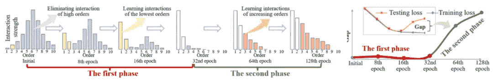

图 1：两阶段现象的示意图。在第一阶段， 神经网络 逐渐消除中高阶交互，学习低阶交互；在第二阶段， 神经网络 逐渐建模阶数不断增大的交互。当 神经网络 训练过程中测试损失和训练损失之间的 `loss gap` 开始增大时， 神经网络 恰好也进入训练的第二阶段。

我们希望在等效交互框架里提出新的理论，精确预测出 神经网络 每一个 时间点上 神经网络 所学到的交互概念的数量、复杂度，以及泛化性变化的动力学规律 （如图 1 所示）。具体地，我们希望证明出两方面结论。

第一，基于前人的证明（一个 神经网络 的决策 逻辑 可以被严格解构表示为几十个交互概念效用的和的形式），进一步严格推导出在整个训练过程中， 神经网络 所建模的交互效用的变化动力学过程 —— 即理论需精确预测出在不同训练阶段， 神经网络 所建模的交互概念的分布的变化 —— 推导出哪些交互会在哪个时间点上被学到 。

第二，寻找充分的证据，证明所推导的交互复杂度的变化规律 客观反映出 神经网络 在全训练周期中泛化性变化的规律 。

综上两点，我们希望具体彻底解释清楚 神经网络 的泛化性变化的内在根因。

与前人的关系：当然大家可能第一反应想到神经正切核（NTK）[2]，但是神经正切核只是把 参数 的变化曲线解了出来，而没办法进一步深入到决策 逻辑 层面进行解释，没有将 神经网络 建模的概念表征与其泛化性的关系建立起来，对泛化性的分析依然停留在特征空间分析的层面，而没有在【符号化概念 逻辑 】与【泛化性】之间建立起严格的关系。

## 三、两大研究背景

### 误会 1：神经网络 的第一性表征是『等效交互』，而不是 神经网络 的 参数 和结构

单纯从结构层面分析 神经网络 是人们对 神经网络 泛化根本表征的误解。目前大部分 神经网络 泛化性研究主要着眼于 神经网络 的结构、特征、以及数据。人们认为不同的 神经网络 结构就自然对应不同的函数，并自然展现出不同的性能。

但是，事实上，如图 2 所示，结构的区别只是 神经网络 表征的表面形式。除去有明显缺陷的对性能有明显影响的 神经网络 ，所有其他可以实现 SOTA 性能的具有不同结构的 神经网络 往往都建模了相似的等效交互表征，即不同结构的高性能 神经网络 在等效交互表征上往往都是殊途同归的 [3, 4]。虽然 神经网络 其中层特征内部是复杂的混乱的，虽然不同 神经网络 所建模的特征向量大相径庭，虽然 神经网络 中单个 神经元 往往建模了相对比较混乱的语义（不是严格清晰的语义），但是 神经网络 作为一个整体，我们从理论上证明 神经网络 的所建模的交互关系是稀疏的符号化的（而不是特征的稀疏性，具体见 “四、交互的定义” 章节），而且面向相同任务的完全不同的 神经网络 往往建模了相似的交互关系。

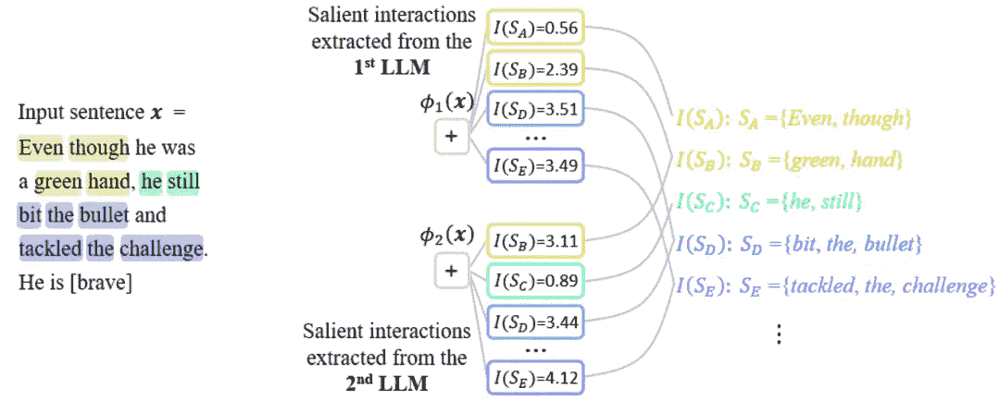

图 2：不同结构的 神经网络 所建模的等效交互往往是殊途同归的。对于一个相同的输入句子，面向两个相同任务的两个完全不同的 神经网络 建模往往相似的交互。

由于不同 神经网络 的 参数 和训练样本不一样，两个 神经网络 中没有任何一个 神经元 在表征上具有严格的一一对应关系，且每一个 神经元 往往建模着不同语义的混合模式。相比之下，正如上段分析， 神经网络 所建模的交互表征实际上是不同 神经网络 表征中的不变量。因此，我们有理由认为 神经网络 根本表征是等效交互，而不是其载体（ 参数 和训练样本），符号化交互表征可能代表了 知识表征 的第一性原理（被交互的稀疏性定理、无限拟合性定理、以及殊途同归现象所保证，见 “四、交互的定义” 章节，具体详细研究见下面 知乎 文章。

参见：https://zhuanlan.zhihu.com/p/633531725

### 误会 2：神经网络 的泛化性问题是一个 混合模型问题，而不是一个高维空间的向量

如图 3 所示，传统的泛化性分析总是假设单个样本整体是高维空间的一个点，实际上 神经网络 对单个样本的表征是 mixture model 的形式 —— 实际上通过大量不同的交互来表达。我们发现简单交互的泛化能力比复杂交互的泛化能力更强，所以不再适合用一个简单标量来笼统表示整个 神经网络 在不同样本上的泛化能力。相反，同一个 神经网络 在不同的样本上建模了不同复杂度的交互关系，而不同复杂度的交互往往对应着不同泛化能力。通常情况下， 神经网络 建模的高阶（复杂）的交互往往难以泛化到测试样本上（测试样本上不会触发相同的交互），代表 过拟合 表征，而 神经网络 建模的低阶（简单）交互往往代表泛化性较强的表征，具体详细研究见 [1]。

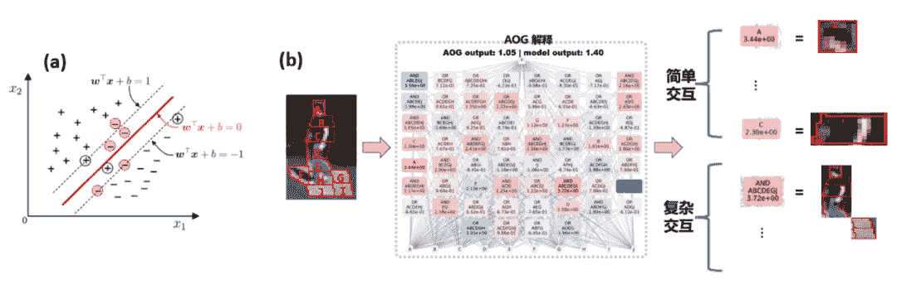

图 3：（a）传统的泛化性分析总是假设单个样本整体是高维空间的一个点。（b）实际上 神经网络 对单个样本的表征是 mixture model 的形式， 神经网络 在单个样本会建模简单交互（可泛化的交互）和复杂交互（不可泛化的交互）。

## 四、交互的定义

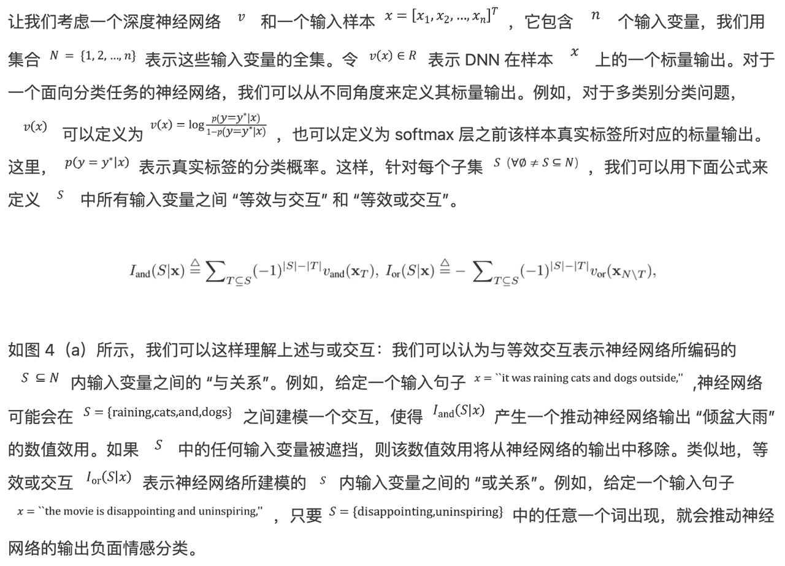

神经网络 所建模的等效交互满足 “理想概念” 的三条公理性准则，即无限拟合性、稀疏性、样本间迁移性。

### 1. 无限拟合性

如图 4，5 所示，对于任意遮挡样本， 神经网络 在样本上的输出可以用不同交互概念的效用之和来拟合。即，我们可以构造出一个基于交互的 logical model，无论我们如何遮挡输入样本，这个 logical model 依然可精确拟合模型在此输入样本在任意遮挡状态下的输出值。

### 2. 稀疏性

面向分类任务的 神经网络 往往只建模少量的显著交互概念，而大部分交互概念都是数值效用都接近于 0 的噪声。

### 3. 样本间迁移性

交互在不同样本间是可迁移的，即 神经网络 在（同一类别的）不同样本上建模的显著交互概念往往有很大的重合。

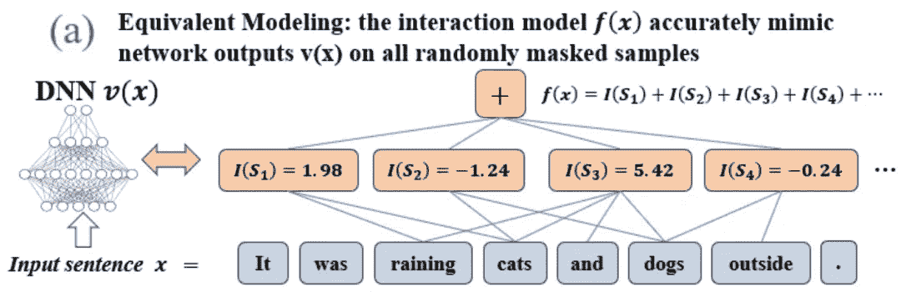

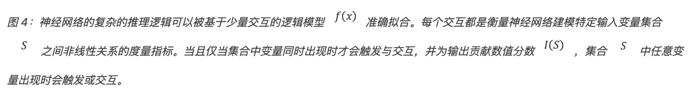

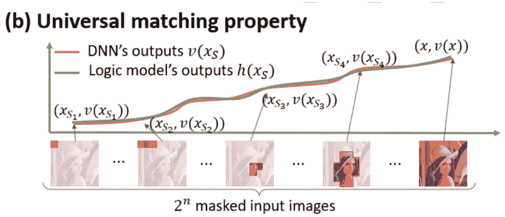

图 5： 神经网络 在任意的遮挡样本上的输出可以用不同交互概念的效用之和来拟合，即我们可以构造出一个基于交互的 logical model，无论我们如何遮挡输入样本，哪怕穷举个输入单元上种完全不同的遮挡方式，这个 logical model 依然可精确拟合模型在此输入样本在任意遮挡状态下的输出值。

## 五、新的发现与证明

### 5.1 发现 神经网络 在训练过程中交互变化的两阶段现象

在这篇 知乎 文章中，我们关注 神经网络 解释性领域的一个根本问题，即 如何从一个解析分析的角度去严格预测出 神经网络 在训练过程中泛化能力的变化情况，并且精确的分析 神经网络 从 欠拟合 到 过拟合 的整个动态变化过程及其背后的根本原因 。

首先，我们将交互的阶数（复杂度）定义为交互中的输入变量的数量，

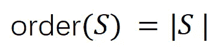

我们团队之前的工作发现 神经网络 在某个特定样本所建模的 “与或交互” 的复杂度直接决定了 神经网络 在这个样本的泛化能力 [1]，即 神经网络 建模的高阶的（大量输入单元之间的）“与或交互” 往往有较差的泛化能力，而低阶的（少量输入单元之间的）“与或交互” 具有较强的泛化能力。

因此，本篇研究的第一步是去 预测 出 神经网络 在训练过程中不同时间点所建模的不同阶 “与或交互” 的复杂度的一个解析解，即我们可以通过 神经网络 在不同时间点所建模的不同阶 “与或交互” 的分布去解释 神经网络 在不同阶段的泛化能力 。交互的泛化能力的定义与 神经网络 整体泛化能力的定义请见 “5.2 神经网络 所建模交互的阶数和其泛化能力的关系” 章节。

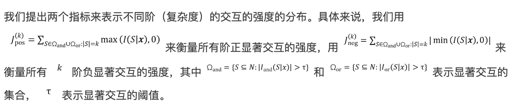

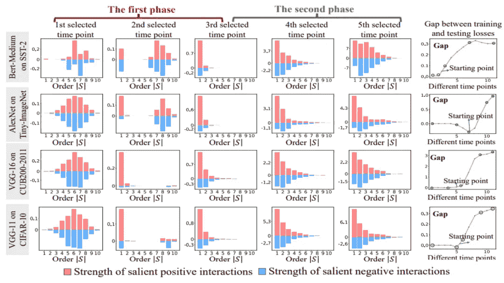

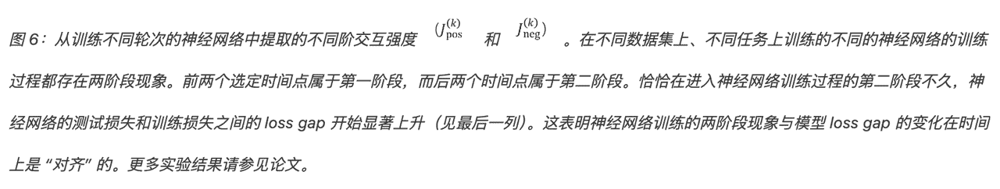

如图 6 所示， 神经网络 的两阶段现象具体表现为：

+ 在神经训练训练之前，初始化的 神经网络 主要编码中阶交互，很少编码高阶和低阶交互，并且不同阶交互的分布看起来呈现 “纺锤形”。假设具有随机初始化 参数 的 神经网络 建模的是纯噪声，我们在 “5.4 理论证明两阶段现象” 章节证明了具有随机初始化 参数 的 神经网络 建模的不同阶的交互的分布呈现 “纺锤形”，即仅建模少量的低阶和高阶交互，大量建模中阶交互。

+ 在 神经网络 训练的第一阶段 ， 神经网络 编码的高阶和中阶交互的强度逐渐减弱，而低阶交互的强度逐渐增强。最终，高阶和中阶交互逐渐被消除， 神经网络 只编码低阶交互。

+ 在 神经网络 训练的第二阶段 ， 神经网络 在训练过程中编码的交互阶数（复杂度）逐渐增加。在逐渐学习更高复杂度的交互的过程中， 神经网络 过拟合 的风险也在逐渐提高。

上述的两阶段现象广泛存在于不同结构的 神经网络 训练于不同任务上的不同数据集的训练过程中 。我们在图像数据集（CIFAR-10 数据集、MNIST 数据集、CUB200-2011 数据集（使用从图片中裁剪出来的鸟类图像）和 Tiny-ImageNet 数据集）上训练了 VGG -11/13/16 和 AlexNet。我们在 SST-2 数据集上训练了用于情感语义分类 Bert-Medium/Tiny 模型，我们在 ShapeNet 数据集中训练 DGCNN 来分类的 3D 点云数据。上图显示了不同的 神经网络 在不同训练时期提取的不同阶的显著交互的分布。我们在这些 神经网络 的训练过程中都发现了两阶段现象，更多实验结果及细节请参考论文。

### 5.2 神经网络 所建模交互的阶数和其泛化能力的关系

我们团队之前的工作已经发现了 神经网络 所建模交互的阶数和其泛化能力的关系，即高阶交互比低阶交互具有更差的泛化能力 [1]。某个具体交互的泛化性有清晰的定义 —— 如果一个交互同时在训练样本和测试样本中频繁的被 神经网络 所建模，则这个交互具有较好的泛化能力。在本篇 知乎 文章中，介绍了两个实验来证明高阶交互具有较差的泛化能力，低阶交互具有较强的泛化能力。

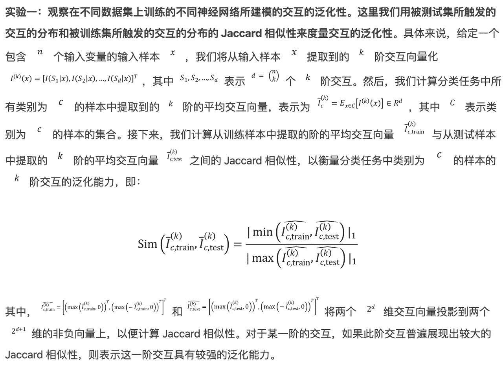

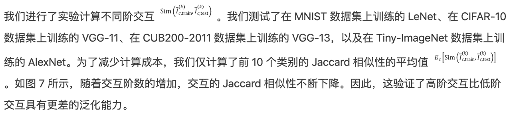

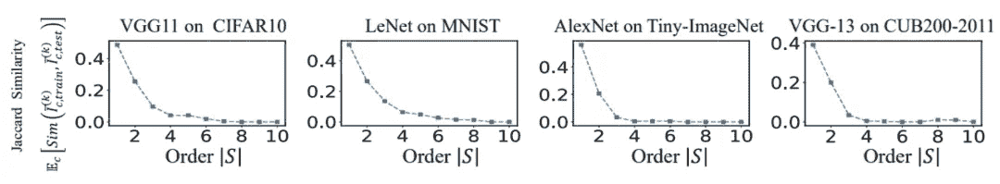

图 7：从训练样本和测试样本中提取的交互之间的 Jaccard 相似性。低阶交互具有相对较高 Jaccard 相似性表明低阶交互具有较强的泛化能力。

实验二：比较 神经网络 在正常样本和 OOD 样本建模的交互的分布 。我们比较了从正常样本中提取的交互与从分布外 (OOD) 样本中提取的交互，以检查 神经网络 在 OOD 样本上是否建模更多的高阶交互。我们将少量训练样本的分类标签设置为错误标签。这样，数据集中的原始样本可以视为正常样本，而一些带有错误标签的样本则对应于 OOD 样本，这些 OOD 样本可能会导致 神经网络 的 过拟合 。我们在 MNIST 数据集和 CIFAR-10 数据集上分别训练了 VGG -11 和 VGG -13。图 8 比较了从正常样本中提取的交互的分布和从 OOD 样本中提取的交互的分布。我们发现， VGG -11 和 VGG -13 在分类 OOD 样本时建模了更多复杂的交互（高阶交互），而在分类正常样本时则使用了较低阶的交互。这验证了高阶交互的泛化能力通常弱于低阶交互。

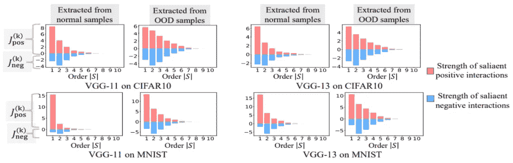

图 8：比较从正常样本中提取的交互与从分布外 (OOD) 样本中提取的交互。 神经网络 通常在 OOD 样本上建模的更高阶的交互。

### 5.3 两阶段现象和 神经网络 训练过程 `loss gap` 的变化相对齐

我们发现上述两阶段现象可以充分表示 神经网络 泛化性动力学。一个很有趣的现象是 神经网络 训练过程中的两阶段现象和 神经网络 在测试集和训练集的 loss gap 的变化在时间上是对齐的 。训练损失和测试损失之间的 loss gap 是衡量模型 过拟合 程度的最广泛使用的指标。图 6 显示了不同的 神经网络 在训练工程的测试损失和训练损失之间的 loss gap 的曲线，还显示了从不同训练时期的 神经网络 中提取的交互分布。我们发现当 神经网络 训练过程中测试损失和训练损失之间的 loss gap 开始增大时， 神经网络 恰好也进入训练的第二阶段。这表明 神经网络 训练的两阶段现象与模型 loss gap 的变化在时间上是 “对齐” 的。

我们可以这样理解上述现象：在训练过程开始前，初始化的 神经网络 所建模的交互全部表示随机噪声，并且不同阶交互的分布看起来像 “纺锤形”。在 神经网络 训练的第一阶段， 神经网络 逐渐消除中阶和高阶的交互，并学习最简单的（最低阶的）交互。然后，在 神经网络 训练的第二阶段， 神经网络 建模了阶数逐渐增大的交互。由于我们在 “5.2 神经网络 所建模交互的阶数和其泛化能力的关系” 章节中的两个实验验证了高阶交互通常比低阶交互具有更差的泛化能力，因此我们可以认为在 神经网络 训练的第二阶段，DNN 首先学习了泛化能力最强的交互，然后逐渐转向更复杂但泛化能力较弱的交互。最终一些 神经网络 逐渐 过拟合 ，并编码了大量中阶和高阶交互。

## 5.4 理论证明两阶段现象

理论证明 神经网络 训练过程的两阶段现象共分为三个部分，第一部分我们需要证明随机初始化的 神经网络 在训练过程开始之前建模的交互的分布呈现 “纺锤形”，即很少建模高阶和低阶交互，主要建模中阶交互。第二部分证明 神经网络 在训练的第二阶段在建模阶数逐渐增大的交互。第三部分证明 神经网络 在训练的第一阶段逐渐消除中阶和高阶交互，学习最低价的交互。

1. 证明初始化 神经网络 建模的 “纺锤形” 交互分布。

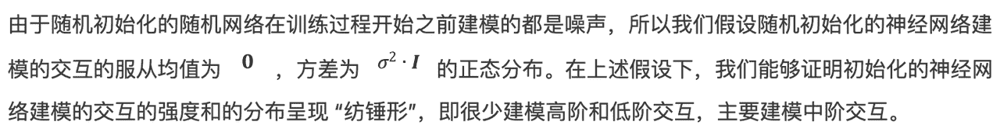

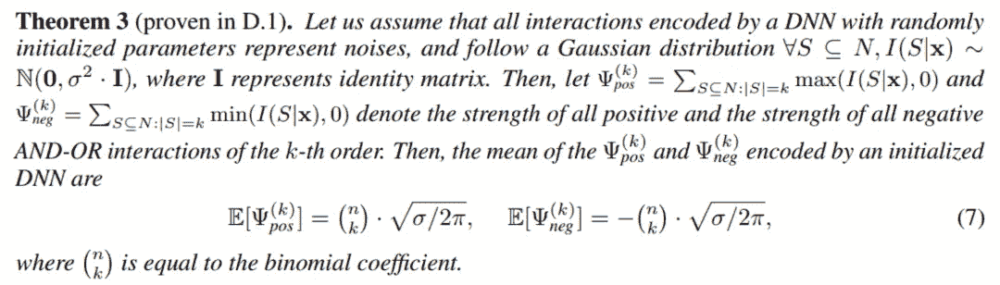

2. 证明 神经网络 训练的第二阶段的交互变化动态过程。

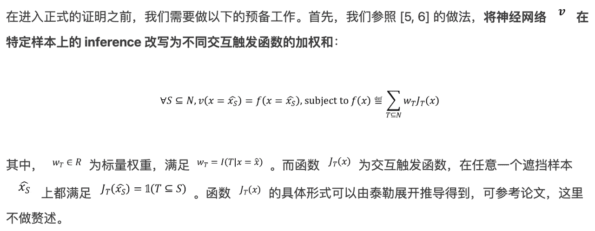

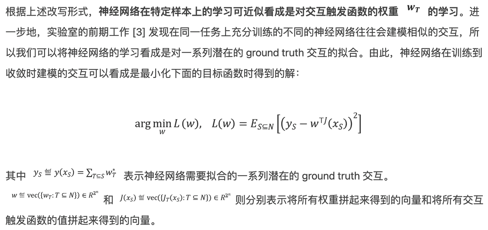

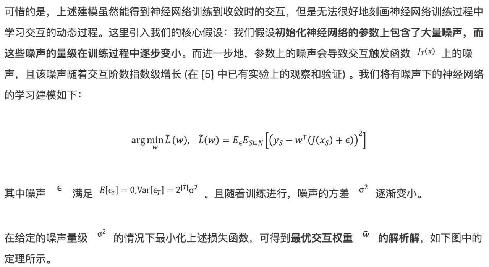

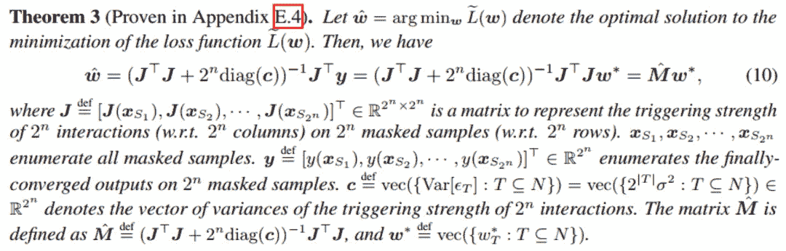

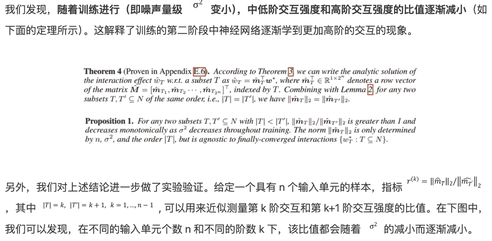

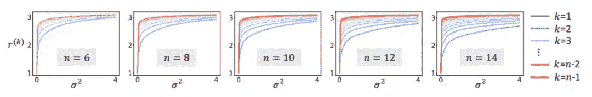

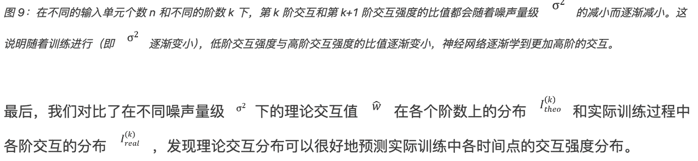

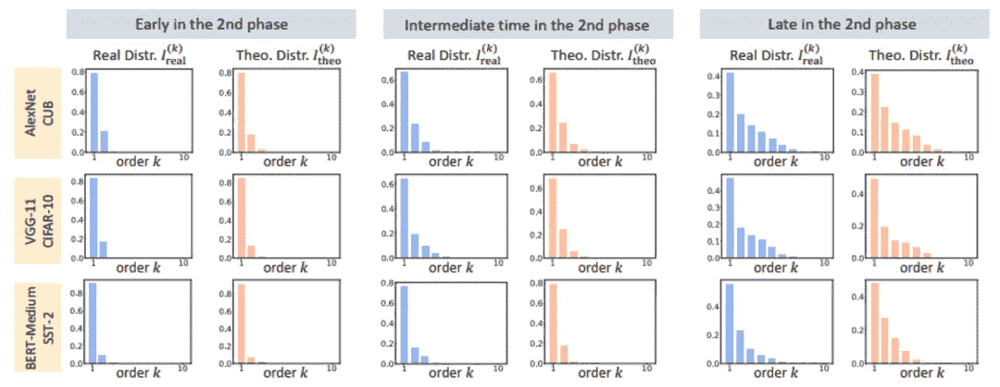

3. 证明 神经网络 训练的第一阶段的交互变化动态过程。

路漫漫其修远兮，我们团队是做 神经网络 可解释性的第一性原理，我们希望在更多的方面把这个理论做扎实，能够严格证明等效交互是符号化的解释，并且能够解释 神经网络 的泛化性、鲁棒性，同时证明 神经网络 表征瓶颈，统一 12 种提升 神经网络 对抗迁移性的方法和解释 14 种重要性估计方法。我们后面会做出更扎实的工作，进一步完善理论体系 。

[1] Huilin Zhou, Hao Zhang, Huiqi Deng, Dongrui Liu, Wen Shen, Shih-Han Chan, and Quanshi Zhang. Explaining generalization power of a dnn using interactive concepts. AAAI, 2024

[2] Arthur Jacot, Franck Gabriel, Clement Hongler. Neural tangent kernel: Convergence and generalization in neural networks. NeurIPS, 2018

[3] Mingjie Li, and Quanshi Zhang. Does a Neural Network Really Encode Symbolic Concept? ICML, 2023

[4] Wen Shen, Lei Cheng, Yuxiao Yang, Mingjie Li, and Quanshi Zhang. Can the Inference Logic of Large Language Models be Disentangled into Symbolic Concepts?

[5] Qihan Ren, Huiqi Deng, Yunuo Chen, Siyu Lou, and Quanshi Zhang. Bayesian Neural Networks Tend to Ignore Complex and Sensitive Concepts. ICML, 2023

[6] Dongrui Liu, Huiqi Deng, Xu Cheng, Qihan Ren, Kangrui Wang, and Quanshi Zhang. Towards the Difficulty for a Deep Neural Network to Learn Concepts of Different Complexities. NeurIPS, 2023

### 等效交互理论体系

[1] Huiqi Deng, Na Zou, Mengnan Du, Weifu Chen, Guocan Feng, Ziwei Yang, Zheyang Li, and Quanshi Zhang. Unifying Fourteen Post-Hoc Attribution Methods With Taylor Interactions. IEEE Transactions on Pattern Analysis and Machine Intelligence (IEEE T-PAMI), 2024.

[2] Xu Cheng, Lei Cheng, Zhaoran Peng, Yang Xu, Tian Han, and Quanshi Zhang. Layerwise Change of Knowledge in Neural Networks. ICML, 2024.

[3] Qihan Ren, Jiayang Gao, Wen Shen, and Quanshi Zhang. Where We Have Arrived in Proving the Emergence of Sparse Interaction Primitives in AI Models. ICLR, 2024.

[4] Lu Chen, Siyu Lou, Benhao Huang, and Quanshi Zhang. Defining and Extracting Generalizable Interaction Primitives from DNNs. ICLR, 2024.

[5] Huilin Zhou, Hao Zhang, Huiqi Deng, Dongrui Liu, Wen Shen, Shih-Han Chan, and Quanshi Zhang. Explaining Generalization Power of a DNN Using Interactive Concepts. AAAI, 2024.

[6] Dongrui Liu, Huiqi Deng, Xu Cheng, Qihan Ren, Kangrui Wang, and Quanshi Zhang. Towards the Difficulty for a Deep Neural Network to Learn Concepts of Different Complexities. NeurIPS, 2023.

[7] Quanshi Zhang, Jie Ren, Ge Huang, Ruiming Cao, Ying Nian Wu, and Song-Chun Zhu. Mining Interpretable AOG Representations from Convolutional Networks via Active Question Answering. IEEE Transactions on Pattern Analysis and Machine Intelligence (IEEE T-PAMI), 2020.

[8] Xin Wang, Jie Ren, Shuyun Lin, Xiangming Zhu, Yisen Wang, and Quanshi Zhang. A Unified Approach to Interpreting and Boosting Adversarial Transferability. ICLR, 2021.

[9] Hao Zhang, Sen Li, Yinchao Ma, Mingjie Li, Yichen Xie, and Quanshi Zhang. Interpreting and Boosting Dropout from a Game-Theoretic View. ICLR, 2021.

[10] Mingjie Li, and Quanshi Zhang. Does a Neural Network Really Encode Symbolic Concept? ICML, 2023.

[11] Lu Chen, Siyu Lou, Keyan Zhang, Jin Huang, and Quanshi Zhang. HarsanyiNet: Computing Accurate Shapley Values in a Single Forward Propagation. ICML, 2023.

[12] Qihan Ren, Huiqi Deng, Yunuo Chen, Siyu Lou, and Quanshi Zhang. Bayesian Neural Networks Avoid Encoding Perturbation-Sensitive and Complex Concepts. ICML, 2023.

[13] Jie Ren, Mingjie Li, Qirui Chen, Huiqi Deng, and Quanshi Zhang. Defining and Quantifying the Emergence of Sparse Concepts in DNNs. CVPR, 2023.

[14] Jie Ren, Mingjie Li, Meng Zhou, Shih-Han Chan, and Quanshi Zhang. Towards Theoretical Analysis of Transformation Complexity of ReLU DNNs. ICML, 2022.

[15] Jie Ren, Die Zhang, Yisen Wang, Lu Chen, Zhanpeng Zhou, Yiting Chen, Xu Cheng, Xin Wang, Meng Zhou, Jie Shi, and Quanshi Zhang. A Unified Game-Theoretic Interpretation of Adversarial Robustness. NeurIPS, 2021.

[16] Wen Shen, Qihan Ren, Dongrui Liu, and Quanshi Zhang. Interpreting Representation Quality of DNNs for 3D Point Cloud Processing. NeurIPS, 2021.

[17] Xin Wang, Shuyun Lin, Hao Zhang, Yufei Zhu, and Quanshi Zhang. Interpreting Attributions and Interactions of Adversarial Attacks. ICCV, 2021.

[18] Wen Shen, Zhihua Wei, Shikun Huang, Binbin Zhang, Panyue Chen, Ping Zhao, and Quanshi Zhang. Verifiability and Predictability: Interpreting Utilities of Network Architectures for 3D Point Cloud Processing. CVPR, 2021.

[19] Hao Zhang, Yichen Xie, Longjie Zheng, Die Zhang, and Quanshi Zhang. Interpreting Multivariate Shapley Interactions in DNNs. AAAI, 2021.

[20] Die Zhang, Huilin Zhou, Hao Zhang, Xiaoyi Bao, Da Huo, Ruizhao Chen, Xu Cheng, Mengyue Wu, and Quanshi Zhang. Building Interpretable Interaction Trees for Deep NLP Models. AAAI, 2021.
