# 投机采样会损失大语言模型的推理精度吗？

> 来源：[https://agijuejin.feishu.cn/docx/E9lTdETE3orwEXx5xljcZ13NnUd](https://agijuejin.feishu.cn/docx/E9lTdETE3orwEXx5xljcZ13NnUd)

> 机器之心｜ [阅读原文](https://www.jiqizhixin.com/articles/2024-08-08-2)

> 转载请联系原作者取得授权

Mit[chell](https://arxiv.org/abs/2311.08252) S[tern 等人](https://arxiv.org/abs/2401.10774)于 [2018 年](https://arxiv.org/pdf/2401.15077)提出了投机采样的原型概念。这种方法后来被各种工作进一步发展和完善，包括 Lookahead Decoding 、 REST 、 Medusa 和 EAGLE ，投机采样显著加快了大型语言模型 (LLM) 的推理过程。

一个重要的问题是：LLM 中的投机采样会损害原始模型的准确性吗？先说答案：不会。

标准的投机采样算法是无损的，本文将通过数学分析和实验来证明这一点。

**数学证明**

投机采样公式可以定义如下：

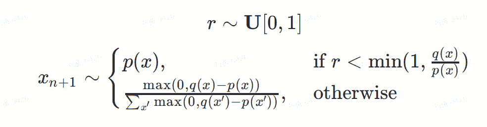

其中：

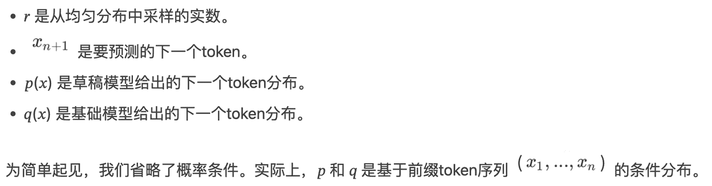

以下是 [DeepMind 论文 ](https://arxiv.org/pdf/2302.01318)中关于该公式无损性的证明：

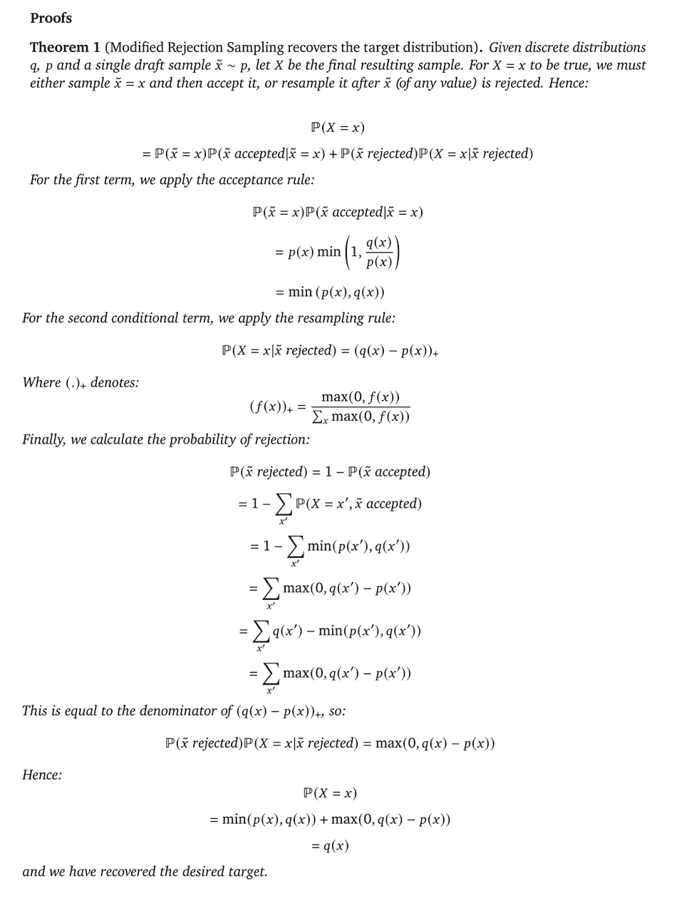

如果你觉得阅读数学方程式太枯燥，接下来我们将通过一些直观的图表来说明证明过程。

这是草稿模型 𝑝 和基础模型 𝑞 的分布示意图：

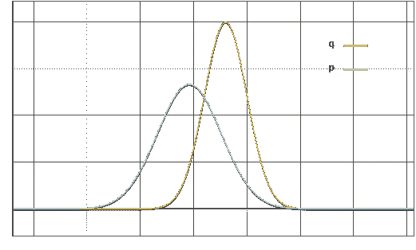

图1：草案模型p和基础模型q输出分布的概率密度函数

需要说明的是，这只是一个理想化的图表。在实践中，我们计算的是一个离散分布，它看起来像这样：

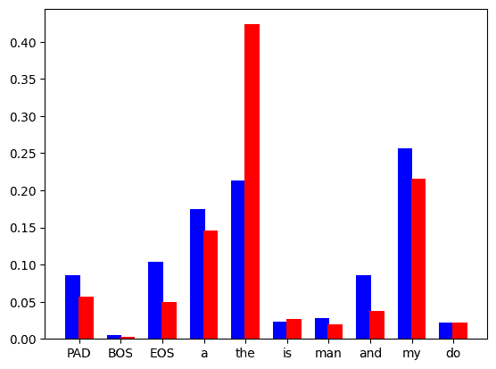

图2：语言模型预测词汇集中每个token的离散概率分布，蓝色条来自草稿模型，红色条来自基础模型。

然而，为了简单和清晰起见，我们使用它的连续近似来讨论这个问题。

现在的问题是：我们从分布 𝑝 中采样，但我们希望最终结果就像我们从 𝑞 中采样一样。一个关键思想是：将红色区域的概率搬运到黄色区域：

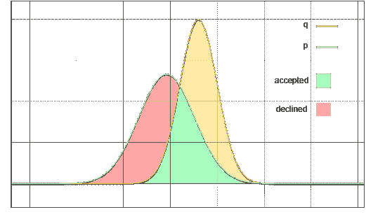

图3：接受和拒绝采样的区域

目标分布 𝑞 可以看作是两部分的总和：

I. 校验接受

该分支中有两个独立事件：

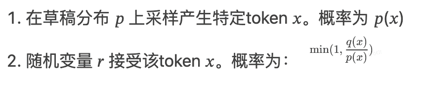

将这些概率相乘：

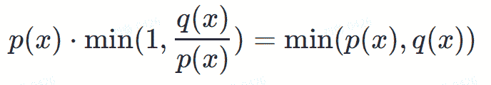

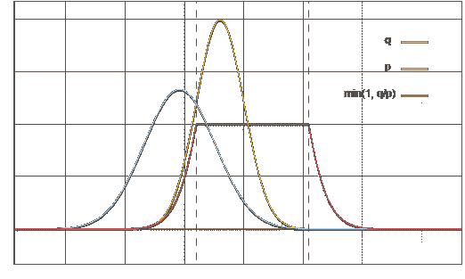

图4：将蓝线和红线相乘，结果是图6中的绿线

II. 校验拒绝

该分支中也有两个独立事件：

1.  𝑟 拒绝了 𝑝 中的某个token，概率为：

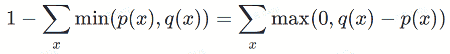

这是一个积分值，数值与特定token x 无关

1.  在分布 𝑞−𝑝（的正数部分）上采样产生特定token 𝑥，概率为：

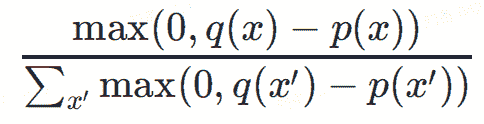

其分母作用是对概率分布进行归一化，以保持概率密度积分等于 1。

两项相乘，第二项的分母被约掉：

max(0,𝑞(𝑥)−𝑝(𝑥))

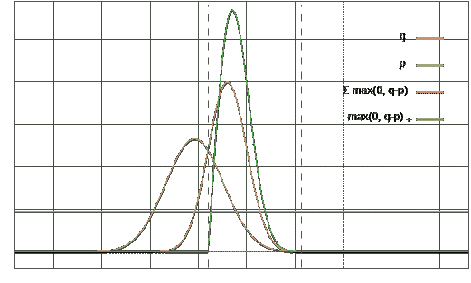

图5. 该图中的红线与绿线对应函数相乘，结果等于图6中的红线

为什么拒绝概率恰好可以归一化max(0,𝑞−𝑝) ？看起来似乎是巧合，这里一个重要的观察是，图 3 中红色区域的面积等于黄色区域的面积，因为所有概率密度函数的积分都等于 1。

将I, II两部分相加：

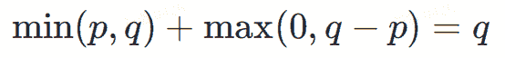

最后，我们得到了目标分布 𝑞。

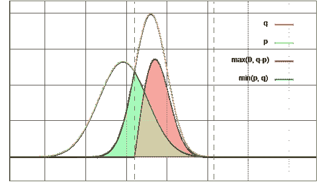

图6. 绿色区域与红色区域相加，正好等于黄线以下的面积

而这正是我们的目标。

**实验**

尽管我们已经从原理上证明了投机采样是无损的，但算法的实现仍然可能存在bug。因此，实验验证也是必要的。

我们对两种情况进行了实验：贪婪解码的确定性方法和多项式采样的随机方法。

**贪婪解码**

我们要求 LLM 生成两次短篇故事，首先使用普通推理，然后使用投机采样。两次采样温度均设[置为 0。我们使用了 Medu](https://huggingface.co/lmsys/vicuna-7b-v1.5)sa 中的投机采样实现。模型权重为 medusa-1.0-vicuna-7b-v1.5 及其基础模型 vicuna-7b-v1.5 。

测试运行完成后，我们得到了两个精确相同的结果。生成的文本如下：

**User **: Please tell a tale about a cyperpunk knight named PPIO keeps a charming llama as his pet.

**Assistant **: Once upon a time, in a world where technology had advanced beyond our wildest dreams, there lived a cyberpunk knight named PPIO. PPIO was a skilled warrior, with advanced cybernetic enhancements that gave him incredible strength and speed. He was also a man of great honor, always striving to do what was right and just.

One day, while out on a mission, PPIO stumbled upon a beautiful llama. Despite being a cybernetic being, PPIO had a soft spot for animals and he couldn't resist rescuing the llama from whatever danger it may have been in. From that day on, the llama followed PPIO wherever he went, and the two became fast friends.

The llama, whose name was Llama-ella, was a special llama. It had a unique ability to sense when someone was in danger and would let out a loud, distinctive call to alert them to the danger. PPIO was grateful for Llama-ella's ability and the two became an unstoppable team.

Together, PPIO and Llama-ella took on all sorts of challenges, from battling cybernetic villains to rescuing innocent people from harm. They were a force to be reckoned with, and their bravery and honor were an inspiration to all who knew them.

**多项式采样**

在随机采样的情况下，情况更加复杂。大多数在随机程序中重现结果的方法都使用固定的随机种子来利用伪随机生成器的确定性。但是，这种方法不适合我们的场景。我们的实验依赖于大数定律：如果有足够的样本，则实际分布与理论分布之间的误差将收敛于零。

我们编制了四个提示文本，对LLM在每个提示下生成的首个token进行了 1,000,000 次投机采样迭代。使用的模型权重为 Llama3 8B Instruct 和 EAGLE-LLaMA3-Instruct-8B 。统计结果如下所示：

|  |  |
| --- | --- |

|  |  |
| --- | --- |

+   蓝色：来自基础模型输出 logits 的 softmax

+   绿色：来自草稿模型输出 logits 的 softmax

+   橙色：来自投机采样（1,000,000 次）的首个token计数占比

基础模型输出结果与采样分布之间的标准差为 9.694e-5。符合预期。

**结论**

投机采样不会损害大型语言模型的推理精度。通过严格的数学分析和实际实验，我们证明了标准投机采样算法的无损性。其中数学证明说明了投机采样公式如何保留基础模型的原始分布。我们的实验，包括确定性贪婪解码和概率多项式采样，进一步验证了这些理论发现。贪婪解码实验在使用和不使用投机采样的情况下产生了相同的结果，而多项式采样实验表明，在大量样本中，token分布的差异可以忽略不计。

这些结果共同证明，投机采样可以显着加快 LLM 推理速度，而不会牺牲准确性，为未来更高效、更易于访问的 AI 系统铺平了道路。