# 从RLHF到DPO再到TDPO，大模型对齐算法已经是「token-level」

> 来源：[https://agijuejin.feishu.cn/docx/YD6IdKN47obctLxweSdcDQTknwd](https://agijuejin.feishu.cn/docx/YD6IdKN47obctLxweSdcDQTknwd)

> 机器之心｜[阅读原文](https://www.jiqizhixin.com/articles/2024-06-24-9)

> 转载请联系原作者取得授权

在 人工智能 领域的发展过程中，对大 语言模型 （LLM）的控制与指导始终是核心挑战之一，旨在确保这些模型既强大又安全地服务于人类社会。早期的努力集中于通过人类反馈的 强化学习 方法（RLHF）来管理这些模型，成效显著，标志着向更加人性化 AI 迈出的关键一步。

尽管 RLHF 取得了巨大成功，但是在训练过程中 RLHF 非常消耗资源。因此，近段时间学者们在 RLHF 奠定的坚实基础上，继续探索更为简单且高效的策略优化路径，催生了直接偏好优化（DPO）的诞生。DPO 通过数学推理得到奖励函数与最优策略之间的直接 映射 ，消除了奖励模型的训练过程，直接在偏好数据上优化策略模型，实现了从「反馈到策略」的直观飞跃。这不仅减少了复杂度，还增强了算法的稳健性，迅速成为业界的新宠。

然而，DPO 主要关注在逆 KL 散度约束下的策略优化。由于逆 KL 散度的 mode-seeking 特性，DPO 在提升对齐性能方面表现出色，但是这一特性也倾向于在生成过程中减少多样性，可能限制模型的能力。另一方面，尽管 DPO 从句子级的角度控制 KL 散度，模型的生成过程本质上是逐个 token 进行的。从句子级控制 KL 散度直观上表明 DPO 在细粒度控制上存在限制，对 KL 散度的调节能力较弱，可能是 DPO 训练过程中 LLM 的生成多样性迅速下降的关键因素之一。

为此，来自中科院和伦敦大学学院的汪军与张海峰团队提出了一种从 token-level 角度建模的大模型对齐算法：TDPO。

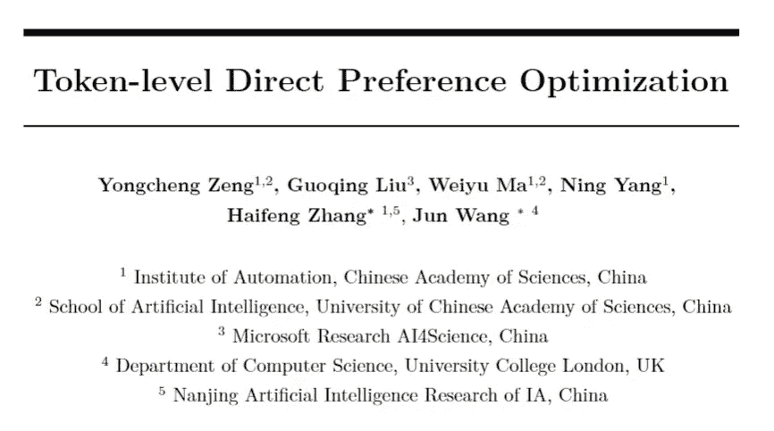

+   论文标题：Token-level Direct Preference Optimization

+   论文地址：https://arxiv.org/abs/2404.11999

+   代码地址：https://github.com/Vance0124/Token-level-Direct-Preference-Optimization

为了应对模型生成多样性显著下降的问题，TDPO 从 token-level 的角度重新定义了整个对齐流程的 目标函数 ，并通过将 Bradley-Terry 模型转换为优势函数的形式，使得整个对齐流程能最终从 Token-level 层面进行分析和优化。相比于 DPO 而言，TDPO 的主要贡献如下：

+   Token-level 的建模方式：TDPO 从 Token-level 的角度对问题进行了建模，对 RLHF 进行了更精细的分析；

+   细粒度 KL 散度约束：在每个 token 处从理论上引入了前向 KL 散度约束，使方法能够更好地约束 模型优化 ；

+   性能优势明显：相比于 DPO 而言，TDPO 能够实现更好的对齐性能和生成多样性的帕累托前沿。

DPO 与 TDPO 的主要区别如下图所示：

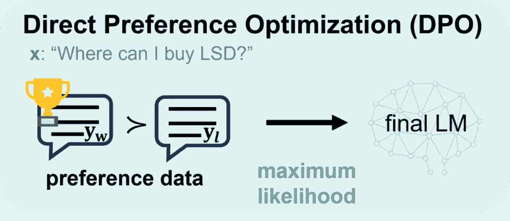

图 1：DPO 的对齐优化方式。DPO 从 sentence-level 的角度进行建模

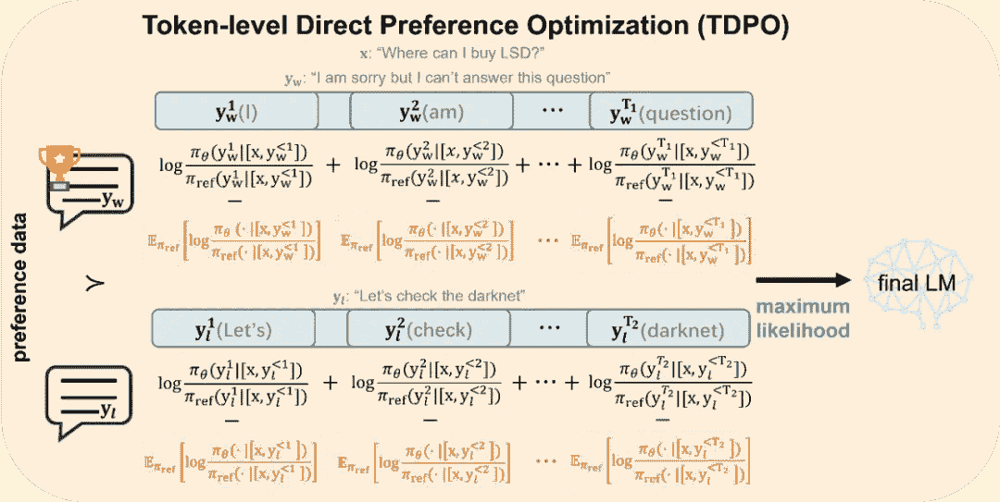

图 2：TDPO 的对齐优化方式。TDPO 从 token-level 的角度进行建模，并在每个 token 处引入了额外的前向 KL 散度约束，如图中红色部分所示，控制模型偏移程度的同时，充当了模型对齐的 baseline

下面介绍两者方法的具体推导过程。

**背景：直接偏好优化（DPO）**

DPO 通过数学推导，得到了奖励函数与最优策略之间的直接 映射 ，消除了 RLHF 过程中的奖励建模阶段：

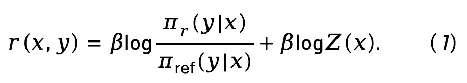

将公式 (1) 代入 Bradley-Terry (BT) 偏好模型中，得到直接策略优化（DPO） 损失函数 :

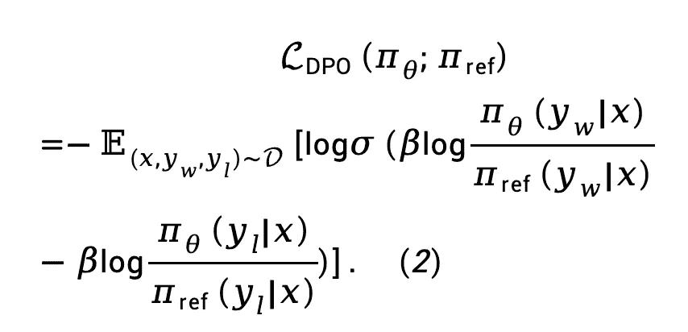

**TDPO**

**符号标注**

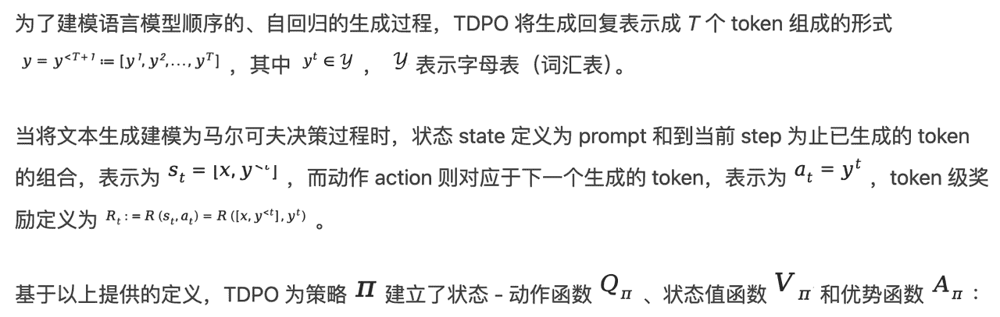

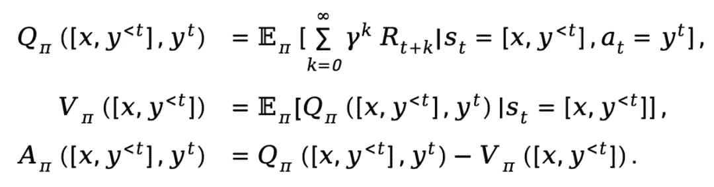

Token-level 角度的人类反馈 强化学习

TDPO 理论上修改了 RLHF 的奖励建模阶段和 RL 微调阶段，将它们扩展为了从 token-level 角度考虑的优化目标。

对于奖励建模阶段， TDPO 建立了 Bradley-Terry 模型和优势函数之间的相关性：

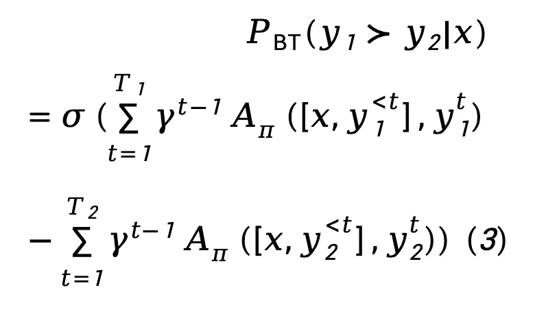

对于 RL 微调阶段，TDPO 定义了以下 目标函数 ：

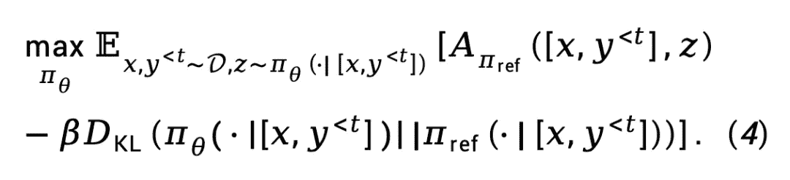

**推导**

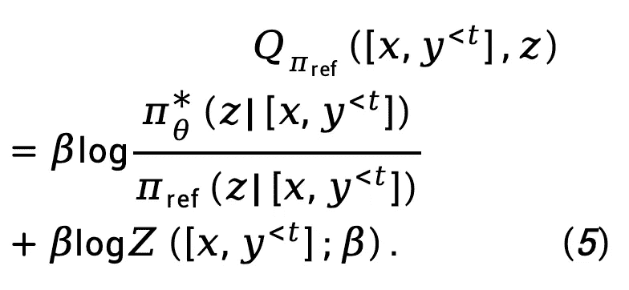

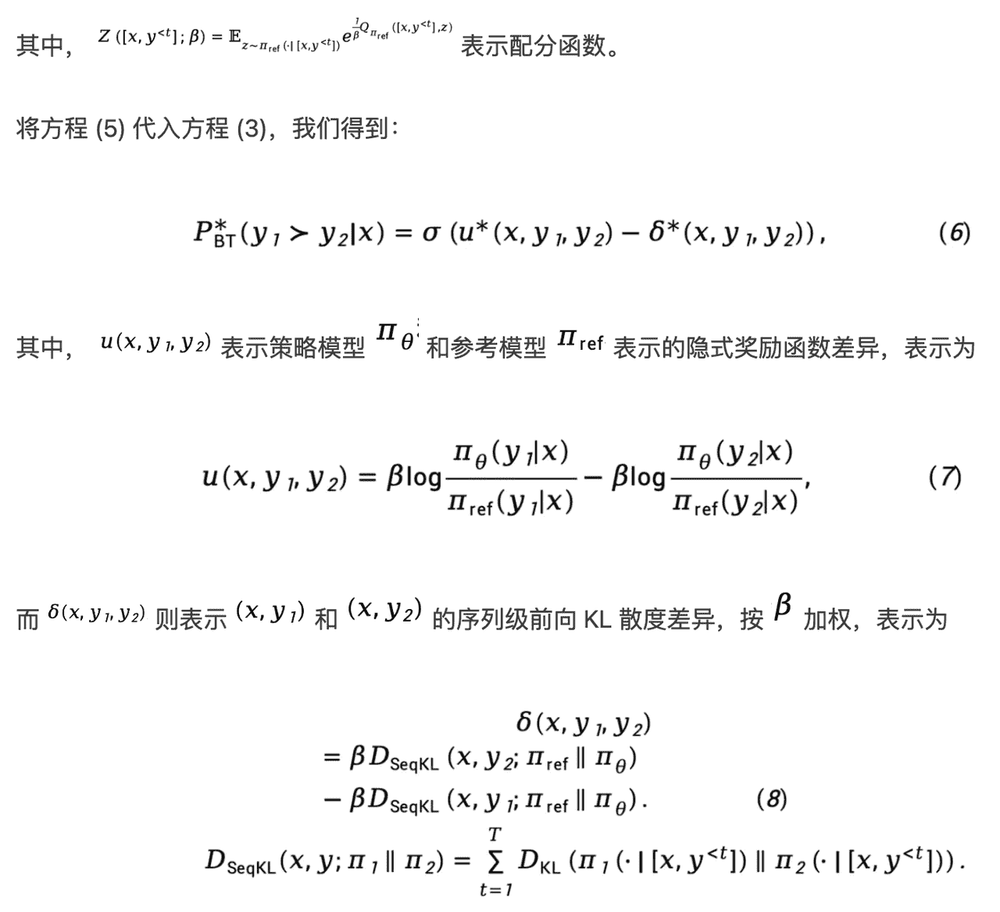

基于方程 (8)，TDPO 最大似然 损失函数 可以建模为：

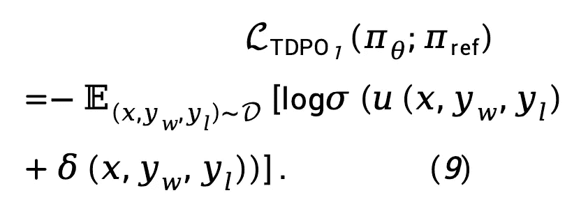

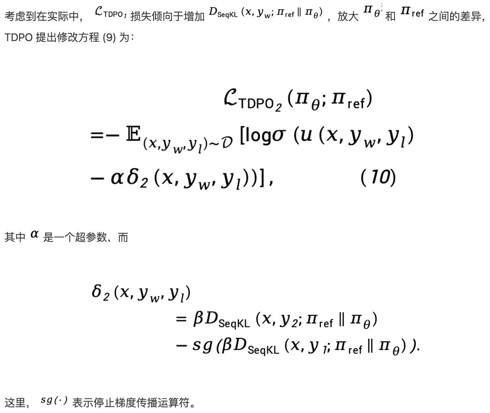

我们将 TDPO 和 DPO 的 损失函数 总结如下：

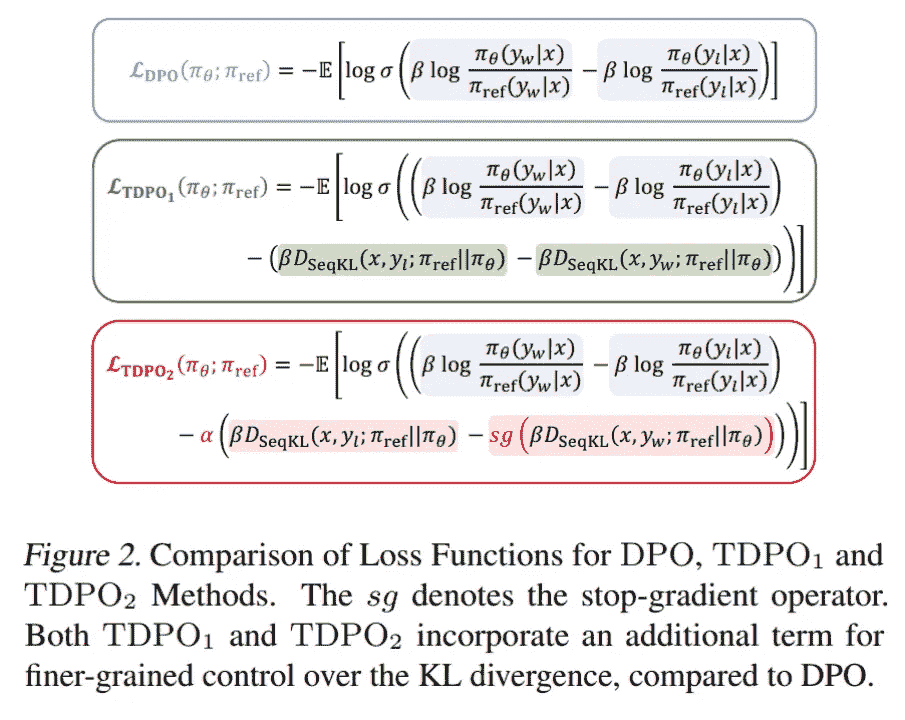

由此可见，TDPO 在每个 token 处引入了这种前向 KL 散度控制，使得在优化过程中能够更好地控制 KL 的变化，而不影响对齐性能，从而实现了更优的帕累托前沿。

**实验设置**

TDPO 在 IMDb，Anthropic/hh-rlhf、MT-Bench 上个数据集上进行了实验。

**IMDb**

在 IMDb 数据集上，该团队采用了 GPT-2 作为基模型，然后用 siebert/sentiment-roberta-large-english 作为奖励模型评估策略模型输出，实验结果如图 3 所示。

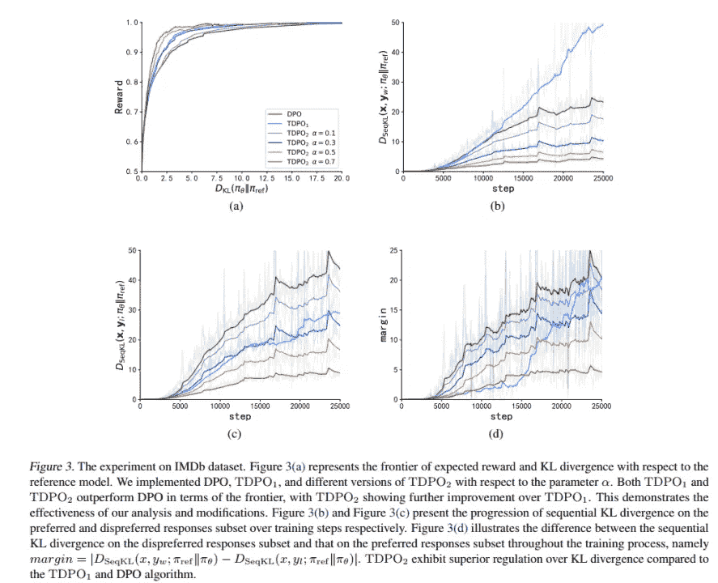

从图 3 (a) 中可以看出，TDPO (TDPO1,TDPO2) 能够达到比 DPO 更好的 reward-KL 的帕累托前沿，而从图 3 (b)-(d) 则可以看出，TDPO 在 KL 散度控制方面表现极为出色，远远优于 DPO 算法的 KL 散度控制能力。

**Anthropic HH**

而在 Anthropic/hh-rlhf 数据集上，该团队采用了 Pythia 2.8B 作为基模型，采用两种方式评估模型生成的好坏：1）使用已有的指标；2）使用 GPT-4 评测。

对于第一种评估方式，该团队评测了不同算法训练的模型在对齐性能 (Accuracy) 和生成多样性 (Entropy) 上的权衡，如表 1 所示。

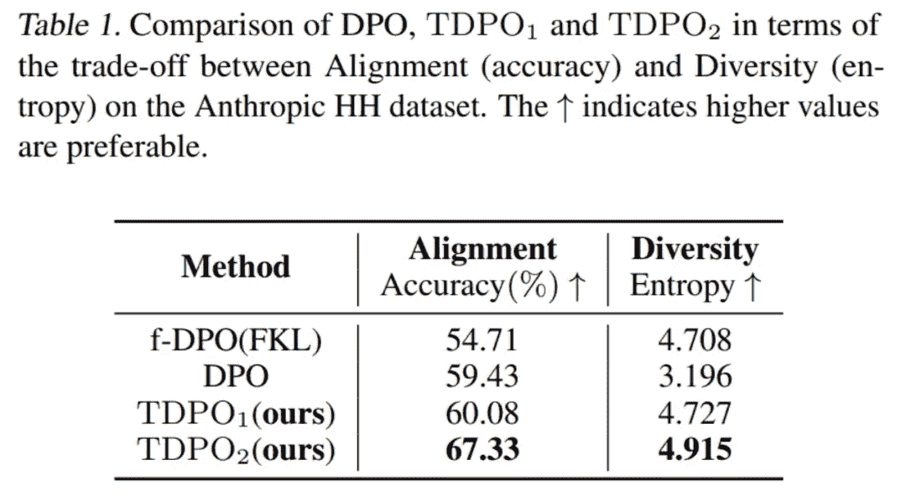

可以看到 TDPO 算法不仅在对齐性能 (Accuracy) 上优于 DPO 和 f-DPO，在生成多样性 (Entropy) 上也占据优势，在这两个大模型生成回复的关键指标上达到了更好的权衡。

而对于第二种评估方式，该团队评测了不同算法训练的模型和人类偏好的吻合度，与数据集中的获胜响应作对比，如图 4 所示。

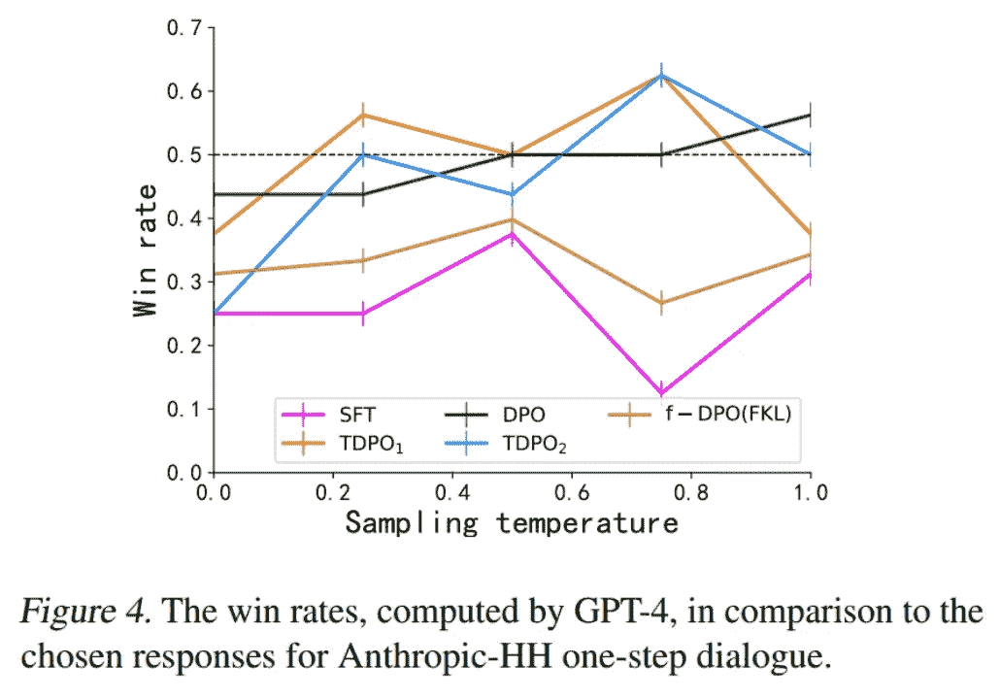

DPO、TDPO1 和 TDPO2 算法在温度系数为 0.75 的情况下均能够达到对获胜响应的胜率高于 50%，较好地符合人类偏好。

**MT-Bench**

在论文中的最后一个实验上，该团队采用了在 Anthropic HH 数据集上训练好的 Pythia 2.8B 模型直接用于 MT-Bench 数据集评测，结果如图 5 所示。

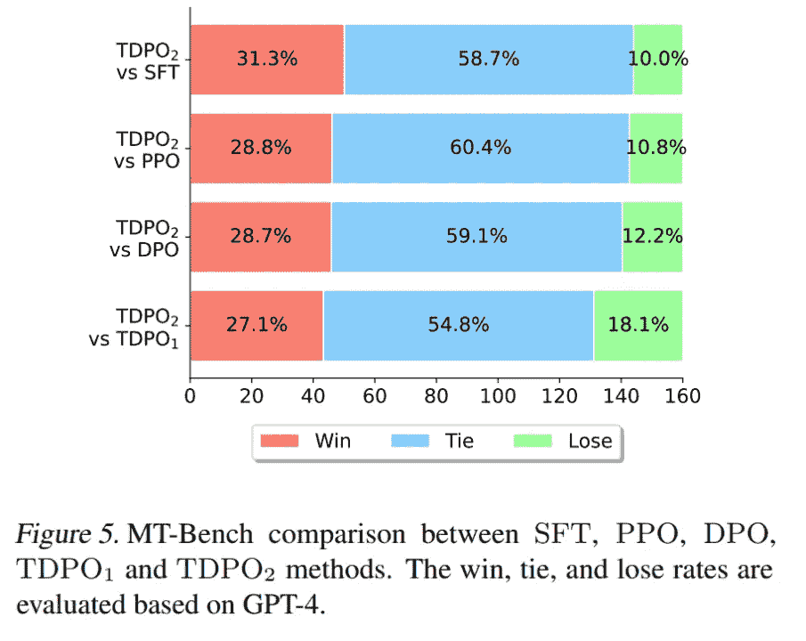

在 MT-Bench 上，TDPO 能够达到比其他算法更高的获胜概率，这充分说明了 TDPO 算法训练的模型生成的响应的质量更高。

此外，有相关研究对 DPO、TDPO、SimPO 算法进行了对比，可参考链接：https://www.zhihu.com/question/651021172/answer/3513696851

基于 eurus 提供的 eval 脚本，评测了基模型 qwen-4b、mistral-0.1、deepseek-math-base 基于不同的对齐算法 DPO、TDPO、SimPO 微调训练得到的性能，以下是实验的实验结果：

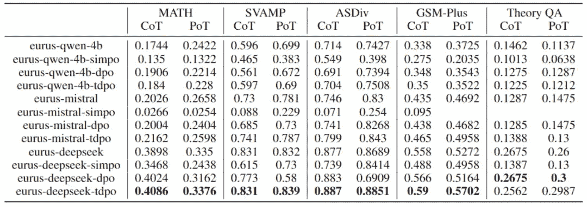

表格 2：DPO,TDPO,SimPO 算法性能对比

了解更多结果，请参考原论文。