# 不做数值运算、纯靠嘴炮也能机器学习？基于自然语言的全新ML范式来了

> 来源：[https://agijuejin.feishu.cn/docx/CgAZdBg1koqweHxSVYwcIaKMn7f](https://agijuejin.feishu.cn/docx/CgAZdBg1koqweHxSVYwcIaKMn7f)

> 机器之心｜[阅读原文](https://www.jiqizhixin.com/articles/2024-06-21-6)

> 转载请联系原作者取得授权

**本文作**者肖镇中是德国马克思普朗克-智能系统研究所和图宾根大学的博士生，Robert Bamler 是图宾根大学 机器学习 方向的教授，Bernhard Schölkopf 是马克思普朗克-智能系统研究所的所长，刘威杨是马普所剑桥大学联合项目的研究员。

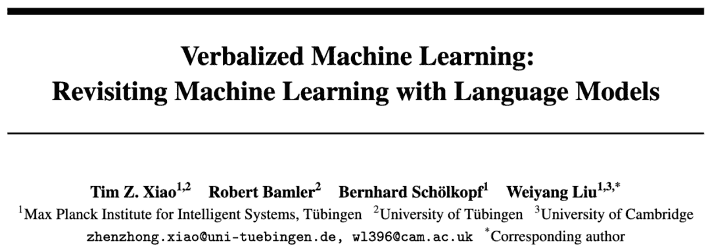

论文地址：https://arxiv.org/abs/2406.04344

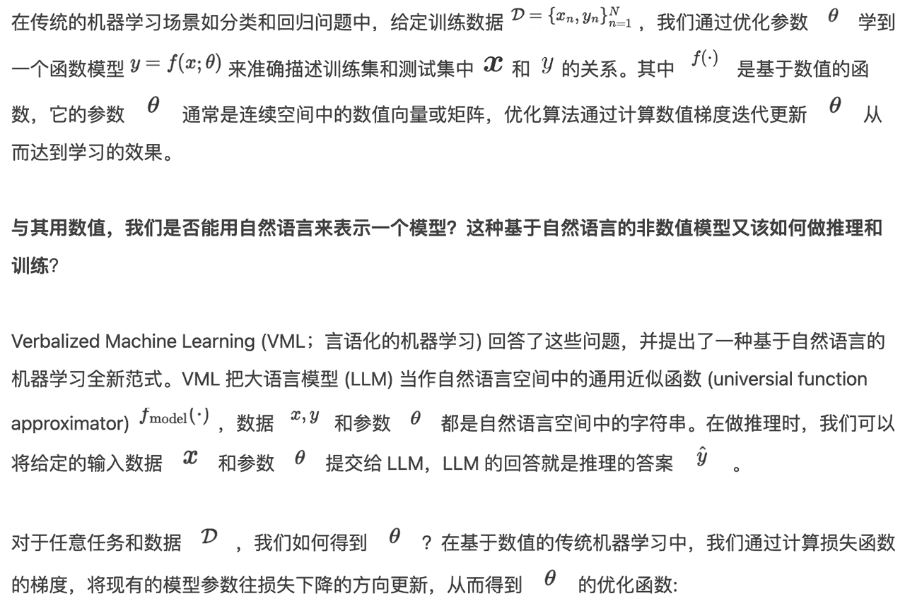

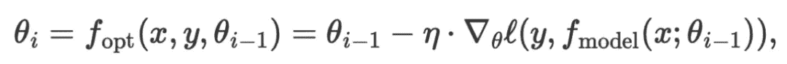

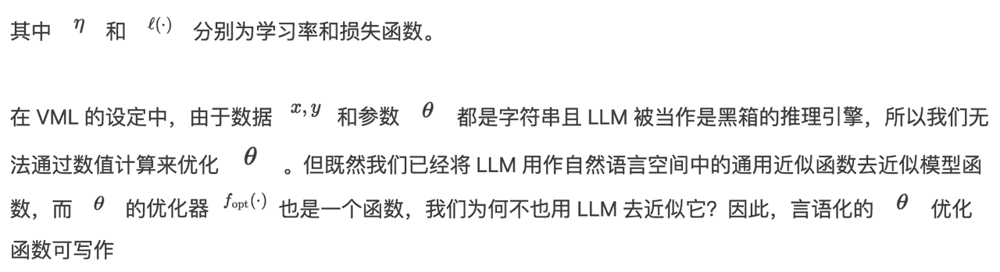

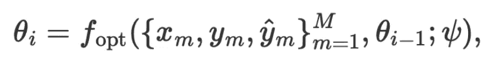

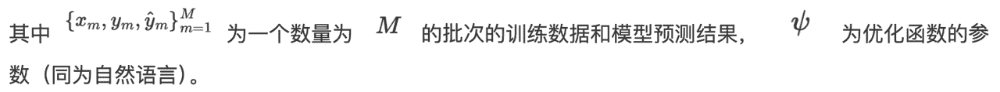

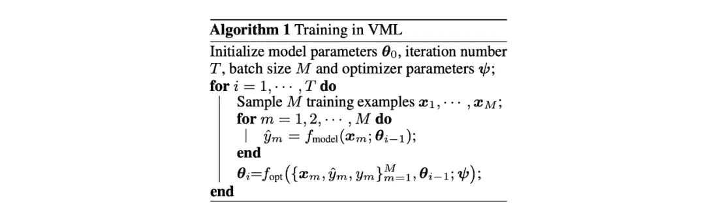

图 1：VML 的训练算法。

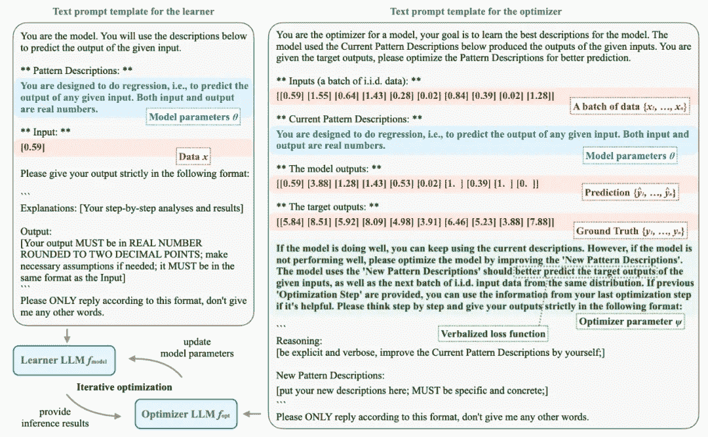

图 2：VML 中模型和 优化器 的自然语言模版样例。

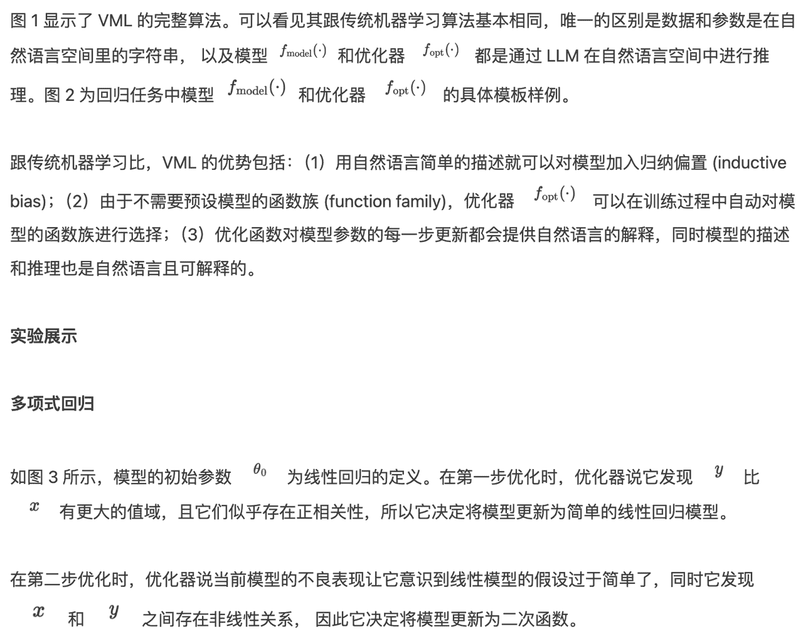

第三步优化时， 优化器 的关注点从函数族选择转换成二次函数的 参数 修改。最终模型学到了真实函数很接近的结果。

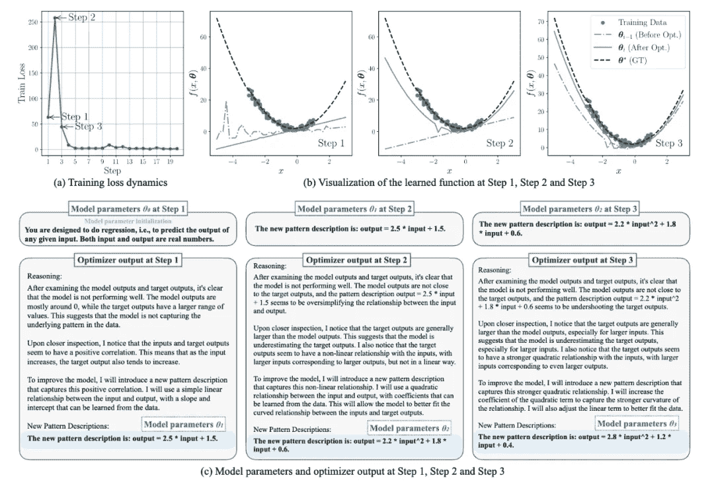

图 3: VML 在 多项式回归 任务中的训练过程记录。

**非线性二维平面分类**

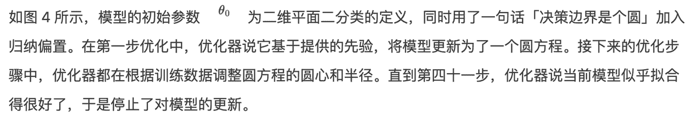

同时，我们也可以看见在不加归纳偏置的情况下，VML 也能学到一个基于决策树的不错的模型，但相比之下训练损失的波动更大。

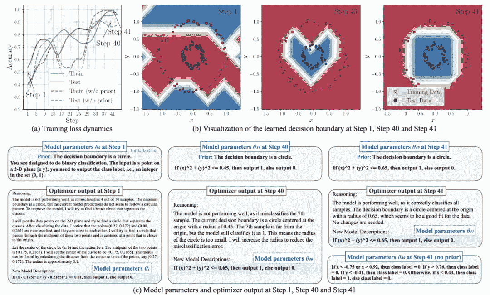

图 4: VML 在非线性二维平面分类任务中的训练过程记录。

**医疗图像二分类**

如果大模型接受多模态输入，如图片和文字，那 VML 也可以用在图片任务上。这个实验中，我们使用了 GPT-4o 和 PneumoniaMNIST 数据集，做了一个 X 光片肺炎检测的任务。

仔细观察第五十步后的模型 参数 ，我们可以看到加了归纳偏置的模型描述中包含了很多与肺炎相关的医学词汇，比如「感染」、「发炎」；而没有加归纳偏置的模型描述中只有对肺部 X 光片的特征描述，比如「透明度」、「对称」。

同时，这些模型所学到的描述，都是可以被具备专业知识的医生验证的。这种可解释和人工检验的 机器学习 模型在以安全为重的医疗场景下十分有价值。

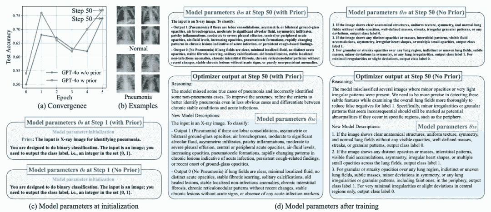

图 5: VML 在 PneumoniaMNIST 图片二分类上的训练记录。

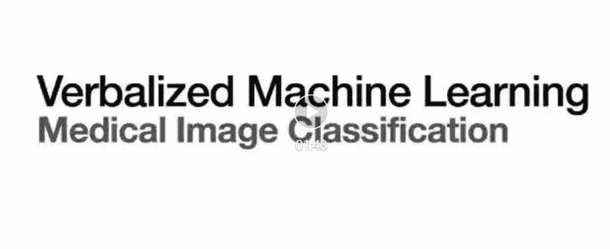

**结语**

该文章介绍了一种基于大 语言模型 的 机器学习 新范式 Verbalized Machine Learning (VML; 言语化的 机器学习 )，并在回归和分类任务上展示了 VML 的有效性和可解释性的特点。