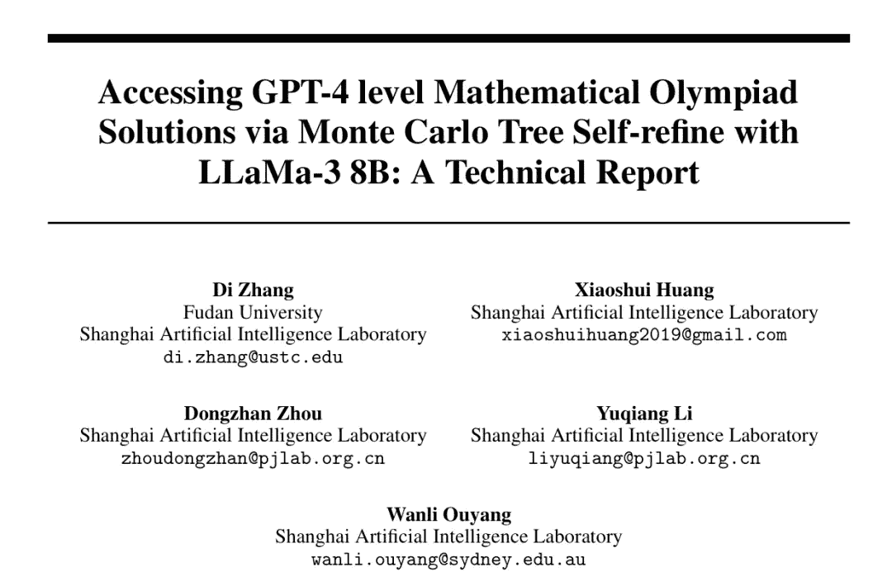
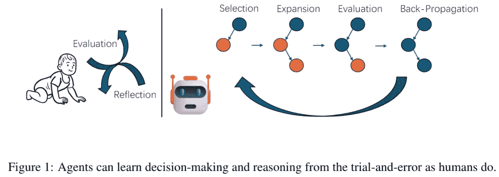
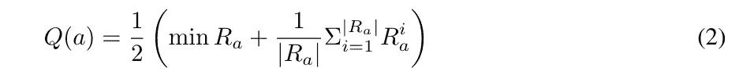
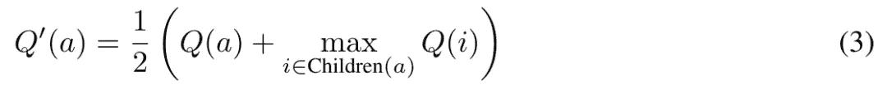
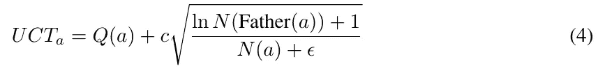
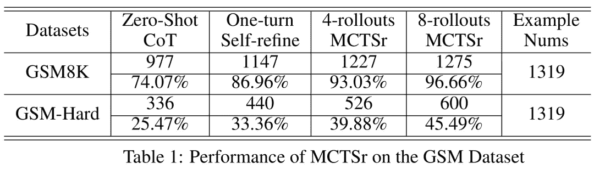
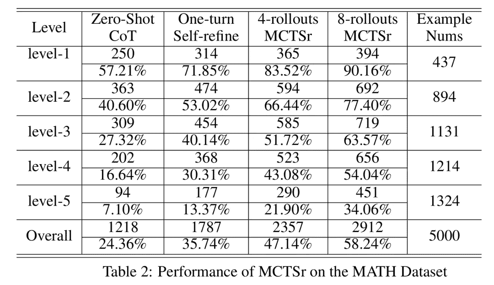
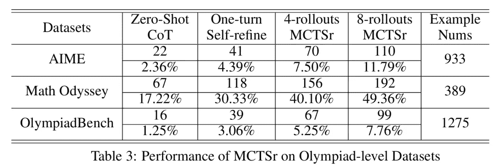
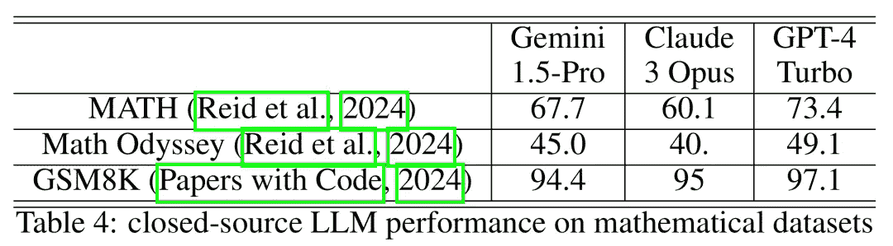

# 大模型+蒙特卡洛树搜索，一招让LLaMa-3 8B奥数水平直逼GPT-4

> 来源：[https://agijuejin.feishu.cn/docx/UaondjP9KomDGdxKHpmcAJybnRb](https://agijuejin.feishu.cn/docx/UaondjP9KomDGdxKHpmcAJybnRb)

> 机器之心｜[阅读原文](https://www.jiqizhixin.com/articles/2024-06-17-7)

> 转载请联系原作者取得授权

> 通过算法层面的创新，未来大语言模型做数学题的水平会不断地提高。

这几天，17 岁中专生姜萍在 2024 阿里巴巴 全球数学竞赛预选赛中取得全球第 12 名的新闻刷了屏。而同时，AI 挑战赛的成绩显示，在所有 563 支 AI 参赛队伍中，最高分 34 分，平均分 18 分，赶上了人类选手平均水平。

AI 参与数学竞赛的主要短板是 逻辑 推理能力弱，证明题很难拿到完整得分点。这也是 GPT-4、LLaMA 等当前大 语言模型 （LLM）在需要策略和 逻辑 推理的任务中面临的重大挑战。

其中的一大障碍是输出的准确性和可信度，尤其是在需要保证精度的数学上下文中，LLM 在推理时往往容易产生幻觉。输出结果表面上看似合理，但实际上不相关或事实不正确，最终导致不合理的推理过程。

虽然像 Self-Refine 这样的重写技术有助于缓解这种倾向，但依然可能导致现实世界复杂的数学问题产生误导性或错误的结果。

因此，为了应对这些挑战，来自 复旦大学 、上海 AI Lab 的研究者提出了 MCT Self-Refine（MCTSr），将 LLM 与蒙特卡洛树搜索（MCTS）算法相结合，并重点提高 LLM 在复杂数学推理任务（比如奥数竞赛题）中的表现。

作为一种决策工具，MCTS 广泛应用于 人工智能 中需要战略 规划 的场景，通常用于游戏和复杂的问题解决环境。本文通过将 MCTS 的系统探索能力与 LLM 的 Self-Refine 和 Self-Evaluation 能力相结合， 旨在创建一个更强大的框架来应对当前 LLM 难以解决的复杂推理任务。

+   论文地址：https://arxiv.org/pdf/2406.07394

+   项目地址：https://github.com/trotsky1997/MathBlackBox

不过，在将 MCTS 与 LLM 集成过程中存在一些技术挑战。传统的 MCTS 策略可能与 LLM 输出的随机性和生成性不太吻合，后者通常涉及无限、连续的潜在动作空间。这种不一致需要在 MCTS 框架内采用定制的期望计算和反向传播方法，以更好地适应 LLM 的特有属性。

此外，研究者还引入了一种动态 剪枝 策略，它结合了改进的置信上限（UCB）公式，以优化高风险任务中有效决策制定所需要的探索 - 利用平衡。

可以说，这项研究推进了 LLM 在复杂推理挑战中的应用，为未来整合 AI 相关的技术创新奠定了基础，从而使得 LLM 驱动的应用拥有了更强大的决策制定、推理准确性和可靠性。

**方法概览**

MCTSr 架构图如图 1 所示：

MCTSr 工作流包括：

+   初始化：使用模型生成的答案和虚拟响应建立根节点，以最大限度地减少模型过度拟合趋势；

+   选择：该算法采用值函数 Q 对所有未完全展开的答案进行排序，并采用贪心策略选择值最高的节点进行进一步的探索和优化；

+   Self-Refine ：选择好的答案 a 使用 Self-Refine 框架进行优化。最初，模型生成反馈 m，指导优化过程以产生增强的答案 a ′；

+   Self-Evaluation：精炼后的答案经过评分从而采样一个奖励值，并计算其 Q 值。这涉及模型自我奖励反馈和约束，如严格的评分标准和抑制满分，以确保评分的可靠性和公平性；

+   反向传播：将精炼答案的值反向传播到其父节点和其他相关节点，以更新树的值信息。如果任何子节点的 Q 值发生变化，则更新父节点的 Q；

+   UCT 更新：在所有节点的 Q 值更新完成后，确定一个候选节点集合 C，用于进一步扩展或选择，然后使用 UCT 更新公式更新所有节点的 UCT 值，以备下一步的选择阶段。

迭代上述阶段，直到满足终止条件 T 为止。

**Self-Refine**

在 self-refine 阶段， 模型通过多轮对话完善提示来优化针对问题 P 的答案 a。首先，模型生成一个关于答案 a 的反思性或批判性评论 m。随后，在 m 的指导下，模型修改答案 a，产生一个改进版本 a'，这种迭代的精炼方式提高了模型响应质量。

**自评估**

在数学问题 P 的答案精炼过程中，一个答案 a 的 Q 值被定义为将 a 进一步精炼成更优答案的预期质量。这个定义是基于从 a 到其重写形式的转换具有 马尔可夫性质 ，即下一个状态（即改写后的答案）仅依赖于当前状态（即当前的答案 a），而与之前的状态无关。

此外，研究者还设计了三个约束：提示约束、满分抑制、重复采样。采样后，计算 a 的 Q 值。

**反向传播**

在所有叶节点的奖励值经过采样和 Q 值更新完成后，然后将这些变化传播至其父节点和祖节点。在这个更新过程中，如果节点 a 的子节点集合 Children (a) 中任何元素的 Q 函数值发生变化，那么节点 a 的 Q 函数值也将进行更新。这样的传播确保了节点的 Q 值能够反映其所有可能子节点的最新状态和评估。

**更新 UCT 和选择**

在更新了树中所有节点的 Q 值之后，会进入下一轮选择阶段。这个过程包括以下步骤：

+   候选节点选择：在选择节点时，研究者无需从根节点开始，而是按层次顺序遍历树中的节点。

+   UCT 更新：借鉴 AlphaGo，该研究使用 UCT 和 UCB-1 方法来平衡节点的探索和利用；对于候选集 C 中的节点 a，其 UCT_a 值为：

**终止函数**

提前终止：当搜索结果的改进开始减少或连续搜索产生重复结果时，终止发生。

搜索约束：一旦展开次数达到预定限制或树中的一个或多个节点满足最大深度约束，搜索就会终止。

**实验结果**

为了评估 MCTSr 算法在解决数学问题中的有效性，研究者将 LLaMA3-8B 作为基础模型，并使用 MCTSr 进行增强。他们在 Zero-Shot CoT、Self-Refine、4-rollouts MCTSr 和 8-rollouts MCTSr 等几种设置中，将 LLaMA3-8B 与 GPT-4、Claude 3 和 Gemini 1.5-Pro 等进行了比较。

研究者在 GSM8K 和 GSM-hard 测试集（它们分别包含了典型和具有挑战性的数学问题）上评估了上述方法，结果如下表 1 所示。

可以发现，MCTSr 的 rollout 次数与成功率之间存在着直接相关性，并随着迭代次数增加而显著提升，在不太复杂的 GSM8K 中尤为明显。不过对于更复杂的 GSM-Hard 测试集，即使 rollout 次数更高也会达到性能上限，表明当前策略在解决复杂问题时存在局限性。

这些结果强调了 MCT-Self-refine 算法的稳健性和潜在边界，以及持续改进的必要性，从而有效应对更复杂的挑战。

下表 2 展示了在 MATH 数据集上应用不同复杂度级别的 MCT-Self-refine 算法的结果。数据集分为五个难度级别，从 Level 1（最简单）到 Level 5（最具挑战性）。

结果显示，Level 1 的成功率最高，8 次 rollout 后，MCTSr 实现了 90.16% 的成功率，解决了 437 个问题中的 394 个。随着 rollout 次数的增加，这一级别的成功率显著提高。

在最具挑战性的 Level 5 难度，8 次 rollout 后，MCTSr 的成功率为 34.06%，解决了 1324 个问题中的 451 个。这说明了随着难度不断增加，该算法在高度复杂的场景中性能受到限制。

所有级别的整体性能显示，8 次 rollout 后，MCTSr 的累计成功率为 58.24%，解决了 5000 个问题中的 2912 个。这一成功率相较于 Zero-Shot CoT 的初始成功率 24.36% 有了显著提高。这表明了，rollout 次数的增加与成功率的提高呈现出一致性，强调了 MCT-Self-refine 算法在提升不同数学复杂度级别的问题解决能力方面的有效性。

这些结果还验证了 MCT-Self-refine 算法在学术和问题解决上下文中的潜力，并强调了其对 MATH 数据集中不同复杂度级别问题的可扩展性和适应性。

下表 3 为 MCT-Self-refne 算法在奥数竞赛的三个数据集上进行了测试：AlME、GAIC Math Odyssey 和 OlympiadBench。

AIME：从 Zero-Shot CoT 的 2.36%（解决 22 个问题）到 MCTSr 的 11.79%（解决 110 个问题）。

GAIC Math Odyssey：成功率从 17.22%（解决 67 个问题）上升至 49.36%（解决 192 个问题）。

OlympiadBench：从 Zero-Shot CoT 的 1.25%（解决 16 个问题）提高到 MCTSr 的 7.76%（解决 99 个问题）。

这些结果证实了 MCT-Self-refine 算法在未见过的数学问题上的适用性，表明其在奥林匹克等竞争性学术环境中具有优势。

如表 4 所示。与当前闭源大模型进行比较时，MCTSr 可以有效提升小 参数 开源模型（如 LLaMa-3）的数学推理能力到相当的水平。

更多技术细节和实验结果请参阅原论文。