# 从高考到奥林匹克竞技场：大模型与人类智能的终极较量

> 来源：[https://agijuejin.feishu.cn/docx/GXjwdfiUfowe0bxjsZ0cmufFnJf](https://agijuejin.feishu.cn/docx/GXjwdfiUfowe0bxjsZ0cmufFnJf)

> 机器之心｜[阅读原文](https://www.jiqizhixin.com/articles/2024-06-20-6)

> 转载请联系原作者取得授权

上海交通大学生成式 人工智能 实验室 (GAIR Lab) 的研究团队，主要研究方向是：大模型训练、对齐与评估。团队主页：`https://plms.ai/`

图灵奖得主Hinton在他的访谈中提及「在未来20年内，AI有50%的概率超越人类的智能水平」，并建议各大科技公司早做准备，而评定大模型（包括多模态大模型）的「智力水平」则是这一准备的必要前提。

一个具有跨学科问题集、可以从多维度严谨评估AI的认知推理能力评估 基准 已经变得相当亟需。

## 1. 大模型不断占领人类智力高地：从小学试题到参加高考

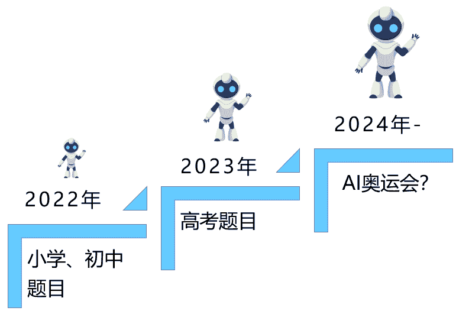

以大模型为核心的生成式 人工智能 技术的兴起，使得人类不仅有了可交互的文本、图片、视频交互生成工具，还使得人类有机会训练出一个”有智力“能力的模型，它可以看成是人类延申的大脑，独立完成不同学科问题，成为未来10年可以给 科学发现提供加速度 的最有力的工具（即`AI4Science`).

过去两年，我们看到这种以大模型为代表的硅基智能的快速进化，从最初只能用来去解决小学题目, 到2022年，CMU等人[1]第一次把AI带到了“高考”考场，并在全国卷II英语上取得了134分的成绩，然而，那时候的AI还是个数理 逻辑 掌握不好的偏科生。直至今年，2024高考刚刚落下帷幕，在无数学子在这一年一度的大考中奋力拼搏，展现了他们多年来的学习成果的同时，大模型也是空前第一次被全学科的拉到考场，并且在数理学科中取得巨大进步。这里我们不禁思考，AI智力进化的天花板在哪？人类还没祭出最难的题目，那会是AI的天花板吗？

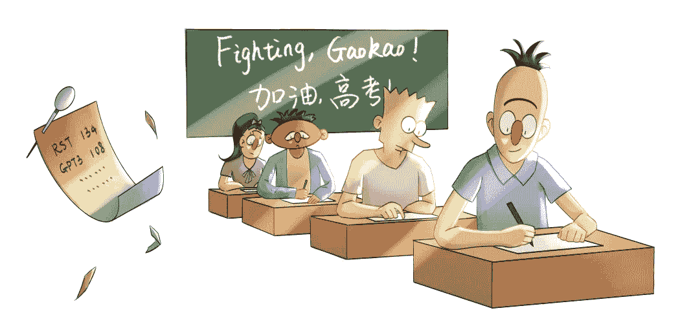

## 2. 智力较量最高殿堂：从 AI 高考到 AI 奥运会

四年一度的奥运会也即将到来，这不仅是体育竞技的巅峰盛会，更象征着人类对极限的不断追求和突破。学科奥林匹克竞赛则是知识的深度与智力的极限的完美结合，它既是对学术成就的严格评估，也是对思维敏捷性和创新能力的极限挑战。在这里，科学的严谨与奥运会的激情相遇，共同塑造了一种追求卓越、勇于探索的精神。

学科的奥林匹克竞赛给将会给人机智力巅峰对决提供最好的赛场。不管未来AGI能否实现，AI参加奥林匹克竞赛将会成为通向AGI的必经一站，因为这些考察了模型极具重要的 认知推理能力，而这些能力逐渐被体现于各种复杂的现实世界场景中，比如用作软件开发的AI代理，合作处理复杂的决策过程，甚至推动科学研究领域（`AI4Science`).

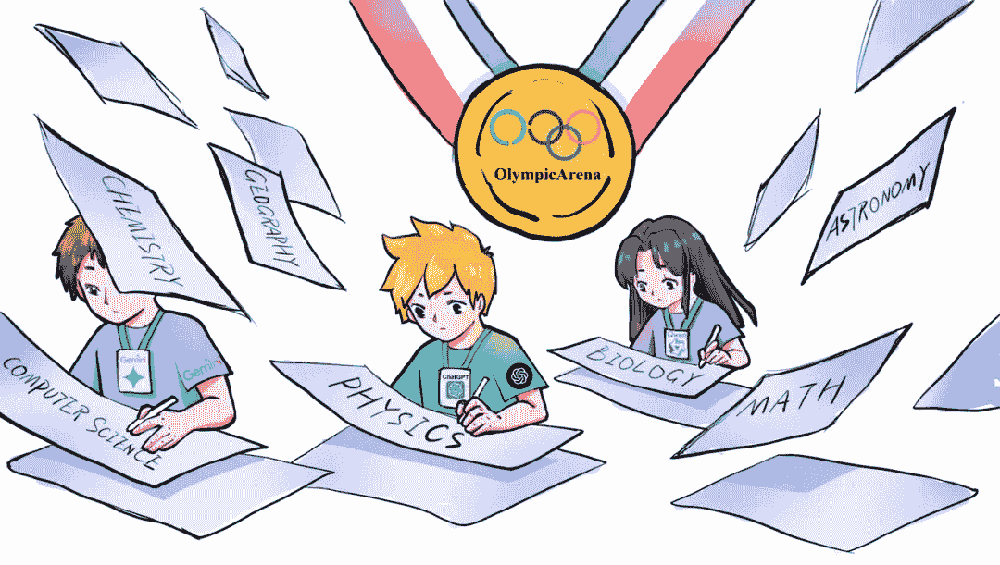

## 3. 构建面向 AI 奥林匹克赛场

在此背景下，上海交通大学生成式 人工智能 实验室 (GAIR Lab) 的研究团队将大模型从高考考场搬到了更加具有挑战性的“奥林匹克竞技场”，推出了全新的大模型（包括多模态大模型）认知推理能力评估 基准 ——`OlympicArena`。这一 基准 使用国际学科奥赛的高难度题目，全面测试了 人工智能 在跨学科领域的认知推理能力。`OlympicArena`涵盖了数学、物理、化学、生物、地理、天文、计算机七大核心学科，包括62个国际学科奥赛（如`IMO`, `IPhO`, `IChO`, `IBO`, `ICPC`等）的11,163道中英双语题目，为研究者们提供了一个全面评估AI模型的理想平台。

同时，更长远来看，`OlympicArena`为今后AI在科学领域（`AI4Science`），工程领域（`AI4Engineering`）发挥自身强大的能力，甚至促进AI激发出超越人类水平达到`Superintelligence`，起到了不可忽视的奠定作用。

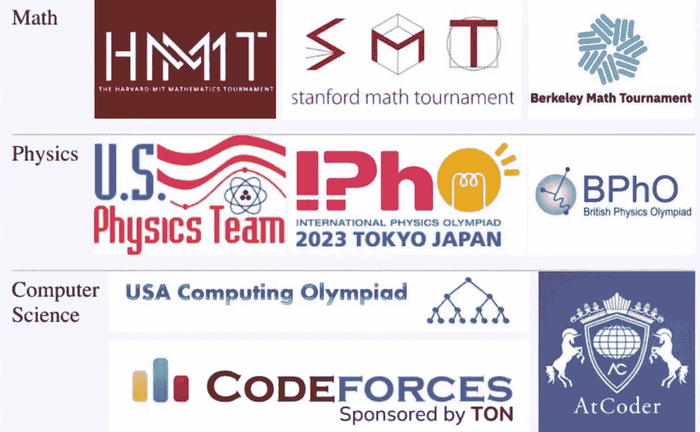

研究团队发现，当下所有的大模型在学科奥赛上都不能交出较好的答卷，即使是`GPT-4o`，仅仅只有39%的正确率，`GPT-4V`仅有33%，离及格线（60%正确率）还有相当大的距离。而多数开源大模型表现的更加不尽人意，例如，`LLaVa-NeXT-34B`, `InternVL-Chat-V1.5`等当下较强的多模态大模型都未达到20%的正确率。

此外，多数多模态大模型都不擅长充分利用视觉信息解决复杂的推理任务，这也是大模型与人类最显著的差异（人类往往会优先关注处理视觉信息）。因此，`OlympicArena`上的测试结果表明模型在科学问题的求解上与人类依然有所差距，其内在的推理能力仍然需要不断提高才能更好的辅助人类的科学研究。

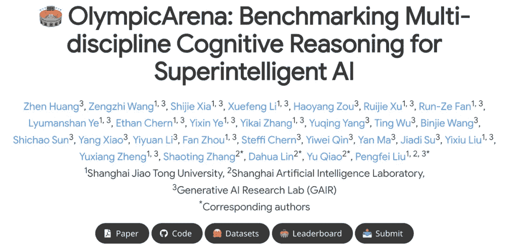

+   论文地址：`https://arxiv.org/pdf/2406.12753`
+   项目地址：`https://gair-nlp.github.io/OlympicArena/`
+   代码地址：`https://github.com/GAIR-NLP/OlympicArena`

### OlympicArena特点

OlympicArena的特点概述，以及一个可以反应benchmark对多模态支持、多种认知能力考察、以及细粒度评估（既考虑对答案对错的评估，又考虑对每个推理步骤评估）的例题。

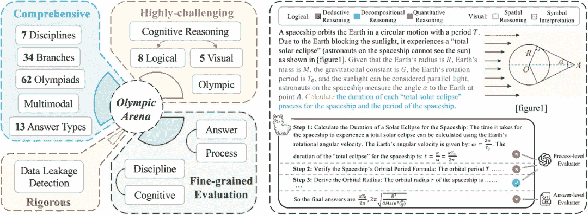

+   全面：`OlympicArena`包括来自62个不同奥林匹克竞赛的共11,163道题目，跨越了七大核心学科：数学、物理、化学、生物、地理、天文和计算机，涉及34个专业分支。同时，不同于以往的benchmark大多数聚焦在选择题等客观题，`OlympicArena`支持丰富的题型，包含表达式、方程式、区间、化学方程式的书写甚至是编程题等。此外，`OlympicArena`支持多模态（将近半数的题目含有图片），并采用了与现实中最贴合的文本-图像环绕的输入格式（`interleaved text-image`），充分测试了大模型利用视觉信息协助进行推理的能力。

+   极具挑战性：与以往的benchmark要么聚焦于高中（高考）题，要么聚焦于大学题不同，`OlympicArena`更加聚焦于更加纯粹的复杂推理能力的考察，而不是考察大模型对海量知识点的记忆、召回能力或是简单的应用能力。因此，`OlympicArena`中所有的题目均是奥赛难度。并且，为了细粒度的评估大模型在不同类型的推理能力上的表现，研究团队还总结归纳了8种 逻辑 推理能力，5种 视觉推理 能力，后续特别分析了现有的大模型在不同类型的推理能力上表现的差异。

+   严谨：引导大模型的健康发展是学术界应该扮演的角色，目前在公开的benchmark中，许多流行大模型多多少少会存在数据泄露问题（即benchmark的测试数据泄露在大模型的训练数据中）。因此研究团队专门测试了`OlympicArena`在当下一些流行大模型上的数据泄露情况，以更加严谨的验证该benchmark的有效性。

+   细粒度的评估：以往的benchmark往往仅评估大模型给出的最终答案是否与正确答案一致，这在非常复杂的推理问题的评估中是片面的，不能很好的反映出当下模型更加真实的推理能力。因此，研究团队除了有对答案的评估，还加入了对题目过程（步骤）正确性的评估。同时，研究团队也从多个不同的维度进行了不同结果的分析，例如，分析模型在不同学科、不同模态、不同推理能力上的表现差异。

### 与相关benchmark的比较

从上表可以看出：`OlympicArena`无论是在学科、语言、模态的覆盖，还是在题目类型的多样性，对推理能力的考察深度，以及评估方式的全面性上，都与现存的其他一些聚焦于评测科学问题的benchmark有显著的差异。

## 实验分析

### 实验设置

研究团队在`OlympicArena`上测试了多个多模态大模型（`LMM`）和纯文本大模型（`LLM`）。对于多模态大模型，使用了文本-图像环绕（`interleaved text-image`）的输入形式；而对于纯文本大模型，在两种设置下进行了测试，分别是不含任何图片信息的纯文本输入（`text-only LLMs`）和包含图片描述信息的纯文本输入（`image caption + LLMs`）。加入纯文本大模型测试的目的不仅是为了扩大该benchmark的适用范围（使所有的`LLM`都能参与排行榜），更是为了更好地了解和分析现有的多模态大模型在与其对应的纯文本大模型相比时，是否能够充分利用图片信息提升其解决问题的能力。所有实验均使用`zero-shot CoT prompts`，研究团队针对每种答案类型进行了定制，并指定了输出格式以便于 答案提取 和基于规则的匹配。

### 实验结果

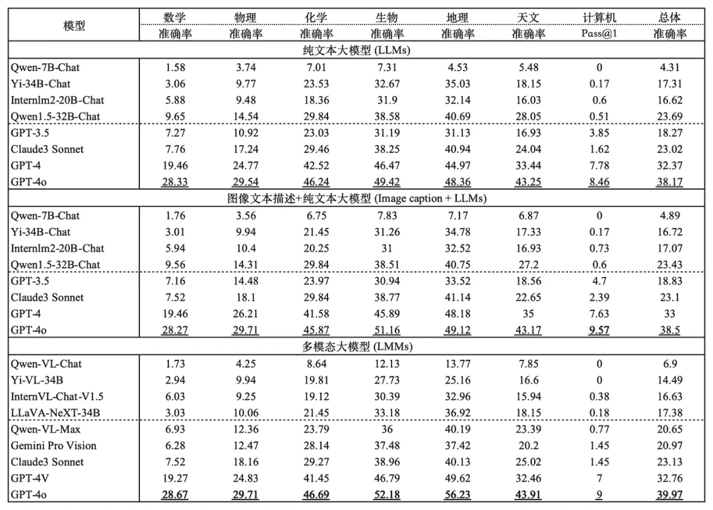

不同模型在`OlympicArena`不同学科上的 准确率 ，其中CS编程题用无偏`pass@k`指标，其余均用 准确率 指标。

从表格的实验结果可以看出，目前市面上所有的主流大模型都没能展现出很高的水准，即使是最先进的大模型`GPT-4o`，整体 准确率 也仅为39.97%，而其他开源模型的整体 准确率 则难以达到20%。这种明显的差异突显了该benchmark的挑战性，证明其在推动当前AI推理能力上限的提升上发挥了很大的促进作用。

此外，研究团队观察到数学和物理依然是最难的两个学科，因为它们更加依赖于复杂灵活的推理能力，推理的步骤也更多，所需综合应用的思维能力也更加多样。而像生物、地理学科， 准确率 相对高一些，因为这类学科更注重考察利用丰富的科学知识解决、分析实际问题的能力，侧重于对溯因、 因果推理 能力的考察，相比复杂的归纳、 演绎推理 ，大模型更加善于借助自己训练阶段获得的丰富知识进行此类学科的分析。

计算机编程竞赛也被证明是非常困难的，一些开源模型甚至无法解决其中的任何问题（ 准确率 为0），这表明当前模型在设计有效算法以用程序解决复杂问题方面的能力依然有很大的提升空间。

值得一提的是，`OlympicArena`被提出的初衷不是一味追求题目难度，而是充分挖掘大模型跨学科、运用多种推理能力解决实际科学问题的能力。上述提到的运用复杂推理的思维能力，利用丰富的科学知识解决、分析实际问题的能力，以及编写高效、准确的程序求解问题的能力，都是在科研领域不可或缺的，也是该benchmark始终侧重的。

### 细粒度的实验分析

为了实现更细粒度的实验结果分析，研究团队基于不同的模态和推理能力进行了进一步评估。此外，研究团队还进行了模型在题目推理过程上的评估分析。主要发现如下：

模型在不同的 逻辑 推理和 视觉推理 能力上表现各异

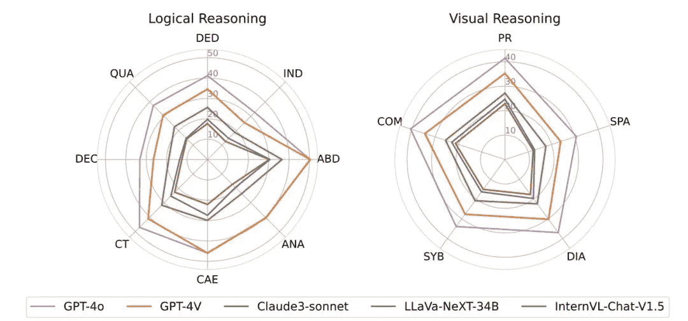

各模型在 逻辑 推理和 视觉推理 能力上的表现。 逻辑 推理能力包括： 演绎推理 （`DED`）、 归纳推理 （`IND`）、 溯因推理 （`ABD`）、 类比推理 （`ANA`）、 因果推理 （`CAE`）、批判性思维（`CT`）、分解推理（`DEC`）和 定量推理 （`QUA`）。 视觉推理 能力包括： 模式识别 （`PR`）、空间推理（`SPA`）、图表推理（`DIA`）、符号解释（`SYB`）和视觉比较（`COM`）。

几乎所有模型在不同 逻辑 推理能力上的表现趋势相似。它们在 溯因推理 和 因果推理 方面表现突出，能够很好地从提供的信息中识别因果关系。相反，模型在 归纳推理 和分解推理方面表现较差。这是由于奥林匹克级别问题的多样性和非常规性，这些问题需要将复杂问题分解为较小的子问题的能力，这依赖于模型成功求解每一个子问题，并将子问题组合起来解决更大的问题。在 视觉推理 能力方面，模型在 模式识别 和视觉比较方面表现较好。

然而，它们在涉及空间和几何推理的任务以及需要理解抽象符号的任务中表现较为困难。从对不同推理能力的细粒度分析来看，大模型所欠缺的能力（如对复杂问题的分解，对几何图形的 视觉推理 等）正是科学研究中不可或缺、至关重要的能力，表明了AI离真正可以全方位辅助人类进行科学研究还有一段距离。

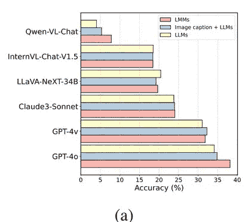

不同多模态模型（`LMMs`）及其对应的纯文本模型（`LLMs`）在三种不同实验设置中的比较。

大多数多模态模型（`LMMs`）依然不擅长利用视觉信息协助进行推理

如上图(a)所示，只有少数多模态大模型（如`GPT-4o`和`Qwen-VL-Chat`）在有图像输入时相对于其对应的纯文本模型表现出显著的性能提高。许多多模态大模型在图像输入时没有表现出性能提升，甚至在处理图像时表现出效果下降。可能的原因包括：

+   当文本和图像一起输入时，`LMMs`可能更多地关注文本，忽略图像中的信息。
+   一些`LMMs`在基于其文本模型训练视觉能力时，可能会丧失其固有的一些语言能力（例如，推理能力），这在本项目的复杂场景中尤为明显。
+   该benchmark的题目使用了复杂的文本-图像环绕的输入格式，一些模型无法很好地支持这一格式，导致其不能很好的处理和理解嵌入文本中的图像位置信息。

而在科学研究中，往往伴随着非常海量的图表、几何图形、可视化数据等视觉信息，只有当AI可以娴熟的使用其视觉能力协助推理时，才可以有助于推动科学研究的效率和创新，成为解决复杂科学问题强有力的工具。

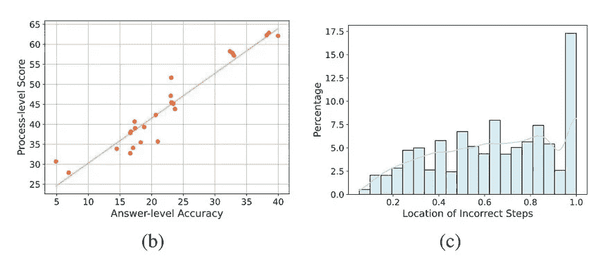

左图：所有模型在所有进行推理过程评估的问题中的，答案的正确率和过程的正确率的相关性。右图：错误过程步骤位置的分布。

### 推理步骤的评估结果分析

通过对模型推理步骤进行正确性的细粒度评估，研究团队发现：

+   如上图(b)所示，步骤层面评估的结果和仅仅依靠答案的评估之间通常具有高度一致性。当模型生成正确答案时，其推理过程的质量大多较高。
+   推理过程的 准确率 通常高于只看答案的 准确率 。这表明即使是非常复杂的问题，模型也能正确执行一些中间步骤。因此，模型在认知推理方面可能具有显著的潜力，这为研究人员开辟了新的研究方向。研究团队还发现，在某些学科中，一些在只参照答案评估时表现良好的模型在推理过程上表现不佳。研究团队推测这是因为模型在生成答案时有时会忽略中间步骤的合理性，尽管这些步骤对最终结果可能并不关键。
+   此外，研究团队对错误步骤的位置分布进行了统计分析（见图c），发现较高比例的错误发生在一题中较后的推理步骤。这表明随着推理过程的累积，模型更容易出错，并产生错误的累积，这表明模型在处理长链 逻辑 推理时仍然有很大的提升空间。

团队也呼吁所有研究者在AI推理任务中更多地关注模型推理过程的监督和评估。这不仅可以提高AI系统的可信度和透明度，帮助更好地理解模型的推理路径，还能识别出模型在复杂推理中的薄弱环节，从而指导改进模型结构和训练方法。通过细致的过程监督，可以进一步挖掘AI的潜力，推动其在科学研究和实际应用中的广泛应用。

### 模型错误类型的分析

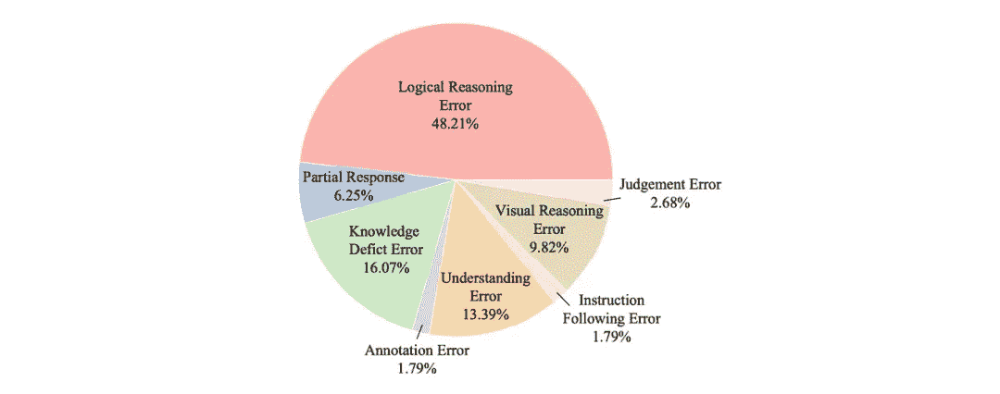

研究团队采样了 `GPT-4V` 回答错误的112道题（每个学科 16 道题目，其中 8 道为纯文本题目，8 道为多模态题目），并人工标注这些错误的原因。如上图，推理错误（包括 逻辑 推理错误和 视觉推理 错误）构成了最大的错误原因，这表明我们的 基准 有效地突显了当前模型在认知推理能力方面的不足，这与研究团队的初衷是吻合的。

此外，相当一部分错误也来源于知识的缺乏（虽然奥赛的题目仅仅以高中知识为基础范围），这表明当前模型在缺乏领域知识之外，更多的无法利用这些知识来辅助推理。另一个比较多的错误原因是理解偏差，这可以归因于模型对上下文的误解以及整合复杂语言结构和多模态信息的困难。

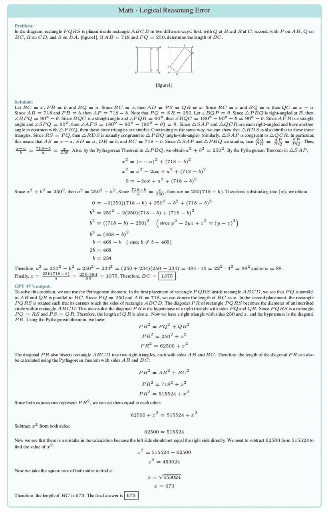

一个`GPT-4V`在数学奥赛题上犯错的例子

### 数据泄露检测

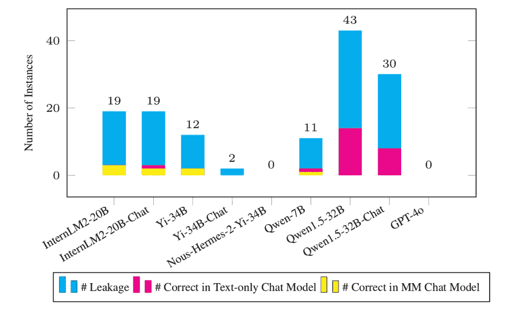

检测到的泄漏样本数量以及相应的纯文本和多模态模型在这些样本题目上做对的数量。

随着预训练语料规模不断扩大，检测benchmark上潜在的数据泄漏至关重要。而预训练过程的不透明通常使这项任务具有挑战性。为此，研究团队采用了一种新提出的实例级泄漏检测指标，称为“`N-gram`预测准确性”。这一指标均匀地从每个实例中抽取几个起始点，预测每个起始点的下一个`N-gram`，并检查所有预测的`N-gram`是否正确，以判断模型是否可能在训练阶段遇到过该实例。研究团队将这一指标应用于所有可用的基础模型。

如上图所示，主流模型在`OlympicArena`上并没有显著的数据泄露问题，哪怕有泄露，数量相对于完整的benchmark数据集来说微不足道。例如，泄漏最多的`Qwen1.5-32B`模型也仅仅被检测出43个疑似泄露的实例。这也自然而然引发了一个问题：模型能正确回答泄露的这些实例问题吗？

在这个问题上，研究团队很惊讶的发现，即使是泄露的问题，相应的模型能回答正确的也非常少。这些结果都表明，该benchmark几乎没有遭受数据泄露的影响，并且保持着相当大的挑战性，可以在接下来很长的时间保持其有效性。

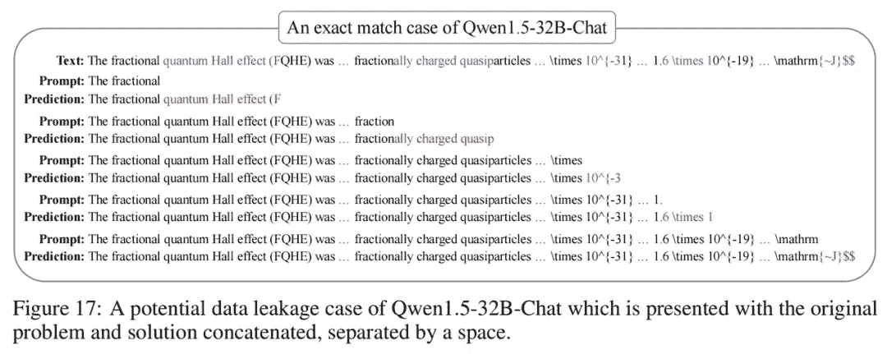

## 结语

尽管`OlympicArena`具有非常高的价值，但研究团队表示未来仍有不少工作要做。首先，`OlympicArena` benchmark不可避免地会引入了一些噪声数据，作者将积极利用社区反馈来不断改进完善。此外，研究团队还计划每年发布 基准 测试的新版本，以进一步减轻与数据泄露相关的问题。此外，从更长远来讲，当前的 基准 测试仅限于评估模型解决复杂问题的能力。

在未来，所有人更希望 人工智能 能够协助完成复杂的综合任务，并在实际应用中展示价值，例如`AI4Science`和`AI4Engineering`，这将是未来 基准 设计的目标和宗旨。尽管如此，目前`OlympicArena`依然作为促进AI走向`Superintelligence`的催化剂，发挥着重要的作用。

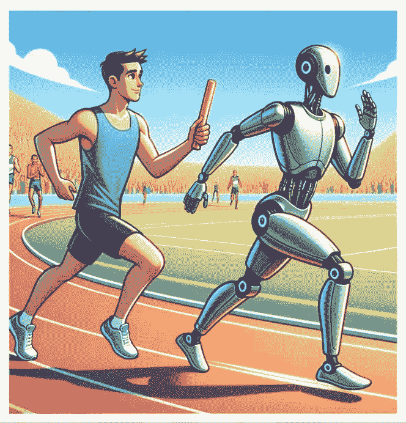

## 愿景：人类与AI共同进步的辉煌时刻

在未来，我们有理由相信，随着AI技术的不断成熟和应用场景的不断拓展，OlympicArena将不仅仅是一个评估AI能力的赛场，更将成为一个展示AI在各个领域应用潜力的舞台。无论是在科学研究、工程设计，还是在体育竞技等更广泛的领域，AI都将以其独特的方式，为人类社会的发展贡献力量。

最后，研究团队也表示学科奥林匹克赛场也将仅仅是OlympicArena的一个开始，AI更多的能力值得不断的探索，例如奥林匹克体育赛场将在未来成为具身智能的竞技场。

### 参考链接：

[1] reStructured Pre-training, arXiv 2022, Weizhe Yuan, Pengfei Liu
