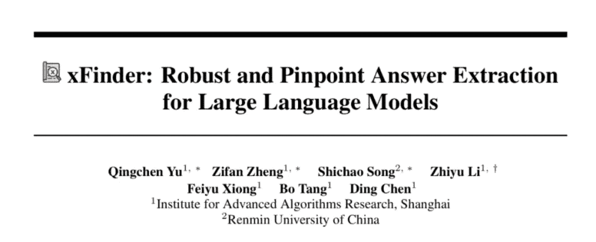
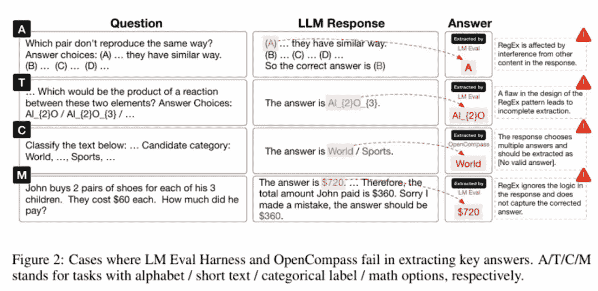
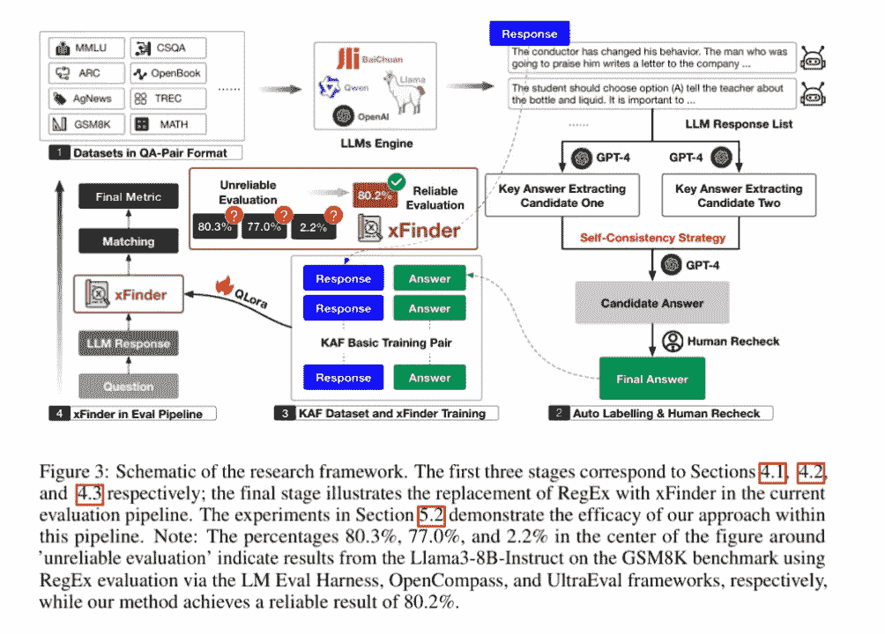
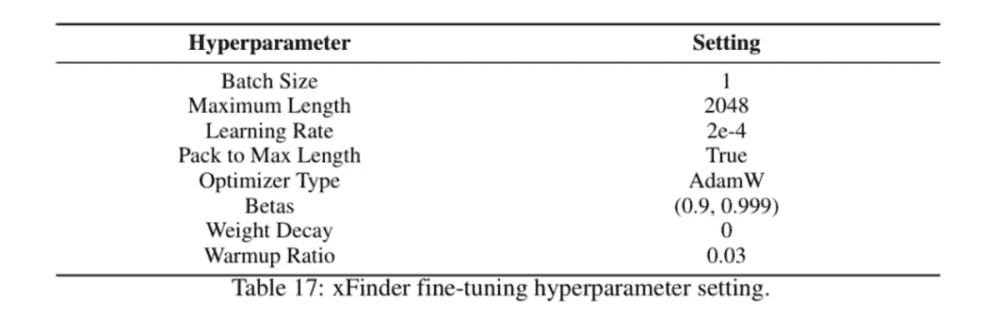
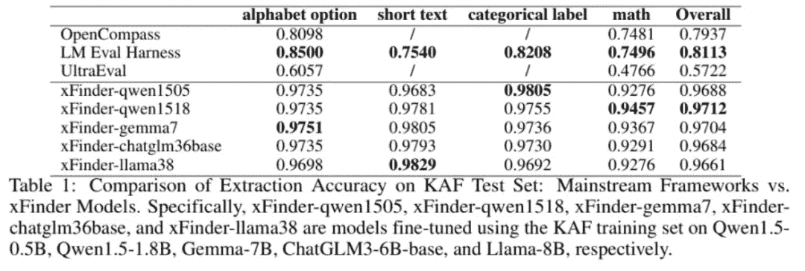
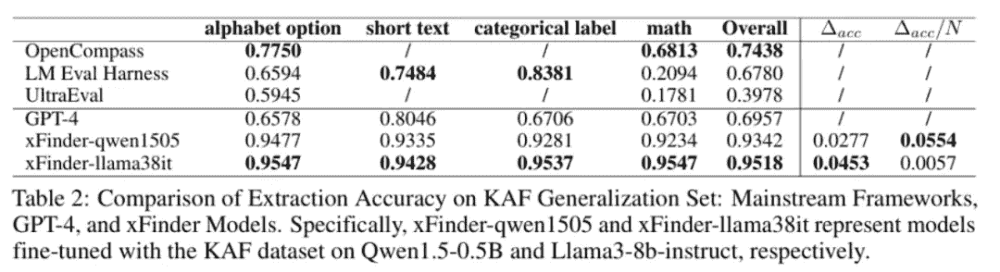
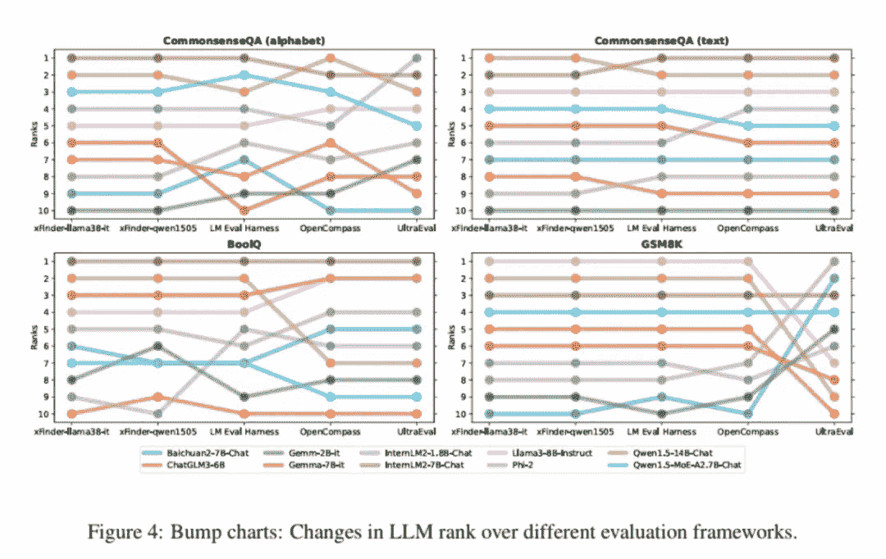

# 答案抽取正确率达96.88%，xFinder断了大模型「作弊」的小心思

> 来源：[https://agijuejin.feishu.cn/docx/WYfMd2Iolo1fKxxUgkhczIQynDh](https://agijuejin.feishu.cn/docx/WYfMd2Iolo1fKxxUgkhczIQynDh)

> 机器之心｜[阅读原文](https://www.jiqizhixin.com/articles/2024-06-17-3)

> 转载请联系原作者取得授权

**本文第一作者和通讯作者均来自上海算法创新研究院。其中，通讯作者李志宇博士毕业于中国人民大学计算机专业，并曾在阿里巴巴、小红书等互联网公司从事算法落地与研究工作，曾参与了包括千亿级商品知识**图谱、用户图谱和舆情图谱的研发工作，累计发表论文四十余篇。李志宇当前在上海算法创新研究院大模型部门（由熊飞宇博士带领）负责整体的技术研发工作。研究院主页：https://www.iaar.ac.cn/

大语言模型（LLM）的迅速发展，引发了关于如何评估其公平性和可靠性的热议。

尽管现有的评估框架如 OpenCompass、LM Eval Harness 和 UltraEval 以及各种 Benchmark 推动了行业进步，但专注于这些评估框架核心组件可信度或可靠性度量的团队却为数不多。

近日，上海算法创新研究院和中国人民大学的研究团队发布了一篇名为《xFinder: Robust and Pinpoint Answer Extraction for Large Language Models》的论文。这篇论文深入分析了LLM评估框架的整体流程，重点评估了答案抽取器组件在大模型评估中的可靠性和一致性。

+   论文地址：

+   https://arxiv.org/abs/2405.11874

+   Github链接：

+   https://github.com/IAAR-Shanghai/xFinder

+   Huggingface链接：

+   https://huggingface.co/collections/IAAR-Shanghai/xfinder-664b7b21e94e9a93f25a8412

+

当前的评估框架主要依赖正则表达式（RegEx）来抽取答案，但这种方法存在明显缺陷。人工复核结果显示，其最佳抽取正确率仅为74.38%，评估结果极不可靠。

此外，RegEx方法容易被有意或无意地拟合，增加了「作弊」的可能性，从而影响评估结果的可靠性和一致性。下图展示了LLM评估框架中RegEx组件抽取错误的情况。

为了有效解决这一问题，上海算法创新研究院和中国人民大学的研究团队开发了一个名为 xFinder 的新模型，用于更准确地抽取关键答案。

xFinder 具有以下优势：

（1）不要求特定格式的答案输出，具备较强的答案抽取鲁棒性，抽取准确率高达95.18%，显著优于目前最佳LLM评估框架中的RegEx方法。

（2）支持多样化题型，能够将字母选择题自动转换为问答题，并支持不同题型的混排评估，从而降低测试者拟合题型的可能性。

**方法介绍**

xFinder的实现过程主要包括LLM响应内容的生成、KAF数据集的标注和xFinder的训练。为了实现 xFinder 模型的有效训练，团队构建了一个专门的数据集——关键答案查找（KAF）数据集。该数据集包含 26,900 个训练样本、4,961 个测试样本和 4,482 个泛化样本，涵盖多种评估任务。

**大语言模型响应生成**

首先，研究团队从现有的主要评估基准和报告中挑选了多个典型的评估任务数据集，这些任务被分类为四种类型：字母选项任务、短文本选项任务、分类标签任务和数学任务。

接着，团队使用不同系列的 LLM（如 Qwen、InternLM、ChatGLM 等）生成这些任务的数据对。通过多种 LLM，团队生成了丰富多样的数据对，为 xFinder 模型的训练提供了充分的数据支持。

**自动标注与人工复核**

团队使用了一种策略，从 LLM 响应中提取关键答案并将其用作标签，以构建高质量的 KAF 数据集。为提高训练集的标注效率，他们采用了半自动化流程，通过不同提示使用 GPT-4 生成了两组标注，并利用自一致性策略筛选出标注不一致的项和所有数学问题，提交给人工复查。为了确保测试集和泛化集的有效性和可靠性，所有标签都经过两轮手动注释。

**训练 xFinder**

为了增强 KAF 数据集的多样性和模型的泛化能力，研究团队采用了两种数据增强策略：

（1）模拟 LLM 响应：对 KAF 训练集中 50% 的字母选项问题进行修改，增加或删除一到两个选项，以模拟 LLM 的多样化响应。

（2）丰富提示形式：提取包含关键答案句子的 LLM 响应的 10%，替换其中的提示部分，例如将「The final answer is A」替换为「Based on the context of the question, A is the most likely answer」。

此外，团队使用 XTuner 工具和 QLoRA 方法，对 Llama 系列、Qwen 系列和 Gemma 系列等基座模型进行微调，最终获得 xFinder。

**实验结果**

该团队进行了广泛的实验，评估xFinder在不同任务上的表现，并与现有的RegEx方法进行了对比。

**KAF 测试集上的结果**

在 KAF 测试集上，xFinder-qwen1505 的平均提取准确率达到了 96.88%，显著高于最佳评估框架中的 RegEx 方法的 74.38%。

具体来看，xFinder-qwen1505 在字母选项任务中的提取准确率为 97.35%；在短文本选项任务中为 96.83%；在分类标签任务中为98.05%；在数学选项任务中为 92.76%。这些结果表明，xFinder 在各类任务中均表现出色，显著提升了评估的准确性和可靠性。

**KAF 泛化集上的结果**

在全新的 KAF 泛化集上（该泛化集使用了与 KAF 数据集中的训练集和测试集不同的 LLM 和测试任务生成的样例构造的），xFinder-qwen1505 展现了卓越的性能，平均提取准确率达到了 93.42%。

实验结果表明，xFinder 的表现不仅优于其他基于 RegEx 的评估框架，甚至显著优于 GPT-4，充分展示了其高鲁棒性和泛化能力。

**在现实世界场景中的评估**

研究团队使用 xFinder 和传统评估框架对 10 种 LLM 进行了综合评估。评估任务涵盖了 CommonsenseQA、BoolQ 和 GSM8K 等。通过对 10 种不同的 LLM 应用五种答案提取方案，进行了一系列对比实验。

概括起来，实验结果主要揭示了三个关键发现：

（1）同一模型在不同框架下的排名常常出现较大差异，难以准确反映模型的真实能力，显示出一致性较低。

（2）不同的 xFinder 在这些实验中显示出了高度的一致性，并且在提取答案的准确率上也超越了其他评测框架，表明 xFinder 是一种更加可靠的评测方法。

（3）与传统的字母选项设置相比，直接使用选项文本能显著提升排名的一致性，反映了字母选项设置的不稳定性。更多的细节和实验结果已在附录中展示，这些内容进一步证实了上述发现的有效性。

**结语**

总的来说，xFinder通过优化关键答案提取模块，提高了LLM评估的准确性和可靠性。实验结果表明，xFinder在多种任务上均表现出色，具备较高的鲁棒性和泛化能力。未来，该研究团队将继续优化xFinder，并研究其他评估关键问题，为LLM性能的可靠评估提供坚实基础。