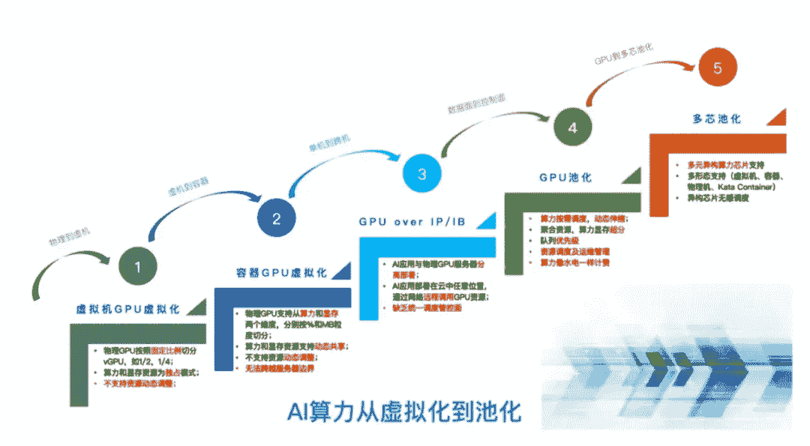
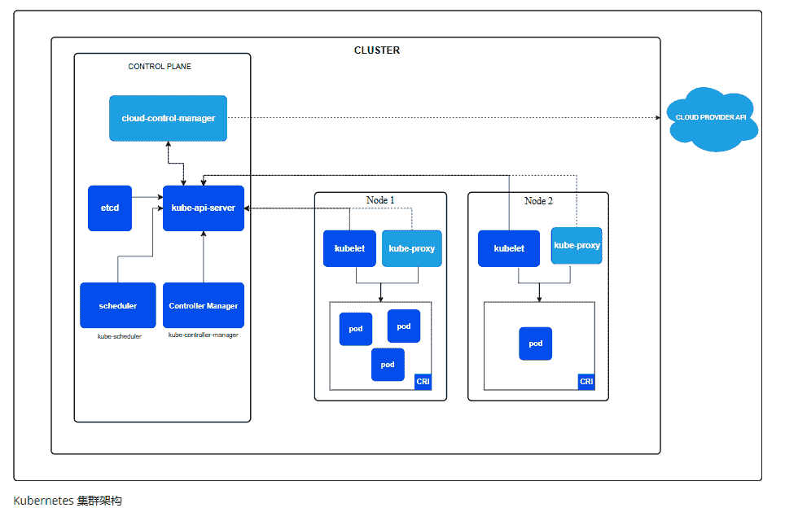

# 从虚拟化到容器化再到池化，AI算力的灵活调度技术研究

> 来源：[https://agijuejin.feishu.cn/docx/NUt5dK8EOoO8kZx0GNCcI9bandc](https://agijuejin.feishu.cn/docx/NUt5dK8EOoO8kZx0GNCcI9bandc)

> 坚果 智见AGI｜[阅读原文](https://mp.weixin.qq.com/s/C11fQP0ENKQj-QzPYWGfhg)

> 转载请联系原作者取得授权

> AI 算力，触手可及

**©作者 | **坚果

**来源 | **神州问学

# **引言 - AI时代下的算力变革**

近年来，人工智能（AI）技术的快速发展极大地推动了各个领域的创新与进步。伴随着AI模型复杂度的不断提高以及数据量的爆炸式增长，对于高性能计算资源的需求也随之水涨船高。为了满足这一需求，算力基础设施经历了从虚拟化、容器化到资源池化的技术演进过程。

在早期阶段，传统的虚拟化技术通过将物理资源抽象成多个独立的虚拟机来实现资源隔离与共享，但这种方式存在启动时间长、资源开销大的缺点。随后，容器技术因其轻量级、快速启动的特点而兴起，大大提升了资源利用率和服务部署速度。然而，随着AI训练任务规模的进一步扩大，如何更高效地管理和调度异构资源成为新的挑战。

为了解决上述问题，资源池化技术应运而生。它能够将多种类型的硬件资源整合在一起形成统一的资源池，并通过智能化调度策略实现动态资源分配，从而最大程度地提高资源使用效率和系统的整体性能。

图源网络

# **虚拟化 - 算力的初步解放**

**历史背景**

早期的计算机系统设计是为了满足单一任务的需求，因此硬件资源的利用率相对较低。随着计算需求的增长和技术的进步，人们开始寻找更有效的方法来利用这些昂贵的硬件资源。虚拟化技术就是在这样的背景下诞生的，它能够将一台物理服务器划分为多个虚拟服务器，每个虚拟服务器都可以运行自己的操作系统和应用程序。这样不仅可以提高硬件资源的利用率，还能简化管理和部署流程，同时降低了总体的成本。

# **技术原理**

**虚拟机的工作机制：**

虚拟机（Virtual Machine, VM）是一种通过软件模拟出来的计算机系统，它可以在物理计算机**上**运行，并且拥有自己的操作系统和应用程序。虚拟机的运行依赖于一个特殊的软件层——虚拟化管理器（Hypervisor）。 虚拟化管理器负责将物理资源（如CPU、内存、磁盘空间和网络带宽）分配给各个虚拟机，并确保这些虚拟机相互之间保持隔离。

虚拟机的实现方式有两种主要类型：

Type 1 Hypervisor（裸金属虚拟化）： 直接安装在物理硬件之上，没有依赖任何操作系统。这种类型的虚拟化管理器通常用于数据中心和云计算环境。

Type 2 Hypervisor（托管式虚拟化）： 运行在一个现有的操作系统之上。这种方式通常用于开发环境和个人电脑。

**AI领域的应用案例：**

在人工智能领域，虚拟化技术被广泛应用于加速AI模型的训练和部署过程。例如：

**● 模型训练： **通过虚拟化技术，可以在一个物理GPU上划分出多个虚拟GPU（vGPU），以供多个AI训练任务并行使用，从而提高GPU资源的利用率。

**● 实验环境： **AI研究人员可以为不同的实验创建独立的虚拟机环境，这样可以轻松地复现特定的实验条件，并且避免了环境之间的冲突。

**● 服务部署： **虚拟化技术还可以用来快速部署AI服务，例如机器学习模型的在线预测服务，可以快速创建和销毁虚拟机来应对流量的变化。

**挑战与局限**

尽管虚拟化技术在**AI领域有**着广泛的应用，但它也面**临着一些挑战和**局限。首先，虚拟化层的存在会引入额外的性能开销，这对高性能计算的AI应用尤其不利，特别是在GPU密集型任务中更为明显。其次，虚拟机的启动和关闭需要一定的时间，这使得虚拟化技术在面对需要快速响应的AI任务时显得不够灵活；而且，资源的过度预留可能会导致实际利用率不高，造成资源浪费。此外，AI计算往往涉及多种类型的硬件资源，如CPU、GPU、TPU等，而虚拟化技术在处理这些异构资源时可能存在局限性。再者，虚拟化环境可能在不同的平台上存在兼容性问题，尤其是在跨云环境下的部署和迁移时，这给开发者带来了额外的挑战。最后，虚拟化环境中的安全问题也不容忽视，包括hypervisor层面的 安全漏洞 以及虚拟机之间的潜在 数据泄露风险 ，这些都是需要重点关注的问题。

综上所述，虚拟化技术在提高硬件资源利用率方面发挥了重要作用，但在AI算力调度中仍面临一些挑战。为了克服这些局限，业界正在探索更先进的技术和方法，例如容器化和专门针对AI优化的虚拟化技术。

# **容器化 - 算力的敏捷部署**

技术革新：容器化带来的轻量级资源隔离与管理

容器化技术通过引入轻量级的资源隔离和管理机制，解决了传统虚拟化技**术的一些局限性。与传统的虚**拟化技**术相比，容器不需要运行完整的操作系统副本，而是 共享宿主机**的操**作系统内核** ，并 利用命名空间（namespaces）和控制组（cgroups）等技术实现进程间的隔离和资源限制。 这种设计方式极大地减少了资源消耗，提高了资源利用率。容器化的另一大优势在于其快速的启动时间和灵活的部署方式，使得它能够更好地满足AI应用中对资源快速分配和回收的需求。例如，在训练模型时，可以根据训练任务的规模 动态调整 容器的数量和资源配额，从而提高整体的工作效率。

Kubernetes实践：容器编排在AI工作负载上的应用

Kubernetes作为一种容器编排工具，提供了自动化部署、扩展和管理容器化应用的能力，这在处理AI工作负载方面展现出了显著的优势。通过Kubernetes，可以轻松地实现容器的集群管理和调度，使得AI应用能够高效地运行在多个节点上。特别是对于那些资源需求较大的AI任务，Kubernetes能够自动平衡各个容器间的负载，确保整个系统的稳定运行。此外，Kubernetes还支持定义复杂的依赖关系和服务发现机制，使得AI应用能够更加灵活地与其他服务集成。例如，使用Kubernetes可以方便地部署机器学习流水线，每个步骤都可以作为独立的服务运行在一个或多个容器中，这样不仅提高了开发效率，还 增强了系统的可维护性和可扩展性。

图源：Kubernetes 官方文档

性能与灵活性：容器与虚拟机的对比

在AI任务处理方面， 容器相较于虚拟机具有更好的性能和更高的灵活性 。由于容器共享宿主机的操作系统内核，因此在启动速度和资源消耗上都有显著的优势。这意味着在执行AI任务时，容器能够更快地响应，减少等待时间，同时还能有效地利用计算资源。相比之下，虚拟机需要启动完整的操作系统，启动时间较长，而且每个虚拟机都需要占用一定的内存和存储资源，这在大规模部署AI应用时可能会成为瓶颈。此外，容器的轻量化特性使其在部署和迁移方面更加灵活，能够更容易地适应不同的计算环境，从而提高整体的工作效率。总之，容器化技术和Kubernetes的应用为AI领域的技术创新提供了强有力的支持，有助于克服传统虚拟化技术的局限性，实现更高效、更灵活的资源管理和应用部署。

# **资源池化 - 算力的极致优化**

**概念引入：资源池化及其潜力**

资源池化是一种资源管理方法，它通过将服务器中的资源（如CPU、内存、磁盘空间等）进行统一管理和分配，实现资源的共享和复用，从而提高服务器的利用率。在云计算环境中，资源池化是实现弹性计算的关键技术之一，它允许用户按需获取资源，并且只为其实际使用的资源付费。

资源池化能够通过多种方式帮助组织最大化硬件投资回报率（ROI）。首先，通过将资源集中管理和动态分配，资源池化可以显著提高硬件资源的利用率，减少闲置资源，从而更高效地利用现有硬件设施。其次，资源池化降低了对硬件可靠性的硬性要求，这意味着即使部分硬件出现问题，也可以迅速将应用迁移到其他可用资源上，有效减少了硬件维护的成本。此外，资源池化的灵活性和可扩展性使得组织能够根据业务需求快速扩展或缩减资源，既能及时响应业务增长的需求，也能在业务低谷时避免资源浪费，从而有效避免了过度投资或资源不足的情况发生。这些措施共同作用，显著提升了硬件资源的投资回报率。

池化策略：适应动态变化的AI工作负载

AI工作负载往往具有高度的不确定性和动态性，这要求资源池化策略能够灵活地适应这些变化。以下是几种常见的资源池化策略：

**CPU资源池**

**动态调度： **根据实时的CPU使用情况，动态地分配和重新分配CPU资源。

**预留与抢占： **为关键任务预留一部分CPU资源，同时允许非关键任务在资源充足时使用剩余CPU资源；当关键任务需要更多资源时，可以抢占非关键任务的资源。

**GPU资源池**

**GPU共享： **多个任务可以共享同一个GPU，通过时间分片或者空间分片的方式实现。

**GPU虚拟化： **使用虚拟化技术将一个物理GPU划分为多个虚拟GPU，每个虚拟GPU可以被单独的任务使用。

**存储资源池**

**分布式存储： **将存储资源分散到多个节点上，形成一个统一的存储资源池，以提供高可用性和容错能力。

**智能缓存： **利用智能算法预测数据访问模式，并将热点数据放入缓存中，以加速数据访问。

# **智能调度：基于机器学习的调度器**

随着AI技术的发展，基于机器学习的调度算法逐渐成为了实现算力智能分配的有效手段。这些调度算法能够根据历史数据和当前系统状态做出决策，从而提高资源分配的效率和准确性。

**基于机器学习的调度器实现**

基于机器学习的调度器通过其自适应性、预测性及对复杂任务的支持等特点，实现了算力的智能分配。这种调度器能够根据系统的实时状态和任务需求自动调整调度策略，利用历史数据预测未来的工作负载模式，从而提前做出资源分配决策。在设定多种优化目标（如最小化任务完成时间或最大化资源利用率）的基础上，调度器对于复杂的AI任务，如深度学习模型训练，能够智能地分配合适的资源组合。实现这一目标的关键技术包括强化学习（通过不断试错学习最佳资源分配策略）、监督学习（利用标记的历史数据预测工作负载模式）和聚类分析（将相似工作负载聚类以优化资源分配）。这些技术共同作用，使得基于机器学习的调度器能够在动态变化的环境中高效、智能地分配算力资源。

通过上述方法，资源池化不仅能够显著提高硬件资源的利用率，还能针对动态变化的AI工作负载进行高效的资源分配，进而提升整体系统的性能和效率。

# **展望 - 算力调度的未来趋势**

技术融合：预测虚拟化、容器化与异构资源池化技术的融合方向

随着AI应用的普及和计算需求的增长，算力结构呈现出多样化和碎片化的特征。为了有效整合各类资源并实现高效利用，虚拟化、容器化与异构资源池化技术的融合成为关键。通过虚拟化技术，物理服务器被分割成多个独立的虚拟服务器，每个虚拟服务器能够独立运行不同的操作系统和应用程序，从而实现资源的灵活分配；容器化技术则允许在同一操作系统上运行多个隔离的应用实例，极大地减少了资源消耗并提高了资源利用率，尤其适用于快速部署和扩展AI应用；而异构资源池化技术则统一管理不同类型、不同架构的计算资源（如CPU、GPU、FPGA等），并通过统一接口供上层应用使用，实现了资源的高效调配。这些技术的融合不仅可以构建统一的资源管理平台，实现跨平台、跨设备的资源调度，还能根据任务的实际需求动态调整资源分配策略，甚至通过机器学习等技术实现智能调度，自动优化资源分配方案，从而显著提高整体系统的性能和效率。

**算力调度技术进步对AI行业，尤其是大模**型分布式训练技术对大模型结构和性能的影响

虚拟化、容器化与异构资源池化技术的融合不仅有助于提高大模型分布式训练的效率，还能显著降低成本并促进模型创新。具体而言，这些技术通过更高效的资源管理和调度机制，可以显著缩短训练时间，加快模型迭代速度；同时，它们还能更好地利用现有的计算资源，减少资源浪费，进而降低AI模型训练的整体成本。更重要的是，随着资源调度能力的增强，研究人员得以尝试更大规模、更复杂的模型设计，这不仅推动了AI技术的发展和创新，还通过更好地利用GPU、TPU等高性能计算资源，显著提升了大模型的训练性能，增强了模型的准确性和鲁棒性。

推动AI算力调度技术持续创新的重要性

面对日益增长的AI算力需求，持续的技术创新至关重要。通过不断探索虚拟化、容器化与异构资源池化技术的新应用，我们可以更好地应对算力结构混乱的问题，实现资源的有效利用。此外，随着AI技术的快速发展，对高性能计算的需求也在不断增加，因此，加强技术创新，推动AI算力调度技术的进步，对于支撑AI产业的发展具有重要意义。企业和研究机构应当持续关注这些领域的最新进展，并积极探索其在实际场景中的应用，共同推动AI技术的持续发展。