# 不同数据集有不同的Scaling law？而你可用一个压缩算法来预测它

> 来源：[https://agijuejin.feishu.cn/docx/GMGjdIpt2o8qfpxdWAhcMu97nVd](https://agijuejin.feishu.cn/docx/GMGjdIpt2o8qfpxdWAhcMu97nVd)

> 机器之心｜[阅读原文](https://www.jiqizhixin.com/articles/2024-06-03-14)

> 转载请联系原作者取得授权

一般而言，训练 神经网络 耗费的计算量越大，其性能就越好。在扩大计算规模时，必须要做个决定：是增多模型 参数 量还是提升数据集大小 —— 必须在固定的计算预算下权衡此两项因素。

Scaling law 告诉我们：只要能适当地分配 参数 和数据，就能在固定计算预算下实现性能最大化。之前已有不少研究探索过 神经 语言模型 的 Scaling law，而这些研究通常得出的结论是 参数 和训练 token 数应当一比一地扩展。

但是，之前的 语言模型 Scaling law 研究都是基于在散乱的网络文本上训练的 Transformer 得到的。这是一种非常特定的数据分布，因此我们自然会问：基于这样的网络文本数据集得到的 Scaling law 是否可以泛化到其它分布？

此外，人们普遍认为，训练数据混合的秘诀在于能让前沿探索的产业界实验室能持续产出当前最佳的 LLM。考虑到提升数据质量能显著提升 语言模型 的性能，而 强化学习 的 Scaling law 也会随博弈难度而缩放，也许我们可以假设：当前的 语言模型 Scaling law（即 Chinchilla）只是针对网络文本数据的具体案例，其背后还有一个基于训练数据属性的更广义的 Scaling law。

那么，神经 Scaling law 对训练用的 token 序列数据集的哪些性质敏感呢？换句话说，如果我们想要准确预测如何以最佳方式为训练过程分配计算量，我们该观测数据的哪些属性？另外，Scaling law 的数据依赖性质仅仅是个理论问题，还是说对真实世界数据集也很重要？

为了探究这些问题，AI 数据公司 Reworkd 的研究者 Rohan Pandey 做了一番调查，得到了这些问题的答案；另外他还提出了一种压缩算法 gzip，可预测数据复杂性对扩展性质的影响。

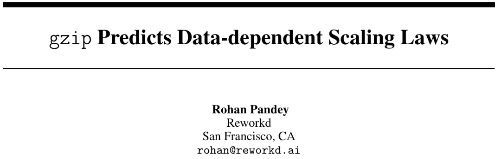

+   论文标题：gzip Predicts Data-dependent Scaling Laws

+   论文链接：https://arxiv.org/pdf/2405.16684

他的研究方法是：在可以直观控制复杂度的文本数据设置下，以 信息论 方法理解 Scaling law 的数据依赖性的原因。

他最终找到的设置名为概率式上下文无关语法（PCFG，最早由乔姆斯基于 1956 年提出）。该设置相对自然（可以建模自然语言、代码等），句法复杂度可控，遵循一些已被很好理解的 信息论 原理。

实验中，通过调整 PCFG 的句法性质，他生成了 6 个具有不同复杂度的数据集。对于每个数据集，他又训练了 6 个不同大小的 语言模型 （ 参数 量从 4.4M 到 1.4B），并记录了这些 语言模型 在 6 种不同训练步数（100K 到 100M token）下的结果。然后，他为每个数据集都拟合了一个 Scaling law，发现 Scaling law 的 参数 会随句法复杂度而有意义地变化。遵循之前有关形式语法的熵的研究，对于复杂度度量，他使用的是数据集中每个 token 序列的可压缩率（compressibility）中值，这能通过 gzip 轻松计算出来。

结果发现，随着训练数据的可压缩率降低（更加复杂），Scaling law 的计算最优边界也会逐渐从 参数 量偏向数据大小。然后，他测量了真实世界的代码和自然语言数据集的可压缩率，结果发现前者的可压缩率更大，因此可预测其服从不同的 Scaling law。

通过 PCFG 的句法性质调节数据复杂度

概率式上下文无关语法（PCFG）是计算 语言学 的一种基础工具，可用于建模自然语言的句法。PCFG 是对标准的上下文无关语法（CFG）的扩展，即在生成规则中关联了概率，从而能以一种可 量化 的方式表征语言的模糊性和可变性。这些语法会 生成树 ，其中每个节点都表示一个句法类别，每条边则表示用于生成句子的生成规则。在根据 PCFG 生成句子时，会以概率方式采样应用生成规则的序列，直到该树的所有叶节点都是端点（实际的词汇 token）。

我们可以控制 PCFG 的句法性质，以自然方式调节文本数据集的复杂度。具体来说，PCFG 创建函数可接收的 参数 包括：端点的数量、非端点的数据、生成规则右侧的最大长度、任何非端点允许的生成规则的最大数量（如果这个值为 1，则给定的非端点将始终得到同样的右侧）。直观而言，以上每个值的增长都会导致句法复杂度增大。

为了基于以上 参数 创建 PCFG，对于每个端点，都随机选取其生成数量（RHS 选项）、这些生成的每个长度，通过从端点和非端点随机采样来实例化生成规则，并为其分配一个概率（根据非端点的总 RHS 选项而进行了归一化）。然后，收集所有为全部非端点生成的生成规则，并使用基于 NLTK 构建的 PCFG 软件包实例化一个语法。

再使用该语法（在给定约束下随机创建的）来概率式地采样句子，以构建 token 序列数据集。为了后面更容易比较在不同语法（生成不同平均长度的句子）上的训练情况，他决定将句子采样到同等 token 数量的文档中。持续基于语法采样句子，直到填满上下文长度，如有溢出，则直接截断句子。

句子由仅为整数的端点构成，因此可以被视为 语言模型 的 token ID；再使用未被使用的整数 0（可有效对应于自然语言中的句号）将句子连接起来。澄清一下，这里不是生成「看起来」像自然语言的字符串再进行 token 化 ——PCFG 是直接生成 token ID 本身的序列。现在，可以根据 6 组初始语法约束生成 6 个有不同复杂度的 token 序列数据集了。

用 gzip 可压缩率度量句法复杂度

为了估计生成数据集以及真实数据集的复杂度，Rohan Pandey 选择使用一种压缩算法 gzip。

gzip 的一个优点是已有很好的理论研究基础，它们表明：可压缩率（compressibility）与熵成反比，而熵与句法复杂度成正比。具体来说，针对数据集中 1000 个 token 构成的每个 token 序列，使用 gzip 并计算压缩后数据与原始数据的大小（字节数）之比。

然后，计算可压缩率的中值和标准差，确认有更高句法复杂度的语法会得到更难压缩的数据集。

表 1 列出了每个语法的句法 参数 和测得的压缩率。

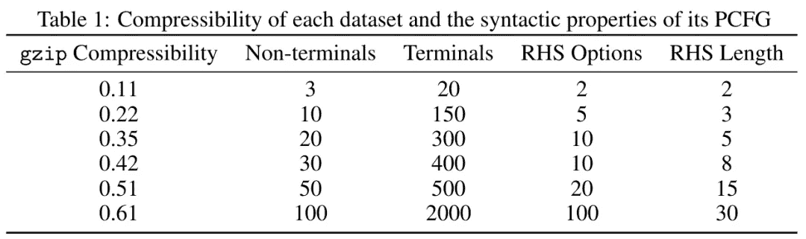

可以观察到，随着非端点（语法类别）、端点（token）、右侧选项和右侧长度的增长，gzip 压缩率也会增长，即变得更难压缩。

图 1 绘出了这些数据集以及自然语言和代码数据的情况。

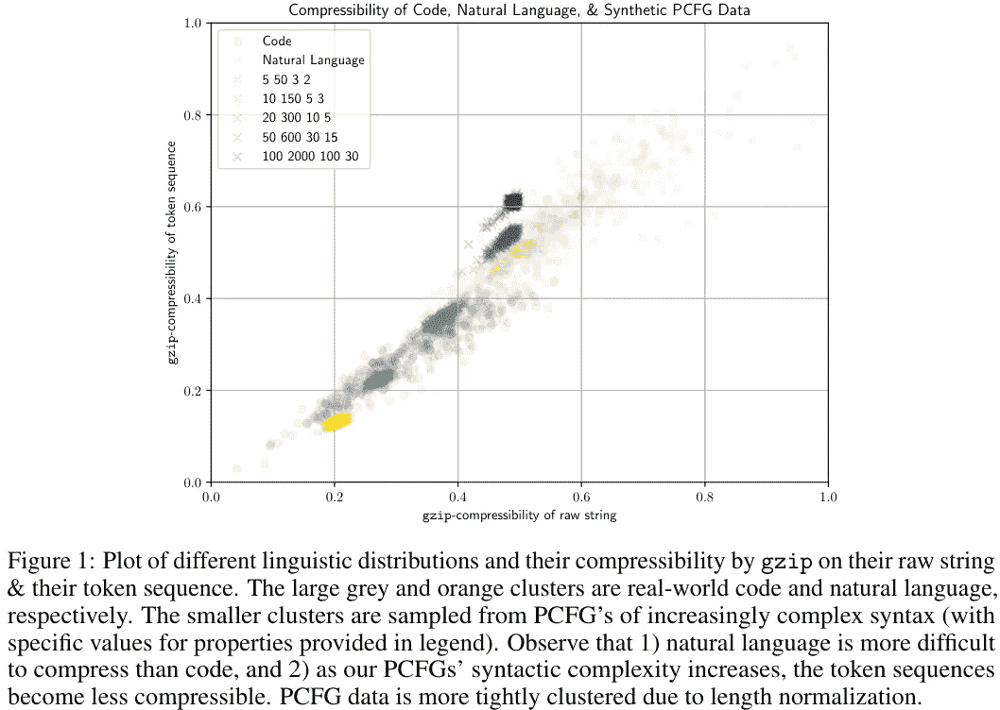

可以看到，在复杂度方面，某些 PCFG 数据集与代码数据相近（易于压缩的部分），而另一些则与自然语言相近。

Scaling law 对数据复杂度敏感吗？

为了确定数据集的 Scaling law，该研究者在不同大小的数据子集（100K、1M、5M、20M、50M、100M token）上训练了几个不同大小（ 参数 量为 4.2M、8.8M、20.3M、59.0M、275.3M、1.4B）的模型，表 6 给出了其架构详情；然后他在所得损失结果上进行幂律拟合。大多数实验都是在 4 台有 80 GB VRAM 的英伟达 A100 上完成的，使用了 PyTorch FSDP。

如图 2 所示，如果一个数据集更容易压缩（可压缩率越低），模型的 收敛 速度就越快。这符合我们的直观认识。

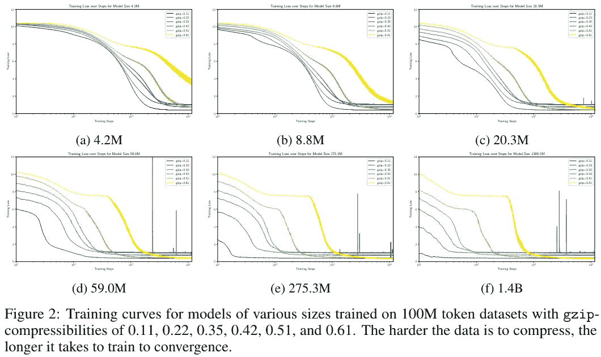

尽管这表明我们需要更多计算量去建模更复杂的数据集，但我们还是需要更多证据才能确定计算最优边界是否会直接根据数据复杂度而变化。为了确立 Scaling law 对数据复杂度的非平凡的敏感性，需要计算每个数据集的 Scaling law 并调查其拟合 参数 。

根据 gzip 可压缩率计算数据敏感的 Scaling law

Hoffmann et al. 在 2022 年提出的 Scaling law 函数形式是将训练损失作为模型和数据大小的函数：

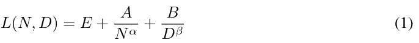

其中 N 是模型的 参数 量，D 是训练数据集的 token 数量。他们宣称 E 是「自然文本的熵」且 Scaling law「与数据集无关」。但是，当 Rohan Pandey 在 PCFG 数据集上拟合训练结果与该函数时，却发现每个数据集的 Scaling law 大不相同，见表 2。

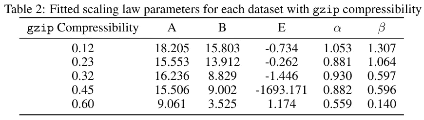

该 Scaling law 可为 参数 量得到一个计算最优边界（由 Kaplan et al. [2020] 和 Hoffmann et al. [2022]）推导得出，可简化为：

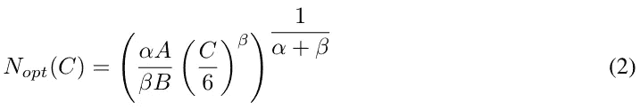

其中 C 是计算预算，单位 FLOPs。

图 3 绘出了 Chinchilla 的计算最优边界以及每个 PCFG 数据集拟合得到的 Scaling law。

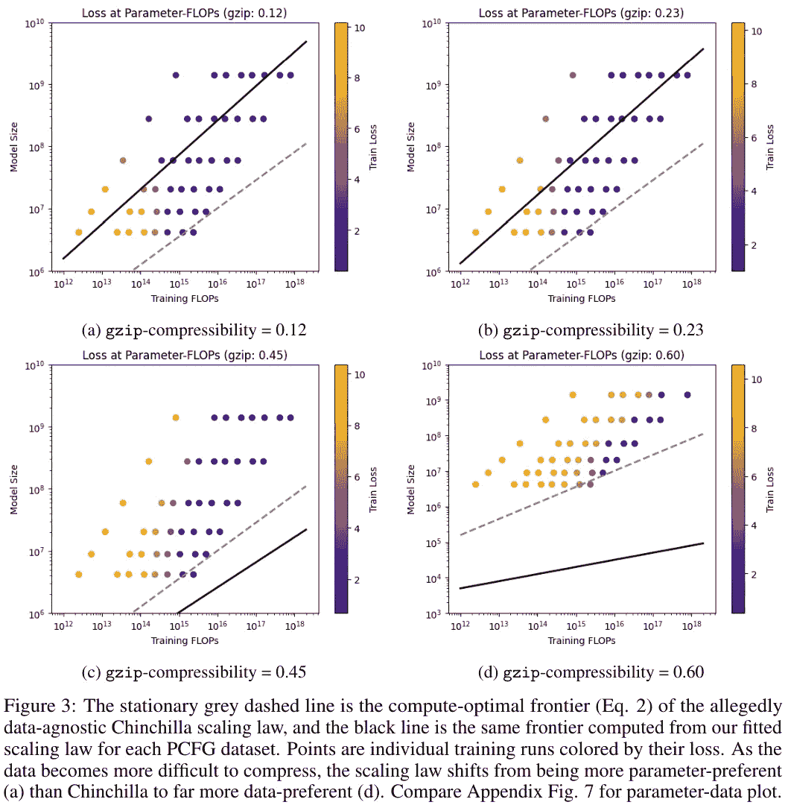

可以看到，随着数据越来越难压缩，拟合得到的 Scaling law 的边界逐渐变得偏向于数据，在 0.23 < gzip 可压缩率 < 0.45 区间中某个点时越过 Chinchilla 的一比一边界。

为了根据数据集的可压缩率预测 Scaling law 参数 ，可在每个数据集的拟合 Scaling law 参数 上进行简单的 线性回归 拟合。之前我们提到，针对数据集 D，计算可压缩率 H 的方法是：先计算每个元素 d 压缩后比特量与原始比特量的比值，然后再计算所有元素的平均值。

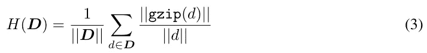

一旦从 H 拟合出预测每个参数（E, A, B, α, β）的线，就可以将每个 参数 重新定义成可压缩率的一个函数：

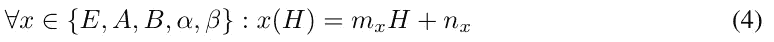

其中 m_x 和 n_x 是拟合后 线性回归 的 参数 。

表 3 给出了这些拟合后的值（以及回归的 p 值），图 4 则是这些 线性回归 的可视化结果。

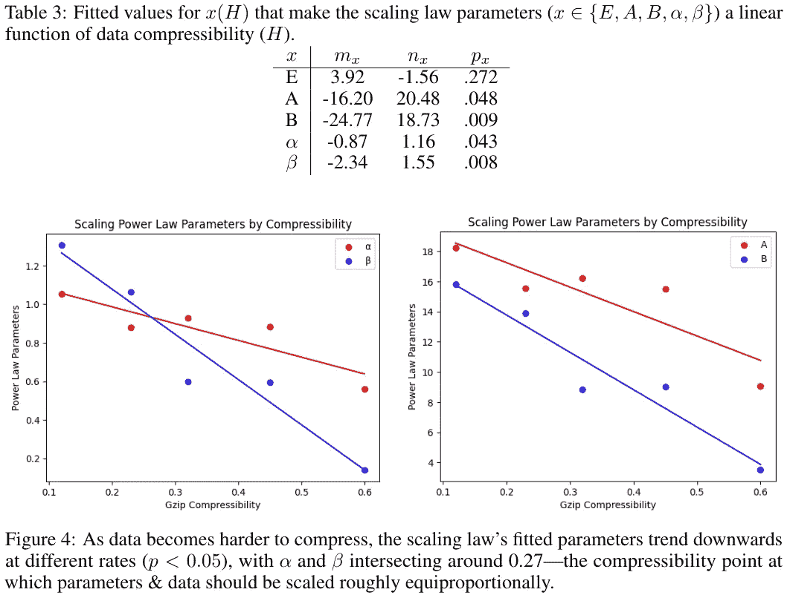

它们几乎都是单调递减的，只是速率不同，而在 H 约 0.27 的位置，α 和 β 相交。需要指出，E（原本设定为常数的「自然语言的熵」）是唯一一个会随 H 增大的 参数 （但不明显）。

现在就可以将 (1) 式重新 参数 化为可压缩率 H 的函数：

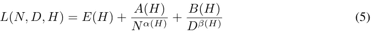

但是，由于这里的实验规模相当小，并且主要集中于 PCFG 数据集，因此 Pandey 又对该函数进行了扩展 —— 调整 Chinchilla 后得到了数据依赖型的 Scaling law：

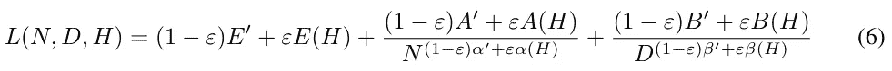

其中 ε 是对训练数据的 gzip 压缩率的调整 权重 ，加 ' 的 参数 是 Chinchilla 常量。

将句法 参数 作为可压缩率的一个混杂变量而消除掉

上面的实验并没有解决这一可能性：这个可压缩率度量混杂了某个底层的句法属性（如词汇库大小）。为了解决这一问题，图 5 给出了另外的结果。

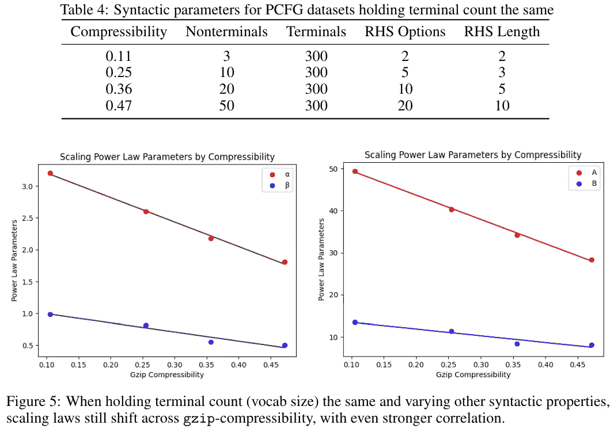

可以看到，当维持词汇库大小稳定不变并改变其它句法性质（表 4）时，gzip 可压缩率依然可以预测 Scaling law 的 参数 变化情况（相关性甚至强于增加词汇量的设置）。

图 6 则是实证中找到的反例，这表明当句法性质变化范围很大（表 5）但这些数据集的最终 gzip 可压缩率一样时，Scaling law 参数 并不会有显著变化。

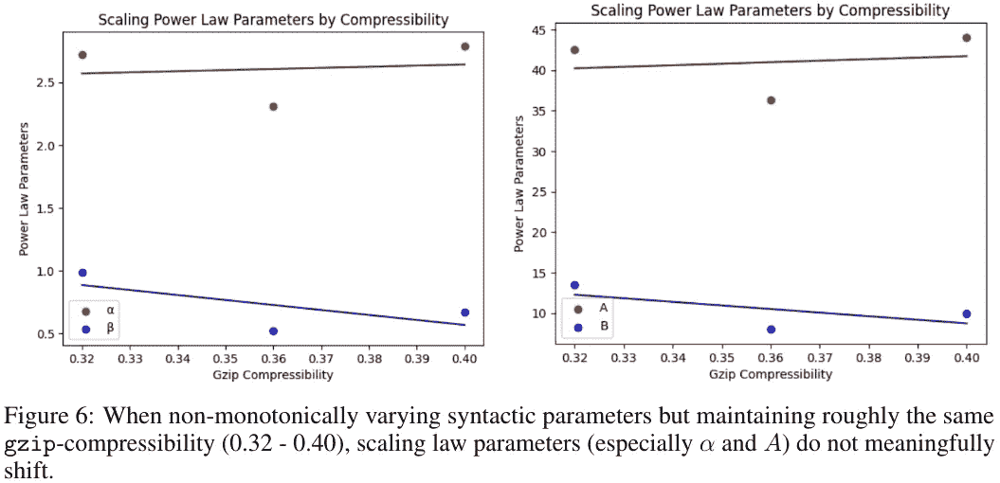

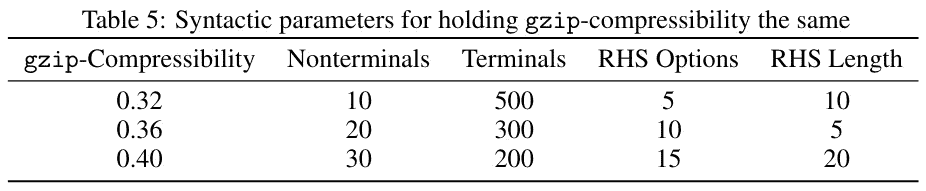

尽管在这个同等词汇案例中并未观察到图 4 中那样的相交行为，但 α 的斜率依然比 β 陡（A 也比 B 陡），这说明随着 gzip 可压缩率增大，有同样的偏向数据的现象。

因此，可以说这些结果表明：Scaling law 依赖于训练数据，而 gzip 可压缩率可以很好地预测数据复杂度对扩展性质的影响。