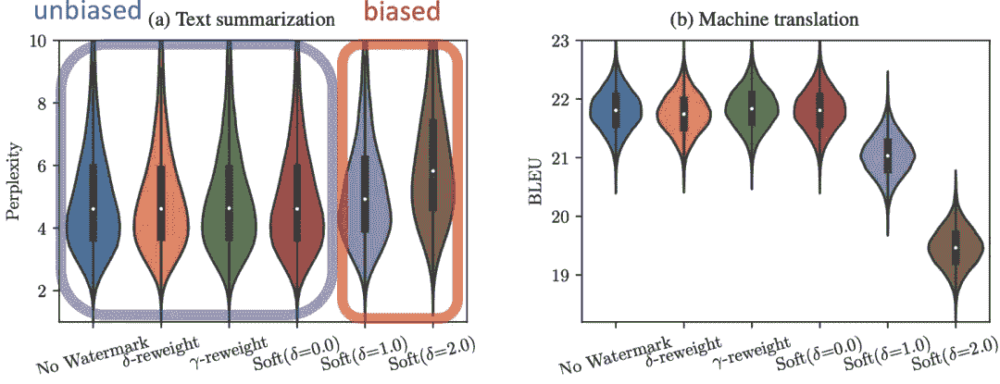
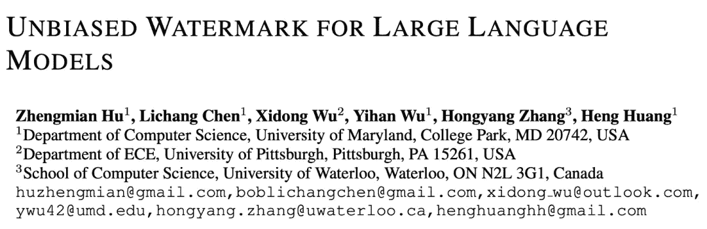
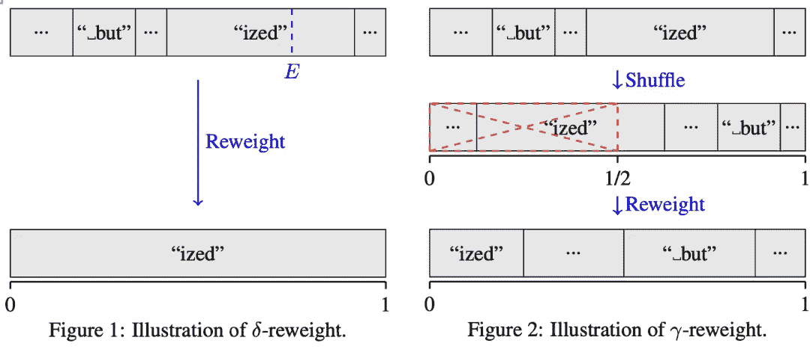
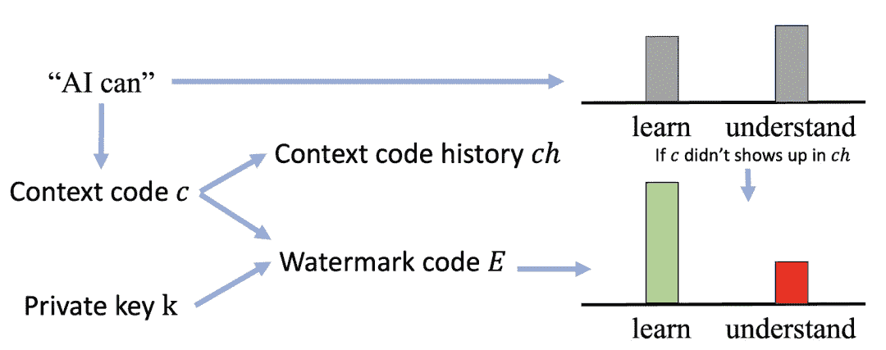
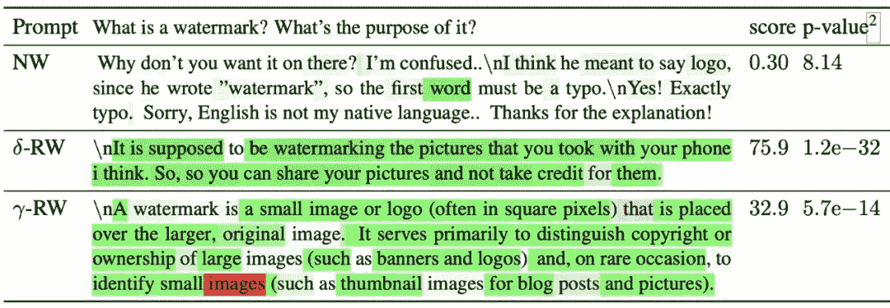
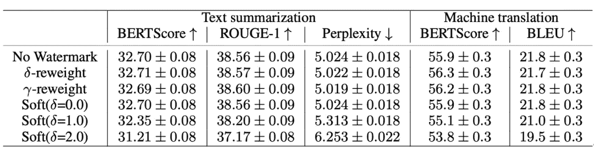

# 不影响输出质量还能追踪溯源，「大模型无偏水印」入选ICLR 2024 Spotlight

> 来源：[https://agijuejin.feishu.cn/docx/YxJcd9ObIoj4OSxHxcRc2TlEnhp](https://agijuejin.feishu.cn/docx/YxJcd9ObIoj4OSxHxcRc2TlEnhp)

> 机器之心｜[阅读原文](https://www.jiqizhixin.com/articles/2024-05-28-3)

> 转载请联系原作者取得授权

**本文通讯作者为马里兰大学计算机系的博士生胡正冕，其导师为 Heng Huang。他的主要研究方向是采样与 机器学习 **理论，曾在ICML、NeurIPS、ICLR等顶级会议上发表多篇论文。邮箱: huzhengmian@gmail.com

随着大 语言模型 （LLM）的快速发展，其在 文本生成 、翻译、总结等任务中的应用日益广泛。如微软前段时间发布的Copilot+PC允许使用者利用生成式AI进行团队内部实时协同合作，通过内嵌大模型应用，文本内容可能会在多个专业团队内部快速流转，对此，为保证内容的高度专业性和传达效率，同时平衡内容追溯、保证文本质量的LLM水印方法显得极为重要。

如何从使用面的事后追溯管控生成式AI的应用，因此成为了一些研究者关注的议题。

为了应对这一挑战，研究者们提出了在LLM生成过程中嵌入水印的方法，以实现对模型输出内容的追踪和溯源。

近日，马里兰大学、匹兹堡大学和滑铁卢大学的研究者在ICLR 2024上发表了一项名为「Unbiased Watermark for Large Language Models」的研究，提出了一种新的LLM水印方法—— 无偏水印（Unbiased Watermark） 。

该方法不仅能在LLM生成过程中嵌入水印，实现内容溯源，还能保证嵌入水印后的文本质量不受影响。相关论文已被ICLR 2024会议接收为Spotlight论文。

+   论文地址: https://openreview.net/pdf?id=uWVC5FVidc

+   代码仓库: https://github.com/xiaoniu-578fa6bff964d005/UnbiasedWatermark

**无偏水印方法**

传统的LLM水印方法存在一个两难困境：「如果水印信号过强，虽然易于检测，但会影响生成文本的质量；如果水印信号过弱，虽然对文本质量影响小，但难以检测。」

这一矛盾导致传统水印方法难以在内容溯源和质量保证之间取得平衡。

**为了解决这一问**题，该研究提出了 无偏水印方法 。

其核心思想是：利用多个水印分布，而不是单一的水印分布。这些水印分布的组合能够恢复原始的 语言模型 输出分布。在生成过程中，根据一个私钥在所有可能的水印分布之间进行选择。

对于没有私钥的观察者来说，含水印模型的期望输出与原始模型完全一致，从而保证了无偏性。但对于拥有私钥的人来说，相应水印分布与原始分布之间的差异可以很大，从而实现可靠的水印检测。

无偏水印方法主要包括两个关键组件： 无偏重赋权（Unbiased Reweight） 和 独立水印码（Independent Watermark Codes） 。

无偏重赋权的目的是确保含水印分布的期望值与原始分布相匹配。

**研究者提出了两种具体的**无偏**重赋权方法： δ-re**weight 和 γ-reweight 。

+   δ-reweight方法利用 逆变换采样 （Inverse Transform Sampling） 的思想，根据原始分布和一个均匀分布的随机数来生成水印分布。

+   γ-reweight方法则先对词**表进行随机重排**，然后对重排后的词表进行 分段线性变换 ，得到水印分布。

理论分析表明，这两种方法都 **满足无偏性要求 **。

δ-reweight和γ-reweight方法示例

为了保证整个序列的无偏性，水印码在每一步生成过程中都必须是独立的。由于水印码依赖于上下文码（Context Codes），研究者引入了上下文码历史（Context Code History）的概念。

在生成过程中，如果某个上下文码出现过，就跳过水印嵌入，直接使用原始的 语言模型 输出分布。这样可以避免重复的上下文码导致的水印码相关性，从而保证水印码的独立性。

水印的检测

在水印检测方面，该研究提出了两种检测方法： 基于似然（likelihood-based） 的检测和 无需似然（likelihood-agnostic） 的检测。

**基于似然的检测方法 **利用 语言模型 的输出概率进行水印检测。研究者首先介绍了对数似然比检验（LLR Test）的方法。LLR Test比较给定文本在原始分布和水印分布下的似然，如果似然比超过一个阈值，则判定该文本含有水印。

LLR Test在理论上是最优的检验方法，能够在I类错误（ 假阳性 ）和II类错误（ 假阴性 ）之间取得最佳平衡。

然而，标准的LLR Test对原始分布和水印分布的扰动比较敏感。如果文本在水印检测前被修改，真实的水印分布可能与假设的水印分布不同，导致检测性能下降。为了解决这个问题，研究者提出了一种稳健的LLR Test变体。

该变体引入了一个新的优化问题，允许水印分布有小幅度的扰动。实验表明， 稳健的LLR Test在面对文本修改时，仍然能保持较好的检测性能 。

基于似然的检测方法需要访问 语言模型 的输出概率，在某些情况下可能不易求解。

为此，研究者还提出了一种 **无需似然的检测方法 **。该方法不依赖于 语言模型 的输出概率，而是利用Gumbel Trick生成水印码，并设计了一种新的打分函数。

理**论分析表明，无**需似然的检测方法同样能够保证I类错误的上界。然而，与基于似然的检测方法相比，无需似然的检测方法的 检测效率较低 ，在相同的I类错误率下，通常需要更长的文本序列才能可靠地检测到水印。

**实验结果**

研究者在文本摘要和 机器翻译 两个任务上，评测了无偏水印方法的性能。

实验结果表明，嵌入水印后的文本质量与原始模型输出相当，在ROUGE、BLEU等指标上没有显著差异。相比之下，传统的水印方法（如Soft Red List）会导致明显的质量下降。

此外，研究者还测试了无偏水印方法对多种可能的文本变化的鲁棒性，包括温度改变，Top-k采样，输入扰动，模型扰动，随机替换攻击。

实验表明无偏水印方法具有较强的鲁棒性，能够应对一定程度的文本修改攻击。

**总结**

无偏水印方法为LLM水印技术提供了一种新的思路。通过新颖的采样策略，该方法在保证生成文本质量的同时，实现了可靠的水印嵌入和检测。这为解决LLM生成内容的滥用问题提供了一种有效的解决方案。

无偏水印技术在维持文本质量的同时，也可能引发一些伦理问题。由于用户无法在不知道创建者私钥的情况下检测水印，这可能导致未经披露的跟踪行为。

在实际应用中，人们应当谨慎、合乎伦理地应用无偏水印方法，并向用户明确说明其存在，工作原理和意义。