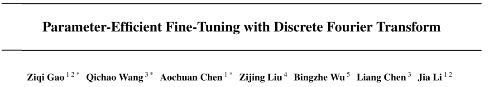
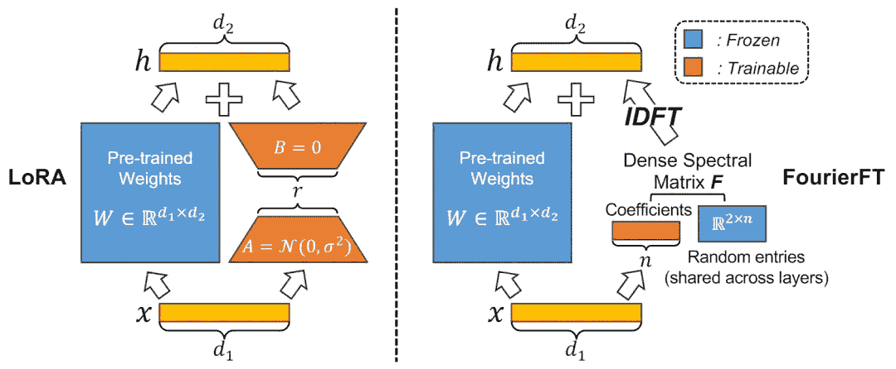
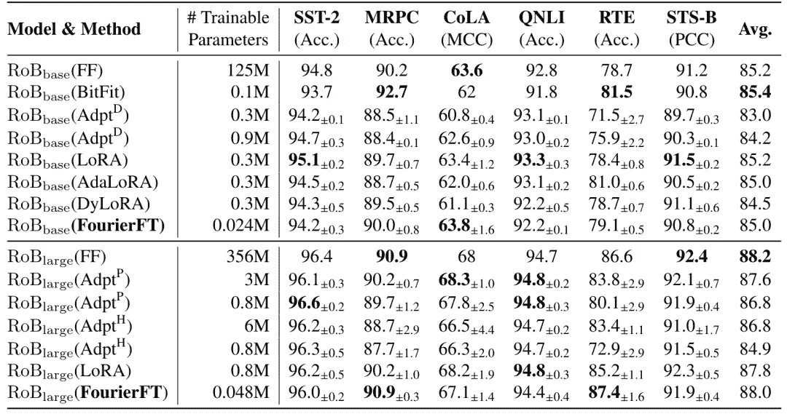
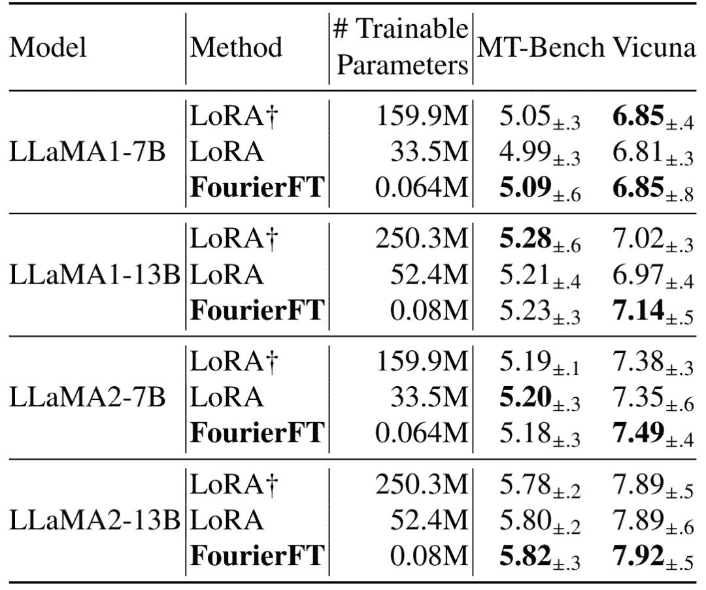
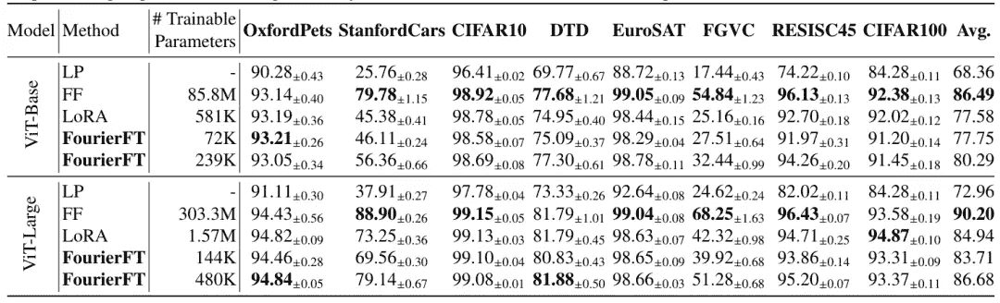
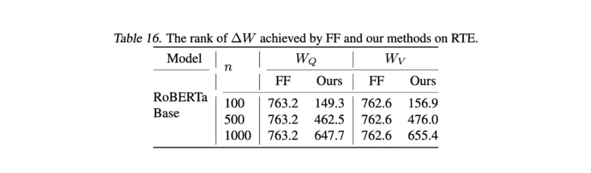
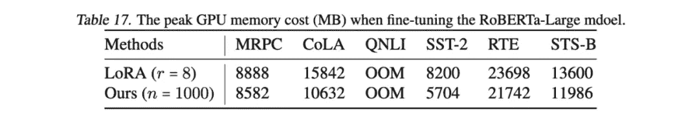

# ICML 2024 | 脱离LoRA架构，训练参数大幅减少，新型傅立叶微调来了

> 来源：[https://agijuejin.feishu.cn/docx/Jk85dkWZfoQf62xNRXFcfLLPnFd](https://agijuejin.feishu.cn/docx/Jk85dkWZfoQf62xNRXFcfLLPnFd)

> 机器之心｜[阅读原文](https://www.jiqizhixin.com/articles/2024-05-27-6)

> 转载请联系原作者取得授权

本文介绍了 **香港科技大学（广州） 的一篇关于大模型高效微调（LL**M PEFT Fine-tuning） 的文章「Parameter-Efficient Fine-Tuning with Discrete Fourier Transform」， 本文被 ICML 2024 接收，代码已开源。

+   论文地址：https://arxiv.org/abs/2405.03003

+   项目地址：https://github.com/Chaos96/fourierft

**背景**

大型基座模**型**在 自然语言处理 （NLP）和 计算机视觉 （CV）领域都获得了瞩目的成就。微调（Finetuning）大型基座模型，使其更加适应特殊的下游任务，成为了一项热门研究课题。然而，在模型越来越大，下游任务越来越多样的今天，微调整个模型带来的计算、存储消耗已大到不再能被接受。LoRA 采用低秩拟合微调增量的方案，成功降低了大量的此类消耗，但每个适应器（adapter）的大小仍然是不可忽视的。这激发了本文的核心问题： 相比 LoRA，如何进一步大幅减少可训练 参数 ？此外，一个有趣的附加问题是能否采用更少的 参数 量得到高秩增量矩阵 。

**方法**

傅立叶基底在各类 数据压缩 应用中广泛使用，例如一维向量信号和二维图像的压缩。在这些应用中，稠密的空域信号通过傅立叶变换被转化为稀疏的频域信号。基于这一原理，作者推测模型 权重 的增量也可以被视为一种空域信号，其对应的频域信号可以通过稀疏表示来实现。

在这一假设的基础上，作者提出了一种新的方法，用于在频域中学习增量 权重 信号。具体来说，该方法通过随机位置的稀疏频域信号来表示空域 权重 增量。在加载预训练模型时，首先随机选择 n 个点作为有效的频域信号，然后将这些信号拼接成一个一维向量。在前向传播过程中，这个一维向量被用来通过傅立叶变换恢复空域矩阵；在反向传播过程中，由于 傅里叶变换 的可导性，可以直接对此可学习的向量进行更新。这种方法不仅有效减少了模型微调时所需的 参数 数量，同时保证了微调性能。通过这种方式，作者不仅实现了对大规模基础模型的高效微调，还展示了傅立叶变换在 机器学习 领域中的潜在应用价值。

得益于傅立叶变换基底的高信息量，仅需很小的 n 值即可达到与 LoRA 相当甚至超过 LoRA 的表现。一般来说，傅立叶微调的可训练 参数 仅为 LoRA 的千分之一到十分之一。

**实验**

**1. 自然语言理解**

作者在 自然语言理解 的 GLUE 基准 测试上对傅立叶微调方法进行了评估。基线对比方法包括全量微调（FF，Full Finetuning）、Bitfit、适应器微调（Adapter Tuning）、LoRA、DyLoRA 和 AdaLoRA。下表展示了各种方法在 GLUE 各个任务上的表现及其所需的训练 参数 量。结果表明，傅立叶微调以最少的 参数 量达到了甚至超越了其他微调方法的性能。

**2. 自然语言指令微调**

大模型的 自然语言生成 是目前模型微调的重要应用领域。作者在 LLaMA 系列模型、MT-Bench 任务和 Vicuna 任务上评估了傅立叶微调的性能。结果显示，傅立叶微调以极低的训练 参数 量达到了与 LoRA 相似的效果，进一步验证了傅里叶微调方法的通用性和有效性。

**3. 图像分类**

作者在 Vision Transformer 上测试了傅里叶微调的性能，涵盖了 8 个常见的 图像分类 数据集。实验结果表明，虽然在 图像分类 任务中傅立叶微调相较LoRA的压缩率提升并不比自然语言任务中显著，但其仍然以远小于 LoRA 的 参数 量超越了 LoRA 的效果。这进一步展示了傅立叶微调在不同应用领域中的有效性和优势。

**4. 突破低秩**

在 GLUE 基准 的 RTE 数据集上，FourierFT 可以实现明显高于 LoRA (通常为 4 或 8) 的增量的秩。

**5.GPU 资源消耗**

微调过程中，FourierFT 可以实现比 LoRA 更少的 GPU 消耗。下图为采用单张 4090 显卡在 RoBERTa-Large 模型上的巅峰内存消耗。

**结论**

作者介绍了一种名为傅立叶微调的高效微调方法，通过利用 傅里叶变换 来减少大基础模型微调时的可训练 参数 数量。该方法通过学习少量的傅里叶谱系数来表示 权重 变化，显著降低了存储和计算需求。实验结果显示，傅立叶微调在 自然语言理解 、 自然语言生成 、指令调优和 图像分类 等任务上表现优异，与现有的低秩适应方法（如 LoRA）相比，傅立叶微调在保持或超过 LoRA 性能的同时，所需的可训练 参数 大幅减少。